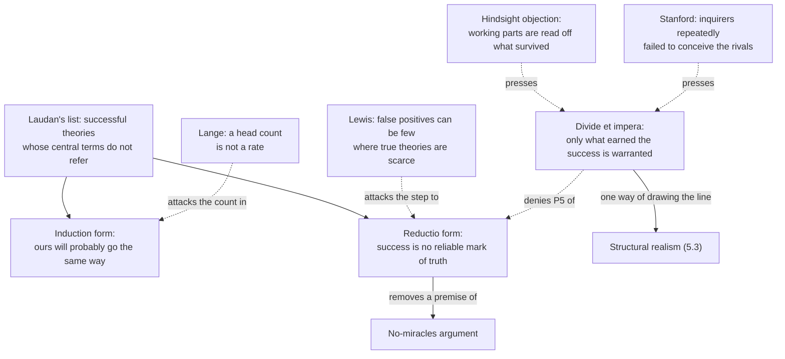

# Philosophy of Science · Lesson 5.2: The pessimistic induction and selective realism

> ⏱ ~15 min · Module 5: Scientific realism · Builds on: [5.1](05-01-realism-and-the-no-miracles-argument.md), [2.2](02-02-duhem-quine-and-underdetermination.md), [`philosophical-method` 2.1](../../philosophical-method/lessons/02-01-inference-to-the-best-explanation.md) · Unlocks: [5.3](05-03-structural-realism.md), [5.4](05-04-constructive-empiricism-and-entity-realism.md)

## Why this matters

[`stat-mech` 1.4](../../stat-mech/lessons/01-04-temperature-pressure-chemical-potential.md) wrote down the "caloric equation of state", and the adjective is a fossil. Caloric was the fluid of heat: it did decades of calculating work and does not exist. [5.1](05-01-realism-and-the-no-miracles-argument.md) said success this good would be a miracle unless our theories were roughly true. The critics' reply, drawn from history, is that caloric, the ether and phlogiston were successful too, which leaves the electron with some explaining to do.

## The idea

Every family has a bread recipe that never fails and a story about why. Some of the stories are flatly wrong, and the bread rises anyway. So, the thought goes, "it works" cannot show "the story is right". That is the [pessimistic induction](../reference.md#pessimistic-induction) in a kitchen.

The realist's answer is to stop defending the whole story. Warmth makes the dough rise; stirring clockwise does nothing. Believe the parts that do the work. That is [selective realism](../reference.md#selective-realism).

The trouble is finding out which parts those are. In a kitchen you drop a step and see. An 1830 physicist could not drop the ether and rerun wave optics, since a wave with nothing waving was hardly conceivable. That is the third idea: inquirers can test only the rivals they can imagine.

Already taught: [5.1](05-01-realism-and-the-no-miracles-argument.md) gave the [no-miracles argument](../reference.md#no-miracles-argument), [`philosophical-method` 2.1](../../philosophical-method/lessons/02-01-inference-to-the-best-explanation.md) the best of a bad lot, and [2.2](02-02-duhem-quine-and-underdetermination.md) the point that no physicist holds a complete list of rivals. This lesson uses all three.

## The argument

The mood is old. Henri Poincaré's *Science and Hypothesis* (tr. W. J. Greenstreet, 1905), ch. X, describes a man of the world who "sees ruins piled upon ruins" and speaks of "the bankruptcy of science". Poincaré's own word for this scepticism is "superficial".

Larry Laudan gave the mood teeth in "A Confutation of Convergent Realism" (*Philosophy of Science*, 1981). His target is the realist's inference that explanatory success makes a theory probably [approximately true](../reference.md#approximate-truth), together with the claim that a theory cannot be approximately true if its central terms fail to refer. Then [the list](../reference.md#laudans-list) (p. 33), twelve entries that he says could be extended "ad nauseam": crystalline spheres, humoral medicine, the effluvial theory of static electricity, catastrophist geology, phlogiston, caloric, the vibratory theory of heat, vital forces, the electromagnetic and optical ethers, circular inertia, spontaneous generation. For each successful theory we now think refers, he estimates half a dozen that do not (p. 35).

Laudan never calls this an induction. The label descends from Hilary Putnam (*Meaning and the Moral Sciences*, 1978). The literature reconstructs the argument two ways.

**As an induction.**

- **P1.** Many past successful theories had central terms that, by current lights, do not refer, so they were not even approximately true. *In words:* success and failed reference have kept company.
- **P2.** Our successful theories are no different in kind. *In words:* we have no special standing.
- **∴ C1.** Probably ours will go the same way, so we should not believe them approximately true.

**As a reductio** (Psillos's and Lewis's reading).

- **P3.** Assume that a successful theory is probably approximately true. *In words:* success is a reliable mark of truth.
- **P4.** Then our current successful theories are probably approximately true.
- **P5.** If they are, past theories that differ from them fundamentally were not. *In words:* you cannot keep the present and the past together.
- **P6.** Many such past theories were successful.
- **∴ C2.** So success is not a reliable mark of approximate truth. *In words:* the assumption undoes itself.

C2 says nothing about whether today's theories are false. It withdraws the premise that no-miracles needs.

Four replies.

**Shrink the base.** The commonest realist move counts only mature sciences and novel predictions (Psillos, 1999). Laudan had pre-empted it: "maturity" risks being defined so that it cannot fail, and the ethers are mathematical physics, which Putnam grants is mature.

**Count differently.** Marc Lange ("Baseball, Pessimistic Inductions and the Turnover Fallacy", *Analysis*, 2002) says P1 is a cumulative count, and rejected theories turn over faster, so the past holds more of them than a snapshot would. Of 542 major-league managers from 1876 through 1990, only 176 (32%) had winning records; yet in six of the eight seasons he sampled, most managers then in office went on to winning records. The [turnover fallacy](../reference.md#turnover-fallacy) reads a head count as a moment-by-moment rate. The induction needs, he says, that at most past moments most accepted theories were false.

**Mind the false positives.** Peter Lewis ("Why the Pessimistic Induction Is a Fallacy", *Synthese*, 2001) says reliability is a matter of [error rates](../reference.md#false-positives-objection). Take a pool of 1,000 past theories, 40 of them approximately true, with success marking three-quarters of the true ones and 5% of the false ones. Then successful false theories outnumber successful true ones, 48 to 30, while the test errs on only 5% of false theories. P6 may show that true theories were scarce, not that the test is bad: the [base-rate objection](../reference.md#base-rate-objection) of 5.1 turned around. Juha Saatsi ("On the Pessimistic Induction and Two Fallacies", *Philosophy of Science*, 2005) answers that turnover cannot touch the timeless C2, and that no non-arbitrary class of false, unsuccessful theories exists to fix Lewis's rate.

**Divide the theory.** This reply denies P5. Stathis Psillos (*Scientific Realism*, 1999, chs. 5–6) calls it *divide et impera*: success warrants the constituents that earned it, and those survive. Philip Kitcher (*The Advancement of Science*, 1993) sorts [working posits](../reference.md#working-and-presuppositional-posits), the putative referents of terms in a theory's problem-solving schemata, from presuppositional posits, which merely seem to be required for those schemata to be true. Psillos's [test](../reference.md#indispensability-test): a hypothesis is indispensable to a prediction if the rest of the derivation cannot yield it and no other available, non-ad-hoc hypothesis could stand in. On his reading of the record, caloric's materiality did no essential work; Hasok Chang (2003) disputes that. Pierre Duhem drew a similar line in 1906 (*La Théorie physique*, Part I, ch. III): "it is not to this parasitic explanatory part [*partie explicative*] that the theory owes its power and its fruitfulness" (lesson's translation).

Two pressures on that reply. The [hindsight objection](../reference.md#hindsight-objection): working parts get identified by what survived, so the test runs only backward, and a realist needs a criterion usable before the successor arrives (P. Kyle Stanford, 2003, 2006). And Stanford's *Exceeding Our Grasp* (2006) runs a new induction over inquirers instead of theories: again and again, the evidence of the day equally supported radically different theories that nobody had yet [conceived](../reference.md#unconceived-alternatives). This generalizes the bad-lot worry (van Fraassen's phrase, 1989) from one inference to the record of science, and, he argues, it reaches a pruned theory as readily as a whole one, since "indispensable" means indispensable among the rivals anyone has conceived. Those rivals are [transient](../reference.md#transient-underdetermination): equally supported by the evidence in hand, not empirically equivalent.

**Where the argument is weakest.** P5, read as all-or-nothing. The strongest objection is divide et impera: success never warranted whole theories, so the ruin of a whole theory proves nothing about the constituents that earned its success. The strongest reply is the hindsight objection: the sorting is done by looking at what survived, so it gives no guidance about today's posits. Psillos answers that scientists sorted their commitments at the time, citing Lavoisier, Laplace and Carnot on caloric; Laudan had already recalled Maxwell's judgment that the ether was better confirmed than any other theoretical entity (p. 27). The realist concedes that success does not warrant a theory whole. The pessimist concedes that a discredited central term does not settle what the theory got right.

## Argument map

The list feeds two arguments, each realist reply attacks a different link, and both pressures on divide et impera ask how the line gets drawn.

## Worked examples

**Example 1 (clean case: the ether and the bright spot).** Poisson derived from Fresnel's equations a bright spot at the centre of a circular shadow, as an absurdity, and Arago found it ([2.4](02-04-kuhn-incommensurability-and-theory-choice.md)). Laudan offers it as a paradigm of empirical success (p. 27).

Run the test. Fresnel's derivation sums contributions from each point of an open wavefront, with phases set by path length. Wavelength, phase and superposition enter. What the medium is made of does not. So for Kitcher the wave is a working posit and the ether is presupposed, on the thought that something had to be waving; and Psillos's test counts the wave indispensable and the elastic-solid model of the medium not. The sorting is clean because you can read it off the derivation. The realist can add that Maxwell's theory kept what the derivation used. Psillos goes further and argues that "luminiferous ether" referred to the electromagnetic field (1999, ch. 12); Laudan (1984) charges that reference then comes too cheap.

**Example 2 (hard case: phlogiston).** Phlogiston explained why metals are alike ([2.3](02-03-kuhn-normal-science-and-revolutions.md), [2.4](02-04-kuhn-incommensurability-and-theory-choice.md)) and made combustion, respiration and calcination one family, reciprocal to smelting. In 1783 Joseph Priestley predicted that a calx heated in inflammable air would turn back into metal, and a burning lens on red lead confirmed it (Hasok Chang, "The Hidden History of Phlogiston", *HYLE*, 2010).

Run the test. "Phlogiston" occurs in the schema that generated the prediction: something from the air enters the calx and makes it metal. So by Kitcher's own definition it is a working posit, and the presuppositional escape is closed. He can retreat to his view that some tokens of a term refer and others do not. Psillos's test turns on a date. Lavoisier reinterpreted the same experiment as the calx giving up its oxygen to the inflammable air, but only by using Cavendish's new work on the production of water. Was that rival "available" when Priestley reasoned?

Chang's *Is Water H2O?* (2012) sharpens this: the abandonment was too rash, and it cost chemistry resources that had to be rebuilt later as electrons and chemical potential. If so, what worked was dropped by the immediate successor and retention failed for a long stretch. The realist replies that the test asks for retention in the current image, not the next theory, and that electrons are not phlogiston. The critic replies that the current image is then doing all the selecting.

Here the account stops. The verdict depends on which success is listed, on whether "available" means 1783 or now, and on how loose retention may be. Selective realists say careful case studies discipline those choices. Critics such as Chang and Stanford say those choices are the problem.

## Watch out

- **You might think Laudan argued that today's theories are probably false, but actually** his stated target is the realist's step from success to approximate truth. The prediction about current theories belongs to the later induction reading.
- **You might think Poincaré holds the "bankruptcy of science", but actually** he puts it in the mouth of the man of the world and calls the scepticism superficial. [5.3](05-03-structural-realism.md) takes up what he thinks survives.
- **You might think selective realism is structural realism, but actually** structure is one way of drawing the line. Psillos says his divide et impera is not meant to capture Worrall's distinction between structure and content ([5.3](05-03-structural-realism.md)).
- **You might think Stanford's rivals are the [empirically equivalent theories](../reference.md#empirically-equivalent-theories) of [2.2](02-02-duhem-quine-and-underdetermination.md), but actually** his are transient: further evidence could separate them, and he doubts that a general case for equivalents has been made.

## One-liner

> Laudan's list targets the step from success to truth; the realist's reply, believe only what earned the success, is pressed to say which parts those were before the successor arrives.

## Problems

**P1 (🟢) *(Reconstruct. Exegetical (a)–(b) · Evaluative (c).)*** Poincaré, *Science and Hypothesis*, ch. X, p. 160 (tr. W. J. Greenstreet, 1905), reporting a view he goes on to reject:

> The ephemeral nature of scientific theories takes by surprise the man of the world. Their brief period of prosperity ended, he sees them abandoned one after another; he sees ruins piled upon ruins; he predicts that the theories in fashion to-day will in a short time succumb in their turn, and he concludes that they are absolutely in vain.

(a) Put the man of the world's reasoning in the induction form: numbered premises and a conclusion, at most four lines. Mark any premise the text leaves unstated.

(b) Recast it as a reductio, taking as the assumption the realist's claim that a successful theory is probably approximately true. Numbered, at most five lines.

(c) One sentence: where does the final inference of the passage outrun what (a) supports?

**P2 (🟡) *(Apply to a hard case. Exegetical (a)–(b) · Evaluative (c).)*** In 1818 Fresnel explained why Arago (1810) had found no effect of the Earth's motion on refraction in a prism. He made two posits about a transparent body of refractive index $n$:

(i) the ether inside it has $n^2$ times the density of the ether outside;

(ii) when the body moves, it carries along only that excess ether, and the rest stays at rest.

These give a drag factor of $1 - 1/n^2$, so that light moving with a body of speed $v$ travels at $c/n + v(1 - 1/n^2)$, with $c$ the vacuum speed of light. Fizeau's 1851 measurement in flowing water agreed with the factor. In 1892 Lorentz obtained the same factor from an ether wholly at rest, assigning the effect to how moving matter modifies wave propagation, with no entrainment at all. In 1907 von Laue got it from relativistic velocity addition, $u = (c/n + v)/(1 + v/(nc))$, to first order in $v/c$ ([`relativity` 1.2](../../relativity/lessons/01-02-lorentz-transformations.md)). Treat these three as the only accounts of the factor on offer.

(a) By Kitcher's definitions, is (ii) a working or a presuppositional posit in Fresnel's derivation? One sentence.

(b) Apply Psillos's test to (ii) twice: reading "available" as available in 1851, then as available after 1892. One sentence each, and say which later derivation your second verdict relies on.

(c) What does the pair of verdicts do to the hindsight objection? State what the selective realist can reply and what the reply costs. Any verdict; 100 words or fewer.

**P3 (🔴) *(Steelman and reply. Evaluative.)*** Stanford's new induction, given to you: at past moments inquirers could think of only a few theories that fit their evidence well, and later inquiry turned up radically different theories that the same evidence supported just as well, so probably we are in that position now.

A selective realist replies: *An unconceived rival can threaten only the idle parts of a theory. Any successor must recover what earned the success, so the working posits are safe.*

Using the bright spot of Example 1 and the drag factor of P2 as tests, say whether the reply succeeds. Give its premise, the best case for it, and what "working" must mean for the reply to say anything. Any verdict; 150 words or fewer.

Solutions

**P1** *(Exegetical (a)–(b) · Evaluative (c))*

**Accept:** any wording that keeps the structure below.

**Must hit, strict (a):**

- A premise that theories, after a period of success, have been abandoned one after another.
- A premise, marked as unstated, that today's theories are like those. The passage never says so, and the prediction needs it.
- ∴ today's theories will be abandoned too, the prediction the passage reports.

**Must hit, strict (b):**

- The assumption stated first as the thing to be overturned.
- The step that current successful theories are therefore probably approximately true.
- The premise that past theories differing fundamentally from them were then not approximately true.
- The premise that many of those past theories were successful.
- The conclusion that success is not a reliable mark of approximate truth. It is not that today's theories are false.

**Must hit, any verdict (c):** locate the step from "will be abandoned" to "absolutely in vain", and say that being replaced entails neither that every part was wrong nor that the theory did nothing.

**Wrong turns:** giving "theories are false" as the passage's conclusion, when its stated conclusion is "in vain". Running (b) with the conclusion "so our theories are false", which makes it the induction again. Treating the passage as Poincaré's own view.

**Model answer (a), (b):**

(a) P1. Scientific theories, after a brief success, have been abandoned one after another. P2 (unstated). Theories in fashion today are like those. ∴ C. Today's will in a short time be abandoned too.

(b) P1. Assume a successful theory is probably approximately true. P2. So today's successful theories are probably approximately true. P3. Then past theories that differ fundamentally from them were not. P4. Many of those were successful. ∴ C. Success is not a reliable mark of approximate truth.

**Model answer (c), one of several:** "Absolutely in vain" needs a further premise, that a replaced theory achieved nothing, which being replaced does not show.

---

**P2** *(Exegetical (a)–(b) · Evaluative (c))*

**Must hit, strict (a):** working. The excess ether and its density occur in the schema that generates the number, since the factor is computed from the density ratio. It is not merely something the schema's truth seemed to require.

**Must hit, strict (b):**

- 1851: indispensable. Without (ii) the derivation of the factor fails, and of the three accounts only Fresnel's yet existed, so nothing available could stand in.
- After 1892: not indispensable. Lorentz's account supplies the replacement while keeping an ether and dropping entrainment.
- The second verdict rests on Lorentz, not on von Laue. A replacing theory eliminates the old theory as a whole, and Psillos holds that this does not by itself show that a specific constituent was eliminable.

**Accept (b):** an answer that goes beyond the stipulation and raises Stokes's complete-drag account (1845–46) as a rival on the table in 1851, if it says why that rival does or does not count as available and non-ad-hoc.

**Must hit, any verdict (c):**

- Say that the verdict changed while the derivation did not, so "indispensable" depends on what rivals have been conceived.
- Say what follows for the hindsight objection (it is confirmed, sharpened or answered).
- Name a realist reply and its cost.

**Wrong turns:** calling (ii) presuppositional because entrainment turned out false, which reads the fate of the posit back into its role. Citing von Laue for the post-1892 verdict. Answering (c) by declaring the realist refuted, which the rubric does not require.

**Model answer (c), one of several:** The verdict flipped with no change in Fresnel's reasoning, so the objection gains force: a posit counts as indispensable until someone conceives a replacement. The selective realist can reply that (ii) simply was a working posit that failed, and that the thesis was only ever that working posits are typically retained. The cost is that one such counterexample per generation thins the inference from "indispensable now" to "probably true", which was the point of the test.

---

**P3** *(Evaluative)*

**Must hit, any verdict:**

- State the premise the reply needs: that a successor must retain the working *posits*, and not merely recover the *predictions* they produced.
- Test it on both cases. The bright spot favours the reply, since waves, wavelength and phase carried over. The drag factor strains it, since the successor recovered the number without entrainment. Either reclassify (ii) or accept the strain, and say which.
- Say what "working" must mean for the reply to be more than a truism. If it means "what survives", the reply is true by definition; if it is fixed in advance, the reply needs the criterion the hindsight objection demands.
- Draw the verdict on the reply from those moves.

**Wrong turns:** reading Stanford as claiming past theories were false, which is Laudan's premise. Treating his rivals as empirically equivalent. Concluding from "successors recover the phenomena" that successors keep the posits.

**Model answer, one of several:** The reply needs successors to keep working posits, not just their predictions. The bright spot supports it: Maxwell kept the waves, the wavelength and the phase. The drag factor does not. Fresnel's entrainment did the arithmetic, and the successor kept the number and dropped the mechanism. The realist can say entrainment was never truly working, but then "working" means "what survived", and the reply is empty. To be more than that, it needs a test usable before the successor arrives, and such a test must rank posits among the rivals we have conceived, which is exactly where Stanford's worry lives. His induction is fallible, but the reply does not yet answer it.

## Flashback

**From Lesson [4.5](04-05-reduction-and-emergence.md) (Reduction and emergence):** *(Exegetical (a), (c) · Formal (b).)* Galileo's law: a body in free fall near the Earth has a constant acceleration $g$. Newton's gravitation: at height $h$ above a uniform sphere of mass $M$ and radius $R$, the acceleration is $a(h) = GM/(R+h)^2$, with $G$ the gravitational constant. Take Newton's theory as $T_P$ and Galileo's law as $T_S$.

(a) Does [Nagel's model](../reference.md#nagelian-reduction) call for [bridge laws](../reference.md#bridge-laws) here? Name this kind of reduction and give the reason. One sentence.

(b) With the round figures $R = 6{,}400$ km and $h = 64$ km, compute $a(h)/a(0)$ exactly. Is N2 met for Galileo's law as stated?

(c) Whose charge does (b) illustrate, and what do Schaffner and the 1970 Nagel allow? On that amended model, is this replacement, as with phlogiston? Three sentences in all.

Solution

**Must hit, strict (a):** no bridges. The reduction is homogeneous: body, fall and acceleration are all terms of Newton's theory, and N1 asks only about terms of $T_S$ absent from $T_P$.

(b)

$$\frac{a(h)}{a(0)} = \left(\frac{R}{R+h}\right)^2 = \left(\frac{6400}{6464}\right)^2 = \left(\frac{100}{101}\right)^2 = \frac{10000}{10201} \approx 0.9803.$$

The shortfall is $201/10201 \approx 0.0197$, close to the first-order value $2h/R = 0.02$. N2 is not met. The premises yield an acceleration that falls with height at every $h > 0$, which contradicts "constant". As $h/R \to 0$ the ratio tends to 1, so what follows is a corrected law with Galileo's as its limit.

**Must hit, strict (c):**

- Feyerabend's 1962 charge that the model left no room for correction.

- Schaffner's model and Nagel's 1970 paper let the derived law be a corrected approximation of the old one.

- On that model, no: free fall and acceleration stay and the old law survives as an approximation in its range, whereas phlogiston was dropped.

**Wrong turns:** demanding a bridge because Newton's theory has "force" and Galileo's law does not, when N1 runs the other way. Saying N2 holds because 2% is small: derivability is strict, and tolerance of the gap is what the amended model adds. Treating the mismatch as a problem for Newton's theory.

**Model answer (a), (c):** (a) None: it is homogeneous, since Galileo's law uses no term absent from Newton's theory. (c) This is Feyerabend's 1962 charge, that the model leaves no room for correction. Schaffner and the 1970 Nagel let the derived law be a corrected approximation of the old one. On that model this is reduction and not replacement, since the old law's terms stay and it holds as a limit.

## Connections

- **Backward:** [5.1](05-01-realism-and-the-no-miracles-argument.md) gave the argument this lesson undercuts, and Lewis's reply reuses its base-rate arithmetic. [`epistemology` 4.2](../../epistemology/lessons/04-02-humes-problem-of-induction.md) owns the general worry about arguing from past to future. [`philosophical-method` 2.1](../../philosophical-method/lessons/02-01-inference-to-the-best-explanation.md) named the best of a bad lot and [2.2](02-02-duhem-quine-and-underdetermination.md)'s P4 denied any complete list of rivals: Stanford runs both across the history of science.
- **Forward:** [5.3](05-03-structural-realism.md) draws the selective line between structure and content. [5.4](05-04-constructive-empiricism-and-entity-realism.md) stops believing past the observable. [`philosophy-of-physics`](../../philosophy-of-physics/syllabus.md) reads effective field theories against this argument.
- **Sideways:** [`geology` 2.1](../../geology/lessons/02-01-evidence-for-drift.md) is a divide-et-impera case without the label: Wegener's mechanism died and his correlations stayed. [`apologetics-foundations` 3.1](../../apologetics-foundations/lessons/03-01-naturalism-at-its-best.md) runs a meta-induction the other way, from the record of past explanations to the naturalist's confidence, and shares this argument's question of what the record is a sample of.
