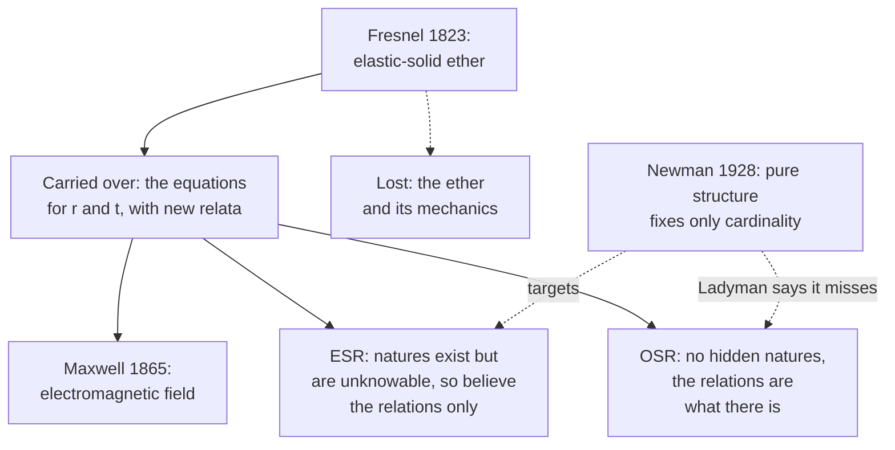

# Philosophy of Science · Lesson 5.3: Structural realism

> ⏱ ~15 min · Module 5: Scientific realism · Builds on: [5.1](05-01-realism-and-the-no-miracles-argument.md), [5.2](05-02-the-pessimistic-induction-and-selective-realism.md) · Unlocks: [5.4](05-04-constructive-empiricism-and-entity-realism.md)

## Why this matters

Render a glass sphere and your ray tracer evaluates, or approximates, a formula Augustin Fresnel derived in the 1820s by treating light as the vibration of an elastic solid filling space ([`computer-graphics` 3.4](../../computer-graphics/lessons/03-04-whitted-ray-tracing-reflection-refraction.md)). There is no such solid, and for glass the formula is still right. [5.1](05-01-realism-and-the-no-miracles-argument.md) said success of that kind is no accident; [5.2](05-02-the-pessimistic-induction-and-selective-realism.md) said the theory behind it was false. Structural realism tries to keep both claims, and then has to say what is left to believe.

## The idea

A subway map gets the connections right and nearly everything else wrong: stations are not dots, lines are not coloured, the distances are fiction. Rebuild the whole system in new materials and the map stays correct. [Structural realism](../reference.md#structural-realism) says a successful theory is like that map. It tells us how things are related, and it may be wrong or silent about what the things are. So when a theory is replaced, the relations can carry over even though the furniture is thrown out.

John Worrall proposed this in "Structural Realism: The Best of Both Worlds?" (*Dialectica*, 1989). Grant the [no-miracles argument](../reference.md#no-miracles-argument) and the [pessimistic induction](../reference.md#pessimistic-induction) together, he argued: what science gets right is structure. Like [selective realism](../reference.md#selective-realism), the view keeps part of a theory and lets the rest go, but it draws the line at relations, not at working posits. (The name is unrelated to Kenneth Waltz's structural realism in [`international-relations`](../../international-relations/syllabus.md) 2.2.)

The thesis splits two ways. [Epistemic structural realism](../reference.md#epistemic-structural-realism) (ESR) says there are things with natures behind the relations, and we cannot know those natures. [Ontic structural realism](../reference.md#ontic-structural-realism) (OSR) says there is nothing behind the relations to know: structure is what there is. One objection, from a Cambridge mathematician in 1928, threatens to show that "only the structure" says almost nothing.

## The argument

**Worrall's argument (1989).**

1. **P1 (no miracles).** Novel predictive success is a reason to think a theory has latched onto something about the unobservable world. *In words:* grant [5.1](05-01-realism-and-the-no-miracles-argument.md), that this much success is no accident.
2. **P2 (theory change).** Theories with that success have been replaced by successors that reject their central entities. *In words:* grant [5.2](05-02-the-pessimistic-induction-and-selective-realism.md), that the ether was thrown out anyway.
3. **P3 (continuity).** Across the change, more than the empirical content carries over and less than the account of what light is: the relations, which Worrall calls "form or structure". *In words:* same equations, new things for them to be about.
4. **P4 (diagnosis).** So the success is credited to the structure both theories share, not to what each says about natures. *In words:* credit the equations, not the ether.

∴ **C.** Believe what our best theories say about structure, and withhold belief about what stands in the relations. *In words:* the best of both worlds.

The continuity is [Fresnel's equations](../reference.md#fresnel-equations). Light passes from refractive index $n_1$ to $n_2$, arriving at angle $\theta_1$ from the normal and leaving at $\theta_2$, with $n_1\sin\theta_1=n_2\sin\theta_2$. Let $r$ and $t$ be the reflected and transmitted amplitudes divided by the incident amplitude, for vibration across the plane of incidence ($s$) or in it ($p$):

$$r_s=-\frac{\sin(\theta_1-\theta_2)}{\sin(\theta_1+\theta_2)},\qquad r_p=\frac{\tan(\theta_1-\theta_2)}{\tan(\theta_1+\theta_2)},$$

$$t_s=\frac{2\sin\theta_2\cos\theta_1}{\sin(\theta_1+\theta_2)},\qquad t_p=\frac{2\sin\theta_2\cos\theta_1}{\sin(\theta_1+\theta_2)\cos(\theta_1-\theta_2)}.$$

(A positive coefficient means the transverse electric field, for $s$, or magnetic field, for $p$, keeps its direction.) Fresnel gave these in a memoir read to the Académie des Sciences in January 1823, with $r$ and $t$ as ratios of displacements in an elastic ether whose density varies between media. Maxwell's theory (1865) has no such solid. Hendrik Lorentz first derived the equations from electromagnetic principles in 1875, and there the same formulas are ratios of field amplitudes.

Henri Poincaré had made the point: "Fresnel's theory of optics did not perish. Parts of it are yet alive, and their mutual relations are still the same" (*Science and Hypothesis*, W. J. Greenstreet's translation, 1905, ch. XII, p. 213; ch. X is the fuller statement). He is a forerunner with a caveat, since the same chapter says mathematical theories aim "not to reveal to us the real nature of things" (p. 211).

**ESR and OSR.** Worrall's 1989 paper left open which he meant; he has since made his view explicitly epistemic. An older source of ESR is Bertrand Russell's *The Analysis of Matter* (1927): from percepts "it is only structure that we can validly infer" (p. 254). Most ESR defenders hold that objects with natures are ontologically prior to their relations. James Ladyman ("What Is Structural Realism?", 1998) objected that restricting belief leaves the ontological discontinuity where it was. He urged a metaphysical revision, developed with Steven French (2003) and Don Ross (*Every Thing Must Go*, 2007): science describes modal structure, what depends on what and what would happen if, and individual objects are derivative or absent. Critics reply that there cannot be [relations without relata](../reference.md#relations-without-relata) (Chakravartty 1998; Psillos 2001). OSR's further motivations, from the identity of quantum particles and spacetime points, are for [`philosophy-of-physics`](../../philosophy-of-physics/syllabus.md), which applies the thesis in 6.2–6.3.

**The [Newman objection](../reference.md#newman-objection) (M. H. A. Newman, *Mind*, 1928), aimed at Russell.** Two systems have the same structure when an [isomorphism](../reference.md#isomorphism) links them: a one-to-one correspondence under which two members are related exactly when their correlates are.

1. **P1.** A purely structural claim says: there is some relation $R$ on the world's objects under which they have structure $W$, and nothing more is known of $R$. *In words:* a pattern is asserted; what it is a pattern of is not.
2. **P2.** A relation is fixed by which pairs it holds of, and every set of pairs is a relation. *In words:* relations are extensional and cheap.
3. **P3.** For any set $X$ with as many members as $W$'s domain $A$, some relation on $X$ has structure $W$. *In words:* the lemma proved next.

∴ **C.** The structural claim is true of any set of the right size. *In words:* it says how many objects there are and nothing else.

*Proof of P3.* Let $S$ be $W$'s relation and $f:A\to X$ a bijection. Put $R=\{(f(a),f(b)):(a,b)\in S\}$. Then $(a,b)\in S$ exactly when $(f(a),f(b))\in R$, so $f$ is an isomorphism. ∎

In Newman's words: "Any collection of things can be organised so as to have the structure W, provided there are the right number of them" (p. 144). William Demopoulos and Michael Friedman (1985) applied this to the [Ramsey sentence](../reference.md#ramsey-sentence), a theory with its theoretical terms replaced by quantified variables: given a consistent theory and enough objects, it is true if the theory's observational consequences are. Russell wrote to Newman on 24 April 1928 accepting the point; scholars dispute how much he gave up.

**Where the argument is weakest.** Worrall's P3: structure must be thin enough to survive theory change and thick enough to say something. Read purely, Newman empties it. Read with its physical interpretation, Stathis Psillos (1995) replies that structure and nature form a continuum, since mature science defines properties by the laws they obey, so the position either fails or collapses into ordinary realism. The strongest reply keeps the distinction but constrains the relations: they must be natural or causal (Melia and Saatsi 2006), or modal and not mere sets of pairs (Ladyman and Ross 2007), and what carried over from Fresnel to Maxwell is of that kind. The defender concedes that something beyond pure structure is then known, which was Newman's own conclusion. The critic concedes that a structural claim about a definite relation is not trivial, and that the difference between Fresnel's equations and his ether is real even without a sharp line.

## What survives

Both structuralisms read the same continuity; they differ over whether anything lies behind it, and over whether Newman's proof reaches them.

## Worked examples

**Example 1 (clean case: one number, two mechanisms).** Let $n_1=1$, $\sin\theta_1=3/5$ and $\sin\theta_2=5/13$, so $\cos\theta_1=4/5$, $\cos\theta_2=12/13$ and $n_2=39/25$, a plausible glass. Write $a=n_1\cos\theta_1=4/5$ and $b=n_2\cos\theta_2=36/25$.

- *Fresnel's conditions:* the ether displacement along the boundary is continuous, $1+r_s=t_s$, and energy is conserved, with ether density proportional to $n^2$ and wave speed to $1/n$, so $a(1-r_s^2)=b\,t_s^2$.
- *Maxwell's conditions:* the electric and magnetic components along the boundary are continuous, $1+r_s=t_s$ and $a(1-r_s)=b\,t_s$.

Divide Fresnel's energy condition by $1+r_s=t_s$ and you have Maxwell's second condition. Either way,

$$r_s=\frac{a-b}{a+b}=\frac{20/25-36/25}{20/25+36/25}=-\frac{2}{7},\qquad t_s=\frac{5}{7}.$$

Fresnel's sine form agrees: $\sin(\theta_1-\theta_2)=16/65$ and $\sin(\theta_1+\theta_2)=56/65$, giving $-2/7$. Now send "ether displacement here" to "electric field here". The correspondence preserves every relation these equations state, and the number comes out the same. What changed is what the number is a ratio of. That is the sense in which structure is preserved.

**Example 2 (hard case: Newman on four objects).** Newman's own illustration (p. 139, note) is a society of four: $A$ knows $B$, $B$ knows $C$, $C$ knows $D$, $D$ knows $A$, and the other two pairs are strangers. Four dots on a circle, joined to their neighbours, have the same structure. Call it $W$.

Take $X=\{\text{Moon},\ \text{stapler},\ 7,\ \text{rain}\}$, where the rain is last Tuesday's. Send $A,B,C,D$ to those four in order and define $R$ to hold of Moon and stapler, stapler and 7, 7 and rain, rain and Moon, in both orders. Then $(X,R)$ has structure $W$, and nothing about the objects was used.

In fact every relation of the right type already exists on $X$. There are $16$ ordered pairs, so $2^{16}=65{,}536$ relations, covering all $3{,}044$ isomorphism types of binary relation on four points. Exactly $3$ of the 65,536 have structure $W$: each bijection from $W$'s domain gives a copy, and two give the same copy when they differ by a symmetry of $W$, so a structure has $n!/|\mathrm{Aut}(W)|$ copies on $n$ objects, where $|\mathrm{Aut}(W)|$ counts its symmetries. Here that is $4!/8$, the eight symmetries of a square.

A defender objects that $R$ is a fake, a bare list. Newman's reply (p. 146, adapted here to $W$): label the objects in order round the cycle $a,\beta,c,\delta$, two Latin and two Greek. The relation "denoted by letters of different alphabets" holds of exactly the pairs of the same cycle. That is a description, not a list, so excluding "fictitious" relations does not help.

Here the account stops. The defender must say which relations count. Newman held that no criterion could rank relations known only by which pairs they relate, so "important" would have to be a primitive quality of the world, and that to know a relation's character is already to know something not structural. Melia and Saatsi reply that naturalness and causal role do the ranking. Ladyman and Ross say modal structure was never a set of pairs, so the construction misses its target. The lemma stands on every side. What is disputed is whether any structural realist should have meant the thin claim.

## Watch out

- **You might think structural realism is instrumentalism with better manners, but actually** it claims more than empirical adequacy: the relations are said to hold of the unobservable world, where [5.4](05-04-constructive-empiricism-and-entity-realism.md)'s constructive empiricist withholds belief.
- **You might think Newman proved structural knowledge impossible, but actually** the lemma concerns only the claim that *some* relation has structure $W$. He says the statements that matter concern the structure set up "by a given, definite, relation" (p. 140), and his own repair is a relation we know directly.
- **You might think structural realism needs the equations to survive letter for letter, but actually** defenders claim less: well-confirmed relations among phenomena are retained, sometimes only as a limiting case of the successor. Critics (Stanford 2003; Chakravartty 2004) answer that structure is often lost too.
- **You might think ESR and OSR dispute the history, but actually** they agree on what carried over. They differ on whether anything lies behind it.

## One-liner

> Structural realism credits a theory's success to the relations it got right, not the things it posited; the epistemic version leaves the things unknowable, the ontic version denies there is anything more than the relations, and Newman's proof shows that a claim of pure structure says little beyond how many things there are.

## Problems

**P1 (🟢) *(Exegetical.)*** Newton's theory said a force of attraction acts between masses at a distance. General relativity says there is no such force: bodies follow the straightest paths of a curved spacetime. In the limit of weak gravity and slow speeds, Einstein's equations reduce to Newton's inverse-square law ([`relativity` 5.5](../../relativity/lessons/05-05-newtonian-limit-redshift.md)), so Newton's account of why one face of the Moon always points at Earth still goes through in that regime.

(a) What does a standard realist, an epistemic structural realist and an ontic structural realist each say survived this change? One line each.

(b) "Survived" means something different here than in Fresnel's case. Say how. One sentence.

**P2 (🟡) *(Formal (a)–(b) · Exegetical (c).)*** Let $W=(\{1,2,3,4,5\},S)$ with $S=\{(1,2),(2,3),(3,4),(4,5),(5,1)\}$: five stops on a one-way loop. Let $X$ be the set whose members are the Eiffel Tower, a goldfish, the number 13, the Peace of Westphalia and a bowl of soup.

(a) Write out a relation $R$ on $X$ and a bijection $f$ from $\{1,\dots,5\}$ to $X$ that is an isomorphism from $W$ to $(X,R)$.

(b) How many binary relations on $X$ are there, and how many of them have structure $W$? Use the count from Example 2 and show the arithmetic.

(c) Is "some relation on this set has structure $W$" true of a six-member set? Of every five-member set? Say in one sentence what the claim tells you about a set.

**P3 (🔴) *(Find the crux: Exegetical (a)–(b) · Evaluative (c).)*** Worrall's epistemic structural realist and Ladyman's ontic structural realist agree that Fresnel's equations carried over into Maxwell's theory while the ether did not. They disagree about what that shows.

(a) State the single premise on which they divide, and say who denies it. One sentence.

(b) Why does the Fresnel–Maxwell record not decide between them? Two sentences.

(c) Say what kind of argument or finding would move that premise in each direction, and what each side concedes if it moves against them. Any verdict; 150 words or fewer.

Solutions

**P1** *(Exegetical)*

**Must hit, strict (a):**

- Standard realist: what survives is the approximate truth, in its domain, of what Newton's theory says about the unobservable, including what acts on what. The realist therefore owes an account of how "gravitational force" got something right, or must retreat to [selective realism](../reference.md#selective-realism) about the working parts.
- ESR: the relations among masses, distances and accelerations survive as the limit, and belief about what stands in those relations is withheld, so the loss of force costs nothing.
- OSR: the same relational and modal structure survives (what would happen to the Moon if its orbit or mass differed), and that structure is the reality described; there was no further thing that Newton needed to get right.

**Must hit, strict (b):** Fresnel's equations carry over in identical form with new relata. Newton's law is recovered only approximately, as a limiting case in a regime, so here "survives" means "is recovered in the limit".

**Accept:** "modal" may be stated as "what depends on what"; for the standard realist, either the approximate-truth line or the retreat to working parts, if the debt is named.

**Wrong turns:** saying what survived for the structural realist is only the predictions (that is empirical adequacy, [5.4](05-04-constructive-empiricism-and-entity-realism.md)); saying ESR believes in the force or denies it (it withholds belief); saying OSR denies that the Moon exists.

**Model answer:** (a) Standard realist: Newton's account of what acts on what is approximately true in its domain, and the realist owes an account of what "force" got right. ESR: the relations among masses, distances and accelerations survive as a limit, and belief about their relata is withheld. OSR: that relational and modal structure survives and is what the theory was describing; nothing further needed getting right. (b) Fresnel's equations carry over exactly, while Newton's law returns only as a limiting case, so here survival is approximate and regime-bound.

---

**P2** *(Formal (a)–(b) · Exegetical (c))*

(a) One answer: $f(1)=$ Tower, $f(2)=$ goldfish, $f(3)=13$, $f(4)=$ Westphalia, $f(5)=$ soup, and

$$R=\{(\text{Tower},\text{goldfish}),\ (\text{goldfish},13),\ (13,\text{Westphalia}),\ (\text{Westphalia},\text{soup}),\ (\text{soup},\text{Tower})\}.$$

By construction $(i,j)\in S$ exactly when $(f(i),f(j))\in R$, so $f$ is an isomorphism. Nothing about the objects was used.

(b) A binary relation on $X$ is a subset of the $5\times 5=25$ ordered pairs, so there are $2^{25}=33{,}554{,}432$ relations. The symmetries of $W$ are the five rotations $i\mapsto i+k$ (mod 5), so $|\mathrm{Aut}(W)|=5$ and the number of copies is

$$\frac{n!}{|\mathrm{Aut}(W)|}=\frac{5!}{5}=24.$$

Check: a one-way loop through five labelled points is fixed by starting at one point and ordering the other four, $4!=24$.

**Must hit, strict (c):** False of a six-member set, because an isomorphism needs a bijection. True of every five-member set, by the construction in (a). So the claim says only that the set has exactly five members: its cardinality.

**Wrong turns:** counting $5!=120$ by forgetting that rotated bijections give the same relation; counting $2^{5}$ by treating a relation as a subset of $X$ rather than of the ordered pairs; answering (c) with "it tells you the objects are connected" (nothing about them is connected until $R$ is defined).

---

**P3** *(Find the crux: Exegetical (a)–(b) · Evaluative (c))*

**Must hit, strict (a):** The premise: the relata, objects with natures of their own, exist and are ontologically prior to the relations they stand in. Most ESR defenders accept it; OSR denies it.

**Accept:** "there is more to the world than its relational structure". An answer may note that some ESR defenders (Morganti 2004) stay agnostic about the premise rather than affirm it, so long as it says OSR denies it.

**Must hit, strict (b):** Both views accept the same continuity, so the record fits both. It shows what is retained across the change, and on ESR's own account the natures behind the relations are exactly what such a record cannot reveal.

**Must hit, any verdict (c):**

- A consideration moving the premise toward OSR: for example, that natures doing no work in any theory are idle, so a naturalist or parsimony argument removes them, or physics in which the relata's identity is left open (cited to `philosophy-of-physics`).
- A consideration moving it toward ESR: for example, that relations require relata (Chakravartty 1998; Psillos 2001), or that with nothing non-structural the difference between physical and mathematical structure disappears (van Fraassen 2006).
- What each concedes: ESR, that it posits natures it says can never be known; OSR, that it owes an account of relations without independently existing relata.

**Wrong turns:** locating the crux in the history of optics, on which they agree; making the crux the triviality of pure structure, which is a separate objection and does not divide them on this premise; treating OSR as simply denying that ordinary objects exist, when only its eliminative form goes that far.

**Model answer (c), one of several:** The premise would move toward OSR if natures made no difference to any theory: a naturalist then has no reason to keep them, and an argument that physics leaves the identity of the relata open would strengthen this. It would move toward ESR if relations cannot be understood without things related, or if a structure with nothing non-structural behind it can no longer be told apart from a piece of mathematics. Either way, the loser pays. If the premise falls, ESR has posited natures it said could never be known, and they turn out to do nothing. If it stands, OSR must explain what its relations are relations of, or accept the charge that it has described no concrete world.

## Flashback

**From Lesson [5.1](05-01-realism-and-the-no-miracles-argument.md) (Realism and the no-miracles argument):** *(Formal (a)–(b) · Exegetical (c).)* Use 5.1's notation: $s = P(S \mid T)$, $f = P(S \mid \neg T)$, $\pi = P(T)$. Invented figures: among the theories a field selects for serious testing, $P(S) = 0.3$, and $s = 0.75$.

(a) Let $f = 0.1$. Without using $\pi$ or $s$, show that $P(T \mid S) \ge \tfrac23$. Then find $\pi$ from $P(S) = s\pi + f(1-\pi)$ and give the exact posterior.

(b) Keep $P(S)$ and $s$, and let $f = 0.2$. What does the same bound give now? Find $\pi$ and the exact posterior.

(c) Whose move is (a), and whose reply is (b)? What does neither side have? Two sentences.

Solution

(a) By Bayes' theorem $P(\neg T \mid S) = f(1-\pi)/P(S)$, and $1-\pi \le 1$, so

$$P(\neg T \mid S) \le \frac{f}{P(S)} = \frac{0.1}{0.3} = \frac13, \qquad\text{hence}\qquad P(T \mid S) \ge \frac23.$$

From $0.3 = 0.75\pi + 0.1(1-\pi)$ we get $0.2 = 0.65\pi$, so $\pi = \tfrac{4}{13}$, and

$$P(T \mid S) = \frac{s\pi}{P(S)} = \frac{0.75 \times \tfrac{4}{13}}{0.3} = \frac{10}{13} \approx 0.769.$$

(b) The bound gives $P(T \mid S) \ge 1 - \tfrac{0.2}{0.3} = \tfrac13$, which no longer reaches one half, since $P(S) = 0.3 < 2f = 0.4$. From $0.3 = 0.75\pi + 0.2(1-\pi)$ we get $0.1 = 0.55\pi$, so $\pi = \tfrac{2}{11}$, and

$$P(T \mid S) = \frac{0.75 \times \tfrac{2}{11}}{0.3} = \frac{5}{11} \approx 0.455.$$

At the same observed success rate, doubling $f$ moves the posterior from above one half to below it.

**Must hit, strict (c):**

- (a) is Dawid and Hartmann's (2018) move: $P(T \mid S) > \tfrac12$ whenever $P(S) > 2f$, trading $\pi$ for the success rate of selected theories.

- (b) is Dyck's (2023) reply, that selection raises $f$ too.

- Neither side has the number: no one has a value of $f$ for selected theories, and neither has shown it small or large.

**Wrong turns:** using $s$ in the bound, or writing the bound as an equality. Reading $\tfrac{5}{11}$ as showing that selected theories are probably false, when the figures are invented.

**Model answer (c):** (a) is Dawid and Hartmann's trade of $\pi$ for the success rate of selected theories, and (b) is Dyck's reply that selection raises $f$ as well. Neither side has a value for $f$, so neither has shown the posterior high or low.

## Connections

- **Backward:** [5.1](05-01-realism-and-the-no-miracles-argument.md) supplies the no-miracles argument and [5.2](05-02-the-pessimistic-induction-and-selective-realism.md) the pessimistic induction this lesson tries to keep together. The physics is [`waves-optics` 2.4](../../waves-optics/lessons/02-04-light-as-em-wave.md) and [`em-refresher` 4.2](../../em-refresher/lessons/04-02-electromagnetic-waves.md). Brewster's angle in [`waves-optics` 4.3](../../waves-optics/lessons/04-03-polarization.md) is the case $r_p=0$, where $\theta_1+\theta_2=90^\circ$ and the tangent in the denominator blows up.
- **Forward:** [5.4](05-04-constructive-empiricism-and-entity-realism.md) believes less still: empirical adequacy, with no commitment to the structure of the unobservable. [`philosophy-of-physics`](../../philosophy-of-physics/syllabus.md) 6.2–6.3 takes OSR into gauge fields and particles, which this lesson leaves out.
- **Sideways:** Rae Langton's Kant in [`modern-philosophy` 6.1](../../modern-philosophy/lessons/06-01-transcendental-idealism-and-the-thing-in-itself.md), on which we know things only by their relations and powers and never their intrinsic natures, is a cousin of ESR, and Elie Zahar's structural realism is explicitly Kantian. Whether that is the right account of physics, the question 6.1 sends here, is the question between ESR and OSR, and it stays open. The unknowable natures are close kin to the quiddities of [`metaphysics` 4.3](../../metaphysics/lessons/04-03-powers-dispositions-and-laws.md), and OSR's relations without relata invite the charge made there against a world of pure powers.
