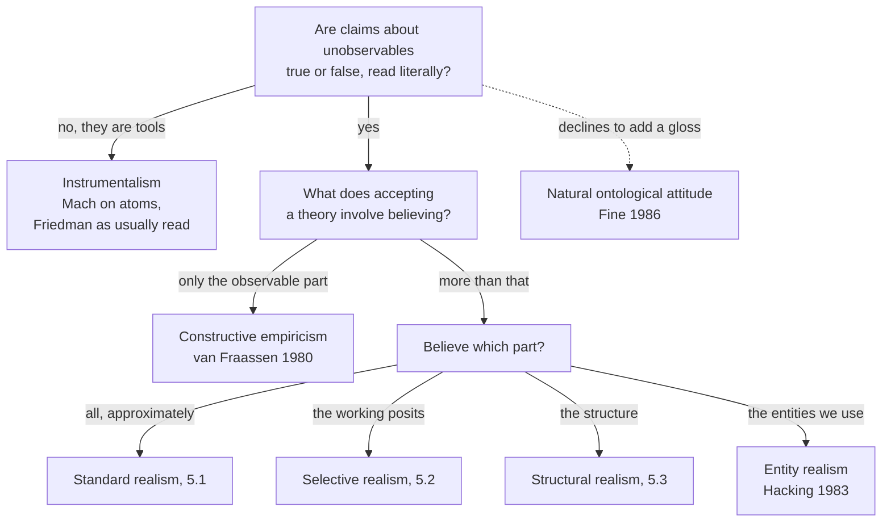

# Philosophy of Science · Lesson 5.4: Constructive empiricism and entity realism

> ⏱ ~15 min · Module 5: Scientific realism · Builds on: [5.1](05-01-realism-and-the-no-miracles-argument.md), [5.2](05-02-the-pessimistic-induction-and-selective-realism.md), [5.3](05-03-structural-realism.md), [2.2](02-02-duhem-quine-and-underdetermination.md), [4.3](04-03-unification-and-the-pragmatics-of-explanation.md) · Unlocks: [`philosophy-of-physics`](../../philosophy-of-physics/syllabus.md)

## Why this matters

A physicist says at a seminar that electrons have spin one-half, and at dinner that she has no opinion on whether there are electrons. On one respectable view she has not contradicted herself. The last three lessons asked how much of a successful theory to believe: all of it ([5.1](05-01-realism-and-the-no-miracles-argument.md)), the parts that did the work ([5.2](05-02-the-pessimistic-induction-and-selective-realism.md)), its structure ([5.3](05-03-structural-realism.md)). Bas van Fraassen's answer draws a different kind of line: believe what the theory says about what humans could observe, and no more. This lesson states that view and the two strongest attacks on where it draws its line.

## The idea

An auditor signs off that a company's books agree with every receipt, including receipts nobody has pulled yet. She does not sign off on the chief executive's story of why profits rose. That story is true or false. She has no view, and her signature does not need one.

Van Fraassen's [constructive empiricism](../reference.md#constructive-empiricism) treats a theory the same way. The receipts are what humans could [observe](../reference.md#observable-and-unobservable). The story is what the theory says about electrons. To accept a theory is to sign off on the receipts and work inside the books, not to believe the story. Its defenders give two reasons this is no dodge. The signature covers *every* receipt, so it is a bold claim about the whole observable past and future. And the story stays a story, true or false, which separates the view from [instrumentalism](../reference.md#instrumentalism), where there is no story, only a calculating device. ([`philosophy-of-economics` 6.2](../../philosophy-of-economics/lessons/06-02-friedmans-as-if-and-its-critics.md) taught instrumentalism in Friedman's form; here it is the foil.)

Two objections attack the line between receipts and story. Grover Maxwell says it is arbitrary: a windowpane, spectacles and a microscope shade into one another with no step you can point to. Ian Hacking says it is in the wrong place: an auditor who has personally moved money through a subsidiary knows the subsidiary exists, whatever anyone's story about it, and experimenters do that with electrons. Arthur Fine says the quarrel itself is the mistake.

## The argument

**Constructive empiricism** (van Fraassen, *The Scientific Image*, 1980). [Scientific realism](../reference.md#scientific-realism), as he states it, says science aims at a literally true story and acceptance is belief in that story. He replaces both clauses. A theory is [empirically adequate](../reference.md#empirical-adequacy) if everything it says about what can be observed is true: it "saves the phenomena". [Acceptance](../reference.md#acceptance-and-belief) has two parts, the belief that the theory is empirically adequate and a commitment to meet new phenomena inside its framework. Something is observable if a member of the human community, suitably placed, would perceive it unaided.

1. **P1.** A theory's claims about unobservables are true or false, read literally. *In words:* "there are electrons" means there are electrons.
2. **P2.** Truth entails empirical adequacy and not conversely, and adequacy covers all observable phenomena, noticed or not. *In words:* adequacy is the weaker claim, and still a bold one.
3. **P3.** Experiment, theory choice and explanation need only acceptance. Millikan's measurement fills in a value the theory left open; simplicity and explanatory power are pragmatic virtues ([4.3](04-03-unification-and-the-pragmatics-of-explanation.md)). *In words:* nothing in a working scientist's day requires the further belief.
4. **P4.** Experience is the only source of information about the world (his 1985 statement; *The Empirical Stance*, 2002, recasts empiricism as a stance). *In words:* belief past what experience could reach adds risk that nothing can check. No epistemic rule, he says, tells you that you may as well "hang for a sheep" as for a lamb.

∴ **C.** Science can be understood as aiming at empirical adequacy, with acceptance involving only that belief. *In words:* an empiricist can accept all of physics, and make sense of it, without believing in electrons.

Notice what is absent. [Empirically equivalent rivals](../reference.md#empirically-equivalent-theories) are no premise: Gideon Rosen (1994) pointed out that the data fit "adequate so far" as well as "adequate", so that argument would undercut the belief he keeps.

**Instrumentalism distinguished.** Ernst Mach, *The Science of Mechanics* (McCormack's translation, 1893): "The atomic theory plays a part in physics similar to that of certain auxiliary concepts in mathematics; it is a mathematical model for facilitating the mental reproduction of facts." Friedman's 1953 essay, on its usual reading, takes that attitude to economic assumptions. A constructive empiricist keeps P1: "atoms exist" is a claim, one she neither affirms nor denies. Because her belief stops at the observable, some commentators still file her under instrumentalism.

**[Maxwell's continuum](../reference.md#maxwells-continuum)** (Grover Maxwell, "The Ontological Status of Theoretical Entities", 1962).

1. **M1.** Looking through a vacuum, a windowpane, spectacles, binoculars, a low-power and a high-power microscope form a continuous series. *In words:* no step is a leap.
2. **M2.** So no non-arbitrary line separates observation from theory. *In words:* any cut shifts with the job at hand.
3. **M3.** What exists cannot depend on such a line. *In words:* what you see through spectacles is not a little less real.

∴ **C.** The observable–unobservable distinction carries no ontological weight. *In words:* the line cannot mark what is real.

Van Fraassen's reply: "observable" is vague, and a vague predicate is usable if it has clear cases and clear non-cases. He also grants C. His line marks nothing about what exists, only what experience can speak to.

**[Entity realism](../reference.md#entity-realism)** (Ian Hacking, *Representing and Intervening*, 1983).

1. **H1.** Experimenters build devices that exploit an entity's causal powers to interfere in something more hypothetical. *In words:* the entity is a tool, not the thing under test.
2. **H2.** One cannot rely on a thing's causal powers, year after year, while withholding belief that it exists. *In words:* you do not doubt your hammer.

∴ **C.** Belief in such entities is warranted, without belief in any theory of them. *In words:* of electrons, "if you can spray them", then they are real.

For microscopes he adds the [grid argument](../reference.md#grid-argument): a grid made in one shape at smaller and smaller sizes is seen, through microscopes built on unrelated physical processes, to keep that shape. Otherwise, a gigantic coincidence. Van Fraassen (1985) replies that appealing to how the grid was made assumes the manufacture succeeded, and that the coincidence argument assumes persistent agreement must have a true explanation.

**Fine** (*The Shaky Game*, 1986) offers the [natural ontological attitude](../reference.md#natural-ontological-attitude): accept science's checked results on the footing of everyday truths, as both sides already do, and stop. "Really true" and "merely adequate" are glosses science does not need. Alan Musgrave (1989) answers that this is either empty or realism.

**Where the argument is weakest.** P4, joined to the line. Paul Churchland (1985) asks why size should matter when distance does not: things too far to see count as observable because we could go there, things too small do not because we cannot shrink, and that is a contingent fact about human bodies. And critics add that belief in adequacy already outruns all experience, so modesty cannot be what stops it at the line. The reply: the line is no claim about the world's joints. It tracks what experience can bear on, and stopping at the merely *observed* would leave no reason to run an experiment nobody has run (Monton and van Fraassen, 2003). The empiricist concedes that the line is not forced on anyone; it expresses what warrant she will act on. The realist concedes that belief past the line adds exposure to error and no observable consequence.

## Map of positions

The first fork is about meaning and the second about belief: constructive empiricism sides with realism at the first and against it at the second.

## Worked examples

**Example 1 (clean case): the moons of Jupiter.** Galileo reported four moons circling Jupiter in 1610, through a telescope. Run the test. Is there a circumstance in which a human would see them unaided? Yes: an astronaut near Jupiter. So they are observable and fall inside empirical adequacy, and van Fraassen counted a look at them through a telescope as a clear case of observation. Now swap in a red blood cell under a microscope. Nobody can stand anywhere from which the cell is visible unaided, so acceptance does not reach it. The constructive empiricist believes the image is public and repeatable, and stays agnostic about the cell. Two points. The verdict turned on the object, not the instrument. And no astronaut has been to Jupiter: "observable" is itself something our best theories of moons and eyes tell us, so the line is drawn from inside science. Monton and van Fraassen accept that circle as unavoidable.

**Example 2 (hard case): the polarized electron gun.** Hacking's first case was a Stanford experiment that changed the charge on a superconducting niobium ball by spraying it with electrons or positrons. That uses only the electron's charge, so his better case was PEGGY II, a source of electrons with aligned spins, built at the Stanford Linear Accelerator Center in the late 1970s and fired at deuterium to probe the weak neutral current. Electrons there are not under test. They are the probe, and several of their causal properties are relied on at once. By H1 and H2, belief is warranted.

Here it strains. "Electrons with aligned spins" is theory. Margaret Morrison (1990), David Resnik (1994) and others press that you cannot build the gun, or say what leaves it, without a theoretical account of what is happening inside, so manipulation cannot float free of theory. Hacking's side replies that only a few well-understood causal generalizations are needed, and that reference to the entity can stay fixed while theories of it change. The critic answers that those generalizations are theory, in small print. A constructive empiricist adds, as with the grid, that "we manipulated electrons" describes the device in the language of an accepted theory; what is observed is that the machine does what the theory says.

The account stops giving a verdict here, because no agreed test separates a low-level causal claim from a theoretical one. Hacking owes a reason why his sliver of theory is knowledge and the rest is not. The constructive empiricist owes an account of why a machine designed from a story works so well if the story is idle, the [no-miracles argument](../reference.md#no-miracles-argument) at the scale of one instrument.

## Watch out

- **You might think constructive empiricism says electrons do not exist, but actually** it leaves "there are electrons" true or false and takes no stand. It is a thesis about science's aim and what acceptance involves, not a ban: van Fraassen (1998) allows someone to believe more than science requires.
- **You might think observable means observed, but actually** adequacy covers every observable event, past or future, watched or not. That is why critics ask what stops it at the line.
- **You might think a successful manipulation vindicates the theory, but actually** entity realism detaches the two. It is also offered as a sufficient condition: nobody has sprayed Jupiter's moons.
- **You might think the natural ontological attitude is a third theory of science, but actually** it is the refusal to add one, and whether a refusal can be stable is the dispute with Musgrave.

## One-liner

> Constructive empiricism keeps realism's literal reading of theories but limits the belief acceptance involves to what is observable; Maxwell calls that line arbitrary, Hacking says we can use what lies beyond it, and Fine says stop drawing it.

## Problems

**P1 (🟢) *(Exegetical, strict.)*** Take three claims.

> (O) The counter's reading peaks at one angle.
>
> (U1) Neutrons from the reactor scatter off the hydrogen atoms in the crystal, and that is how the peak tells us where those atoms sit.
>
> (U2) A neutron is made of one up quark and two down quarks.

For each of standard realism, constructive empiricism, instrumentalism, entity realism (Hacking) and the natural ontological attitude, say what accepting all three involves believing about (O), (U1) and (U2). One line each.

**P2 (🟡) *(Apply to a hard case. Exegetical (a)–(b) · Evaluative (c).)*** Three instruments, three targets.

(i) A ×10 hand lens on the date stamped on a coin.

(ii) A ×400 optical microscope on a red blood cell about 7 micrometres across. (The unaided eye at its closest focus resolves roughly 100 micrometres.)

(iii) A scanning tunnelling microscope on a xenon atom lying on a cold nickel surface. A needle crosses the surface and records the electric current tunnelling between its tip and the surface; the picture is a plotted map of that record. In 1989 Donald Eigler and Erhard Schweizer used such a needle to drag 35 xenon atoms into the letters IBM.

(a) For each, does van Fraassen's criterion count the target as observable, and what decides it? One line each.

(b) Which of the three belong to the series in Maxwell's premise M1, and why? One line each.

(c) What does (iii), as described, offer Hacking that (ii), as described, does not, and what does a constructive empiricist say to it? Two sentences.

**P3 (🔴) *(Steelman and reply. Evaluative.)*** Paul Churchland ("The Ontological Status of Observables", 1985) imagines humanoids like us except that they are born with electron microscopes fixed over their left eyes. They report seeing viruses. Is the observable line arbitrary? In 150 words or fewer: say what "arbitrary" has to mean for the charge to bite, give the strongest form of the charge using this case, give van Fraassen's best reply, and say what the reply costs. Any verdict.

Solutions

**P1** *(Exegetical, strict)*

**Must hit, strict:**

- Standard realism: all three are at least approximately true, including the claims about neutrons and quarks.
- Constructive empiricism: believe (O) and the theory's other claims about observables. (U1) and (U2) are true or false, and acceptance involves believing neither and denying neither; she uses them and works within them.
- Instrumentalism: (O) is a report; (U1) and (U2) are devices for getting from one report to the next, not descriptions, so believing them is not what using them involves.
- Entity realism: (O); and neutrons exist, because here they are used as a tool on something else. (U2) is a claim of theory, which that use does not warrant. The hydrogen atoms are the target of this use, so it does not extend to them either.
- Natural ontological attitude: all three, on the footing of (O) and on science's own checks, with neither "really" nor "merely" added.

**Wrong turns:** saying the constructive empiricist disbelieves (U1) or reads it as shorthand for (O); that is instrumentalism's or the positivists' move, and premise P1 of the argument rules it out. Saying the entity realist believes (U2) because neutrons are real: entity realism's whole point is that the first does not carry the second.

**Model answer:** Realist: all three, approximately. Constructive empiricist: (O) and its observable kin; (U1) and (U2) truth-apt, and no belief either way. Instrumentalist: (O); (U1) and (U2) are tools, not descriptions. Entity realist: (O) and the neutrons used; not (U2). Fine: all three, as ordinary truths, with no gloss.

---

**P2** *(Exegetical (a)–(b) · Evaluative (c))*

**Must hit, strict (a):**

- (i) Observable: the date can be seen unaided, and the lens only spares the eye.
- (ii) Not observable: at about 7 micrometres the cell is well under the eye's limit, and no position lets a human see it unaided. What the eye sees is an image about 2.8 mm across (7 micrometres times 400).
- (iii) Not observable, for the same reason.

The target decides in each case, never the instrument's power.

**Accept:** an answer extending the series through M1's open end, if it says what has changed in kind and that M1 alone does not license the extension.

**Must hit, strict (b):**

- (i) and (ii) are members: looking through a lens, and looking through a microscope, are both on his list.
- (iii) is not as stated: nothing is looked through. A needle and a current replace light from the object to the eye, so M1's series stops short of it.

**Must hit, any verdict (c):**

- The same needle moves the atoms, and they stay where put, so the atoms are used and not only pictured. (ii) as described offers at most a coincidence argument.
- The constructive empiricist's reply: "moves atoms" describes the record in the language of the accepted theory; what is observed is the picture changing as the theory says, which supports adequacy. As with the grid, saying we put them there assumes what is in dispute.

**Wrong turns:** answering (a) by the strength of the instrument. Treating (ii) as observable because the image is sharp. In (c), saying the constructive empiricist doubts the machine's reliability; she grants it.

**Model answer (c), one of several:** The needle that maps the atoms also pushes them, so Hacking can point to use, where (ii) offers only a picture. A constructive empiricist answers that "pushing atoms" is the accepted theory's description of a sequence of plotted maps, and that the sequence's agreement with the theory is evidence of adequacy, not of the atoms.

---

**P3** *(Evaluative, any verdict)*

**Must hit, any verdict:**

- Distinguish arbitrary from vague. A vague predicate with clear cases is usable, so the charge needs the line to lack epistemic significance.
- State the case at strength: the humanoids differ from us only in where the instrument sits and how it got there, yet viruses count for them and not for us, so agnosticism turns on an accident of birth.
- Van Fraassen's reply: "observable" is relative to an epistemic community. Take them into ours, and viruses are observable; otherwise treat them as reliable indicators, like any human with a microscope.
- Name a cost: the line moves with a decision about whom to count as "us", which evidence does not settle; or the circle in which accepted theory says what is observable.

**Wrong turns:** answering only Maxwell's vagueness point. Saying van Fraassen must deny that the humanoids exist or that their reports are reliable. Claiming the case settles whether viruses exist; the question is what attitude the line supports.

**Model answer, one of several:** Vagueness is not enough, since a predicate with clear cases can do work. The charge must be that the line lacks epistemic significance. The humanoids press that: they differ from us only in where the instrument is fixed and how it got there, yet their viruses count and ours do not, so our agnosticism turns on an accident of birth. The best reply makes "observable" relative to an epistemic community. Either we admit them, and viruses become observable, or we treat them as reliable indicators, like any human at an electron microscope. That is coherent. Its cost is that the line now moves with a decision about whom to count as one of us, which evidence does not settle. The empiricist's restraint rests on a commitment about whose experience counts.

## Flashback

**From Lesson [5.2](05-02-the-pessimistic-induction-and-selective-realism.md) (The pessimistic induction and selective realism):** *(Diagnose: Formal (a) · Exegetical (b)–(c).)* A memo by the historian Brandvold (invented, written for this problem): "In sixty years my field has accepted 32 successful theories, and 24 proved false. So at any time three in four accepted theories were false. Expect no better now." Her records: 12 theories are accepted at any time, all successful. Eight slots keep one approximately true theory throughout; in each of the other four, a false theory gives way to another every $L = 10$ years.

(a) Confirm 24 of 32 and give the false share at any moment. For which $L$ does the sixty-year count show a false majority?

(b) Name the error and who named it, and say what her induction needs. Two sentences.

(c) Does correcting the count touch the reductio form? One sentence.

Solution

(a) Each false slot holds $60/L$ theories. At $L = 10$ that is $4 \times 6 = 24$ false, and with 8 true the total is 32, so the false share of the count is $\tfrac{24}{32} = \tfrac34$. At any moment the false share is $\tfrac{4}{12} = \tfrac13$, whatever $L$ is.

The count shows a false majority when

$$4 \times \frac{60}{L} > 8, \quad\text{that is, when}\quad L < 30.$$

At $L = 30$ it is 8 against 8. At $L = 60$ it is 4 false of 12, the moment share.

**Must hit, strict (b):**

- The [turnover fallacy](../reference.md#turnover-fallacy) (Lange, 2002): a head count is read as a moment-by-moment rate, though false theories turn over faster.

- The induction needs that at most past moments most accepted theories were false. Here a third were, at every moment.

**Must hit, strict (c):** no. Saatsi's answer is that turnover cannot touch the timeless C2: P6 needs only that many such past theories were successful, and the 24 remain however briefly each was held.

**Wrong turns:** calling $\tfrac34$ an arithmetic mistake, when the count is right and the step from it fails. Taking the correction to show that today's theories are probably true: the one-third is stipulated. Reading C2 as "today's theories are false".

**Model answer (b), (c):** (b) Lange's turnover fallacy: a head count is read as a rate at each moment. The induction needs most accepted theories to have been false at most past moments, and here one in three was. (c) No: as Saatsi answers, C2 is timeless, so how long each false success stayed in place does not bear on whether success reliably marks approximate truth.

## Connections

- **Backward:** [5.1](05-01-realism-and-the-no-miracles-argument.md) gave the no-miracles argument that van Fraassen answers with selection: only theories that latch onto observable regularities survive, and that needs no truth about the unobservable. [5.2](05-02-the-pessimistic-induction-and-selective-realism.md) and [5.3](05-03-structural-realism.md) restrict belief within a theory; entity realism is the third way of doing that, by object. Empirically equivalent theories are [2.2](02-02-duhem-quine-and-underdetermination.md), and the pragmatic account of explanation that premise P3 relies on is [4.3](04-03-unification-and-the-pragmatics-of-explanation.md).
- **Forward:** [`philosophy-of-physics`](../../philosophy-of-physics/syllabus.md) takes this module into particles, fields and spacetime, where what counts as an entity to be manipulated gets harder to say.
- **Sideways:** [`philosophy-of-economics` 6.2](../../philosophy-of-economics/lessons/06-02-friedmans-as-if-and-its-critics.md) is instrumentalism at work in a science, and its Alan Musgrave is the Musgrave who defends realism against van Fraassen and Fine. Bellarmine's contrast between saving the appearances and demonstrating how things are ([`church-history` 7.3](../../church-history/lessons/07-03-the-galileo-affair.md)) keeps the claim about the sun true or false and withholds belief, which is closer in shape to van Fraassen than to Mach, though Bellarmine thought a demonstration could settle it. Van Fraassen's later account of empiricism as a stance appears in [`apologetics-foundations` 8.3](../../apologetics-foundations/lessons/08-03-apologetics-in-a-secular-age.md).

## Closing the course

The course began by asking what evidence does for a hypothesis, and Module 1 left a choice among measures that can disagree and a prior that has to come from somewhere. Module 2 asked whether refutation or revolution can be rational, and logic alone turned out not to say what a failed prediction refutes, which is why Popper, Kuhn and Lakatos give different accounts of rational change. Module 3 asked what the statistics actually license, and the answer depended on whether a procedure, a hypothesis or a body of evidence is being assessed, and on who sets the threshold. Module 4 asked what an explanation is, and each account met cases the next was built to handle. Module 5 asked what to believe about electrons, and it ended with several attitudes, each paying a different price. Left open on purpose: which measure of confirmation to use, whether a stopping rule should matter, whether explanatory virtues track truth, and where, or whether, to draw the observable line. Those questions stay open because the arguments on each side are still good. What the course can give you is the ability to say exactly what each answer costs, which you will need the next time someone says "the science shows".
