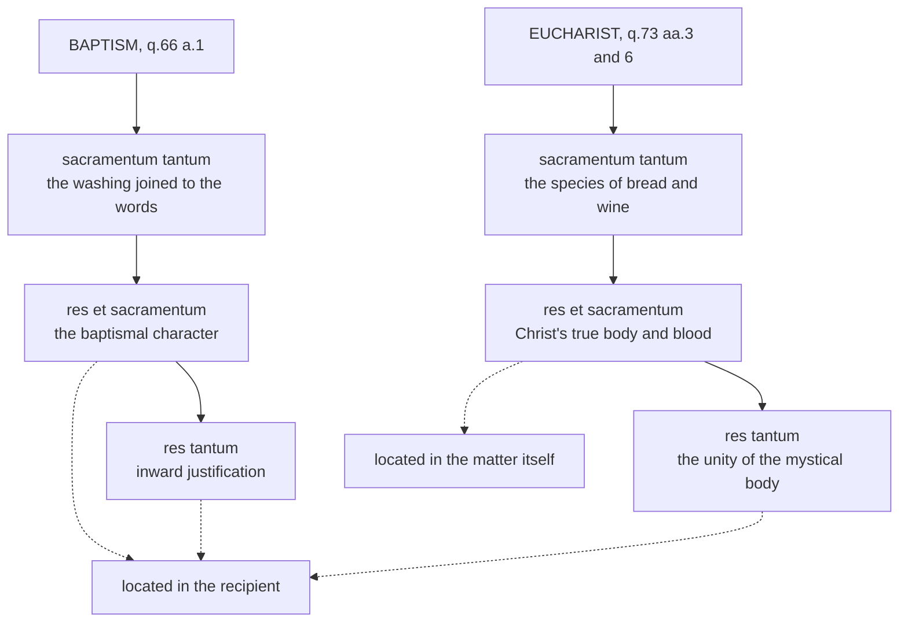

# Sacraments & Liturgy · Lesson 1.1: What a sacrament is

> ⏱ ~15 min · Module 1: The sacramental principle · Builds on: [`ecclesiology-and-mariology` 1.4](../../ecclesiology-and-mariology/lessons/01-04-people-of-god-communion-sacrament.md), [`thomistic-synthesis` 5.2](../../thomistic-synthesis/lessons/05-02-providence-and-secondary-causes.md), [`christology` 3.4](../../christology/lessons/03-04-the-grace-of-the-head.md), [`creation-grace-last-things`](../../creation-grace-last-things/syllabus.md) (grace) · Unlocks: [1.2](01-02-matter-form-minister-intention.md), [1.3](01-03-ex-opere-operato-character-and-fruitfulness.md)

## Why this matters

Every lesson in this course asks of a rite what it is, what it does, and how sure the Church is. This lesson builds the grammar. A sacrament is a **sign**: Augustine's contribution, and the West's starting point. It is a sign that **causes** what it signifies: the schoolmen's precision, and Trent's definition. The two errors that recur through the course, "only a symbol" and "magic", are each a mistake about one of those words. And the line the course runs on, between what is defined (*that* the sacraments give grace) and what is explained (*how*), is drawn here first.

## The idea

**The word.** Paul calls God's plan in Christ a *mystērion*: a purpose hidden for ages and now disclosed (lesson's gloss; Col 1:26, Eph 3:9). The Latin Bible often rendered it *sacramentum*: at Eph 1:9, 3:9 and 1 Tim 3:16, and at Eph 5:32, *sacramentum hoc magnum est*, the wording Trent quotes in Session XXIV. Challoner's Douay–Rheims says "mystery" in the first three and keeps "This is a great sacrament" only at 5:32, which [`new-testament` 6.1](../../new-testament/lessons/06-01-the-disputed-pauline-letters-and-the-pastorals.md) glosses *mega mystērion*, "great mystery", ceding its sacramental reading here.

But *sacramentum* already had a Roman meaning: an oath pledging service, with the soldier's oath of enlistment as the Roman Catechism's example of its ordinary secular sense. Tertullian plays on it: there is "no agreement between the divine and the human sacrament" (*On Idolatry* 19, ANF 3). **What the translation gained** was a rite that does something: a pledge that binds and enrols. **What it lost** came later. Once "sacrament" narrowed to the seven rites, the word stopped carrying Paul's sense of the whole hidden plan now revealed, which is why translators went back to "mystery" ([*mysterion* and *sacramentum*](../reference.md#mysterion-and-sacramentum)).

**The sign.** Augustine gave the West its starting point. A sign brings something else to mind beyond what it shows the senses, and a sacrament is a sacred sign (*On Christian Doctrine* II; *City of God* X; both quoted in q.60 a.1). What makes a washing a sacrament? His answer, on John 15:3 (*Tractates on John* 80.3, NPNF):

> Take away the word, and the water is neither more nor less than water. The word is added to the element, and there results the Sacrament, as if itself also a kind of visible word.

The familiar Latin, as Aquinas quotes it, is *accedit verbum ad elementum, et fit sacramentum* (III q.60 a.4). Augustine adds that the word cleanses "not because it is uttered, but because it is believed": the Church's word of faith, which cleanses even an infant who cannot yet believe.

**The cause.** Israel had sacred signs too: circumcision, the Paschal lamb. Does a sacrament only point, or does it do something? Aquinas answers with [instrumental causality](../reference.md#instrumental-causality), a tool you already have: the sacred writer ([`fundamental-theology` 3.1](../../fundamental-theology/lessons/03-01-inspiration.md)), the axe and the craftsman ([`thomistic-synthesis` 5.2](../../thomistic-synthesis/lessons/05-02-providence-and-secondary-causes.md)), Christ's humanity as living instrument ([`christology` 3.4](../../christology/lessons/03-04-the-grace-of-the-head.md)). A principal cause acts by its own form; an instrument acts only as moved, so the couch resembles the craftsman's art, not the axe (q.62 a.1). Only God causes grace as principal cause, since grace is a share in the divine nature. The sacraments cause it as instruments. Christ's humanity is a joined instrument, like a hand; the sacrament a separate one, like a stick the hand moves; so the power runs from the Godhead, through the humanity and its Passion, into the rite (q.62 a.5; [`christology` 5.1](../../christology/lessons/05-01-the-paschal-mystery-and-the-threefold-office.md)). A visible instrument can also signify its hidden effect, so Aquinas can endorse the "common expression": the sacraments "effect what they signify" (q.62 a.1 ad 1).

He rejects the rival that makes them tokens, like a leaden coin that buys a hundred pounds only because the king has decreed it: then, he says, they would be "mere signs" (q.62 a.1). And Israel's rites? The ancients were justified by faith in the Passion to come, and their rites signified that faith without causing grace (q.62 a.6; [sacraments of the Old Law](../reference.md#sacraments-of-the-old-law)). Florence's Decree for the Armenians (1439) says the seven "differ greatly" from them (lesson's translation):

> For those did not cause grace, but only prefigured that it would be given through the passion of Christ; these of ours both contain grace and confer it on those who receive them worthily.

Why signs at all? Because human beings are led through bodily things to spiritual ones, and God gives grace in a way that suits them (q.61 a.1): an argument from fittingness, the form [`christology` 1.3](../../christology/lessons/01-03-why-the-incarnation.md) taught.

## The doctrine

1. **A [sacrament](../reference.md#sacrament) is a sign of a sacred thing.** The Roman Catechism calls this Augustine's definition, with its other common form: "a visible sign of an invisible grace, instituted for our justification". Trent applies it to the Eucharist (Session XIII, ch. 3), and CCC 1131 calls the sacraments "efficacious signs of grace, instituted by Christ and entrusted to the Church". Aquinas narrows the genus: a sign of a holy thing "so far as it makes men holy" (q.60 a.2). *In words:* not every holy sign is a sacrament: creation and holy water signify holy things without being sacraments in this sense (q.60 a.2 ad 1, ad 3; sacramentals are [7.3](07-03-sacramentals-and-popular-devotion.md)'s).
2. **The sacraments of the New Law contain and confer the grace they signify.** Trent, Session VII, canon 6 anathematizes whoever denies it, as though they were merely outward signs of grace received through faith; canon 2, whoever says they differ from the Old Law's sacraments only in ceremonies and outward rites. *In words:* the sign does what it shows, and that sets it apart from Israel's signs.
3. **Each signifies across three times** (q.60 a.3): "a reminder of the past", the Passion; "an indication" of grace now given; "a prognostic" of glory (*rememorativum, demonstrativum, prognosticum*). *In words:* every sacrament looks back to the cross, into the soul, and forward to heaven.
4. **Each can be analysed in three layers**, the [threefold analysis](../reference.md#threefold-analysis). The *sacramentum tantum* is the sign only; the *res et sacramentum*, a reality the sign effects which itself signifies further; the *res tantum*, the reality only (baptism, q.66 a.1; the Eucharist, q.73 aa.3, 6). Innocent III already sorts the Eucharist this way in a letter of 1202 (*Cum Marthae circa*). *In words:* sort what the senses meet, what it effects that still points onward, and the final grace.
5. **The Church is "like a sacrament".** *Lumen Gentium* 1 calls her, in Christ, *veluti sacramentum*, a sign and instrument of union with God and of the unity of the human race, as [`ecclesiology-and-mariology` 1.4](../../ecclesiology-and-mariology/lessons/01-04-people-of-god-communion-sacrament.md) taught; Semmelroth's "primordial sacrament" is a theologian's term ([Church as sacrament](../reference.md#church-as-sacrament)). *In words:* the Church is the visible sign within which the seven are given, not an eighth.

| Defined or taught (with level) | A school's explanation (no magisterial level) |
|---|---|
| The New Law's sacraments contain and confer the grace they signify (Trent VII can. 6): **rung 1** | As instruments moved by God, with a passing instrumental power (q.62 aa.1, 4); other schools proposed "moral" or "intentional" causality |
| They differ from the Old Law's sacraments by more than ceremony (VII can. 2): **rung 1**; Florence adds that the old rites did not cause grace (the Decree's weight is [1.4](01-04-why-seven.md)'s question) | Why: the Passion could not act as efficient cause before it existed, though faith could be moved by it as a future end (q.62 a.6) |
| Baptism imprints a character (VII can. 9); the Eucharist contains Christ truly, really and substantially (XIII can. 1): **rung 1** | The character and the body are each sacrament's *res et sacramentum* (q.66 a.1; q.73 a.6): the layering is analysis |
| The Church is "like a sacrament" (LG 1, 9, 48): **at least rung 3** | "Primordial sacrament" (Semmelroth) |

**Mark the levels** ([`fundamental-theology` 4.4](../../fundamental-theology/lessons/04-04-the-ladder-of-doctrinal-authority.md); [levels of authority](../reference.md#levels-of-authority)). That the New Law's sacraments contain and confer the grace they signify, and differ from the Old Law's by more than ceremony, is **rung 1**: canons of an ecumenical council (Trent, Session VII, 1547). That there are seven, all instituted by Christ, is also rung 1 (VII can. 1; [`fundamental-theology` 5.1](../../fundamental-theology/lessons/05-01-vincent-of-lerins.md)), and [1.4](01-04-why-seven.md) owns it. The Augustinian definition is the tradition's constant teaching, and the catechisms that restate it carry the weight of what they restate ([`fundamental-theology` 4.5](../../fundamental-theology/lessons/04-05-reading-a-documents-weight.md)). Aquinas's instrumental causality is **theology with no magisterial level**: Trent defined *that* the sacraments confer grace, not *how*, and the how is **rung 5, freely disputed**. The threefold signification and the layering are scholastic analyses, defined nowhere; Innocent III used the layering to answer a question, not to define it. LG's "like a sacrament" is **at least rung 3**.

## The three layers

Each solid arrow reads "signifies". The dashed edges are q.73 a.1 ad 3: where each inner layer sits.

## Worked examples

**Ex 1 (clean): an infant baptism.** A priest pours water three times over an infant, saying "I baptize thee in the name of the Father, and of the Son, and of the Holy Ghost". *Layers:* the sign only is not the water in the font but the washing joined to the words. Aquinas sides against Hugh of St Victor, who had called baptism "water" (q.66 a.1), and Augustine's "take away the word" is why the words belong to the sign. The middle layer is the character, a reality the washing signifies and itself a sign of the justification within; the last is that justification. *Three times:* the rite recalls burial into Christ's death (Rom 6:3–4), shows grace now, and foretells "the likeness of his resurrection" (6:5). *Cause:* the water by its own action touches the body, and as God's instrument cleanses the soul (q.62 a.1 ad 2). *Levels:* that baptism confers grace and imprints a character is rung 1 (VII cann. 6, 9); that the character is the middle layer is analysis.

**Ex 2 (strain): the tabernacle.** After Mass, consecrated hosts are reserved and nobody is receiving them. If a sacrament signifies a holy thing as it makes men holy, who is being made holy? Trent faces the case: the other sacraments sanctify when used, whereas in the Eucharist the Author of sanctity is present "before being used" (Session XIII, ch. 3), and canon 4 defines that the Lord's body remains in reserved hosts (rung 1; [3.3](03-03-real-presence-and-transubstantiation.md), [3.5](03-05-communion-reservation-adoration.md)). The layering absorbs the case. In baptism both inner layers are in the recipient; in the Eucharist the middle layer, Christ's body, is in the matter itself, so this sacrament is complete at the consecration and its last layer, unity, waits for a communicant (q.73 a.1 ad 3). The strain is real all the same: Aquinas must say the Eucharist contains something sacred *absolutely*, not only in relation to us, and the general definition stretches to cover it. The stretch belongs to the analysis; the permanence of the presence is defined.

## Watch out

- **You might think a sacrament is a symbol that reminds.** Reminding is the backward-looking one of three significations (q.60 a.3), and Trent condemns calling the sacraments merely outward signs (VII can. 6, rung 1).
- **You might think the two "threefolds" are one analysis.** q.60 a.3 lists what one sign signifies across time; the layering sorts the rite into sign only, sign-and-reality, reality only. The character appears only in the second.
- **You might think instrumental causality is dogma, or that causing grace is a Thomist opinion.** The first overstates: the *how* is rung 5. The second understates: the *that* is rung 1.
- **You might think "This is a great sacrament" settles that matrimony is a sacrament.** The Greek is *mystērion*, and Paul says he speaks "in Christ and in the church". Trent claims only that the Apostle "intimates" marriage's grace (Session XXIV); [5.3](05-03-matrimony-sacrament-contract-indissolubility.md) takes it up.

## One-liner

> A sacrament is a sign that does what it shows, because Christ uses it as his instrument: that it does so is defined, and how it does so is theology.

## Problems

**P1 (🟢)** *(Exegetical)* Aquinas, ST III q.84 a.1 ad 3 (English Dominican Province):

> In Penance also, there is something which is sacrament only, viz. the acts performed outwardly both by the repentant sinner, and by the priest in giving absolution; that which is reality and sacrament is the sinner's inward repentance; while that which is reality, and not sacrament, is the forgiveness of sin. The first of these taken altogether is the cause of the second; and the first and second together are the cause of the third.

(a) Map penance's three layers from the text, and say what makes the middle layer both "reality" and "sacrament".

(b) Now apply q.60 a.3's threefold signification to penance, and say why it is not the same analysis as (a).

Two sentences per part.

**P2 (🟡)** *(Exegetical)* An **invented** baptism-preparation leaflet from Our Lady of the Wayside parish, Ashcombe, written for this problem:

> (1) "A sacrament is a beautiful symbol: it reminds us of the love God already has for us."
>
> (2) "Baptism is the Christian version of circumcision: the same gift Israel's sons received, only with a different ceremony."
>
> (3) "The water in the font is the sacrament; Father's words simply explain to the family what the water means."
>
> (4) "Catholic theologians still disagree about how the sacraments give grace, but not about whether they do."

For each sentence, say whether it is consistent with Catholic teaching, give the correct statement if it is not, and give the level wherever a level is involved. Canon numbers are not required. Two sentences per item.

**P3 (🔴)** *(Exegetical)* Aquinas, ST III q.62 a.6, the body of the article (English Dominican Province):

> It cannot be said that the sacraments of the Old Law conferred sanctifying grace of themselves, i.e. by their own power: since thus Christ's Passion would not have been necessary … But neither can it be said that they derived the power of conferring sanctifying grace from Christ's Passion. … nothing hinders that which is subsequent in point of time, from causing movement, even before it exists in reality, in so far as it pre-exists in an act of the soul … On the other hand, what does not yet actually exist, does not cause movement if we consider the use of exterior things. … Nevertheless the Fathers of old were justified by faith in Christ's Passion, just as we are. And the sacraments of the old Law were a kind of protestation of that faith, inasmuch as they signified Christ's Passion and its effects.

(a) Name the two things Aquinas denies of the Old Law's sacraments, and the ground of each.

(b) Faith in the Passion could justify before the Passion happened, but a rite could not draw power from it. Which words carry that asymmetry, and what kind of causing does each side involve?

(c) Trent, Session VII, canon 2 anathematizes whoever says the New Law's sacraments differ from the Old Law's only in ceremonies and outward rites. What does the canon make binding, and what in the passage remains Aquinas's explanation?

Two sentences per part.

Solutions

**P1** *(Exegetical)*

**Accept:** for (b), any wording of grace now given that names forgiveness or reconciliation, and any wording of future glory or eternal life.

**Must hit, strict (a):**

- *Sacramentum tantum:* the outward acts of the penitent **and** the priest's absolution, taken together.
- *Res et sacramentum:* the sinner's inward repentance. It is a reality, because the outward acts cause and signify it; it is a sacrament, because it in turn signifies and causes forgiveness.
- *Res tantum:* the forgiveness of sin.

**Must hit, strict (b):**

- Past: Christ's Passion, from which the power to forgive comes. Present: grace, here forgiveness and reconciliation. Future: glory.
- (a) divides the rite into nested layers of sign and reality; q.60 a.3 lists what one sign signifies across past, present and future. They answer different questions.

**Wrong turns:** putting absolution in the middle layer, when the text puts it among the outward acts; treating inward repentance as a private disposition outside the sacrament's structure; saying Trent defined this layering, when it is Aquinas's analysis with no magisterial level; merging (b) into (a).

**Model answer:** (a) The sign only is the outward acts of penitent and priest together, absolution included; the middle layer is the sinner's inward repentance, and the reality only is forgiveness. Repentance is a reality because the outward acts cause and signify it, and a sacrament because it signifies and causes forgiveness in turn. (b) Penance recalls the Passion whose power forgives, shows the grace of forgiveness now given, and foretells glory. That analysis lists what one sign means across time, while (a) sorts the parts of the rite into sign and reality, so they are two different tools.

---

**P2** *(Exegetical)*

**Accept:** "Trent, Session VII" for any rung-1 item, without a canon number.

**Must hit, strict:**

- **(1) Inconsistent.** A sacrament is a sign that causes the grace it signifies: Trent defines that the New Law's sacraments contain and confer it and condemns calling them merely outward signs (**rung 1**). "Reminds" names only one of q.60 a.3's three significations, the backward-looking one.
- **(2) Inconsistent.** Trent defines that the New Law's sacraments differ from the Old Law's by more than ceremony (**rung 1**); Florence and Aquinas add that circumcision signified faith while baptism confers grace. The comparison itself is biblical (Col 2:11–12), so the error is "the same gift", not the link.
- **(3) Inconsistent.** The sign is not the water standing in the font but the washing joined to the words (q.66 a.1), and the words belong to the sacrament rather than commenting on it: take away the word and the water is only water (Augustine, *Tract.* 80.3). The layering is analysis with no level; that the words are required for validity is [1.2](01-02-matter-form-minister-intention.md)'s subject.
- **(4) Consistent.** *That* the sacraments confer grace is **rung 1**; *how* they cause it, whether as Aquinas's instruments or on another school's account, is **rung 5, freely disputed**.

**Wrong turns:** marking (4) wrong because Aquinas's account is "the Church's teaching" (overstatement); correcting (2) by denying any relation between circumcision and baptism; answering (3) only with "the words are the form", without saying that the sacrament is the washing; calling (1) wrong only as "Thomist teaching" (understatement).

**Model answer:** (1) Inconsistent: a sacrament is a sign that causes the grace it signifies, and Trent condemns calling sacraments merely outward signs (rung 1). Reminding is only the backward-looking part of what the sign does. (2) Inconsistent: Trent defines that the New Law's sacraments differ from the Old Law's by more than ceremony (rung 1). Paul links circumcision and baptism (Col 2:11–12), but circumcision signified faith, while baptism confers the grace it signifies. (3) Inconsistent: the sacrament is the washing joined to the words, not the water in the font, and without the word the water is only water (Augustine). That is analysis with no level; what the words must be is 1.2's question. (4) Consistent: that the sacraments give grace is rung 1. How they do it is freely disputed (rung 5), and Aquinas's instrumental account is one school's.

---

**P3** *(Exegetical)*

**Must hit, strict (a):**

- Denial 1: they did not confer grace by their own power, or the Passion would have been unnecessary.
- Denial 2: they did not confer it by power drawn from the Passion either, because in the use of exterior things a cause cannot act before it exists.

**Must hit, strict (b):**

- Faith joins us to the Passion "in an act of the soul", where a future thing can move as an end that is known and desired: final causality.
- A rite joins us through "the use of exterior things", which needs an efficient cause already existing.

**Must hit, strict (c):**

- Binding, **rung 1**: the difference between the two Laws' sacraments is more than ceremonial (and VII can. 6 says what the New Law's do: contain and confer grace).
- Aquinas's explanation, no magisterial level: the final-versus-efficient argument for why the old rites could not draw power from a Passion still to come. That the old rites caused no grace is Florence's teaching too, but the canon itself defines only "not merely ceremony".

**Wrong turns:** saying the ancients were not justified, when the passage says they were, by faith; reading "protestation of that faith" as "useless"; saying Trent defined Aquinas's reason (overstatement); reading the canon as defining nothing about the Old Law (understatement).

**Model answer:** (a) Aquinas denies that the old rites gave grace by their own power, since then the Passion would be unnecessary. He also denies that they gave it by power drawn from the Passion, since an efficient cause working through exterior things cannot act before it exists. (b) The asymmetry is in "pre-exists in an act of the soul" against "the use of exterior things". Faith can be moved by the Passion as a future end, a final cause, but a rite would need the Passion as an already existing efficient cause. (c) The canon binds at rung 1 that the two Laws' sacraments differ by more than ceremony. The causal argument for why the old rites lacked power is Aquinas's explanation, with no magisterial level.

## Connections

- **Backward:** [`ecclesiology-and-mariology` 1.4](../../ecclesiology-and-mariology/lessons/01-04-people-of-god-communion-sacrament.md) gave the Church as "like a sacrament", taken here whole. Instrumental causality comes from [`fundamental-theology` 3.1](../../fundamental-theology/lessons/03-01-inspiration.md), [`thomistic-synthesis` 5.2](../../thomistic-synthesis/lessons/05-02-providence-and-secondary-causes.md), and [`christology` 3.4](../../christology/lessons/03-04-the-grace-of-the-head.md) and [5.1](../../christology/lessons/05-01-the-paschal-mystery-and-the-threefold-office.md). [`thomistic-synthesis` 5.4](../../thomistic-synthesis/lessons/05-04-a-map-of-the-second-and-third-parts.md) placed III qq.60–90 on the map, and this course reads them.
- **Forward:** [1.2](01-02-matter-form-minister-intention.md) turns Augustine's element and word into matter and form. [1.3](01-03-ex-opere-operato-character-and-fruitfulness.md) takes the character, the middle layer of baptism, and what the recipient's disposition adds. [1.4](01-04-why-seven.md) asks why seven, and weighs the Decree for the Armenians. [3.3](03-03-real-presence-and-transubstantiation.md) takes the Eucharist's middle layer. [5.3](05-03-matrimony-sacrament-contract-indissolubility.md) reads Eph 5:32 for marriage. [7.3](07-03-sacramentals-and-popular-devotion.md) takes the holy signs that are not sacraments.
- **Sideways:** the grace a sacrament causes is taught in [`creation-grace-last-things`](../../creation-grace-last-things/syllabus.md). Instrumental causality is the same tool for Scripture (God the principal author, the writer a living instrument) and for the sacraments (God the principal cause, the rite a separate instrument).
