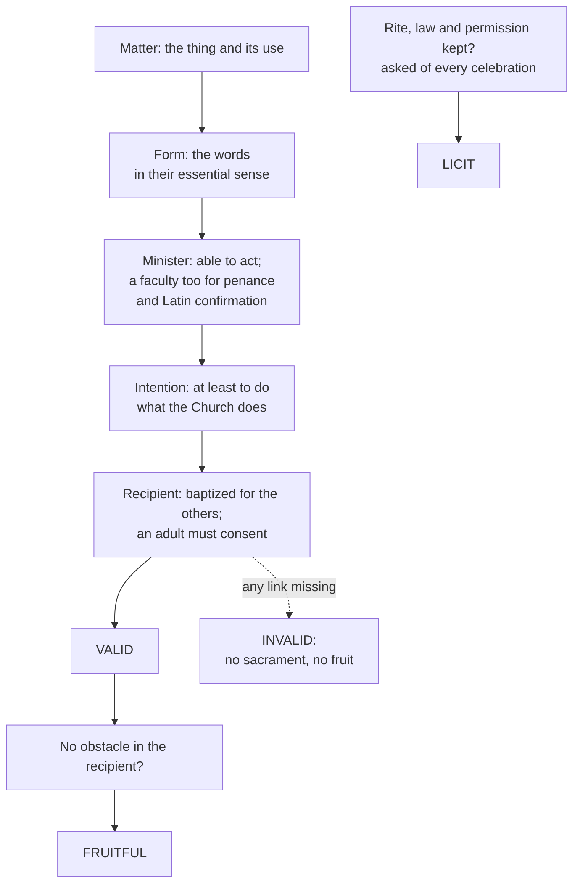

# Sacraments & Liturgy · Lesson 1.2: Matter, form, minister, intention

> ⏱ ~15 min · Module 1: The sacramental principle · Builds on: [1.1 What a sacrament is](01-01-what-a-sacrament-is.md), [`ecclesiology-and-mariology` 2.2](../../ecclesiology-and-mariology/lessons/02-02-holy.md), [`trinity-and-god` 6.2](../../trinity-and-god/lessons/06-02-the-trinity-in-the-economy-liturgy-and-prayer.md), [`metaphysics` 2.3](../../metaphysics/lessons/02-03-hylomorphism-and-composition.md) · Unlocks: [1.3](01-03-ex-opere-operato-character-and-fruitfulness.md), [2.1](02-01-baptism-the-rite-and-its-effects.md), [3.3](03-03-real-presence-and-transubstantiation.md)

## Why this matters

In 2020 the Congregation for the Doctrine of the Faith ruled baptisms given with "we baptize you" invalid, to be given again without condition. The note *Gestis verbisque* (2024) recorded the sequel: people repeated their baptism and every sacrament since, and some priests learned their ordinations were invalid, since no one unbaptized can validly receive another sacrament (§2 and note 4; can. 842 §1). This lesson is the machinery behind such verdicts.

## The idea

Aquinas starts from a plain fact:

> washing with water, which is done in baptism, may be ordained to bodily cleanliness, to the health of the body, to amusement, and many other similar things. (ST III q.64 a.8)

Something must fix the washing to one meaning. The **words** fix what it signifies: "I baptize you" makes the water mean a spiritual cleansing (q.60 a.6). The **minister's intention** fixes what the act is for: he washes as Christ's minister, not as a bath attendant. Add the **thing** (water, bread, oil) and a **person** able to act: four elements.

Early thirteenth-century schoolmen named the first two with Aristotle's pair ([`metaphysics` 2.3](../../metaphysics/lessons/02-03-hylomorphism-and-composition.md)); William of Auxerre is usually credited as the first. The thing is the [matter](../reference.md#matter-and-form), the words the form, since in a composite the form determines the matter (q.60 a.7). The pair earns its keep three ways. It **separates the essential from the ceremonial**: the white garment adorns a baptism, water and words make it. It **makes the form decisive**: water alone is ambiguous. And it **gives a test for changes**: what counts is the words' essential sense, not their sound, which is why the Byzantine passive form is as valid as the Latin ([2.1](02-01-baptism-the-rite-and-its-effects.md); q.60 a.8).

**[Remote matter](../reference.md#remote-and-proximate-matter)** is the thing (water); **proximate matter** is its use in the rite (the pouring). Whether a sacrament *happened* is only the first of [three verdicts](../reference.md#valid-licit-fruitful). Matter, form, minister, intention and an adult recipient's consent decide **validity**; the rite, the law and any required permission decide **liceity**; the recipient's disposition decides **fruitfulness**.

## Source

The Council of Florence, decree for the Armenians in the bull *Exsultate Deo* (22 November 1439), from the Latin (the final clause is DH 1312); lesson's translation:

> Fifth: for the easier instruction of the Armenians themselves, present and future, we reduce the truth of the Church's sacraments to this very brief formula. … All these sacraments are completed by three things: by things as the matter, by words as the form, and by the person of the minister who confers the sacrament with the intention of doing what the Church does. If any of these is lacking, the sacrament is not completed.

Read the shape of the act. It is **instruction** for one church: practical, not a definition of matter, form and minister, as the older Denzinger's editors note, and taken almost word for word from a short work of Aquinas. It says *tanquam*, "as": things *as* matter, an analogy, not a claim that a rite is a substance. It names **three** elements, folding intention into the minister, and leaves the recipient out. Its sanction concerns completion only, nothing about lawfulness or fruit. It leaves open which things and words each sacrament needs ([1.4](01-04-why-seven.md)'s question) and what intention suffices.

## The doctrine

1. **The [intention](../reference.md#intention-of-the-minister) is required.** Trent, Session VII, *On the Sacraments in General*, canon 11 (DH 1611):

   > If any one saith, that, in ministers, when they effect, and confer the sacraments, there is not required the intention at least of doing what the Church does; let him be anathema.

   *In words:* a rite performed without meaning the Church's act is nothing sacramental. "At least" sets a floor: he must intend what the Church *does*, not believe what she believes.

2. **His holiness and faith are not required.** A minister in mortal sin who observes the essentials confers the sacrament (canon 12, DH 1612); baptism given even by heretics in the Trinity's name, with the Church's intention, is true baptism (canons on baptism, canon 4, DH 1617). *In words:* the [Donatist principle](../reference.md#donatist-principle) is false, as [`ecclesiology-and-mariology` 2.2](../../ecclesiology-and-mariology/lessons/02-02-holy.md) and [`patristics` 4.4](../../patristics/lessons/04-04-augustine-against-the-donatists.md) taught (the rebaptism dispute: [`patristics` 2.4](../../patristics/lessons/02-04-cyprian-of-carthage.md)). A priest in mortal sin who says Mass correctly: valid, though he sins (q.64 a.6).

3. **Not everyone can administer every sacrament** (canon 10). Who *can* is validity: only a priest confects the Eucharist (can. 900 §1); penance, and confirmation by a Latin presbyter, also need a faculty for validity ([2.3](02-03-confirmation.md), [4.1](04-01-penance-the-sacrament-and-its-history.md)); anyone at all can baptize validly, though lawfully only in necessity, can. 861 §2 ([2.1](02-01-baptism-the-rite-and-its-effects.md)). Who *may* is liceity. Can. 841 splits them: validity's requirements belong to the supreme authority alone ([minister](../reference.md#minister)).

4. **The Church cannot touch the substance.** In dispensing the sacraments she may change what she judges expedient, "their substance being untouched" (Trent, Session XXI, ch. 2; [3.5](03-05-communion-reservation-adoration.md)'s text). *Gestis verbisque* (2024) §§11–17 restates it: the Magisterium has designated the essential elements as matter and form, with the minister's intention added, and arbitrary changes endanger validity case by case; any change to a sacramental formula is gravely illicit (note 31). *In words:* the [substance](../reference.md#substance-of-the-sacraments) is received; the ceremony around it is hers to arrange.

5. **An adult must intend to receive.** Innocent III held in 1201 (*Maiores Ecclesiae causas*) that one who never consents and expressly refuses receives neither the grace nor the character of baptism (so III q.68 a.7; can. 865 §1). Disposition governs fruit, which is [1.3](01-03-ex-opere-operato-character-and-fruitfulness.md)'s.

**Why holiness is irrelevant and intention is not.** One premise does both jobs. The minister is Christ's [instrument](../reference.md#instrumental-causality) ([1.1](01-01-what-a-sacrament-is.md)), and an instrument's other qualities are accidental: a pipe carries water whether silver or lead (q.64 a.5), so his sin and unbelief do not reach the effect (a.9). But a *living* instrument moves his own limbs, so he must subject himself to the principal agent by intending what Christ and the Church do (a.8 ad 1). The Donatist principle settles his holiness, not his intention.

**What kind of intention.** An intention to mock voids the sacrament, so an actor baptizing in a film baptizes no one; a wicked purpose beyond the sacrament does not void it (q.64 a.10). A wandering mind still acts on the intention brought to the font (a.8 ad 3): Aquinas calls it "habitual", the later manuals *virtual*, and both hold it sufficient. Internal or external? Ambrosius Catharinus, a Dominican theologian at Trent, held a seriously performed external rite sufficient even if the minister inwardly withholds. In 1690 the Holy Office under Alexander VIII condemned a proposition close to it (old Denzinger 1318; lesson's translation):

> Baptism is valid when conferred by a minister who observes the whole external rite and form of baptizing, but inwardly in his heart resolves: I do not intend what the Church does.

Since then theologians commonly require an internal intention, presumed whenever the rite is seriously performed; Catharinus's view survived at most as a speculation no one may act on, since on validity the safer course binds ([`moral-theology` 4.1](../../moral-theology/lessons/04-01-casuistry-and-the-probabilism-controversy.md)). The other edge, a correct rite with a corrupted intention, is *Gestis verbisque* note 39 on Latter-day Saints' baptism ([2.2](02-02-necessity-infants-and-baptism-of-desire-and-blood.md)).

| Defined or taught (with level) | A school's explanation (no magisterial level) |
|---|---|
| Intention at least of doing what the Church does (VII can. 11): **rung 1** | That it must be internal; that virtual suffices |
| A minister in mortal sin confers (can. 12); heretics' baptism is true (Baptism can. 4): **rung 1** | Why: he is Christ's living instrument |
| True and natural water for baptism (Baptism can. 2): **rung 1** | Matter and form as hylomorphism applied to rites |
| The substance is untouchable (XXI ch. 2): **at least rung 3** | Which words are "substantial" where the Church has not said |

**Mark the levels** ([`fundamental-theology` 4.4](../../fundamental-theology/lessons/04-04-the-ladder-of-doctrinal-authority.md)). The canons are **rung 1**, as `ecclesiology-and-mariology` already marks can. 12 and Baptism can. 4; the substance doctrine, in a doctrinal chapter, **at least rung 3**. Florence's clause is instruction, not definition (the decree's weight is [1.4](01-04-why-seven.md)'s). Hylomorphism as metaphysics has **no level**, though the Magisterium uses its vocabulary. The 1690 decree is a papal act of the authentic magisterium with global censures, as [`moral-theology` 4.1](../../moral-theology/lessons/04-01-casuistry-and-the-probabilism-controversy.md) marks it: the proposition is excluded, **not declared heretical**. Innocent III's decretal: **at least rung 3**. The 2008 and 2020 responses and *Gestis verbisque*, dicastery acts with ordinary papal approval, are **rung 3**, binding in practice ([`fundamental-theology` 4.5](../../fundamental-theology/lessons/04-05-reading-a-documents-weight.md)). The right-hand column has no magisterial level: the internal-intention thesis is **common teaching (rung 4)**, the rest theology.

## The decision

Validity is a chain. Fruitfulness is asked only of a valid sacrament; liceity, of every celebration, valid or not.

## Worked examples

**Ex 1 (clean): "we baptize you".** The 2020 Doctrinal Note describes a minister who named parents, godparents, family and friends, then said "in the name of the community we baptize you" (the Note's words) and the Trinitarian names. Matter and minister are in order. One word of the form changed: does it touch the essential sense? Mere departure does not, since the Byzantine form departs further. Aquinas met "we baptize thee" where several baptize one person (q.67 a.6) and placed the defect in what "we" expresses: several concurring in one baptism, against the nature of a minister, who stands in the place of the one Christ. The Note argues the same for one minister speaking for the assembly, which acts ministerially, not collegially. **Valid?** No, decided by the form (in Aquinas's terms, by the intention the altered form expresses), and with certainty, since the response orders baptism *in forma absoluta*, not the conditional baptism kept for doubt (can. 869 §1). **Licit?** No, decided by the rite (can. 846 §1). **Fruitful?** The question lapses. The 2008 responses said the same of "in the name of the Creator, and of the Redeemer, and of the Sanctifier": functions replaced the names, so [`trinity-and-god` 6.2](../../trinity-and-god/lessons/06-02-the-trinity-in-the-economy-liturgy-and-prayer.md)'s "one name" is the form's substance.

**Ex 2 (strain): the hidden reservation.** *Invented, written for this lesson.* Fr Oswin Achterberg kept baptizing through a crisis of faith. His posthumous memoir says that at one dated baptism he inwardly resolved, "I do not intend what the Church does." Matter, form and rite were perfect. On common teaching a real inner refusal voids it: that is the rejected 1690 proposition. Aquinas puts the strain to himself: if a hidden intention decides validity, no one can be sure he was baptized (q.64 a.8 obj. 2). He answers that the minister acts in the person of the whole Church, whose intention the words express, and this suffices "except the contrary be expressed" (ad 2). Read "expressed" as spoken aloud and you stand near Catharinus; as willed, with the theologians after 1690. Practice closes the gap without closing the theory: intention is presumed from a serious rite, so his other baptisms stand, but the dated one carries a positive doubt no investigation can remove: **validity doubtful, decided by the minister's intention**, remedied by conditional baptism (can. 869 §1). The guilt is his.

## Watch out

- **You might think "matter and form" is a school's vocabulary, so the essential elements are negotiable.** That understates: the vocabulary has no level, but the intention requirement and true water are rung 1, and what the supreme authority fixes for validity binds (can. 841).
- **You might think "doing what the Church does" means believing what she believes.** An unbeliever can intend the Church's act while thinking it empty (q.64 a.9 ad 1); *Gestis verbisque* 18 keeps intention apart from faith.
- **You might think invalid and illicit are two words for "wrong".** Invalid means nothing happened; illicit, that something happened unlawfully. A suspended priest's Mass is valid and illicit: suspension removes the permission, not the power (q.64 a.9 ad 3).

## One-liner

> Matter and form make the sign, intention makes it the Church's act, and those decide whether it happened; lawfulness and fruit are separate verdicts.

## Problems

**P1 (🟢)** *(Exegetical)* **Invented**, written for this problem. The sacristan's log for one Sunday at the parish of St Odran, Halvergate:

> (a) 8:30. Beside the ordinary hosts, Father consecrated one host from a sealed packet marked "certified gluten-free: rice and potato flour" and gave it to a parishioner with coeliac disease.
>
> (b) 11:00. The visiting priest, two years sober, celebrated with mustum (grape juice whose fermentation was stopped by freezing). He had asked no one's permission.
>
> (c) 4:00, First Communion. A parent baked unleavened wheat hosts with a spoonful of honey in the whole batch, "so the children like them".

For each, give three verdicts (valid, licit, fruitful), name the element that decides each, and cite the text that fixes the validity verdict. **Two sentences per item.**

**P2 (🟡)** *(Exegetical)* Aquinas on changes to the sacramental forms, ST III q.60 a.8 (English Dominican Province):

> … two points seem to call for our attention. One is on the part of the person who says the words … if he intends by such addition or suppression to perform a rite other from that which is recognized by the Church, it seems that the sacrament is invalid … The other point to be considered is the meaning of the words … whether the change of words destroys the essential sense of the words: because then the sacrament is clearly rendered invalid. … Thus in the form of the Eucharist—"For this is My Body," the omission of the word "for" does not destroy the essential sense … Again, it is possible to add something that destroys the essential sense: for instance, … "I baptize thee in the name of the Father Who is greater, and of the Son Who is less," with which form the Arians baptized.

(a) Name the passage's two tests, and say which one the Arian form fails.

(b) **Invented.** Wanting the consecration "to sound more inclusive", Fr Ettore Benedek says over the bread at a weekday Mass, on Monday: "For this is my Body, which will be given up for you and for the whole of creation"; on Tuesday: "For this is the sign of my Body, given up for you." For each day give the validity and liceity verdicts and the deciding element.

(c) Name one thing a verdict in (b) needs that the passage's tests cannot supply.

**Two sentences per part.**

**P3 (🔴)** *(Exegetical)* **Invented**, written for this problem: three sentences from the Diocese of Brackenmoor's liturgy-office newsletter.

> (1) "The Council of Florence defined as dogma that every sacrament is composed of matter and form in Aristotle's sense."
>
> (2) "In 1690 the Church defined that a minister's private inner reservation invalidates a sacrament, so to doubt it is heresy."
>
> (3) "At the words of consecration the priest must be actually attending to his intention; if his mind wanders, the Mass is invalid."

Correct each, giving the level of what is actually taught. **Two sentences per item.**

Solutions

**P1** *(Exegetical)*

**Must hit, strict:**

- **(a)** **Invalid**, decided by the **matter**: the bread must be wheat (can. 924 §2), and the CDF's 2003 circular letter, restated by the Congregation for Divine Worship on 15 June 2017, says completely gluten-free hosts are invalid matter. **Illicit**, decided by the **law** on matter (can. 924), and **fruitfulness lapses** for that host: she received no sacrament, though the wheat hosts beside it were validly consecrated.
- **(b)** **Valid**, decided by the **matter**: the 2003 letter (restated 2017) says mustum is valid matter. **Illicit**, decided by **permission**: the Ordinary must grant its use. **Fruitfulness** is not decided by matter at all; it turns on each communicant's disposition ([1.3](01-03-ex-opere-operato-character-and-fruitfulness.md)).
- **(c)** **Valid**, decided by the **matter**: a spoonful in a batch leaves bread commonly considered wheat bread, the line *Redemptionis Sacramentum* (2004) 48 draws. **Gravely illicit**, decided by the **rite**: the same section calls adding honey "a grave abuse". Fruitfulness again depends on disposition.

**Wrong turns:** calling (b) invalid because it was unpermitted, which collapses liceity into validity; calling (a) valid because "the Church supplies", when can. 144 supplies power of governance and certain faculties, never matter; treating any honey as automatically invalid, or any quantity as safe (enough to make it no longer wheat bread voids it, and where that is doubtful the safer course binds, RS 50); saying fruitfulness depends on the matter.

**Model answer:** (a) The rice host was invalid matter, since the bread must be wheat (can. 924 §2) and the 2003 letter, restated in 2017, rules completely gluten-free hosts invalid; using it was illicit, and she received no sacrament, so fruit lapses, while the wheat hosts were validly consecrated. (b) Mustum is valid matter on the same letters, so the Mass was valid; it was illicit for want of the Ordinary's permission, and fruitfulness depends on each communicant's disposition, not on the matter. (c) A spoonful of honey leaves wheat bread, so the hosts were valid (RS 48); adding it is a grave abuse, so the celebration was gravely illicit, and fruitfulness again turns on disposition.

---

**P2** *(Exegetical)*

**Accept:** for (c), the form's substantial part (expected), or evidence of what the minister actually intends, which the first test needs and the words alone cannot show.

**Must hit, strict (a):** test one is the **speaker's intention**: a change meant to perform a rite other than the Church's voids it. Test two is the **sense**: a change that destroys the essential sense voids it, while one that leaves it intact does not. The Arian form fails the second, by an addition that subordinates the Son and so destroys the essential sense.

**Must hit, strict (b):** **Monday: valid**, decided by the **form**: the addition leaves "this is my Body" intact, and he intends the Church's consecration with an embellishment, not another rite. **Illicit**, decided by the **rite**: no one may add to the liturgical books (can. 846 §1), and a change to a sacramental formula is always gravely illicit (*Gestis verbisque*, note 31). **Tuesday: invalid**, decided by the **form**: "the sign of my Body" turns a statement of identity into one of signification, which destroys the essential sense; it is also illicit.

**Must hit, strict (c):** which words are the form's **substantial part**. The passage assumes it is known; it must come from the Church's determination of the form (can. 841; the liturgical books), and *Gestis verbisque* 12 admits the Church has not always indicated it univocally, so where she has not, the test yields no verdict and the safer course applies.

**Wrong turns:** calling Monday invalid because the words were changed at all (the test is sense, not sound); calling Tuesday "valid but illicit" because the minister meant well; reading the Arian example as a failure of intention only; giving a fruitfulness verdict as if the form decided it.

**Model answer:** (a) The passage tests the speaker's intention, whether by the change he means a rite other than the Church's, and the words' sense, whether the change destroys their essential meaning. The Arian form fails the second, since "greater" and "less" subordinate the Son and so destroy the sense of the Trinitarian form. (b) Monday is valid, because the addition leaves "this is my Body" and the Church's intention intact, but gravely illicit, because no one may add to the rite (can. 846 §1). Tuesday is invalid, because "the sign of my Body" replaces identity with signification and so destroys the essential sense, and it is illicit as well. (c) The tests presuppose knowing which words are the substantial part of the form, which only the Church's determination supplies (can. 841). Where she has not fixed it univocally (*Gestis verbisque* 12), the test cannot decide and the safer course governs.

---

**P3** *(Exegetical)*

**Must hit, strict:**

- **(1)** Florence's clause is a practical **instruction** for the Armenians, not a definition, and it says things and words act *as* matter and form. The vocabulary is the Magisterium's working language, but hylomorphism as metaphysics has **no level**; what is defined nearby is the intention requirement (Trent VII can. 11) and true water for baptism (Baptism can. 2), **rung 1**.
- **(2)** The Holy Office decree of 7 December 1690 under Alexander VIII condemned the proposition with **global censures**: an act of the authentic magisterium that excludes it without naming its note, so "heresy" **overstates**. The positive thesis, that an internal intention is required, is **common teaching (rung 4)**; only "the intention at least of doing what the Church does" is defined (rung 1).
- **(3)** A **virtual** intention suffices: the intention he formed in going to the altar governs the act though his mind wanders (ST III q.64 a.8 ad 3, where Aquinas calls it "habitual"). That is **common teaching (rung 4)**; actual attention is to be sought, as Aquinas says, but is not required for validity.

**Wrong turns:** in (1), swinging to "matter and form is mere opinion", which understates what is defined; in (2), calling the condemnation rung 1, or treating the proposition as still open; in (3), confusing virtual with the manuals' "habitual", which they hold insufficient, or giving the claim a magisterial rung.

**Model answer:** (1) Florence issued a practical instruction, not a definition, and spoke of things and words *as* matter and form: the vocabulary is the Church's working language, but Aristotle's theory carries no level. What is defined is narrower, the intention at least of doing what the Church does (Trent VII can. 11) and true water for baptism (Baptism can. 2), both rung 1. (2) The 1690 decree condemned the proposition with global censures, an authentic papal act that excludes it without calling it heresy. That an internal intention is required is common teaching (rung 4); only the intention of doing what the Church does is defined. (3) A virtual intention, formed beforehand and still governing the act, suffices, as Aquinas teaches under the name "habitual" (q.64 a.8 ad 3). That is common teaching, rung 4; full attention is desirable, not a condition of validity.

## Connections

- **Backward:** [1.1](01-01-what-a-sacrament-is.md) made the sacrament a sign that causes as Christ's instrument; this lesson finds the four elements that make the sign and the premise that makes the minister's holiness irrelevant. The Donatist principle is [`ecclesiology-and-mariology` 2.2](../../ecclesiology-and-mariology/lessons/02-02-holy.md) and [`patristics` 4.4](../../patristics/lessons/04-04-augustine-against-the-donatists.md); hylomorphism as metaphysics is [`metaphysics` 2.3](../../metaphysics/lessons/02-03-hylomorphism-and-composition.md); the one name of Matthew 28:19 is [`trinity-and-god` 6.2](../../trinity-and-god/lessons/06-02-the-trinity-in-the-economy-liturgy-and-prayer.md).
- **Forward:** [1.3](01-03-ex-opere-operato-character-and-fruitfulness.md) takes the third verdict, fruitfulness, and the obstacle that blocks it. [1.4](01-04-why-seven.md) weighs the Decree for the Armenians and its lists. Each sacrament's lesson applies the chain: [2.1](02-01-baptism-the-rite-and-its-effects.md) to baptism, [2.2](02-02-necessity-infants-and-baptism-of-desire-and-blood.md) to baptisms in other communities, [3.3](03-03-real-presence-and-transubstantiation.md) to the eucharistic matter and form, and [6.3](06-03-the-roman-rite-and-the-eastern-rites.md) to the sharpest test of what the eucharistic form requires.
- **Sideways:** the rule that the safer course binds wherever validity is at stake is the probabilism controversy's exception ([`moral-theology` 4.1](../../moral-theology/lessons/04-01-casuistry-and-the-probabilism-controversy.md)), and the weight of a responsum or note is read by [`fundamental-theology` 4.5](../../fundamental-theology/lessons/04-05-reading-a-documents-weight.md)'s genre table.
