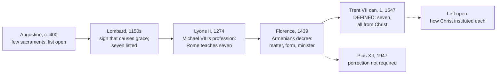

# Sacraments & Liturgy · Lesson 1.4: Why seven

> ⏱ ~15 min · Module 1: The sacramental principle · Builds on: [1.1](01-01-what-a-sacrament-is.md), [1.2](01-02-matter-form-minister-intention.md), [1.3](01-03-ex-opere-operato-character-and-fruitfulness.md), [`fundamental-theology` 4.4](../../fundamental-theology/lessons/04-04-the-ladder-of-doctrinal-authority.md) · Unlocks: [2.1](02-01-baptism-the-rite-and-its-effects.md) and the rest of Modules 2–5, [7.3](07-03-sacramentals-and-popular-devotion.md)

## Why this matters

Trent anathematizes anyone who says there are more or fewer than seven sacraments. Yet Augustine never counted them, a Greek treatise of around 500 describes six rites, and the list of seven becomes standard only through a Paris textbook of the 1150s. This lesson tells that history unsoftened, then says exactly what the Church has defined: the number, and that Christ instituted all seven. How he did so is not defined, and that line runs through the course.

## The idea

**Before anyone counted.** For Augustine *sacramentum* covers a whole family of sacred signs: the ark, the rites of the Old Law, the salt given to catechumens, which he calls "the sacrament of the catechumen" (*On Baptism* IV.21.29). When he describes the new covenant's sacraments, he names two and leaves the list open (Letter 54.1, NPNF first series vol. 1, Cunningham's translation):

> sacraments, which are in number very few … and in significance most excellent, as baptism solemnized in the name of the Trinity, the communion of His body and blood, and such other things as are prescribed in the canonical Scriptures

*Reply to Faustus* XIX.13 says only that the new are "fewer in number" than the old. Augustine asks what such signs are and do, never how many: counting was not a patristic question.

**The twelfth-century narrowing.** Counting needs a definition sharp enough to exclude. Hugh of St Victor (*On the Sacraments of the Christian Faith*, 1130s, I.9.2) defined a sacrament as a material element that represents a grace by likeness, signifies it by institution and contains it by sanctification. Yet Aquinas reports him calling the Old Law's tithes and oblations sacraments (ST III q.65 a.1 obj. 7). Peter Lombard, whose *Sentences* became every school's textbook ([`thomistic-synthesis` 1.1](../../thomistic-synthesis/lessons/01-01-the-plan-of-the-summa.md)), made the cut. A sacrament properly so called is a sign of grace that "bears its image and exists as its cause" (IV d.1 c.4, lesson's translation), so signs that only signify fall out. Then, at d.2 c.1, comes the list of seven. Earlier lists existed; his textbook made this one everyone's.

**Then the Church's acts.** A profession of faith that Clement IV proposed to the Byzantine emperor Michael VIII in 1267, offered in the emperor's name at the Second Council of Lyons (1274), states that the Roman Church "holds and teaches" seven sacraments (lesson's translation). Florence's Decree for the Armenians (in the bull *Exsultate Deo*, 22 November 1439) sets out the seven with matter, form and minister for each. Trent defines.

## In their own words

**The Reformation.** Luther's *Babylonian Captivity of the Church* (1520) denies that there are seven and holds, for the present, to three: baptism, penance and the bread. By its end there are strictly two, since only baptism and the bread have both a divinely instituted sign and the promise of forgiveness. Melanchthon's *Apology of the Augsburg Confession* (1531), art. XIII, calls sacraments the rites with God's command and an added promise of grace, since no human authority can promise grace: baptism, the Lord's Supper and absolution. Confirmation and extreme unction are rites received from the Fathers, without God's command. Ordination, if it means the ministry of the Word, it will call a sacrament; marriage too, if kept distinct from the signs of the New Testament. And no prudent man, it says, will strive greatly over the number or the term, provided what has God's command and promise is kept. The Church of England's Articles (1571), art. XXV, count two sacraments ordained of Christ in the Gospel, baptism and the Supper; the "five commonly called Sacraments" lack a visible sign ordained of God.

**The East.** The treatise *On the Ecclesiastical Hierarchy*, ascribed to Dionysius the Areopagite (around 500), describes six sacred rites: illumination (baptism), the synaxis, the consecration of the myron, priestly consecrations, monastic consecration, and the rites over the dead. The early modern Orthodox confessions count seven: Patriarch Jeremiah II's replies to Lutheran theologians in the 1570s; Peter Mogila's *Orthodox Confession* (approved 1643), which pairs them with the seven gifts of the Spirit (Q. 98); and the Synod of Jerusalem (1672), Decree XV (lesson's translation of the Latin version, Schaff, *Creeds* vol. 2):

> We believe that there are evangelical sacraments in the Church, and that they are seven. We admit in the Church neither a smaller nor a larger number of sacraments, since any number other than seven is the offspring of heretics' madness.

Many Orthodox writers today add that no pan-Orthodox council has made the number exclusive, and that the systematic count came from Latin school theology.

## The doctrine

1. **[Seven, all instituted by Christ](../reference.md#the-number-seven).** [Trent, Session VII](../reference.md#trent-session-vii) (3 March 1547), Canons on the Sacraments in General, can. 1, anathematizes whoever says "that the sacraments of the New Law were not all instituted by Jesus Christ, our Lord; or, that they are more, or less, than seven", then names them, and adds whoever says that any of the seven is not "truly and properly a sacrament". *In words:* exactly these seven, each a sacrament in the strict sense, all from Christ.
2. **What [institution by Christ](../reference.md#institution-by-christ) excludes and leaves open.** It excludes any of the seven being a human invention; Trent uses those very terms of marriage (Session XXIV can. 1: not "invented by men in the Church"). It does not say when, where or how Christ instituted each. *In words:* the author is fixed; the manner is not.
3. **The Church's power reaches the dispensation, not the [substance](../reference.md#substance-of-the-sacraments).** Trent, Session XXI ch. 2: the Church may ordain or change what concerns dispensing the sacraments, "their substance being untouched". Pius XII (*Sacramentum Ordinis*, 1947, §1) glosses the substance as what Christ himself, as revelation's sources show, established to be kept in the sign. *In words:* the Church can reshape a rite; she cannot add, drop or remake a sacrament.
4. **Florence taught; it did not define each rite.** The [Decree for the Armenians](../reference.md#decree-for-the-armenians) sets out its section on the sacraments "in this very brief formula, for the easier teaching of the Armenians, present and future" (lesson's translation). *In words:* a catechism inside a decree of union.

| Defined or taught (with level) | A school's explanation (no magisterial level) |
|---|---|
| Seven sacraments, neither more nor fewer, each truly and properly one: Trent VII can. 1, **rung 1** | Why seven: Aquinas's fittingness argument from bodily life (ST III q.65 a.1): birth, growth, food, healing, convalescence, government, propagation |
| All seven instituted by Christ: the same canon, **rung 1** | How: immediately or mediately; each sign fixed by Christ himself (*in specie*) or only its grace and a sign of a given kind (*in genere*), **freely disputed** |
| Power over dispensation, not substance: Trent XXI ch. 2, restated in 1947, **at least rung 3** | Which parts of a given rite are its substance, until an act like that of 1947 settles it |

**What each act did and did not do.** Lombard listed seven but did not claim that Christ instituted each: anointing, he says, is "read to have been instituted by the apostles" (IV d.23 c.3, lesson's translation). Florence named the handing over of chalice and paten as the priesthood's matter ([porrection](../reference.md#porrection-of-the-instruments)); Pius XII judged that Christ's will never required it ([5.1](05-01-holy-orders-the-three-degrees.md)). Trent defined the number and the author, not the manner.

**Said plainly.** No one counted seven sacraments before the twelfth century, and the Church holds that the seven were always there.

The two claims are about different things. The rites are old: all seven are attested long before 1150. What is new is the class: the judgment that these seven, and nothing else, are sacraments in the strict sense. The Catechism calls this a gradual recognition, like that of the canon of Scripture (CCC 1117). From the later twelfth century the count was taught across the Latin Church, in the schools and then in professions of faith Rome required, so Florence and Trent stated what the ordinary magisterium already taught. That is how [`fundamental-theology` 4.2](../../fundamental-theology/lessons/04-02-infallibility-and-its-conditions.md) can say the seven were held infallibly before any council said so: before the councils, not before Lombard.

**Mark the levels** ([levels of authority](../reference.md#levels-of-authority)). Seven sacraments, all instituted by Christ, each truly and properly one: **rung 1**, Trent VII can. 1 (so [`fundamental-theology` 5.1](../../fundamental-theology/lessons/05-01-vincent-of-lerins.md)). Power over dispensation, not substance: a doctrinal chapter of Trent restated by Pius XII, **at least rung 3**. Michael VIII's profession: evidence of the ordinary teaching, **defining nothing**. The Decree for the Armenians defines nothing: its doctrinal statements are conciliar teaching, **at least rung 3**, with the weight of what they restate (the seven, rung 1); its matter and form are a **practical instruction, changeable**, as 1947 showed, and calling them definitions overstates. Lombard, Hugh, Aquinas's analogy and every account of how Christ instituted: **no magisterial level**. Immediate against mediate institution: **rung 5, freely disputed**. Denying Christ's authorship of any one of the seven is no rung-5 opinion: it contradicts rung 1.

## What each act settled

Solid arrows carry the count into the Church's teaching; dashed arrows mark what stayed open.

## Worked examples

**Ex 1 (clean): is monastic profession a sacrament?** A visitor to an invented abbey asks why the Church does not count monastic profession, which Dionysius listed among the sacred rites. In the strict sense a sacrament is a sign that causes the grace it signifies, instituted by Christ, and Trent fixes the number at seven (rung 1). So profession is not a sacrament. It is not thereby without grace: a consecration the Church instituted works through her prayer, not *ex opere operato* ([1.3](01-03-ex-opere-operato-character-and-fruitfulness.md); [7.3](07-03-sacramentals-and-popular-devotion.md)). Nor is Dionysius a counter-witness: his *mysterion* (lesson's gloss: a sacred rite of initiation) is as broad as Augustine's *sacramentum*. Aquinas makes the same move for holy water (III q.65 a.1 ad 6).

**Ex 2 (strain): when was confirmation instituted?** Aquinas reports three opinions (III q.72 a.1 ad 1). Some held that confirmation was instituted neither by Christ nor by the apostles but later, by a council; others, by the apostles. He answers that Christ instituted it "not by bestowing, but by promising it" (John 16:7). Run Trent's canon: the conciliar opinion is excluded (rung 1), and so is the apostolic one if it means the apostles' own authority. Trent's chapter on anointing shows the canon's reticence: instituted by Christ, "insinuated indeed in Mark", promulgated by James (Session XIV, on extreme unction, ch. 1; [4.3](04-03-anointing-of-the-sick.md)). The manner stays open, and porrection shows the strain. One reading (*in specie*): Christ fixed the imposition of hands, which never left the Latin rite, and the handing over was an addition. Another (*in genere*): Christ fixed the grace and power and left the sign to the Church. Karl Rahner (*Kirche und Sakramente*, 1960) grounds this in the Church as the fundamental sacrament, whose basic acts at decisive moments of a life Christ instituted in instituting her. Trent's canon fits both readings, and stops there.

## Watch out

- **You might think "instituted by Christ" means a Gospel scene for each sacrament.** Trent defines the author, not the scene; Ex 2 shows how far the texts are from naming one.
- **You might think a twelfth-century count makes the seven a medieval opinion.** That understates: rung 1 since Trent, and taught by the ordinary magisterium before it. The mirror-image error is that the Fathers counted seven.
- **You might think Florence defined the matter and form of every sacrament.** It gave the Armenians a practical instruction, as Pius XII read it for orders; calling it a definition overstates its level.
- **You might think the Orthodox reject the seven.** Their confessions from the 1570s to 1672 teach seven, and the number was not among the issues at Lyons or Florence ([`church-history` 4.2](../../church-history/lessons/04-02-east-and-west-the-long-estrangement.md)). Their writers question only its exclusiveness.

## One-liner

> The seven rites are as old as the Church and the count is as young as Peter Lombard; Trent defined the number and that Christ instituted all seven, and left how he did it to the theologians.

## Problems

**P1 (🟢)** *(Exegetical)* Peter Lombard, *Sentences* IV d.1 c.4 n.2 and d.2 c.1 n.1 (lesson's translation of the Latin):

> For that is properly called a sacrament which is a sign of God's grace and a form of invisible grace in such a way that it bears its image and exists as its cause. So the sacraments were instituted not only for the sake of signifying, but also of sanctifying.
>
> Now let us come to the sacraments of the New Law, which are baptism, confirmation, the bread of blessing (that is, the Eucharist), penance, extreme unction, orders, marriage. Of these, some offer a remedy against sin and confer helping grace, as baptism; some are for a remedy only, as marriage; some strengthen us with grace and power, as the Eucharist and orders.

(a) What two things must a sign do to be a sacrament "properly", and what kind of sign does that exclude?

(b) Name two things Trent, Session VII, can. 1 asserts that these passages do not. What authority does Lombard's text itself carry?

(c) Which phrase in the second passage sits uneasily with the first, and what later act settled the question?

Two sentences per part.

**P2 (🟡)** *(Exegetical)* **Invented**, written for this problem: from a call-in programme on *Ferriby Catholic Radio*. A caller, Thibault, asks why there are seven sacraments. The host, Leopoldine Quaye, answers:

> (1) "Jesus instituted each of the seven in a scene you can find in the Gospels: confirmation at Pentecost, anointing when he sent out the Twelve, marriage at Cana."
>
> (2) "And the Church has always counted exactly seven. The Fathers give you the list."
>
> (3) "The Council of Florence defined the matter and form of every sacrament, which is why a priestly ordination is valid only if the bishop hands the man the chalice and paten."
>
> (4) "The Orthodox reject the seven sacraments, which is one reason we split."
>
> (5) "That there are seven, all instituted by Christ, is defined. Why seven, the parallel with the stages of natural life, is Aquinas's explanation."

For each sentence, say whether it is correct, and correct each error, giving the level wherever a level is involved. Two sentences per item.

**P3 (🔴)** *(Exegetical (a) · Exegetical (b))*

(a) State the position of the *Apology of the Augsburg Confession*, art. XIII, on the number of the sacraments, as Melanchthon states it: its criterion, the rites it counts and why, how it treats ordination, marriage, confirmation and extreme unction, and what it thinks of the count itself. 100 words or fewer.

(b) Trent, Session VII, can. 1 and the Apology part company over one premise about how a rite's institution by Christ is known. Name the premise and say what each side holds, without adjudicating. 80 words or fewer.

Solutions

**P1** *(Exegetical)*

**Accept:** for (b), any two of the three items listed.

**Must hit, strict (a):**

- The sign must **signify** grace by bearing its image (likeness) and must **cause** it ("exists as its cause"): sacraments are instituted for sanctifying, not only for signifying.
- Excluded: signs that only signify. Lombard's next sentence names the Old Law's sacrifices and ceremonies, and with them goes much of what Augustine had called sacraments.

**Must hit, strict (b):**

- Two of: (i) that **all were instituted by Christ**, since the passages name no institutor, and Lombard elsewhere reads anointing as instituted by the apostles (IV d.23); (ii) **neither more nor fewer**, since the list is given but not closed; (iii) that **each is truly and properly** a sacrament, which "for a remedy only" leaves unclear for marriage.
- Lombard's text is a theologian's textbook with **no magisterial level**. Its list became the Church's teaching through later acts (Lyons II, Florence, Trent), not by being written.

**Must hit, strict (c):**

- "For a remedy only" (*in remedium tantum*) said of marriage: a sign that confers no grace fails the first passage's test of a sign that causes grace.
- Trent, Session XXIV can. 1 anathematizes whoever says matrimony is not truly and properly one of the seven or **does not confer grace**: rung 1.

**Wrong turns:** reading the list as Lombard inventing the rites, when he is classifying rites long in use; giving the *Sentences* magisterial weight because the schools used it; saying Lombard denied that marriage is a sacrament, when he lists it among the sacraments of the New Law.

**Model answer:** (a) The sign must bear the image of grace and be its cause, since sacraments exist to sanctify and not only to signify. That excludes signs that only signify, such as the Old Law's ceremonies and much of what Augustine called sacraments. (b) The passages do not say that Christ instituted all seven (Lombard elsewhere credits the apostles with anointing), and they do not close the list with "neither more nor fewer". Lombard's text carries no magisterial weight; its list became Church teaching through Lyons II, Florence and Trent. (c) "For a remedy only", said of marriage, sits badly with a definition that requires a sacrament to cause grace. Trent settled it in Session XXIV can. 1, which anathematizes denying that matrimony confers grace.

---

**P2** *(Exegetical)*

**Must hit, strict:**

- **(1) Wrong in its claim about scenes.** That Christ instituted all seven is defined (Trent VII can. 1, rung 1), but not when or how. A Gospel scene for each is not taught and is not available for all: Pentecost came after the Ascension, Aquinas says confirmation was instituted "by promising" (III q.72 a.1 ad 1), and Trent says anointing was only "insinuated" in Mark. The manner is freely disputed (rung 5).
- **(2) Wrong.** The count is twelfth-century (Lombard, *Sentences* IV d.2). Augustine named two and left the list open (Letter 54.1), and Dionysius described six. The rites themselves are old, and the Church holds that the seven were always there, recognized gradually (CCC 1117); the number is rung 1 since Trent.
- **(3) Wrong on level and on fact.** The Decree for the Armenians is a practical instruction "for the easier teaching of the Armenians", not a definition of matter and form. Pius XII's *Sacramentum Ordinis* (1947) made the imposition of hands the only matter of the diaconate, priesthood and episcopate and declared the handing over of the instruments not necessary for validity, at least for the future ([5.1](05-01-holy-orders-the-three-degrees.md)).
- **(4) Wrong.** Orthodox confessions teach seven: Mogila's *Orthodox Confession* and the Synod of Jerusalem (1672), which calls any other number heretical. The number was not among the issues at Lyons or Florence; Orthodox writers question its exclusiveness, not the rites.
- **(5) Correct.** The number and Christ's institution are rung 1 (Trent VII can. 1); the parallel with natural life is Aquinas's fittingness argument (III q.65 a.1), with no magisterial level, and the Catechism calls the order it suggests not the only one possible (CCC 1211).

**Wrong turns:** "correcting" (2) by calling the seven rites medieval inventions, which understates rung 1 on institution; concluding from (3) that Florence's list of seven is not binding, when the number is defined at Trent; marking (5) wrong because the analogy appears in Florence's decree, which repeats an explanation without defining it; correcting (4) by saying the Orthodox agree with Trent on everything sacramental.

**Model answer:** (1) Wrong: Trent defines that Christ instituted all seven (rung 1) but not in which scene or how. Pentecost followed the Ascension, Aquinas puts confirmation's institution in a promise, and Trent says anointing was only "insinuated" in Mark; the manner is freely disputed. (2) Wrong: the Fathers used *sacramentum* broadly and never counted (Augustine names two and leaves the list open), and the seven were first listed as a set in twelfth-century textbooks like Lombard's. The rites are old, the Church holds they were always there, and the number is rung 1 since Trent. (3) Wrong: Florence's decree is a practical instruction for the Armenians, not a definition. Pius XII in 1947 made the imposition of hands the only matter of ordination and declared the handing over of chalice and paten unnecessary for validity, at least for the future. (4) Wrong: the Orthodox confessions, Jerusalem 1672 among them, teach seven, and the number was not an issue at Lyons or Florence. Orthodox writers question only whether the count is exclusive. (5) Correct: the number and the institution are rung 1, and the life-analogy is Aquinas's fittingness argument, which carries no magisterial level.

---

**P3** *(Exegetical (a) · Exegetical (b))*

**Must hit, strict (a):**

- **Criterion:** sacraments properly so called are rites with **God's command and an added promise of grace**; rites instituted by men are not, since human authority cannot promise grace.
- **Counted:** **baptism, the Lord's Supper and absolution** (the sacrament of repentance) are truly sacraments.
- **Confirmation and extreme unction:** rites received from the Fathers, without God's command, not necessary to salvation.
- **Ordination:** if understood as the ministry of the Word, the Apology is "not unwilling" to call it a sacrament, and the imposition of hands too. **Marriage:** it has God's command but its promises concern bodily life; it may be called a sacrament if distinguished from the signs of the New Testament.
- **The count itself:** the Fathers did not reckon alike, and no prudent man will strive greatly over the number or the term, if what has God's command and promise is kept.

**Must hit, strict (b):**

- **The premise:** whether a rite's institution by Christ must be shown by his **command with a promise of grace in Scripture**, or can be **attested by the Church's tradition** where Scripture does not record it.
- **Apology:** without God's command a rite is not a sure sign of grace; rites received from the Fathers do not qualify.
- **Trent:** its canons rest on Scripture, "the apostolic traditions" and the consent of councils and Fathers (Session VII, proem), and it defines all seven as instituted by Christ. Aquinas had said the same: the essentials are from Christ though "not all handed down by the Scriptures" (III q.64 a.2 ad 1).

**Wrong turns:** **volunteering a rebuttal** of the Apology, or adjudicating the crux; saying "Lutherans count two", which is Luther's strict conclusion in 1520 and the Thirty-Nine Articles' count, not the Apology's; saying the Apology rejects ordination outright; treating the disagreement as merely verbal because the Apology shrugs at the number, when its criterion excludes confirmation and extreme unction.

**Model answer (a):** For the Apology, a sacrament properly so called is a rite with God's command and an added promise of grace, since no human authority can promise grace. Baptism, the Lord's Supper and absolution therefore are truly sacraments. Confirmation and extreme unction are rites received from the Fathers, lacking God's command. Ordination, understood as the ministry of the Word, it is willing to call a sacrament; marriage too, if distinguished from the signs of the New Testament, since its promises concern bodily life. On the count itself, the Fathers differed, and no prudent man will fight over number or term while the commanded and promised rites are kept.

**Model answer (b):** The premise is how institution by Christ is known. The Apology requires God's command and promise, shown in Scripture, so rites received from the Fathers fall short. Trent grounds its canons in Scripture together with the apostolic traditions and the consent of councils and Fathers, and defines all seven as Christ's, as Aquinas held that the essentials are from Christ though not all are written down.

## Flashback

**From Lesson [1.2](01-02-matter-form-minister-intention.md) (Matter, form, minister, intention):** *(Exegetical.)* Apply to a new case. **Invented**, written for this problem. Fr Ilario Vossberg, pastor of St Fintan's, Pellworth, likes to say that "the water and the words are all that count". At a Sunday baptism, at her parents' request, he pours water three times over the head of the infant Marisela Dallimore, saying the exact form, but skips the anointing with chrism, the white garment and the lighted candle "to save time". He then invites her father, Ruairc, who is unbaptized and has twice told him that he does not want to be baptized, to come forward "for a blessing with water", pours water over his head and says: "Ruairc, I baptize you in the name of the Father, and of the Son, and of the Holy Spirit." Ruairc, realizing what has been done, says at once: "I told you no."

(a) For Marisela, give three verdicts (valid, licit, fruitful), naming the element that decides each.

(b) Do the same for Ruairc. Then cite the text that decides his validity verdict, with its level.

**One line per verdict; one sentence for the citation.**

Solution

**Accept:** for Marisela's liceity, either can. 850 or can. 846 §1.

**Must hit, strict (a):**

- **Valid**, decided by **matter and form**: true water poured, the exact form, and a minister intending the Church's act. The skipped rites are ceremony, not substance: the white garment adorns a baptism, water and words make it. Can. 850 itself separates what validity requires from the rest of the rite.
- **Illicit**, decided by the **rite**: outside urgent necessity baptism follows the approved books in full (can. 850), and no one may omit anything from them on his own authority (can. 846 §1). Law, no rung.
- **Fruitful**, decided by the **recipient**: an infant places no obstacle ([1.3](01-03-ex-opere-operato-character-and-fruitfulness.md)).

**Must hit, strict (b):**

- **Invalid**, decided by the **recipient's intention**. Matter, form, minister and the minister's intention were all in order; the chain breaks at its last link, since an adult who never consents and has expressly refused receives neither the grace nor the character of baptism.
- **Illicit**, decided by the **law**: an adult may be baptized only if he has manifested the intention to receive baptism, been instructed and been tested in the catechumenate (can. 865 §1).
- **Fruitful:** the question lapses. Nothing was conferred, neither character nor grace, and Ruairc is still unbaptized.
- **The text:** Innocent III's decretal *Maiores Ecclesiae causas* (1201), **at least rung 3**; can. 865 §1 restates the requirement as law, no rung.

**Wrong turns:** calling Marisela's baptism invalid because rites were skipped, which makes ceremony substance; calling it licit because it is valid, or denying it fruit because it is illicit, which collapses the three verdicts. Calling Ruairc's baptism valid *ex opere operato*, or "valid but unfruitful": *ex opere operato* means the rite works by the act performed, not that it works on an adult against his will, and his refusal touches validity, not merely fruit. Reading his coming forward as consent, when he came for a blessing and had refused baptism. Giving the decretal rung 1, which overstates it, or treating it as mere law, which understates it.

**Model answer:** (a) Valid, by matter and form: water poured with the exact form by a minister meaning the Church's act, the skipped rites being ceremony, not substance. Illicit, by the rite: outside urgent necessity the approved books are kept in full (can. 850; can. 846 §1). Fruitful, by the recipient: an infant places no obstacle. (b) Invalid, by the recipient's intention: with everything on the minister's side in order, an adult who never consented and expressly refused receives neither grace nor character. Illicit, by the law, which requires an adult to have manifested the will to be baptized (can. 865 §1). Fruitfulness lapses, since nothing was conferred. The deciding text is Innocent III's decretal *Maiores Ecclesiae causas* (1201), at least rung 3.

## Connections

- **Backward:** [1.1](01-01-what-a-sacrament-is.md) gave the definition Lombard sharpened; [1.2](01-02-matter-form-minister-intention.md) set out the matter, form and minister that Florence's decree names for each; [1.3](01-03-ex-opere-operato-character-and-fruitfulness.md) gave *ex opere operato*, which separates a sacrament from a rite working through the Church's prayer (Ex 1). Fittingness as an argument form is [`christology` 1.3](../../christology/lessons/01-03-why-the-incarnation.md); the ordinary universal magisterium is [`fundamental-theology` 4.2](../../fundamental-theology/lessons/04-02-infallibility-and-its-conditions.md), and [`ecclesiology-and-mariology` 1.4](../../ecclesiology-and-mariology/lessons/01-04-people-of-god-communion-sacrament.md) already ruled that the Church "like a sacrament" is no eighth.
- **Forward:** Modules 2–5 take the seven one by one, following the Catechism's grouping (CCC 1211: initiation, healing, the service of communion) with the Eucharist given a module of its own. The porrection case is [5.1](05-01-holy-orders-the-three-degrees.md)'s; Trent on anointing is [4.3](04-03-anointing-of-the-sick.md)'s; Trent XXI ch. 2 on the cup is [3.5](03-05-communion-reservation-adoration.md)'s; what is not counted, the sacramentals, is [7.3](07-03-sacramentals-and-popular-devotion.md)'s.
- **Sideways:** Lyons II and Florence as events, and why signed unions were not received, are [`church-history` 4.2](../../church-history/lessons/04-02-east-and-west-the-long-estrangement.md). Augustine's *On Baptism* is read in [`patristics` 4.4](../../patristics/lessons/04-04-augustine-against-the-donatists.md).
