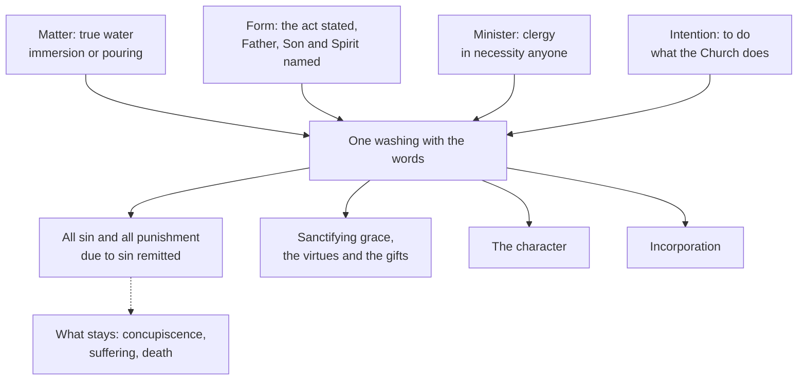

# Sacraments & Liturgy · Lesson 2.1: Baptism: the rite and its effects

> ⏱ ~15 min · Module 2: Christian initiation · Builds on: [1.2 Matter, form, minister, intention](01-02-matter-form-minister-intention.md), [1.3 Ex opere operato, character, and fruitfulness](01-03-ex-opere-operato-character-and-fruitfulness.md) · Unlocks: [2.2 Necessity, infants, and baptism of desire and blood](02-02-necessity-infants-and-baptism-of-desire-and-blood.md), [2.3 Confirmation](02-03-confirmation.md)

## Why this matters

Baptism is Module 1's cleanest test case: the one sacrament anyone can give, the one whose effects the Church states most fully, and the door to the other six (Florence: *vitae spiritualis ianua*, the gateway of the spiritual life). This lesson states its matter, form, minister and effects: what baptism takes away, and what it leaves.

## The idea

**Six texts, briefly.** No `new-testament` lesson exegetes them; here is the minimum. Matthew 28:19 gives the command and the formula, "baptizing them in the name of the Father and of the Son and of the Holy Ghost" (DR): one name for three ([`trinity-and-god` 6.2](../../trinity-and-god/lessons/06-02-the-trinity-in-the-economy-liturgy-and-prayer.md)). John 3:5 makes water and the Spirit the means of a new birth needed to "enter into the kingdom of God". In Romans 6:3–4 we are "buried together with him by baptism into death" to "walk in newness of life": immersion is the picture. Titus 3:5 calls it *loutron palingenesias*, "a bath of rebirth" (lesson's gloss; DR "the laver of regeneration"), owed to God's mercy, not our works. Acts 2:38 joins repentance, baptism "for the remission of your sins" and the Spirit. 1 Peter 3:21 says baptism "now saveth you", not as removing dirt but as the *eperōtēma* of a good conscience toward God, "appeal" or "pledge" (lesson's gloss; DR "examination"). Together: a washing in the triune name that forgives, gives the Spirit, joins one to Christ's death and rising, and saves by God's act.

**The earliest practice** is read in `patristics`. The Didache (ch. 7) prefers running water, allows other water, and failing both allows pouring three times on the head ([`patristics` 1.2](../../patristics/lessons/01-02-first-clement-and-the-didache.md), Ex 1). Justin's *First Apology* 61 puts instruction, fasting and prayer before a washing in the threefold name ([`patristics` 1.4](../../patristics/lessons/01-04-justin-martyr.md)). Basil lists blessing the font and triple immersion among unwritten traditions ([`patristics` 3.2](../../patristics/lessons/03-02-basil-the-great.md)). From the start the words were fixed; the mode was ranked, not required.

## Source

Tertullian, *On Baptism* 17, "Of the Power of Conferring Baptism" (about 200; S. Thelwall's translation, ANF vol. 3):

> Of giving it, the chief priest (who is the bishop) has the right: in the next place, the presbyters and deacons, yet not without the bishop's authority, on account of the honour of the Church, which being preserved, peace is preserved. Beside these, even laymen have the right; for what is equally received can be equally given. … Let it suffice assuredly, in cases of necessity, to avail yourself (of that rule) … for then the stedfast courage of the succourer, when the situation of the endangered one is urgent, is exceptionally admissible.

Read the shape of the act: two questions, kept apart. **Who can baptize?** Any of the baptized, because what was received equally can be given equally. **Who may?** The bishop by right, presbyters and deacons under him, laymen when necessity presses, for the Church's honour and peace. That is the later line between validity and liceity ([1.2](01-02-matter-form-minister-intention.md)), drawn around 200. Two limits. The chapter goes on to deny women the right, citing the presbyter deposed for forging the *Acts of Paul*; the later Church did not follow him. And his ground, that the giver has himself received, is narrower than the later Church's, which extends the power to the unbaptized.

## The doctrine

1. **Matter: true and natural water.** Trent anathematizes whoever denies that "true and natural water" is necessary and makes John 3:5's water a metaphor (Session VII, *On Baptism*, can. 2). Cold or warm is indifferent (Florence); immersion or pouring both serve (can. 854), triple immersion being the most expressive (CCC 1239). *In words:* a real washing with real water; the rest is rite.

2. **[Form](../reference.md#form-of-baptism): the act stated, the Trinity named.** The Latin form is *Ego te baptizo in nomine Patris et Filii et Spiritus Sancti*. The Byzantine form is passive: "The servant of God, N., is baptized, in the name of the Father, Amen. And of the Son, Amen. And of the Holy Spirit, Amen" (Hapgood's *Service Book*, 1906). Florence's [Decree for the Armenians](../reference.md#decree-for-the-armenians) (bull *Exsultate Deo*, 22 November 1439) accepts the passive form and says why (lesson's translation):

   > since the principal cause from which baptism has its power is the Holy Trinity, and the instrumental cause is the minister who outwardly confers the sacrament, if the act exercised by the minister himself is expressed, with the invocation of the Holy Trinity, the sacrament is effected.

   *In words:* a valid form says this washing is being done and names Father, Son and Spirit; the Latin and Greek wordings both do so.

3. **[Minister](../reference.md#minister-of-baptism): ordinarily the clergy, in necessity anyone.** The ordinary ministers are bishop, presbyter and deacon (can. 861 §1). Lateran IV's profession *Firmiter* (1215) confesses that baptism duly conferred "by anyone" (*a quocunque*) in the Church's form profits infants and adults for salvation. Florence spells out "anyone" (lesson's translation): "In necessity not only a priest or deacon but also a layman or a woman, indeed even a pagan and a heretic, can baptize, provided he keeps the Church's form and intends to do what the Church does." CCC 1256 repeats it. Can. 861 §2 makes such a baptism licit in necessity, and allows a catechist designated by the local ordinary when the clergy are absent or impeded. *In words:* who *can* is anyone with the form and the intention; who *may* is a question of order. This is [1.1](01-01-what-a-sacrament-is.md)'s principle at its plainest: Christ baptizes, so the minister supplies only the act and the intention. Trent keeps it an exception: not all Christians have power over all the sacraments (Session VII, can. 10).

4. **[Effects](../reference.md#effects-of-baptism).** (a) *Remission.* The guilt of original sin is remitted, and "the whole of that which has the true and proper nature of sin" is taken away, not "only rased, or not imputed" (Trent, Session V, can. 5). With it go all personal sins and all punishment due to them, so no satisfaction is imposed (Florence): "a full and entire remission of all sins" (Session XIV, ch. 2). (b) *Grace.* Justifying grace inheres in the soul (Session VI, can. 11), with faith, hope and charity "infused at once" (Session VI, ch. 7, where baptism is justification's instrumental cause); CCC 1266 adds the moral virtues and the gifts. (c) *The [character](../reference.md#sacramental-character):* an indelible spiritual sign, so baptism is never repeated (Session VII, can. 9; can. 845 §1; [1.3](01-03-ex-opere-operato-character-and-fruitfulness.md)). (d) *Incorporation* into Christ and the Church (LG 11; can. 204 §1). *Unitatis Redintegratio* 22 calls baptism a sacramental bond of unity among all the validly reborn, and only a beginning, ordered to full faith and eucharistic communion ([`ecclesiology-and-mariology` 2.1](../../ecclesiology-and-mariology/lessons/02-01-one.md)). *In words:* baptism removes all that is sin, gives the life sin blocked, marks the person for good, and makes him a member.

5. **What stays.** Concupiscence, the "incentive (to sin)", remains for the struggle. Trent declares the Church has never understood it as "truly and properly sin" in the reborn; it is called sin "because it is of sin, and inclines to sin" (Session V, can. 5). Suffering and death remain too (CCC 1264). Original sin itself is [`creation-grace-last-things`](../../creation-grace-last-things/syllabus.md) 3.3's. *In words:* baptism takes away guilt and debt, not mortality or the pull toward sin.

**The [catechumenate](../reference.md#catechumenate).** Alcuin's plea of about 796 that preaching come before baptism ([`church-history` 3.1](../../church-history/lessons/03-01-gregory-the-great-and-the-conversion-of-the-peoples.md), Ex 2) asked for what the early catechumenate gave adults; infant baptism had shrunk it into rites performed over infants. *Sacrosanctum Concilium* 64 ordered it restored in distinct steps; the *Ordo initiationis christianae adultorum* (1972) did so. Adults now receive baptism, confirmation and the Eucharist together (can. 866), usually at the Easter Vigil, which can. 856 recommends for any baptism where possible, Sunday being the ordinary day.

**Mark the levels** ([`fundamental-theology` 4.4](../../fundamental-theology/lessons/04-04-the-ladder-of-doctrinal-authority.md); [levels](../reference.md#levels-of-authority)). **Rung 1:** true and natural water is necessary (VII, *On Baptism*, can. 2); heretics' baptism with the Trinitarian form and the Church's intention is true baptism (can. 4); baptism duly given by anyone in the Church's form avails (*Firmiter*); original guilt is remitted and concupiscence is not truly sin in the reborn (V, can. 5); justifying grace inheres (VI, can. 11); the character bars repetition (VII, can. 9). **At least rung 3:** that "anyone" includes the unbaptized (Florence, CCC 1256); that the form must state the act and name the three persons, and that the passive form is valid (Florence, CCC 1240), for no canon fixes the wording; the remission of all personal sin and punishment (Florence; XIV, ch. 2); the infused virtues (VI, ch. 7); incorporation and the bond of unity (LG 11, UR 22). The Decree for the Armenians is an instruction, not a definition ([1.4](01-04-why-seven.md)); here it carries the weight of what it restates. Levels move: Vienne (1312) chose only "as more probable" (*tanquam probabiliorem*) the opinion that infants receive grace and virtues, not remission alone; the Roman Catechism and CCC 1266 now teach it unqualified, **at least rung 3**. The Code is **law, no rung**; Tertullian and Aquinas have **no magisterial level**.

## From the act to the effects

The dashed line is what baptism leaves (Session V, can. 5; CCC 1264).

## Worked examples

**Ex 1 (clean): the Easter Vigil.** Invented: Imelda, 34, a catechumen for a year, is immersed three times in the font at the Vigil while the pastor says the Latin-rite form in English. *Valid:* true water, the form, an ordinary minister intending what the Church does, an adult who has asked (can. 865 §1). *Licit:* the approved rite and the proper minister. *Fruitful:* she comes in faith and sorrow for sin, placing no obstacle ([1.3](01-03-ex-opere-operato-character-and-fruitfulness.md)). Every sin of thirty-four years is forgiven, grave ones included, without confession and with no penance imposed; confession is for sins after baptism (Session XIV, ch. 2). She is marked and incorporated, then confirmed and given communion that night (can. 866). She keeps her temptations and her mortality.

**Ex 2 (strain): "in the name of Jesus Christ."** Acts 2:38 speaks of baptism in Jesus' name. Was that the formula, and would it be valid now? The texts pull apart. Nicholas I, answering the Bulgarians in 866, ruled that those baptized "in the name of the Holy Trinity or only in the name of Christ, as we read in the Acts of the Apostles" are not to be rebaptized (lesson's translation). Pelagius II, as Aquinas quotes him, ordered such people rebaptized. Aquinas (ST III q.66 a.6) holds it "not enough to imply or to believe in the Trinity" unless the Trinity is "expressed in sensible words", and explains the apostles' practice as a special dispensation. Nicholas's reply defined nothing: it is Newman's example of a papal statement made *obiter* ([`ecclesiology-and-mariology` 4.4](../../ecclesiology-and-mariology/lessons/04-04-infallibility-in-exercise-and-the-ordinary-universal-magisterium.md)). The Church now requires the threefold invocation (Florence; CCC 1240). The strain: what the apostles said is a historical question the teaching does not settle, and Aquinas's dispensation is a school's explanation. The Didache, which prescribes the threefold name in ch. 7, calls the baptized in ch. 9 those baptized "into the name of the Lord", so the phrase may say whose baptism it was rather than quote its words. Present-day "Jesus' name" baptisms are [2.2](02-02-necessity-infants-and-baptism-of-desire-and-blood.md)'s question.

## Watch out

- **You might think only the clergy can baptize validly.** Validity needs water, the form and the intention; the clergy rule is liceity, and in necessity anyone baptizes licitly (can. 861 §2).
- **You might think concupiscence is original sin left over.** Trent defines the opposite: in the reborn it is not truly and properly sin (Session V, can. 5, rung 1).
- **You might think Florence defined baptism's matter and form.** Overstated: the Decree for the Armenians is an instruction; water's necessity is defined at Trent (VII, *On Baptism*, can. 2). Calling water "a changeable discipline" understates, denying a rung-1 canon.

## One-liner

> Baptism washes with true water in the named Trinity; anyone can give it in need, because Christ gives it; it takes away all that is sin and leaves the struggle and the dying.

## Problems

**P1 (🟢)** *(Exegetical)* An **invented** baptism-preparation leaflet from the parish of St Anselm, Halsey Ford, written for this problem:

> (1) "Only a priest or deacon can baptize. If a grandparent has already baptized your child at home, we will baptize the child properly in church."
>
> (2) "Baptism washes away original sin, though not completely: the concupiscence it leaves behind is still sin in us, just a lesser kind."
>
> (3) "Pouring is a modern shortcut. The early Church baptized only by immersion, so immersion is the only proper form of baptism."

For each item, name the error, give the correction, and give the level wherever a level is involved. Two sentences per item.

**P2 (🟡)** *(Exegetical)* **Invented**, written for this problem. Tobenna, a catechumen due to be baptized at Easter, is crushed by a rockfall on a winter hike, hours from help. Conscious, he says he believes and asks to be baptized. His companion Zdenka, a Catholic, has no drinking water left, only a flask of sweet tea. She melts snow in a pan on her stove, pours it three times over his head and says, "Tobenna, I baptize you in the name of the Father, and of the Son, and of the Holy Spirit." He survives.

(a) Give three verdicts, valid, licit and fruitful, naming the element that decides each. Two sentences per verdict.

(b) Why was Zdenka right to melt the snow rather than use the tea? Two sentences.

(c) Back home, Tobenna asks whether he must confess the sins of his whole life before his first communion. Answer in two sentences, with the text.

**P3 (🔴)** *(Exegetical)* Aquinas, ST III q.69 a.3, answering whether baptism should take away the penalties of sin that belong to this life (English Dominican Province translation):

> Baptism has the power to take away the penalties of the present life yet it does not take them away during the present life, but by its power they will be taken away from the just in the resurrection … First, because, by Baptism, man is incorporated in Christ, and is made His member … Wherefore a Christian receives grace in Baptism, as to his soul; but he retains a passible body, so that he may suffer for Christ therein … Secondly, this is suitable for our spiritual training … Thirdly, this was suitable, lest men might seek to be baptized for the sake of impassibility in the present life, and not for the sake of the glory of life eternal.

(a) Florence says baptism remits all punishment due to sin. State the difficulty this article answers, and Aquinas's answer with his three reasons. Two sentences.

(b) Sort these four claims into "taught, with its level" or "Aquinas's explanation, no magisterial level": (i) baptism remits the guilt of original sin; (ii) concupiscence remains in the baptized and is not truly and properly sin; (iii) bodily penalties remain so that the baptized may be configured to Christ's passible body; (iv) the penalties of this life are removed by baptism's power, but only at the resurrection. One line each.

Solutions

**P1** *(Exegetical)*

**Must hit, strict:**

- **(1) Two errors.** *Who can:* anyone using water and the Church's form with the intention of doing what the Church does baptizes validly, layman, woman, even the unbaptized (*Firmiter*, rung 1 for "anyone" in the Church's form; Florence and CCC 1256, at least rung 3, for the unbaptized). Without necessity the grandparent acted illicitly (can. 861 §2 allows lay baptism only in necessity or by designation), but illicit is not invalid. *"Properly":* a valid baptism imprints the character and cannot be repeated (Trent VII, can. 9, rung 1; can. 845 §1). The parish investigates; only a doubt that survives serious investigation calls for conditional baptism (can. 869 §1).
- **(2)** Trent, Session V, can. 5 (rung 1): the guilt of original sin is remitted and the whole of what is truly and properly sin is taken away, not merely covered. Concupiscence remains but is not truly and properly sin in the reborn; it is called sin because it comes from sin and inclines to it.
- **(3)** Pouring is ancient: the Didache allows it ([`patristics` 1.2](../../patristics/lessons/01-02-first-clement-and-the-didache.md)), and CCC 1239 says it has been used "from ancient times". Can. 854 allows immersion or pouring (law, no rung). The leaflet also misuses "form": the form is the words; immersion and pouring are two modes of applying the matter.

**Wrong turns:** fixing only the clergy claim in (1) and missing the rebaptism error, which is the graver one; calling the grandparent's baptism lawful because laypeople may baptize (only in necessity), or invalid because it was unlawful; saying in (2) that concupiscence is "venial sin"; calling immersion invalid or pouring a mere tolerance in (3); assigning a rung to can. 854.

**Model answer:** (1) Anyone who uses water and the Church's form with the intention of doing what the Church does baptizes validly (Lateran IV's *Firmiter*, rung 1; the unbaptized included on Florence and CCC 1256, at least rung 3); outside necessity a lay baptism is illicit (can. 861 §2) but still valid. A valid baptism cannot be repeated, because it imprints the character (Trent VII, can. 9, rung 1), so the parish investigates and baptizes conditionally only if real doubt survives (can. 869 §1). (2) Trent defines that baptism takes away everything that is truly and properly sin (Session V, can. 5, rung 1). The concupiscence that remains is called sin only because it comes from sin and inclines to it. (3) Pouring is attested from the Didache on, and can. 854 allows immersion or pouring (law, no rung). Immersion is the most expressive sign (CCC 1239), but it is a mode of applying the matter, not the form, which is the words.

---

**P2** *(Exegetical)*

**Accept for (b):** any answer that calls the tea at best doubtful matter and says certain matter must be used when it is available.

**Must hit, strict (a):**

- **Valid.** Snow-melt is true and natural water (Trent VII, *On Baptism*, can. 2), the Latin form is used, and anyone with the intention can baptize (*Firmiter*; Florence; CCC 1256). The recipient is an adult in danger of death who believes and has asked (can. 865 §2). Deciding elements: matter and form, with a minister who intends what the Church does.
- **Licit.** Necessity decides it: in necessity any person with the right intention baptizes licitly (can. 861 §2), only what validity requires need be done (can. 850), and unblessed water is allowed (can. 853).
- **Fruitful.** The recipient's disposition decides it. He asks in faith and, on the facts, places no obstacle, so baptism gives its full effect; whether he does is known to God, not to Zdenka ([1.3](01-03-ex-opere-operato-character-and-fruitfulness.md)).

**Must hit, strict (b):** Trent requires true and natural water, and tea is water with an extract dissolved in it, so whether it is still water in kind is doubtful (Aquinas sets the test at ST III q.66 a.4). With certain matter at hand, risking a doubtful sacrament is wrong. Had tea been all she had, a later conditional baptism would follow (can. 869 §1).

**Must hit, strict (c):** No. Baptism remits all sins committed before it and all punishment due to them, so no satisfaction is imposed (Florence; Trent, Session XIV, ch. 2, "a full and entire remission of all sins"). Confession is for sins after baptism.

**Wrong turns:** calling the baptism illicit because a layperson used unblessed water outside a church; collapsing the three verdicts into "it counts"; making fruitfulness depend on Zdenka's holiness; saying Tobenna must be baptized again at Easter; requiring confession of pre-baptismal sins.

**Model answer:** (a) Valid: melted snow is true and natural water, the form names the act and the three persons, and any person intending what the Church does can baptize; Tobenna, in danger of death, believed and asked (can. 865 §2). Licit: necessity makes a lay baptism lawful (can. 861 §2), and in urgent necessity only what validity requires is needed, unblessed water included (cann. 850, 853). Fruitful: that turns on Tobenna's disposition, and asking in faith with no obstacle, he receives the effects. (b) Tea is at best doubtful matter, since it is not plainly true and natural water, and certain matter was at hand. Using doubtful matter when certain matter is available risks the sacrament for nothing. (c) No: baptism remitted every sin before it and all punishment due to them (Florence; Trent, Session XIV, ch. 2). Confession is for sins after baptism.

---

**P3** *(Exegetical)*

**Must hit, strict (a):** the difficulty is that if baptism remits all punishment due to sin, death, suffering and other penalties of this life should end with it. Aquinas: baptism has the *power* to remove them but uses it only at the resurrection, because (1) the member is configured to the Head, who had grace and a passible body before glory; (2) the struggle trains us spiritually; (3) otherwise people would seek baptism for impassibility in this life rather than for eternal glory.

**Must hit, strict (b):**

- (i) Taught: **rung 1** (Trent, Session V, can. 5).
- (ii) Taught: **rung 1** (Session V, can. 5).
- (iii) Aquinas's explanation, **no magisterial level**. That the penalties *remain* is fact and teaching (CCC 1264); *why* is his first reason.
- (iv) Aquinas's explanation, **no magisterial level**. The resurrection of the body is of faith, but that baptism's own power removes these penalties then is his account.

**Wrong turns:** giving (iii) or (iv) a level because they appear in the *Summa*; calling (ii) "Aquinas's view" when Trent defines it; answering (a) as if Aquinas denied that baptism remits all punishment, when he relocates its effect in time.

**Model answer:** (a) If baptism remits all punishment due to sin, the baptized should no longer suffer or die. Aquinas answers that baptism has the power to remove these penalties but exercises it at the resurrection, so that members are configured to a Head who bore grace in a passible body, so that the struggle trains us, and so that no one seeks baptism for impassibility instead of glory. (b) (i) Taught, rung 1, Session V, can. 5. (ii) Taught, rung 1, Session V, can. 5. (iii) Aquinas's explanation, no level. (iv) Aquinas's explanation, no level, though the resurrection itself is of faith.

## Flashback

**From Lesson [1.3](01-03-ex-opere-operato-character-and-fruitfulness.md) (*Ex opere operato*, character, and fruitfulness):** *(Exegetical.)* Apply to a new case. **Invented**, written for this problem. Fr Quillan Penhallow knows he is in grave sin: last week he sent anonymous letters falsely accusing a parishioner of fraud, and she lost her job. He means to let the lie stand and has not confessed, though a neighbouring priest hears confessions every morning at seven. On Tuesday he celebrates Mass with the approved Missal, wheat bread and grape wine, intending to do what the Church does, and receives Communion himself. Isaura Rowntree, 71, who went to confession on Saturday, receives devoutly.

(a) Give three verdicts on the Mass, valid, licit, and fruitful for Isaura, naming the element that decides each. One sentence per verdict.

(b) What did Fr Penhallow's own Communion give him? In March the letters are traced to him, and he repents, confesses and puts things right: does that Tuesday Communion now bear its fruit? Give the level of your answer. Two sentences.

Solution

**Accept:** for "licit", an answer that calls the rite itself lawful and Fr Penhallow's act of celebrating unlawful passes, provided it places the fault in his act, cites can. 916, and keeps it apart from validity and fruit. For (b), "no reviviscence is taught for the Eucharist" and "the question is generally said not to arise" both pass.

**Must hit, strict (a):**

- **Valid: yes.** Matter, form and a priest intending what the Church does decide it. A minister in mortal sin who observes the essentials still effects the sacrament (Trent, Session VII, can. 12, **rung 1**): the minister is the pipe, not the spring.
- **Licit: no.** The law binding the minister decides it. Can. 916 forbids anyone conscious of grave sin to celebrate Mass without confessing first unless there is a grave reason *and* no opportunity to confess; here a confessor was at hand and no grave reason pressed (**law, no rung**).
- **Fruitful for Isaura: yes**, so far as anyone can see. Her disposition decides it, not the celebrant's holiness: the sacrament gives grace *ex opere operato* to those who place no obstacle (VII cann. 6, 8, **rung 1**).

**Must hit, strict (b):**

- He received Christ validly but without fruit: conscious, unrepented grave sin is an obstacle (ST III q.79 a.3), and receiving so was a further grave sin.
- His repentance brings forgiveness through penance, but that Communion does not revive. The Eucharist imprints no character, so nothing of it remains in him to revive; reviviscence is common teaching only for baptism (**rung 4**), its extension beyond baptism is **rung 5**, and for the Eucharist the question is generally said not to arise.

**Wrong turns:** calling the Mass invalid, or Isaura's Communion fruitless or "less fruitful", because of the priest's sin, which is the Donatist error condemned at rung 1; calling the celebration licit because the rubrics were kept, or invalid because it was illicit; saying in (b) that his Communion revives by analogy with baptism, which overstates; saying he received only bread; giving can. 916 a doctrinal rung.

**Model answer:** (a) Valid, because matter, form and a priest intending what the Church does were present, and a minister in mortal sin still effects the sacrament (Trent VII can. 12, rung 1). Illicit, because can. 916 forbids one conscious of grave sin to celebrate without confessing first, and he had a confessor at hand and no grave reason. Fruitful for Isaura, because the fruit turns on her disposition, not his holiness: the sacrament gives grace *ex opere operato* to those who place no obstacle. (b) He received Christ validly but without fruit, since his unrepented grave sin was an obstacle, and the reception was itself a further grave sin. His confession forgives him, but that Communion does not revive: the Eucharist leaves no character in him, reviviscence is common teaching (rung 4) only for baptism, and beyond baptism it is rung 5 and generally said not to arise for the Eucharist.

## Connections

- **Backward:** [1.2](01-02-matter-form-minister-intention.md) supplied matter, form, minister and intention, and the line between valid and licit that Tertullian already draws. [1.3](01-03-ex-opere-operato-character-and-fruitfulness.md) supplied the character and fruitfulness. The practice texts are [`patristics` 1.2](../../patristics/lessons/01-02-first-clement-and-the-didache.md), [1.4](../../patristics/lessons/01-04-justin-martyr.md) and [3.2](../../patristics/lessons/03-02-basil-the-great.md), and Augustine's argument for original sin from the baptism and exorcism of infants is [`patristics` 4.5](../../patristics/lessons/04-05-augustine-against-the-pelagians.md).
- **Forward:** [2.2](02-02-necessity-infants-and-baptism-of-desire-and-blood.md) asks in what sense baptism is necessary, takes up infants, desire and blood, and judges baptisms given in other communities. [2.3](02-03-confirmation.md) treats the sacrament the West split off from this rite. Penance, which the Fathers, as Trent reports, called "a laborious kind of baptism" (Session XIV, ch. 2), is [4.1](04-01-penance-the-sacrament-and-its-history.md).
- **Sideways:** Florence's principal and instrumental causes are the grammar [`christology` 3.4](../../christology/lessons/03-04-the-grace-of-the-head.md) uses for Christ's humanity and [`fundamental-theology` 3.1](../../fundamental-theology/lessons/03-01-inspiration.md) uses for inspiration. Alcuin's plea for preaching before baptism is [`church-history` 3.1](../../church-history/lessons/03-01-gregory-the-great-and-the-conversion-of-the-peoples.md); the tail of Tertullian's chapter is [`new-testament` 6.1](../../new-testament/lessons/06-01-the-disputed-pauline-letters-and-the-pastorals.md)'s evidence on pseudonymity.
