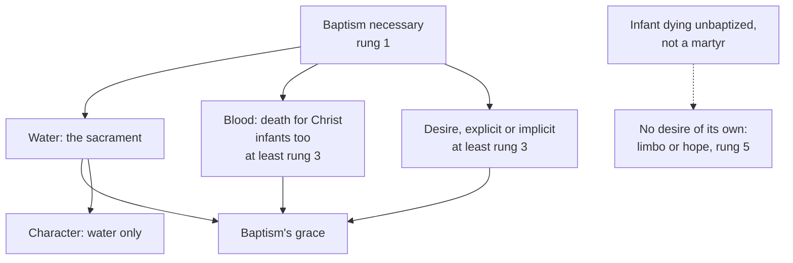

# Sacraments & Liturgy · Lesson 2.2: Necessity, infants, and baptism of desire and blood

> ⏱ ~15 min · Module 2: Christian initiation · Builds on: [2.1](02-01-baptism-the-rite-and-its-effects.md), [1.3](01-03-ex-opere-operato-character-and-fruitfulness.md), [`ecclesiology-and-mariology` 5.1](../../ecclesiology-and-mariology/lessons/05-01-outside-the-church-there-is-no-salvation.md) · Unlocks: [2.3 Confirmation](02-03-confirmation.md), [`creation-grace-last-things` 7.4](../../creation-grace-last-things/lessons/07-04-limbo.md)

## Why this matters

"Unless a man be born again of water and the Holy Ghost, he cannot enter into the kingdom of God" (John 3:5, DR). Read as a census, it damns every unbaptized martyr and infant; read as exaggeration, it makes baptism optional. The Church does neither. This lesson states how baptism is necessary, why infants receive it, and what blood and desire supply, and settles a question [`ecclesiology-and-mariology` 5.1](../../ecclesiology-and-mariology/lessons/05-01-outside-the-church-there-is-no-salvation.md) left here: does Trent's "or the desire thereof" define anything?

## The idea

Two questions get run together: *is baptism necessary?* (defined: yes) and *is everyone who dies unbaptized lost?* (the tradition says not). Ask what kind of necessity it is. The commanded is necessary by **precept**, and ignorance or impossibility excuses. What the end cannot be reached without is necessary as a **means**: no one crosses without the bridge, whatever he knows about bridges. Baptism is a means ([necessity of means](../reference.md#necessity-of-means-and-of-precept)), and commanded to adults besides. But it is a means by Christ's institution, not by nature, so God, who bound salvation to baptism, is not himself bound by his sacraments (CCC 1257).

Hence three classical cases: **[the infant](../reference.md#infant-baptism)**, baptized in the Church's faith; **the martyr**, killed for Christ before the font ([baptism of blood](../reference.md#baptism-of-blood)); and **the one who desires** baptism and dies first, or would desire it if he knew of it ([baptism of desire](../reference.md#baptism-of-desire)). Blood and desire give baptism's grace without its rite or character. Between the cases falls the infant who dies unbaptized, not a martyr, unable to desire.

## In their own words

The objection to baptizing infants is not the magisterial Reformers' (Luther, Zwingli and Calvin kept the practice) but the Anabaptists' and Baptists'. The Schleitheim articles of 24 February 1527 ([`church-history` 6.2](../../church-history/lessons/06-02-reformations-beyond-wittenberg.md)) give baptism to those who have learned repentance and amendment of life, believe Christ has taken away their sins, and ask for it themselves, and exclude infant baptism outright. The Baptist confession printed in London in 1677 and reissued in 1689 calls baptism a sign of the believer's fellowship with Christ, then says (ch. 29 §2, in Schaff, *Creeds of Christendom* vol. 3):

> Those who do actually profess repentance towards God, faith in and obedience to our Lord Jesus, are the only proper subjects of this ordinance.

The argument, in its defenders' order. In the New Testament baptism follows believing: "They therefore that received his word were baptized" (Acts 2:41; Mark 16:16). It is the believer's own confession, which no one can make for another. No text records an infant's baptism; the jailer's household heard the word first (Acts 16:32–33). Of the new covenant God says "all shall know me" (Jeremiah 31:34), so its sign belongs to those who know him.

## The doctrine

1. **Baptism is necessary for salvation.** Trent anathematizes calling baptism "free, that is, not necessary unto salvation" (Session VII, *On Baptism*, can. 5, 1547), and holds John 3:5's "water" to true water (can. 2). The Greek has one birth: one preposition governs both nouns, *ex hydatos kai pneumatos*, "out of water and Spirit" (lesson's gloss). *In words:* the font is the one certain door, never optional.

2. **Infants are to be baptized, truly for the remission of sins, in the faith of the Church.** Session V (1546), can. 4, takes over almost verbatim canon 2 of Carthage (418): infants, even of baptized parents, are baptized truly to remit what they contract from Adam. Session VII anathematizes saying they had better go unbaptized than be baptized "in the faith alone of the Church" (*On Baptism*, can. 13). Whose faith? Augustine's, adopted by Aquinas (ST III q.68 a.9 ad 2): the child is offered by "the whole company of the saints and the faithful" (Letter 98). *In words:* the condition is the Church's faith, and the infant is received into it.

**What the evidence shows.** The household baptisms (Acts 16:15, 33; 1 Cor 1:16) neither name nor exclude infants. Irenaeus (c. 180) counts infants among those "born again to God" (*Against Heresies* II.22.4), which may mean baptism. Around 200 Tertullian urges *delaying* little children's baptism (*On Baptism* 18), so the practice existed. In the early 250s Cyprian's council disputed only whether to wait for the eighth day (P3). Trent's "tradition of the apostles" (V, can. 4) is the Church's reading of her tradition, not a first-century text; CCC 1252 claims explicit testimony from the second century on.

3. **Martyrdom supplies.** Tertullian already calls blood a second baptism that stands in for the font (*On Baptism* 16). Aquinas ranks it highest: it imitates Christ's act and contains charity, without which shed blood is no baptism (ST III q.66 a.12 and ad 2). The liturgy venerates the unbaptized Holy Innocents as martyrs (ITC 2007, §5). *In words:* dying for Christ conforms one to the death the font signifies.

4. **Desire supplies, explicit and implicit.** Reloaded from [E&M 5.1](../../ecclesiology-and-mariology/lessons/05-01-outside-the-church-there-is-no-salvation.md): desire as the outcome of faith working by charity (ST III q.68 a.2, close-read in [E&M 5.3](../../ecclesiology-and-mariology/lessons/05-03-ecumenism-as-doctrine.md)); catechumens joined by explicit intention (LG 14); implicit desire, informed by faith and perfect charity, in the invincibly ignorant (the 1949 letter; [`apologetics-foundations` 8.2](../../apologetics-foundations/lessons/08-02-salvation-outside-the-visible-church.md)). *In words:* where the font is impossible, the will that would go to it, formed by charity, receives what it gives.

**Trent on desire, and its level.**

> And this translation, since the promulgation of the Gospel, cannot be effected, without the laver of regeneration, or the desire thereof. (Session VI, ch. 4)

> If any one saith, that the sacraments of the New Law are not necessary unto salvation, but superfluous; and that, without them, or without the desire thereof, men obtain of God, through faith alone, the grace of justification … (Session VII, *On the Sacraments in General*, can. 4)

The chapter states a *necessary* condition: no justification without the laver or its desire (*aut eius voto*). Its "or" makes desire the laver's alternative, but says neither that desire suffices nor what it must contain. It is a chapter, and Trent's chapters expound while its canons define ([`fundamental-theology` 4.2](../../fundamental-theology/lessons/04-02-infallibility-and-its-conditions.md)), though Session VI's are weighty: the council requires them to be received faithfully and firmly. The canon puts desire *inside* the condemned proposition: the anathema falls on "superfluous" and "faith alone", and one who denied that desire ever suffices would escape it. **Verdict:** Trent presupposes and teaches that desire can stand in for the laver, and does not define it. The level stays **at least rung 3** (LG 14; CCC 1258–1259), Trent's chapter its weightiest witness: **not rung 1**. The Roman Catechism (1566) read Trent so, crediting an adult kept from the font with his "intention and determination to receive Baptism". No act has said whether this constant teaching is definitive.

5. **Baptism given in other communities is true baptism.** Trent anathematizes denying that baptism given even by heretics, in the Trinitarian form and intending what the Church does, is true baptism (VII, *On Baptism*, can. 4). It is not repeated, even conditionally, without serious reason to doubt matter, form or intention ([conditional baptism](../reference.md#conditional-baptism); can. 869 §2), and a minister's faulty faith about baptism never of itself invalidates (Ecumenical Directory, 1993, §95b). The limit case: on 5 June 2001 the CDF, with papal approval, answered "Negative" on baptism in the Church of Jesus Christ of Latter-day Saints. Luis Ladaria's signed commentary (*L'Osservatore Romano*, 1 August 2001) gave the reasons: water and words are right, but for that body Father, Son and Spirit are three gods, so the words invoke no Trinity and the minister cannot intend what the Church does. *In words:* error about what baptism does leaves it valid; error about whose name it is given in does not.

6. **Infants who die unbaptized.** The Church entrusts them to God's mercy, as her funeral rites do, and hopes for their salvation (CCC 1261). [Limbo](../reference.md#limbo), the medieval theory that they lack the vision of God without suffering, was never defined. The ITC's *The Hope of Salvation for Infants Who Die Without Being Baptised* (2007) calls it a possible hypothesis and offers "reasons for prayerful hope, rather than grounds for sure knowledge" (§102): an advisory commission's study, published with Benedict XVI's approval (19 January 2007), not magisterium. The question is ceded to [`creation-grace-last-things` 7.4](../../creation-grace-last-things/lessons/07-04-limbo.md). *In words:* the Church knows one certain way, and about the rest she hopes.

**Said plainly.** Augustine taught that such infants are condemned, if to the mildest punishment; the schools softened this to limbo; until after Vatican II the Latin Church gave them no funeral rite and buried them in unconsecrated ground (ITC 2007, §§18, 22, 100).

| Defined or taught (with level) | A school's explanation (no magisterial level) |
|---|---|
| Baptism is necessary for salvation: **rung 1** | Necessity of means by divine institution: the manuals' classification |
| Infants baptized truly for remission of sins, in the Church's faith: **rung 1** | Augustine's "whole company"; Aquinas's child in the Church's womb (q.68 a.9 ad 1) |
| Blood and desire can give baptism's grace: **at least rung 3**; implicit desire: **rung 3, light** (1949) | Blood the most excellent baptism; desire as faith working by charity |
| Unbaptized infants entrusted to mercy, in hope (CCC 1261): nothing defined | Limbo; the ITC's grounds for hope; a supplied desire: **rung 5** |

**Mark the levels** ([the ladder](../../fundamental-theology/lessons/04-04-the-ladder-of-doctrinal-authority.md); [levels](../reference.md#levels-of-authority)). Beyond the table: baptism by heretics in the right form and intention is true baptism, **rung 1** (as E&M 5.2 graded it); Trent's desire clause is presupposed, **not rung 1**. Cann. 868 and 869 and the Ecumenical Directory are **law and norms, no rung**. The 2001 response binds practice, defining nothing; Ladaria's reasons, the ITC study and the Fathers as authors carry **no magisterial level**.

## What can stand in for the font

Three routes reach baptism's grace; only water gives the character.

## Worked examples

**Ex 1 (clean): the grandmother's request.** Invented: Saskia and Kenji Takeda, neither practising, ask Fr Dragan Petric to baptize their daughter Noa because her grandmother wants it, and say no one will raise her Catholic. He baptizes her anyway, with water and the Trinitarian formula. **Valid:** matter, form, an ordinary minister intending what the Church does. **Illicit:** founded hope of a Catholic upbringing is altogether lacking, so can. 868 §1 2° (as amended in 2016) required deferral and an explanation to the parents; the recipient's canonical condition decides ([valid, licit, fruitful](../reference.md#valid-licit-fruitful)). **Fruitful:** an infant places no obstacle ([1.3](01-03-ex-opere-operato-character-and-fruitfulness.md)), so original sin is remitted and grace and the character given. In danger of death it would have been licit regardless (§2).

**Ex 2 (strain): the baptism that was booked.** Invented: Ayo and Kemi Balogun's son, born very premature, dies within the hour, unbaptized. Water: impossible. Blood: he did not die for Christ. Desire: an adult's desire is his own act, and an infant has none (ITC §29). The strain: if the Church's faith carries an infant through the font (can. 13, **rung 1**), can her desire, or his parents', carry him without it? The ITC notes the Church has never ruled this out (§94); the older answer: the sacrament acts by Christ's power, but desire must be one's own. What can be said: a Church funeral by permission (can. 1183 §2), and hope (CCC 1261). Limbo and a supplied desire are **rung 5**, questions for [`creation-grace-last-things` 7.4](../../creation-grace-last-things/lessons/07-04-limbo.md).

## Watch out

- **You might think Trent defined baptism of desire.** It presupposes it in a chapter and drafts a canon around it. "Defined" overstates; "a modern loophole" ignores Trent and Aquinas. **At least rung 3.**
- **You might think limbo was dogma, or abolished in 2007.** It was never defined, and an ITC study is not magisterium: **rung 5** before and after.
- **You might think parents' unbelief invalidates an infant's baptism.** The faith required is the Church's (can. 13); the hope of upbringing touches liceity only.

## One-liner

> Baptism is the one certain door, and that is defined; blood and desire open it too; for infants who die without it, the Church hopes.

## Problems

**P1 (🟢)** *(Exegetical)* An **invented** parish website, written for this problem: the "Baptism FAQ" of the parish of the Holy Spirit, Harwell, says:

> (1) "Since 2007 the Church no longer teaches limbo: the Vatican officially abolished it."
>
> (2) "But because baptism is necessary, it is defined dogma that a baby who dies unbaptized cannot go to heaven."
>
> (3) "If neither parent practises, Father must refuse the baptism, and if he goes ahead anyway it doesn't count."

Correct each sentence, giving the level or the law involved. **Two sentences per item.**

**P2 (🟡)** *(Exegetical)* Three adults ask to be received at an **invented** parish's OCIA, written for this problem.

(a) Liesl Moraru was baptized as an infant in a Romanian Orthodox parish by triple immersion with "The servant of God, Liesl, is baptized, in the name of the Father, Amen. And of the Son, Amen. And of the Holy Spirit, Amen," and chrismated at once.

(b) Caspar Vinter was baptized at fifteen by immersion in a Baptist church "in the name of the Father, and of the Son, and of the Holy Spirit". His pastor taught that baptism is only a sign of a regeneration already given. He has a certificate.

(c) Brielle Ekdahl was baptized at eight in the Church of Jesus Christ of Latter-day Saints by immersion, with the words "Being commissioned by Jesus Christ, I baptize you in the name of the Father, and of the Son, and of the Holy Spirit" (the formula as Ladaria's commentary gives it).

For each, say whether the earlier baptism is recognized, or baptism is to be conferred conditionally or absolutely; name the element that decides it and the text that settles it. **Two sentences per case.**

**P3 (🔴)** *(Exegetical)* Cyprian and sixty-six bishops in council to Fidus, early 250s (*Ante-Nicene Fathers* vol. 5, Letter 58, §§2 and 5, tr. Robert Ernest Wallis):

> But in respect of the case of the infants, which you say ought not to be baptized within the second or third day after their birth, and that the law of ancient circumcision should be regarded, so that you think that one who is just born should not be baptized and sanctified within the eighth day, we all thought very differently in our council. For in this course which you thought was to be taken, no one agreed. … how much rather ought we to shrink from hindering an infant, who, being lately born, has not sinned, except in that, being born after the flesh according to Adam, he has contracted the contagion of the ancient death at its earliest birth, who approaches the more easily on this very account to the reception of the forgiveness of sins—that to him are remitted, not his own sins, but the sins of another.

(a) What did Fidus propose, and what do he and the council both take for granted? Name the words that show it.

(b) What reason does the council give for not delaying, and name two things this letter does **not** establish.

**Two sentences per part.**

Solutions

**P1** *(Exegetical)*

**Must hit, strict:**

- **(1)** The 2007 text is a study of the International Theological Commission, an advisory body: no magisterial act, so it abolished nothing. Limbo was never defined, and the study itself calls it a possible theological hypothesis while finding grounds for hope, not certainty: **rung 5** before and after.
- **(2)** The necessity of baptism is defined (**rung 1**, Trent VII, *On Baptism*, can. 5), but the fate of infants who die unbaptized has never been defined (**rung 5**). The Church entrusts them to God's mercy and allows hope (CCC 1261), since God bound salvation to baptism without binding himself.
- **(3)** If founded hope of a Catholic upbringing is altogether lacking, baptism is *deferred* under particular law with the parents told why, not refused (can. 868 §1 2°, as amended 2016: **law, no rung**). A baptism given anyway with water and the Trinitarian form by a minister intending what the Church does is valid though illicit, and cannot be repeated; the faith in which an infant is baptized is the Church's (VII, *On Baptism*, can. 13, **rung 1**).

**Wrong turns:** "correcting" (1) by saying limbo is defined, or that the ITC's hope carries papal authority; correcting (2) by saying the Church now teaches that all such infants are saved, which overstates the other way; in (3), calling the baptism invalid, or treating can. 868 as doctrine rather than law.

**Model answer:** (1) The 2007 document is an ITC study, which is advisory and not magisterial, so nothing was abolished. Limbo was never defined; it remains a possible theological hypothesis, rung 5, and the study offers grounds for hope, not certainty. (2) That baptism is necessary is defined at Trent, rung 1, but no text defines the fate of unbaptized infants, which is rung 5. The Church entrusts them to God's mercy and hopes (CCC 1261), since he is not bound by his sacraments. (3) Can. 868 says that where hope of a Catholic upbringing is altogether lacking, baptism is deferred and the parents told why; it is law, not doctrine. A baptism given anyway is valid but illicit, because the infant is baptized in the Church's faith (Trent VII, *On Baptism*, can. 13, rung 1).

---

**P2** *(Exegetical)*

**Must hit, strict:**

- **(a) Recognized; nothing is repeated.** Triple immersion is true matter, and the passive Eastern form invokes the Trinity, so matter and form are sound and there is no doubt to examine (Trent VII, *On Baptism*, can. 4, **rung 1**; the Ecumenical Directory, §99a, adds that Eastern baptism is beyond doubt).
- **(b) Recognized, not even conditionally.** Matter and form are right, and the minister's error about what baptism *does* is not a defect of form or intention: a minister's insufficient faith about baptism never of itself invalidates it (Directory §95b), and can. 869 §2 forbids conditional baptism without a serious reason to doubt.
- **(c) Conferred absolutely.** The CDF answered "Negative" on 5 June 2001, with John Paul II's approval, so there is no doubt left to resolve conditionally. The deciding elements are form and intention: in Ladaria's commentary the words, though verbally Trinitarian, invoke three gods and not the Trinity, so the minister cannot intend what the Church does.

**Wrong turns:** baptizing Caspar conditionally because his community denies baptismal regeneration, which confuses error about the sacrament's effects with a defect of form or intention; treating (c) as a doubtful case for conditional baptism (before 2001 practice presumed such baptisms valid; the response ended that); deciding (c) on matter, which is not in question; attributing Ladaria's reasons to the CDF, whose response gives none; giving the 2001 response or the Directory a doctrinal rung.

**Model answer:** (a) Liesl's baptism is recognized and nothing is repeated: triple immersion with the Eastern passive form is sound matter and form, and Trent defines that baptism given outside the Church with the Trinitarian form is true baptism (VII, *On Baptism*, can. 4). The Ecumenical Directory treats Eastern baptism as beyond doubt (§99a). (b) Caspar's baptism is recognized without even a conditional rite, because matter and form are right and a minister's faulty theology of baptism does not invalidate it (Directory §95b). Can. 869 §2 forbids conditional baptism without a serious reason to doubt, and there is none. (c) Brielle is baptized absolutely, because the CDF ruled LDS baptism invalid on 5 June 2001. The signed commentary places the defect in form and intention: the names do not invoke the Trinity, so the minister cannot intend what the Church does.

---

**P3** *(Exegetical)*

**Accept:** for (b), any two of the four "not established" items below.

**Must hit, strict (a):**

- Fidus proposed waiting until the eighth day, on the analogy of circumcision, rather than baptizing in the first days.
- Both sides take for granted that newborns are baptized; the dispute is over the timing. The words: "ought not to be baptized within the second or third day", "should not be baptized … within the eighth day", and "no one agreed" for the council's unanimity.

**Must hit, strict (b):**

- The reason: the infant has no sin of his own, but born of Adam "after the flesh" has "contracted the contagion of the ancient death". What is remitted is "not his own sins, but the sins of another", so he comes to forgiveness the more easily.
- Not established, any two: (i) apostolic origin, which the letter does not claim (Trent's "tradition of the apostles" is the council's own claim); (ii) the practice outside Africa; (iii) any magisterial level, since this is a regional council's letter, a witness on no rung; (iv) the later definitions on original sin, which this text anticipates but does not state in Trent's terms.

**Wrong turns:** quoting the ANF editor's "Argument" heading ("not establishing any new decree") as Cyprian's words; reading the letter as introducing infant baptism; reading "the sins of another" as the infant's personal guilt; giving the letter a rung.

**Model answer:** (a) Fidus wanted newborns to wait until the eighth day, as for circumcision, instead of being baptized in the first two or three days. Both he and the council assume that newborns are baptized ("ought not to be baptized within the second or third day"), and the unanimous "no one agreed" shows settled African practice. (b) The council's reason is that the infant, though sinless himself, has contracted from Adam "the contagion of the ancient death", so what is remitted is "the sins of another", and he comes to forgiveness the more easily. The letter does not establish that the practice was apostolic or that it held outside Africa, and as a regional council's letter it carries no magisterial rung.

## Flashback

**From Lesson [1.4](01-04-why-seven.md) (Why seven):** *(Exegetical.)* Close reading. The *Roman Catechism* (1566), Part II, "The Number of the Sacraments", in McHugh and Callan's translation (1923):

> The Sacraments of the Catholic Church are seven in number, as is proved from Scripture, from the tradition handed down to us from the Fathers, and from the authority of Councils. Why they are neither more nor less in number may be shown, at least with some probability, from the analogy that exists between the natural and the spiritual life. … seven things seem necessary to man: to be born, to grow, to be nurtured, to be cured when sick, when weak to be strengthened; …

The list goes on to government and offspring, and the Catechism then pairs the seven needs with baptism through matrimony.

(a) The passage backs the number in two ways. Say what each is offered for, which words mark the difference in strength, and what would be left standing if a reader showed the analogy forced (say, that "cured when sick" and "when weak to be strengthened" are one need). Two sentences.

(b) No one counted seven sacraments before the twelfth century. Does that make the appeal to "the tradition handed down to us from the Fathers" false? Say what the Fathers can and cannot supply, and where the closed list comes from. Two sentences.

Solution

**Must hit, strict (a):**

- **That there are seven** is backed by authority: it "is proved from Scripture, from the tradition … and from the authority of Councils".
- **Why neither more nor less** is backed only by an analogy of natural and spiritual life, which "may be shown, at least with some probability", with needs that "seem necessary". It is a fittingness argument, Aquinas's (ST III q.65 a.1): a school's explanation with no magisterial level, even when a catechism issued at Trent's direction prints it.
- A forced analogy costs one reason of fittingness and leaves the number standing, since the number rests on authority and was defined at Trent (Session VII, can. 1), not on the analogy.

**Must hit, strict (b):**

- **Not false as the passage frames it.** Scripture and the Fathers attest the rites, all seven in use long before 1150, but no Father counted them, and the passage does not say one did: it offers its three sources together.
- **The closed list** comes from the councils, taught at Florence and defined at Trent, as the Church's gradual recognition of the class, like her recognition of the canon of Scripture (CCC 1117).

**Wrong turns:** attaching "proved" to the analogy, when the passage itself keeps the two apart; giving the analogy doctrinal weight because this catechism, or Florence's Decree for the Armenians, repeats it; concluding that a forced analogy weakens the number; in (b), saying the Fathers counted seven, or the mirror error, calling the seven a medieval invention because the count is twelfth-century.

**Model answer:** (a) That there are seven is "proved" from authority, Scripture, the Fathers' tradition and the councils, while why there are neither more nor less "may be shown, at least with some probability" from an analogy whose needs only "seem" necessary. The analogy is Aquinas's fittingness argument and carries no magisterial weight, so showing it forced would cost a reason of fittingness and leave the number, which rests on authority and Trent's definition, untouched. (b) Not as the passage frames it: Scripture and the Fathers attest the rites, all long in use before 1150, though no Father counted them and the passage does not claim one did. The closed list comes from the councils, taught at Florence and defined at Trent, as the Church's gradual recognition of the class, like that of the canon (CCC 1117).

## Connections

- **Backward:** [2.1](02-01-baptism-the-rite-and-its-effects.md) gave baptism's matter, form, minister and effects; this lesson asks how necessary it is and who may receive it. [1.2](01-02-matter-form-minister-intention.md) set up the three verdicts and [1.3](01-03-ex-opere-operato-character-and-fruitfulness.md) the obstacle an infant cannot place. Desire, blood and the 1949 letter were read in [`ecclesiology-and-mariology` 5.1](../../ecclesiology-and-mariology/lessons/05-01-outside-the-church-there-is-no-salvation.md) and weighed in [`apologetics-foundations` 8.2](../../apologetics-foundations/lessons/08-02-salvation-outside-the-visible-church.md). Augustine's argument from infant baptism to original sin is [`patristics` 4.5](../../patristics/lessons/04-05-augustine-against-the-pelagians.md); chapters against canons is [`fundamental-theology` 4.2](../../fundamental-theology/lessons/04-02-infallibility-and-its-conditions.md).
- **Forward:** [2.3](02-03-confirmation.md) takes up the second sacrament of initiation, which converts already validly baptized may still need. What baptism remits is [`creation-grace-last-things`](../../creation-grace-last-things/syllabus.md) [3.3](../../creation-grace-last-things/lessons/03-03-trent-session-v-the-definition.md)'s, and the fate of unbaptized infants is its [7.4](../../creation-grace-last-things/lessons/07-04-limbo.md). The dispute over infant baptism is named in [`apologetics-catholic-claims`](../../apologetics-catholic-claims/syllabus.md) [1.1](../../apologetics-catholic-claims/lessons/01-01-shared-ground-and-where-the-argument-is.md), not argued.
- **Sideways:** Schleitheim and the drowning of Felix Manz are events in [`church-history` 6.2](../../church-history/lessons/06-02-reformations-beyond-wittenberg.md), and the persecutions themselves are [`church-history` 1.3](../../church-history/lessons/01-03-persecution-and-martyrdom.md), which sends baptism of blood here. The CDF's 2001 response is a case of the form principle from [1.2](01-02-matter-form-minister-intention.md): the same words can fail to be the same form.
