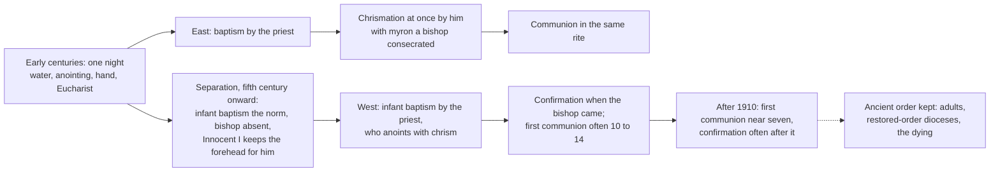

# Sacraments & Liturgy · Lesson 2.3: Confirmation

> ⏱ ~15 min · Module 2: Christian initiation · Builds on: [2.1 Baptism: the rite and its effects](02-01-baptism-the-rite-and-its-effects.md), [2.2 Necessity, infants, and baptism of desire and blood](02-02-necessity-infants-and-baptism-of-desire-and-blood.md), [`ecclesiology-and-mariology` 3.1](../../ecclesiology-and-mariology/lessons/03-01-bishops-and-apostolic-succession.md) · Unlocks: [3.5 Communion, reservation, adoration](03-05-communion-reservation-adoration.md), [5.1 Holy Orders: the three degrees](05-01-holy-orders-the-three-degrees.md)

## Why this matters

A Ukrainian Catholic infant is chrismated by the priest who baptizes her and receives communion that day. A Latin Catholic is confirmed by a bishop at fourteen, years after her first communion. Both received the same sacrament. Its existence and character are defined; its minister, age and place in the sequence are discipline, and the West's discipline came first and its theology after.

## The idea

In the early centuries initiation was usually one night: water, an anointing and a laying on of hands, then the Eucharist. Once infant baptism became the norm and dioceses grew, two goods could no longer both be kept: **the unity of the rite** and **the bishop's own hand**. The Catechism gives exactly these reasons (CCC 1290).

The East kept the unity. The priest who baptizes chrismates at once, with *myron* that a bishop or patriarch consecrated, and the infant then receives communion (CCC 1312, 1318; CCEO cann. 695 §1, 697). The bishop is present through the oil. Cyril of Jerusalem told his neophytes that the anointing after the font was the antitype of Christ's own, "and this is the Holy Ghost" (*Mystagogical Catecheses* 3.1).

The West kept the hand. In 416 Innocent I told Decentius of Gubbio (lesson's translation):

> As for signing infants, it is plain that this may lawfully be done by no one but the bishop.

Presbyters, he goes on, may anoint the baptized with the bishop's chrism, but not sign the forehead, which belongs to bishops when they hand on the Spirit. That double anointing survives: the priest's anointing stays in baptism, and the forehead-signing became [confirmation](../reference.md#confirmation) (CCC 1291). Aquinas's image for the West's reason: the clerk writes the letter, the employer signs it (ST III q.72 a.11).

The cost was time. A rite detached by years from the baptism it completes needs a meaning of its own.

## Source

Acts 8:14–17 and 19:5–6 (Douay–Rheims):

> Now, when the apostles, who were in Jerusalem, had heard that Samaria had received the word of God, they sent unto them Peter and John. Who, when they were come, prayed for them that they might receive the Holy Ghost. For he was not as yet come upon any of them: but they were only baptized in the name of the Lord Jesus. Then they laid their hands upon them: and they received the Holy Ghost.
>
> Having heard these things, they were baptized in the name of the Lord Jesus. And when Paul had imposed his hands on them, the Holy Ghost came upon them: and they spoke with tongues and prophesied.

**The shape of the act.** Baptism first, then a second act by an apostle: prayer, hands, the Spirit given. Innocent I and Florence both cite Acts 8 for the bishop's reservation. Now what it does not say. There is no oil. The pattern is not uniform: at Cornelius's house the Spirit falls *before* baptism (Acts 10:44–48), and Acts 2:38 promises the gift after baptism with no hands. Hebrews 6:2 lists "the doctrine of baptisms and imposition of hands" among the foundations without saying which laying on it means. Paul VI calls the apostolic hand-laying the sacrament's beginning according to Catholic tradition: the warrant is the text as the tradition reads it.

## The doctrine

1. **A true sacrament, distinct from baptism.** Trent anathematizes whoever calls the confirmation of the baptized "an idle ceremony" rather than a true and proper sacrament, or says it was once "nothing more than a kind of catechism" in which those near adolescence gave an account of their faith (Session VII, Canons on Confirmation, can. 1). *In words:* confirmation is a sacrament in its own right, and it never was a coming-of-age profession.
2. **It imprints a [character](../reference.md#sacramental-character).** Baptism, confirmation and order imprint an indelible spiritual sign and so cannot be repeated (Session VII, *On the Sacraments in General*, can. 9; [1.3](01-03-ex-opere-operato-character-and-fruitfulness.md)). *In words:* given once, and any second attempt confers nothing.
3. **The bishop is its ordinary minister.** Trent condemns saying that the ordinary minister "is not the bishop alone, but any simple priest soever" ([Session VII](../reference.md#trent-session-vii), Canons on Confirmation, can. 3). Session XXIII can. 7 denies that bishops' power of confirming is common to them and to priests. *Lumen Gentium* 26 calls bishops its "original" ministers. A Latin presbyter confers it validly only with a faculty, from universal law or by grant (can. 882). The law gives it to the presbyter who, by office or mandate, baptizes someone past infancy or receives a baptized Christian into full communion, and to any presbyter for those in danger of death (can. 883). Every Eastern presbyter confers chrismation validly on faithful of any church *sui iuris*, Latin included (CCEO can. 696 §1). *In words:* the [minister](../reference.md#minister-of-confirmation) is the bishop by right, the presbyter by the Church's grant, and in the East the presbyter always.
4. **Matter and form, as now fixed for the Latin Church.** Paul VI, *Divinae Consortium Naturae* (15 August 1971): the sacrament is conferred by anointing with [chrism](../reference.md#chrism) on the forehead, done by the laying on of the hand, with the words *Accipe signaculum doni Spiritus Sancti*, "Receive the seal of the gift of the Holy Spirit" (lesson's translation; the current English form is "Be sealed with the Gift of the Holy Spirit"). A bishop must consecrate the chrism even when a presbyter confirms (can. 880 §2). The earlier extension of hands over the group is not essential, though highly esteemed. *In words:* one gesture, the anointing hand, plus one sentence.
5. **What it does.** The confirmed are more perfectly bound to the Church and enriched with a special strength of the Spirit, and so more strictly obliged to spread and defend the faith as true witnesses of Christ (LG 11). The Catechism adds an increase and deepening of baptismal grace (CCC 1302–1303). Reception at the proper time is obligatory (can. 890). *In words:* baptism's grace deepened and turned outward.
6. **Age and order.** About the age of discretion, unless the bishops' conference fixes another age, or danger of death or grave cause intervenes (can. 891). Benedict XVI called the differing [orders of initiation](../reference.md#order-of-the-sacraments-of-initiation) pastoral, not dogmatic (*Sacramentum Caritatis* 18, 2007). *In words:* when is a question of practice.

**The old dispute over the matter.** Acts has hands and no oil; the Fathers add oil. Florence's [Decree for the Armenians](../reference.md#decree-for-the-armenians) (1439) named chrism of oil and balsam as matter and *Signo te signo crucis, et confirmo te chrismate salutis* as form, saying the Church gives confirmation "in place of that imposition of hands" (lesson's translation). It is an instruction, not a definition ([1.4](01-04-why-seven.md) marks its weight). Theologians argued over hands, oil or both. Paul VI settled it for the Latin Church by joining them, the hand that anoints being the hand laid on, and took the Byzantine form, which he traces to the fourth and fifth centuries: "The seal of the gift of the Holy Spirit" (Hapgood's *Service Book*, 1906).

**Said plainly.** The West separated confirmation from baptism because bishops could not be at every font, and it has been explaining the result ever since. Its classic explanation came from a fifth-century Gallic Pentecost homily, usually ascribed to Faustus of Riez (the ascription is disputed). The ninth-century Pseudo-Isidorean forgers ([`church-history` 3.3](../../church-history/lessons/03-03-popes-franks-and-emperors.md)) put it into the mouth of Pope Melchiades (311–314). Through Ivo of Chartres and Gratian it reached Lombard and Aquinas, who thought they were quoting a fourth-century pope (L. A. van Buchem, 1967; Eugene Finnegan, *CTSA Proceedings* 62, 2007). Aquinas quotes it: in baptism we are born again to life, after baptism we are strengthened (ST III q.72 a.1). The confirmand "strengthened for the combat" has that pedigree.

**Mark the levels** ([`fundamental-theology` 4.4](../../fundamental-theology/lessons/04-04-the-ladder-of-doctrinal-authority.md); [levels](../reference.md#levels-of-authority)). That confirmation is a true sacrament, imprints a character, and has the bishop as *ordinary* minister is **rung 1** (Trent VII, Canons on Confirmation cans. 1 and 3; *On the Sacraments in General* can. 9; XXIII can. 7); "ordinary" leaves an extraordinary minister open, as Florence's instruction had allowed. LG 11 on the effects is conciliar teaching defining nothing new: **rung 3**; CCC 1302–1305 carry the weight of what they restate. That a presbyter with the faculty, or any Eastern presbyter, confers it validly is settled in both Codes and taught in CCC 1312–1313: **at least rung 3**. *Divinae Consortium Naturae* legislates the essential rite: binding, **no doctrinal rung**, an exercise of the power over the sacraments' dispensation, "their substance being untouched", that Trent claims (Session XXI, ch. 2; [3.5](03-05-communion-reservation-adoration.md)). Age, faculties and CCEO's rules are **law, no rung**; Innocent I's letter is discipline. The order of initiation is **freely disputed** as pastoral practice. Aquinas's "perfect age", the combat imagery, and every account of how a faculty can decide validity have **no magisterial level**. Benedict XIV, in a treatise, called the controversy over a presbyter's power to confirm "difficult and very tangled" (*De Synodo dioecesana* VII.8.7, lesson's translation).

## The timeline

The dashed edge is where the Latin Church still keeps the ancient order.

## Worked examples

**Ex 1 (clean): the Easter Vigil.** Invented. Anouk Visser, 34 and unbaptized, is baptized at the Vigil by her parish priest under the bishop's mandate. He confirms her at once and she receives communion. *Valid:* matter (chrism consecrated by the bishop at the Chrism Mass, can. 880 §2), form (the approved words), minister (the faculty comes from the law, since he baptized an adult by mandate, can. 883 2°), recipient (baptized, not yet confirmed, can. 889 §1). *Licit:* approved rite, and the faculty covers this person. *Fruitful:* baptism has just removed every obstacle. For adults the Latin Church keeps the ancient order (CCC 1298).

**Ex 2 (strain): the infant in danger of death.** Invented. Amara Ilesanmi, born at 26 weeks, is baptized and confirmed by the chaplain, a priest with no granted faculty. *Valid:* any presbyter has the faculty for those in danger of death (can. 883 3°). *Licit:* yes. *Fruitful:* an infant places no obstacle. She survives, and at thirteen her parish enrols her for confirmation. She cannot receive it: only the unconfirmed are capable (can. 889 §1), and the character forbids repetition (rung 1). The strain: every reason the Latin Church gives for waiting (maturity, commitment, understanding) falls away when death threatens. Aquinas saw it: the body's age does not decide the soul's, and the dying should be confirmed (ST III q.72 a.8 ad 2, ad 4). So the delay is discipline, and any account of what confirmation adds must say what it gave Amara at three weeks.

## Watch out

- **You might think only a bishop can confirm validly.** That overstates Trent, which defines the *ordinary* minister (rung 1). "Any priest can confirm" errs the other way: a Latin presbyter without the faculty confirms invalidly (can. 882), unless the Church supplies it in common error or doubt (can. 144 §2).
- **You might think confirmation is the candidate ratifying his baptism.** The renewal of promises belongs to the Latin rite (SC 71), but the sacrament is the Spirit's gift and a character. Trent condemns reducing it to an adolescent's account of his faith (rung 1); CCC 1308 says baptismal grace needs no ratification.
- **You might think "strengthened for the fight" is defined.** "Special strength" is LG 11 (rung 3); the soldier-and-maturity explanation is a school's, and its key text reached the schoolmen as a forgery.
- **You might think the age of confirmation is doctrine.** It is law (can. 891), and the Latin Church confirms dying infants.

## One-liner

> That confirmation is a sacrament, marks the soul, and belongs by right to the bishop is defined; when and by whose hand it is given is discipline the West is still explaining.

## Problems

**P1 (🟢)** *(Exegetical)* An **invented** "Confirmation FAQ" from a Latin parish's website, written for this problem:

> (1) "Only a bishop can confirm validly. When a priest confirms adults at the Easter Vigil, he needs special permission from Rome."
>
> (2) "Families from our Ukrainian Catholic community: your children were anointed after baptism, but that was a blessing, not confirmation. Please enrol them in our Year 8 programme."
>
> (3) "Confirmation is where you finally say yes for yourself to the faith your parents chose for you. That is why Church doctrine fixes the age at fourteen."

Correct each item. For each correction say whether it rests on defined doctrine (give the level), on authentic teaching, or on law. Two sentences per item.

---

**P2 (🟡)** *(Exegetical)* **Invented**, written for this problem. On Pentecost Sunday the bishop of Ashcombe falls ill an hour before he is due to confirm at Holy Spirit parish. The vicar general phones the pastor, Fr Colm Kilbride, to say the bishop will come in three weeks and that no faculty to confirm the parish's candidates will be granted for today. Fr Kilbride tells the congregation exactly that, adds that he "will not send these young people home", and confirms using the approved rite, chrism the bishop consecrated this year, and the exact form. The candidates include Chidinma Eze, 14, baptized Catholic as an infant, well prepared and in a state of grace; and Mattias Lund, 16, validly baptized as an infant in a Methodist church and also well prepared. The bishop had earlier given Fr Kilbride a written mandate to receive Mattias into full communion at this Mass, which he does immediately before the confirmations.

(a) For each candidate give three verdicts, valid, licit and fruitful, each naming the element that decides it. One line per verdict.

(b) What must now happen for Chidinma, and is it done conditionally? Then name one change in the facts that would have made her confirmation valid without any grant from the bishop. Two sentences.

---

**P3 (🔴)** *(Exegetical (a) · Evaluative (b))* Aquinas, ST III q.72 a.1 (English Dominican Province):

> The sacraments of the New Law are ordained unto special effects of grace: and therefore where there is a special effect of grace, there we find a special sacrament ordained for the purpose. … Now it is evident that in the life of the body a certain special perfection consists in man's attaining to the perfect age … So therefore does man receive spiritual life in Baptism, which is a spiritual regeneration: while in Confirmation man arrives at the perfect age, as it were, of the spiritual life. Hence Pope Melchiades says: "The Holy Ghost … bestows at the font, the fulness of innocence; but in Confirmation He confers an increase of grace. In Baptism we are born again unto life; after Baptism we are strengthened." And therefore it is evident that Confirmation is a special sacrament.

(a) Reconstruct the argument in four numbered premises and a conclusion. Say what the "Melchiades" text really is, and whether exposing it lowers the level at which Catholics hold that confirmation is a sacrament distinct from baptism. 100 words or fewer.

(b) Any verdict, 120 words or fewer: is "growth to spiritual maturity" the best account of what confirmation adds to baptism? (The order of initiation is not the question.)

Solutions

**P1** *(Exegetical)*

**Must hit, strict:**

- **(1)** Overstated. Trent defines the bishop as the *ordinary* minister (**rung 1**), not the only valid one. A presbyter confirms validly with the faculty (can. 882), which at the Vigil comes from the law itself, not from Rome (can. 883 2°); the diocesan bishop can also grant it (can. 884). This is **law**.
- **(2)** Wrong. Eastern chrismation is the sacrament of confirmation (CCC 1289, 1312), validly conferred by Eastern presbyters on faithful of any church *sui iuris* (CCEO can. 696 §1, **law**). The character makes it unrepeatable (Trent VII, *On the Sacraments in General*, can. 9, **rung 1**), and only the unconfirmed are capable (can. 889 §1), so the Year 8 "confirmation" would be null and gravely illicit.
- **(3)** Two errors. The sacrament is the Spirit's gift and a character, not the candidate's ratification. Trent condemns reducing it to an adolescent's account of his faith (**rung 1**), CCC 1308 says baptism needs no ratification, and the renewal of promises is a part of the rite (SC 71). And the age is **law**, not doctrine: about the age of discretion unless the conference fixes another (can. 891). Benedict XVI calls such variations pastoral (*Sacramentum Caritatis* 18).

**Wrong turns:** correcting (1) into "any priest can confirm"; in (2), proposing to confirm the children "conditionally, to be safe", when there is no doubt to resolve; calling (3) heresy, when it does not deny the sacrament; answering (3) with "doctrine requires confirmation before first communion", which overstates the other way. Credit for noting the likely source of (2): the Latin rite's own priestly chrism anointing after baptism, which is not confirmation (CCC 1291).

**Model answer:** (1) Trent makes the bishop the ordinary minister (rung 1), not the only valid one. At the Vigil the priest who baptizes or receives an adult has the faculty from the law itself (can. 883 2°), with no appeal to Rome. (2) Those children were confirmed: chrismation by an Eastern priest is the sacrament (CCC 1312; CCEO 696 §1, law). Because it imprints a character (Trent, rung 1) and only the unconfirmed can receive it (can. 889 §1), enrolling them would mean attempting a null and sacrilegious repetition. (3) Confirmation is the Spirit's gift, not the candidate's yes, and Trent condemns making it a mere adolescent profession (rung 1). The age is law (can. 891, about the age of discretion unless the conference decides otherwise), not doctrine.

---

**P2** *(Exegetical)*

**Must hit, strict (a):**

- **Chidinma, valid: no; minister.** A Latin presbyter confers validly only with the faculty (can. 882). None came from the law: she is not being baptized past infancy, not being received into full communion, and not in danger of death (can. 883). None was granted (can. 884 §1). The lack was announced, so there is no common error or doubt for the Church to supply in (can. 144 §2).
- **Chidinma, licit: no; minister.** He acted without the faculty and against an explicit refusal.
- **Chidinma, fruitful: nothing to bear fruit.** No sacrament was conferred, so there is no character and no sacramental grace. Her prayer was prayer, not a sacrament.
- **Mattias, valid: yes; minister.** The law gives the faculty to the presbyter who admits a baptized Christian into full communion by the bishop's mandate (can. 883 2°). Matter, form and recipient are also in order (baptized, never confirmed).
- **Mattias, licit: yes; rite and faculty.** Approved rite, bishop's chrism (can. 880 §2), and a faculty that covers this person (can. 883 2°). The refusal concerned the parish's candidates, not this faculty.
- **Mattias, fruitful: yes, if disposed; recipient.** Well prepared, he places no obstacle.

**Must hit, strict (b):** she is to be confirmed by the bishop or a presbyter with the faculty, **absolutely**, because the first attempt was certainly null. One change, either: she was in danger of death (can. 883 3°), or the congregation had been led to think he held the faculty, common error (can. 144 §2), in which case the act would be valid but still illicit.

**Wrong turns:** calling Chidinma's confirmation valid but illicit, which treats the faculty as a matter of permission when can. 882 makes it a condition of validity; calling Mattias's invalid because the bishop "refused"; confirming Chidinma "conditionally"; one verdict for the whole Mass; treating the priest's good intention as deciding validity.

**Model answer:** (a) Chidinma: invalid, for want of a faculty in the minister (can. 882; no can. 883 case; can. 144 excluded by the announcement); illicit, same element; fruitful does not arise, since nothing was conferred. Mattias: valid, because the faculty comes from the law with the reception mandate (can. 883 2°); licit, approved rite and a faculty covering him; fruitful, if disposed. (b) Chidinma is to be confirmed absolutely by a minister with the faculty. Had she been in danger of death, any presbyter would have had the faculty from the law.

---

**P3** *(Exegetical (a) · Evaluative (b))*

**Must hit, strict (a):**

- P1. The New Law's sacraments are ordered to special effects of grace. P2. Where there is a special effect, there is a special sacrament. P3. Bodily life has a special perfection, reaching perfect age, distinct from birth. P4. Spiritual life answers to bodily life: baptism is spiritual birth, so there is a spiritual perfect age, which confirmation gives. C. Confirmation is a special sacrament.
- "Melchiades" is a Pseudo-Isidorean forgery drawing on a fifth-century Gallic Pentecost homily (usually ascribed to Faustus of Riez). It cannot be from the fourth-century pope.
- The level does not move: that confirmation is a distinct sacrament is **rung 1** on Trent VII, Canons on Confirmation can. 1. It rests on that act, not on Aquinas's argument or his authority. What loses support is a school's explanation.

**Must hit, any verdict (b):**

- Hold the defined points fixed: a true sacrament, a character.
- Account for the Latin Church confirming dying infants (can. 883 3°; q.72 a.8 ad 2, ad 4).
- Avoid both reductions: that baptism gave no Spirit (Acts 2:38), and that confirmation is ratification (Trent can. 1; CCC 1308).
- Name a rival account, whether completion of baptism, a personal Pentecost (CCC 1302), or a commission to public witness (LG 11), and concede its strongest point.

**Wrong turns:** treating Aquinas's "perfect age" as defined; inferring from the forgery that confirmation is not a sacrament; equating spiritual maturity with bodily age; arguing the order of initiation instead (that is reserved).

**Model answer (b), one of several:** Maturity is the best account if it is read as Aquinas meant it, a spiritual age that bodily age does not measure (a.8 ad 2). That reading survives the confirmed infant: what is given is a configuration and power to bear public witness, the character, received now and lived later, as the baptismal character is. It also keeps LG 11's "special strength" and obligation to witness. The strongest rival is the East's and Paul VI's: confirmation completes baptism with the Spirit's seal, a personal Pentecost, and needs no developmental image at all. I concede that the maturity image grew partly from a forgery and has fed the false idea that confirmation is a ratification. A definition by its gift is safer for catechesis than one by the confirmand's stage of life.

## Flashback

**From Lesson [2.1](02-01-baptism-the-rite-and-its-effects.md) (Baptism: the rite and its effects):** *(Exegetical.)* Mark the level.

(a) Give each claim its weight, **rung 1**, **at least rung 3**, **law, no rung**, or **no magisterial level**, and name the text that carries it. Canon numbers are not required. One line each.

- (i) Baptism given even by heretics, in the name of the Father, and of the Son, and of the Holy Ghost, with the intention of doing what the Church does, is true baptism.
- (ii) The Byzantine form, "The servant of God, N., is baptized, in the name of the Father, Amen. And of the Son, Amen. And of the Holy Spirit, Amen", is a valid form of baptism.
- (iii) Baptized infants receive sanctifying grace and the infused virtues, not only the remission of original guilt.
- (iv) The reason any baptized person can baptize is that "what is equally received can be equally given".
- (v) An adult who is baptized is to be confirmed at once and to receive communion in the same celebration, unless a grave reason prevents it.

(b) An ecumenical council once chose one of these claims only "as more probable". Which claim, which council, and what does that show about how to read a claim's level? Two sentences.

Solution

**Accept:** for (iv), an answer that separates the conclusion, which is taught (*Firmiter*'s baptism "by anyone", rung 1), from the reason, which carries no level.

**Must hit, strict (a):**

- **(i) Rung 1:** Trent, Session VII, Canons on Baptism (the canon on baptism given by heretics).
- **(ii) At least rung 3:** Florence's Decree for the Armenians accepts the passive form, and CCC 1240 gives it. The Decree is an instruction, not a definition, and no canon fixes the wording.
- **(iii) At least rung 3:** the Roman Catechism and CCC 1266 teach it without qualification (with Trent, Session VI, ch. 7, an expository chapter, on the virtues "infused at once").
- **(iv) No magisterial level:** Tertullian's reason (*On Baptism* 17). It is also narrower than the Church's teaching: Florence and CCC 1256 hold that even the unbaptized can baptize (at least rung 3), because it is Christ who baptizes.
- **(v) Law, no rung:** the Code (can. 866).

**Must hit, strict (b):**

- Claim (iii). The Council of Vienne (1312) chose it, against the opinion that infants receive remission of guilt without grace, only "as more probable" (*tanquam probabiliorem*).
- A level is read from what an act does, not from where it was done: an ecumenical council adjudicated between theologians without defining. The claim now stands at least at rung 3 because later teaching states it without qualification. Levels move.

**Wrong turns:** (i) "at least rung 3", which understates a canon; (ii) rung 1 "because Florence was an ecumenical council", which overstates the Decree; (iii) rung 1 because Vienne taught it, or "freely disputed" because Vienne left it probable; (iv) giving Tertullian a rung, or treating his reason as the Church's; (v) calling the order of initiation doctrine.

**Model answer:** (a) (i) Rung 1, Trent's Session VII canons on baptism. (ii) At least rung 3, Florence's Decree for the Armenians and CCC 1240; no canon fixes the wording. (iii) At least rung 3, the Roman Catechism and CCC 1266. (iv) No magisterial level: Tertullian's reason, narrower than the Church's teaching that even the unbaptized can baptize. (v) Law, no rung, can. 866. (b) Claim (iii): the Council of Vienne chose it only "as more probable", against the view that infants receive remission without grace. An ecumenical council can settle a dispute without defining anything, so the level is read from the act and from later teaching, which now states the claim without qualification.

## Connections

- **Backward:** [2.1](02-01-baptism-the-rite-and-its-effects.md) is the rite this one completes, including the priest's chrism anointing that stays in baptism. [1.2](01-02-matter-form-minister-intention.md) supplies the three verdicts and the minister, and [1.3](01-03-ex-opere-operato-character-and-fruitfulness.md) the character. [`ecclesiology-and-mariology` 3.1](../../ecclesiology-and-mariology/lessons/03-01-bishops-and-apostolic-succession.md) gives the bishop's power to confirm and Aquinas's view that the pope could commission a priest to confirm. [`patristics` 3.2](../../patristics/lessons/03-02-basil-the-great.md) counts the blessing of the chrism among the unwritten traditions, and [`patristics` 4.1](../../patristics/lessons/04-01-ambrose-of-milan.md) walks Ambrose's neophytes through the seal of the Spirit.
- **Forward:** [3.5](03-05-communion-reservation-adoration.md) takes *Quam Singulari* (1910) and first communion, the decree whose lower first-communion age put communion before confirmation wherever confirmation stayed late. [5.1](05-01-holy-orders-the-three-degrees.md) separates faculties from orders. [6.3](06-03-the-roman-rite-and-the-eastern-rites.md) is the Byzantine rite whose formula the Latin Church borrowed in 1971.
- **Sideways:** churches *sui iuris*, which decide whose law governs a chrismated child in a Latin parish, are [`ecclesiology-and-mariology` 3.2](../../ecclesiology-and-mariology/lessons/03-02-the-local-and-the-universal-church.md). *Divinae Consortium Naturae* is an apostolic constitution that legislates rather than defines, which is how [`fundamental-theology` 4.5](../../fundamental-theology/lessons/04-05-reading-a-documents-weight.md) teaches you to read one.
