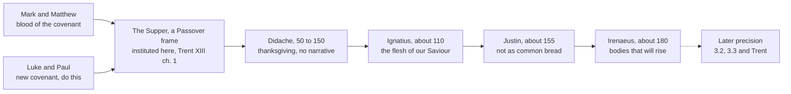

# Sacraments & Liturgy · Lesson 3.1: The institution and the earliest witness

> ⏱ ~15 min · Module 3: The Eucharist · Builds on: [1.4 Why seven](01-04-why-seven.md), [`new-testament` 4.3](../../new-testament/lessons/04-03-paul-at-work.md) · Unlocks: [3.2](03-02-the-controversies-that-forced-precision.md), [3.3](03-03-real-presence-and-transubstantiation.md), [3.4](03-04-the-sacrifice-of-the-mass.md), [6.3](06-03-the-roman-rite-and-the-eastern-rites.md)

## Why this matters

Every eucharistic dispute in this module is fought over a handful of texts written within about 150 years of the Supper. This lesson asks the narrower question doctrine depends on: what each text contributes, what it does not, and what the Church has done with it, at what level. Err one way and you find Trent in Ignatius; err the other and you find a bare symbol in Paul.

## The idea

**The four narratives.** The Supper is told four times, in [two families](../reference.md#institution-narratives) ([`new-testament` 1.1](../../new-testament/lessons/01-01-reading-the-new-testament-in-the-church.md)). Mark 14:22–24 and Matthew 26:26–28 have "This is my blood of the new testament", echoing Sinai's "blood of the covenant" (Exod 24:8). Luke 22:19–20 and 1 Corinthians 11:23–25 have "the new testament in my blood", Jeremiah's new covenant (Jer 31:31), and only they carry "Do this for a commemoration of me", once in Luke, twice in Paul. Paul's, from the mid-50s, is the earliest written ([`new-testament` 4.3](../../new-testament/lessons/04-03-paul-at-work.md)); John has no institution words at the supper ([`new-testament` 2.4](../../new-testament/lessons/02-04-john-and-the-synoptics.md)).

**The Passover frame.** In the Synoptics the Supper is a Passover meal ("this pasch", Luke 22:15); John dates the death to the slaughter of the lambs, a dispute that is [`new-testament` 2.4](../../new-testament/lessons/02-04-john-and-the-synoptics.md)'s. Either way the frame is paschal: "Christ our pasch is sacrificed" (1 Cor 5:7). It supplies a meal that remembers a deliverance, a lamb, and covenant blood.

**[*Anamnesis*](../reference.md#anamnesis).** The "commemoration" is *anamnēsis*: remembrance, memorial (lesson's gloss), to be read with the Passover's sense of memorial rather than the modern sense of recollection. The Passover day is "for a memorial" (Hebrew *zikkaron*, Exod 12:14), and the father tells his son:

> This is what the Lord did to me when I came forth out of Egypt. (Exod 13:8, DR)

The generation keeping the rite says *me*. A memorial is a rite in which a past saving act reaches those who keep it ([`old-testament` 2.5](../../old-testament/lessons/02-05-exodus-and-sinai.md) gives the Mishnah's later rule).

**[John 6](../reference.md#bread-of-life-discourse).** The discourse moves from believing in the bread of life (6:35) to eating "my flesh, for the life of the world" (6:51b; DR 6:52), and ends with many disciples who "walked no more with him" (6:66; DR 6:67). The text and its three readings are [`new-testament` 2.5](../../new-testament/lessons/02-05-the-theology-of-john.md)'s.

**The second century, cited, not re-read.** The Didache (roughly 50–150) has thanksgiving prayers and a Lord's-day breaking of bread it calls a sacrifice (chs. 9–10, 14; [`patristics` 1.2](../../patristics/lessons/01-02-first-clement-and-the-didache.md)). Ignatius (about 110) says the docetists abstain because "they confess not the Eucharist to be the flesh of our Saviour" (*Smyrnaeans* 7; [`patristics` 1.3](../../patristics/lessons/01-03-ignatius-of-antioch.md)). Justin (about 155) describes the whole Sunday and says the food is received "not as common bread" (*First Apology* 65–67; [`patristics` 1.4](../../patristics/lessons/01-04-justin-martyr.md)). Irenaeus (about 180) argues that bodies nourished by the Eucharist will rise (*Against Heresies* IV.18.5, V.2.2–3; [`patristics` 2.2](../../patristics/lessons/02-02-irenaeus-recapitulation.md)).

## Source

1 Corinthians 11:23–27, 29 (DR):

> For I have received of the Lord that which also I delivered unto you, that the Lord Jesus … took bread, and giving thanks, broke and said: Take ye and eat: This is my body … This do for the commemoration of me. In like manner also the chalice, after he had supped, saying: This chalice is the new testament in my blood. This do ye, as often as you shall drink, for the commemoration of me. For as often as you shall eat this bread and drink the chalice, you shall shew the death of the Lord, until he come. Therefore, whosoever shall eat this bread, or drink the chalice of the Lord unworthily, shall be guilty of the body and of the blood of the Lord. … For he that eateth and drinketh unworthily eateth and drinketh judgment to himself, not discerning the body of the Lord.

Read the shape of the act.

- **Received, not composed.** "Received ... delivered": Paul corrects a divided meal (11:17–22) by quoting a tradition.
- **Words that identify, a command that is a rite.** Over the bread an identity, over the cup a covenant in his blood; then "This do" twice, glossed: eating and drinking "shew" the Lord's death "until he come". The memorial is done, not merely thought, and faces both back and forward.
- **The consequence.** "Therefore": the unworthy eater is "guilty of the body and of the blood of the Lord", an offence against the body and blood, not against a reminder of them.
- **An open question.** The oldest Greek manuscripts of 11:29 read only "not discerning the body"; the Douay's "unworthily" and "of the Lord" follow the Vulgate. With 10:17 and 12:27 in view, exegetes divide over whether the body to be discerned is the sacrament, the community, or both. The Church has not settled it.

## The doctrine

What the Church has done with these texts (Trent in Waterworth):

1. **[Institution](../reference.md#institution-by-christ) at the Supper.** Christ instituted this sacrament "at the last supper" ([Session XIII](../reference.md#trent-session-xiii), ch. 1; likewise XXII, ch. 1), one of the seven he instituted (Session VII, can. 1; [1.4](01-04-why-seven.md)). *In words:* the Supper is the act of institution, and the narratives are its record.
2. **The words mean what they say.** Session XIII, ch. 1 holds that the words, recorded by the Evangelists and repeated by Paul, carry

   > that proper and most manifest meaning in which they were understood by the Fathers

   and calls it a crime to wrest them "to fictitious and imaginary tropes". *In words:* "This is my body" is read in its proper sense; the [real presence](../reference.md#real-presence) it grounds is defined in the canons ([3.3](03-03-real-presence-and-transubstantiation.md)).
3. **One verse interpreted by definition.** Session XXII, can. 2 anathematizes whoever says that by "Do this for the commemoration of me" Christ did not institute the apostles priests, or did not ordain that they and other priests should offer his body and blood. *In words:* the command founds a priesthood that offers; the offering is [3.4](03-04-the-sacrifice-of-the-mass.md)'s, the priesthood [5.1](05-01-holy-orders-the-three-degrees.md)'s.
4. **Memorial with its Hebrew weight.** Trent says Christ instituted the sacrament "making a remembrance of his wonderful works" (XIII, ch. 2) and, having kept the old Passover, instituted the new (XXII, ch. 1). The Catechism teaches that memorial in Scripture's sense is not mere recollection: in the Eucharist Christ's Passover is made present, as the Exodus is for Israel (CCC 1362–1364, paraphrased). *In words:* the Church reads *anamnesis* as Passover reads *zikkaron*; how the one sacrifice is present is 3.4's theology.
5. **John 6 used, not defined.** The Church's teaching reads the discourse eucharistically (CCC 1336, 1384), but when Trent ruled on the chapter it expressly left it to the differing interpretations of the Fathers and Doctors (XXI, ch. 1). *In words:* the eucharistic reading is the Church's use, the exegesis is not defined, and Trent rested the real presence on the institution words.
6. **Unworthy reception.** Session XIII, ch. 7 makes "let a man prove himself" the precept of preparation, and can. 11 anathematizes the claim that faith alone suffices ([3.5](03-05-communion-reservation-adoration.md)).
7. **A pledge of rising.** Christ willed the sacrament to be "a pledge of our glory to come" and a symbol of the one body whose head he is (XIII, ch. 2). *In words:* John 6:54 (DR 6:55) and Irenaeus make that pledge a bodily rising; the resurrection itself is [`creation-grace-last-things`](../../creation-grace-last-things/syllabus.md)'s.

| What the earliest witness establishes | What it does not establish |
|---|---|
| A rite received from the Lord, its core fixed before Paul wrote | A fixed text: the families differ, Didache 9–10 has no institution narrative, Justin's president prays "according to his ability" ([6.3](06-03-the-roman-rite-and-the-eastern-rites.md)) |
| Realist language: "This is my body"; "guilty of the body and of the blood"; "the flesh of our Saviour"; "not as common bread" | A theory of *how*: no conversion of substance (the term arrives in the twelfth century, [3.2](03-02-the-controversies-that-forced-precision.md)), no metaphysics of substance and accident ([3.3](03-03-real-presence-and-transubstantiation.md)) |
| The baptized only, after self-examination (1 Cor 11:28; Didache 9, 14) | The later discipline: fast, age, frequency, the cup ([3.5](03-05-communion-reservation-adoration.md)) |
| A paschal, covenantal frame and early sacrificial language (1 Cor 5:7; Didache 14) | Trent's doctrine of the propitiatory sacrifice ([3.4](03-04-the-sacrifice-of-the-mass.md)) |
| A Sunday assembly with readings, a president, thanksgiving, Amen (Justin 67) | The Roman Rite or any later rite ([6.3](06-03-the-roman-rite-and-the-eastern-rites.md)) |

*In words:* the texts are realist in their language and silent about mechanism. Reading Trent's vocabulary into them is one anachronism; reading a bare symbol into them is the other.

**Mark the levels** ([`fundamental-theology` 4.4](../../fundamental-theology/lessons/04-04-the-ladder-of-doctrinal-authority.md); [levels](../reference.md#levels-of-authority)). **Rung 1:** institution by Christ (Session VII, can. 1); the real presence (XIII, can. 1); the reading of "Do this" in XXII, can. 2, where an anathema binds the sense of one verse; XIII, can. 11's anathema on faith alone as preparation. **At least rung 3:** Trent's other uses of these texts (the Supper as the moment of institution, the proper sense of the words, the memorial, the pledge of glory, 1 Cor 11:28 as precept), since expository chapters teach without defining ([`fundamental-theology` 4.2](../../fundamental-theology/lessons/04-02-infallibility-and-its-conditions.md)); and the Catechism's teaching that the Eucharist makes Christ's Passover present. **Not defined:** the eucharistic reading of John 6, which is the Church's use. **Open:** the sense of "the body" in 1 Cor 11:29. **No level:** the exegesis of *zikkaron*, which is scholarship, and the Fathers, who are witnesses: the doctrine is dogma because Trent defined it, not because Ignatius wrote it.

## The timeline

Solid arrows run forward in time; the dashed one is where realist language had to become precise doctrine.

## Worked examples

**Ex 1 (clean): placing Acts 2:42.** *What it says:* the first community persevered "in the doctrine of the apostles and in the communication of the [breaking of bread](../reference.md#breaking-of-bread) and in prayers" (DR). The Douay, after the Vulgate, joins two nouns the Greek sets side by side, *koinōnia* ([`ecclesiology-and-mariology` 1.4](../../ecclesiology-and-mariology/lessons/01-04-people-of-god-communion-sacrament.md)) and the breaking of bread. *What it establishes:* a named, regular practice beside teaching and prayer; Luke uses the language at Emmaus (Luke 24:35) and at Troas "on the first day of the week" (Acts 20:7). *What it does not:* any description of the rite, and 2:46's breaking bread "from house to house" leaves exegetes divided on whether every instance is eucharistic. *What the Church does with it:* the Catechism lists "the Breaking of Bread" among the sacrament's names (CCC 1329). That is catechesis using the verse, not a definition of it.

**Ex 2 (strain): the Didache's silence.** Didache 9–10 may be the oldest eucharistic prayers outside the New Testament, if they are eucharistic at all (three readings in [`patristics` 1.2](../../patristics/lessons/01-02-first-clement-and-the-didache.md)). They give thanks over the cup "for the holy vine of David" and over the broken bread, for the baptized only, and say nothing of body, blood or Christ's death. So the table's left column strains: the realist language of Paul and Irenaeus is absent from the earliest liturgical prayers we have. The silence does not deny the real presence, since a thanksgiving is not a theory of the elements; nor does it witness to it, since nothing there says so. What a prayer without an institution narrative implies for the form is [6.3](06-03-the-roman-rite-and-the-eastern-rites.md)'s question. Weigh each text for what it says; never average the witnesses.

## Watch out

- **You might think the Church has defined that John 6 is about the Eucharist.** Her teaching uses it so (CCC 1336), but Trent expressly left its interpretation open (Session XXI, ch. 1). "Defined" overstates the level.
- **You might think nothing here is defined, so it is all exegesis.** Session XXII, can. 2 binds the sense of "Do this" at rung 1, and Session XIII, ch. 1 teaches that "This is my body" carries its proper sense. "Opinion" understates both.
- **You might think "commemoration" means a mental recollection.** In the Passover frame a memorial is a rite that makes a deliverance present (Exod 12:14; CCC 1363).

## One-liner

> The earliest witness is realist in its words and silent about mechanism; Trent bound the sense of "This is my body" and of "Do this", and left John 6 to the interpreters.

## Problems

**P1 (🟢)** *(Exegetical)* 1 Corinthians 10:16–17, 21 (DR). In 10:16 the Douay's "communion" and "partaking" render one Greek word, *koinōnia*:

> The chalice of benediction which we bless, is it not the communion of the blood of Christ? And the bread which we break, is it not the partaking of the body of the Lord? For we, being many, are one bread, one body: all that partake of one bread. … You cannot drink the chalice of the Lord and the chalice of devils: you cannot be partakers of the table of the Lord and of the table of devils.

(a) What does 10:16 assert about the cup and the bread, which words carry it, and what does the form of the sentence show about whether Paul is teaching this or presupposing it?

(b) What does 10:17 add, and where does Trent's Session XIII take it up, at what level? Name one thing the passage does not establish.

Two sentences per part.

**P2 (🟡)** *(Exegetical)* An **invented** transcript, written for this problem, from *Ask the Sacristy*, an evening phone-in on the invented Lamplight Radio:

> **Radek (caller):** (1) The first Christians saw the Lord's Supper as a fellowship meal and nothing more. Nobody called the bread Christ's flesh until the Middle Ages invented the Real Presence.
>
> **Fenella (host):** (2) Not at all: Ignatius of Antioch taught transubstantiation around the year 110, so the second century already held Trent's doctrine in Trent's terms. (3) And the Church has defined that John 6 is about the Eucharist, which settles it.
>
> **Folake (caller):** (4) Paul's warning about eating "unworthily" was about rich Corinthians eating before the poor arrived. It is about manners, not about the bread.
>
> **Fenella:** (5) Fair enough. And "Do this in memory of me" is only in Paul and Luke, so the Church has never said anything binding about what it means.

For each numbered claim, say what is right and what is wrong, correct it, and give the level wherever a level is involved. Two sentences per claim.

Solutions

**P1** *(Exegetical)*

**Accept:** for the last part of (b), any one thing the passage does not establish, correctly stated.

**Must hit, strict (a):**

- The cup is a *koinōnia*, a sharing, in Christ's blood, and the bread a sharing in his body; the words are "communion of the blood of Christ" and "partaking of the body", one Greek word rendered two ways ([`ecclesiology-and-mariology` 1.4](../../ecclesiology-and-mariology/lessons/01-04-people-of-god-communion-sacrament.md)).
- The questions ("is it not ...?", Greek *ouchi*) expect "yes": Paul argues *from* a conviction the Corinthians already hold, to the conclusion that they cannot also share the table of devils (10:21). So the realism of participation is common ground at Corinth in the mid-50s, not Paul's novelty.

**Must hit, strict (b):**

- 10:17: because the bread is one, the many who share it are one body; sharing in Christ's body makes the sharers one ([3.5](03-05-communion-reservation-adoration.md) builds the ecclesiology on it).
- Trent, Session XIII, ch. 2: Christ willed the sacrament to be a symbol of the one body whose head he is (the decree's preface likewise calls it a symbol of unity and charity). An expository chapter: **at least rung 3**, not a definition.
- Not established, any one: *how* the cup and bread are a sharing in Christ's blood and body (no account of a change); what "table" implies about sacrifice (Trent, Session XXII, ch. 1 reads it as the altar, which is [3.4](03-04-the-sacrifice-of-the-mass.md)'s).

**Wrong turns:** reading *koinōnia* in 10:16 as fellowship among the diners, when its object is "the blood of Christ" and the horizontal point is 10:17's; letting 10:17 replace 10:16, so that the "body" is only the community; finding transubstantiation in the verse; giving Trent's chapter rung 1; volunteering an argument against another tradition's reading of the verse.

**Model answer:** (a) Paul says the blessed cup is a sharing in Christ's blood and the broken bread a sharing in his body, the one word *koinōnia* carrying both ("communion", "partaking"). He puts it as questions expecting "yes", so he is arguing from what the Corinthians already believe to the conclusion of 10:21, that the table of the Lord excludes the table of devils. (b) Verse 17 adds that the one bread makes the many one body, which Trent takes up in Session XIII, ch. 2, calling the sacrament a symbol of the one body whose head is Christ, in an expository chapter at least at rung 3. The passage does not say how the bread is a sharing in Christ's body: it gives no account of a change.

---

**P2** *(Exegetical)*

**Must hit, strict:**

- **(1) Wrong, in the minimizing direction.** Paul makes the unworthy eater "guilty of the body and of the blood of the Lord" (1 Cor 11:27); Ignatius (about 110) says heretics abstain because they do not confess the Eucharist to be the flesh of the Saviour; Justin (about 155) says it is received "not as common bread". What the Middle Ages added was the technical term, transubstantiation, and its precision ([3.2](03-02-the-controversies-that-forced-precision.md)); the real presence was defined at Trent (Session XIII, can. 1, 1551), **rung 1**.
- **(2) Wrong, in the maximizing direction.** Ignatius identifies the Eucharist with the flesh that suffered and rose, in an argument against docetism, and gives no account of how; the term *transubstantiatio* came into use only in the twelfth century. The Fathers have **no rung**: the doctrine is rung 1 because Trent defined it, not because Ignatius wrote it.
- **(3) Overstated level.** Trent expressly left the discourse to the differing interpretations of the Fathers and Doctors (Session XXI, ch. 1) and rested the real presence on the institution words (Session XIII, ch. 1). The eucharistic reading is the Church's teaching's own use (CCC 1336, 1384), **not a defined exegesis**.
- **(4) Half right.** The occasion is the divided meal at Corinth (11:17–22), but Paul's "therefore" makes the unworthy eater guilty of the body and blood and calls for self-examination before eating (11:27–28), which Trent made the precept of preparation (Session XIII, ch. 7, **at least rung 3**; can. 11's anathema on faith alone as preparation, **rung 1**). Whether "the body" of 11:29 is the sacrament, the community or both is **open**, and neither reading turns the warning into manners.
- **(5) First half right, second half wrong.** The command stands only in Luke 22:19 and 1 Cor 11:24–25. But Session XXII, can. 2 defines that by those words Christ instituted the apostles priests and ordained that they offer his body and blood, **rung 1**.

**Wrong turns:** correcting (1) with the overclaim of (2), or (2) with the underclaim of (1); placing Ignatius or Justin on the ladder; marking (4) simply true or simply false; passing (5) whole because the count is right; turning any answer into an argument against Protestant readings, which is volunteering a rebuttal and earns nothing.

**Model answer:** (1) Wrong: Paul already makes unworthy eating an offence against "the body and of the blood of the Lord", Ignatius around 110 calls the Eucharist the Saviour's flesh, and Justin says it is "not as common bread". The Middle Ages added the technical term; the presence itself was defined at Trent, rung 1. (2) Wrong the other way: Ignatius identifies the Eucharist with Christ's flesh against the docetists but explains nothing, and the term transubstantiation is twelfth-century. A Father has no rung; the doctrine is dogma because Trent defined it. (3) Overstated: Trent left John 6 to the differing interpretations of the Fathers and Doctors (XXI, ch. 1). The Church reads it eucharistically (CCC 1336) but has not defined the exegesis, and Trent grounded the presence on the institution words. (4) Half right: the occasion is the divided Corinthian meal, but Paul makes the unworthy eater "guilty of the body and of the blood of the Lord" and demands self-examination, which Trent made the precept of preparation (XIII, ch. 7). What "the body" in 11:29 means is open; manners it is not. (5) The count is right, Luke and Paul only. The conclusion is wrong: Session XXII, can. 2 defines, at rung 1, that by these words Christ instituted the apostles priests to offer his body and blood.

## Flashback

**From Lesson [2.2](02-02-necessity-infants-and-baptism-of-desire-and-blood.md) (Necessity, infants, and baptism of desire and blood):** *(Exegetical.)* An **invented** case, written for this problem. Gunnar Eskildsen, never baptized, comes to believe in Christ during a long stay in hospital, repents of his sins and asks for baptism. He is well instructed and in no danger of death, so his parish arranges for him to be baptized at the Easter Vigil, six weeks away. He recovers and is baptized at the Vigil. Aquinas writes (ST III q.69 a.4 ad 2):

> man receives the forgiveness of sins before Baptism in so far as he has Baptism of desire, explicitly or implicitly; and yet when he actually receives Baptism, he receives a fuller remission, as to the remission of the entire punishment. So also before Baptism Cornelius and others like him receive grace and virtues through their faith in Christ and their desire for Baptism, implicit or explicit: but afterwards when baptized, they receive a yet greater fulness of grace and virtues.

(a) Supposing his desire was formed by charity, what did Gunnar have during the six weeks, and what had he still not received? Two sentences.

(b) His brother says: "He was forgiven in hospital, so the Vigil was a formality." Name two things the water gave that the desire could not, and say what weight Aquinas's "fuller remission" carries. Two sentences.

Solution

**Accept:** for (b), any two of the four items listed.

**Must hit, strict (a):**

- **Baptism's grace, by desire.** An explicit desire for the font, formed by faith working through charity, receives forgiveness of sins and justifying grace without the rite (ST III q.68 a.2), since God bound salvation to baptism without binding himself (CCC 1257).
- **Not yet received:** the sacrament itself, and with it the baptismal character, which only water gives. For six weeks he is justified but not baptized.

**Must hit, strict (b):**

- Any two of: (i) the **character**, which blood and desire cannot give, so that he is now baptized once for all; (ii) **entry into the sacramental life**, since no one unbaptized can be validly admitted to the other sacraments (can. 842 §1); (iii) on Aquinas's account, **remission of the entire punishment**; (iv) on Aquinas's account, **a greater fulness of grace and virtues**.
- **Weight:** "fuller remission" is Aquinas's theology, an explanation of how desire and the font differ, with **no magisterial level**.

**Wrong turns:** saying he had nothing before the Vigil, which ignores what desire formed by charity receives; saying the desire gave him the sacrament or its character ("baptized by desire" taken literally), so that he could have been confirmed before the Vigil; treating the Vigil as a conditional baptism, or as a public celebration of something already complete; giving Aquinas's "fuller remission" the weight of a definition.

**Model answer:** (a) If his desire for the font was formed by faith working through charity, Gunnar had baptism's grace during the six weeks: his sins were forgiven and he was justified, since God bound salvation to baptism without binding himself. He had not received the sacrament, and so not the character, which only water gives: he was justified but not yet baptized. (b) The water gave him the character, marking him once for all as baptized, and opened the other sacraments to him, since no one unbaptized can be validly admitted to them (can. 842 §1). Aquinas adds the remission of the entire punishment and a greater fulness of grace, but that is a theologian's explanation with no magisterial level.

## Connections

- **Backward:** [1.4](01-04-why-seven.md) separates the defined claim, institution by Christ, from the open one, institution of each by an identifiable act; the Eucharist is the sacrament whose institution the New Testament narrates as one. The texts themselves are read in [`new-testament` 1.1](../../new-testament/lessons/01-01-reading-the-new-testament-in-the-church.md) (the cup-words), [2.4](../../new-testament/lessons/02-04-john-and-the-synoptics.md) (the dating), [2.5](../../new-testament/lessons/02-05-the-theology-of-john.md) (John 6) and [4.3](../../new-testament/lessons/04-03-paul-at-work.md) (Corinth), and the Fathers in [`patristics` 1.2](../../patristics/lessons/01-02-first-clement-and-the-didache.md)–[1.4](../../patristics/lessons/01-04-justin-martyr.md) and [2.2](../../patristics/lessons/02-02-irenaeus-recapitulation.md). Acts 2:42 is handed here by [`ecclesiology-and-mariology` 1.2](../../ecclesiology-and-mariology/lessons/01-02-the-church-in-the-new-testament.md).
- **Forward:** [3.2](03-02-the-controversies-that-forced-precision.md) tells how realist language had to become precise; [3.3](03-03-real-presence-and-transubstantiation.md) states what Session XIII defined; [3.4](03-04-the-sacrifice-of-the-mass.md) reads the new Passover, the memorial and Didache 14 as sacrifice; [3.5](03-05-communion-reservation-adoration.md) takes 1 Cor 10:17 and 11:28 into communion and its preparation; [5.1](05-01-holy-orders-the-three-degrees.md) takes "Do this" into Holy Orders; [6.3](06-03-the-roman-rite-and-the-eastern-rites.md) meets a eucharistic prayer without an institution narrative in Addai and Mari.
- **Sideways:** the Passover and its memorial in their literal sense are [`old-testament` 2.5](../../old-testament/lessons/02-05-exodus-and-sinai.md). What these texts *prove* against other traditions' readings is argued in [`apologetics-catholic-claims`](../../apologetics-catholic-claims/syllabus.md), and the resurrection of the body the Eucharist pledges belongs to [`creation-grace-last-things`](../../creation-grace-last-things/syllabus.md).
