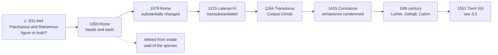

# Sacraments & Liturgy · Lesson 3.2: The controversies that forced precision

> ⏱ ~15 min · Module 3: The Eucharist · Builds on: [3.1 The institution and the earliest witness](03-01-the-institution-and-the-earliest-witness.md), [`patristics` 4.1](../../patristics/lessons/04-01-ambrose-of-milan.md), [`church-history` 5.1](../../church-history/lessons/05-01-papal-monarchy-innocent-iii-to-boniface-viii.md) · Unlocks: [3.3 Real presence and transubstantiation](03-03-real-presence-and-transubstantiation.md)

## Why this matters

For eight centuries the Church said "this is the body of Christ" without having to say what "is" was doing; [3.1](03-01-the-institution-and-the-earliest-witness.md) showed the early language realist and theory-free. Then a king, a schoolmaster, an Oxford theologian and the Reformers each put the question, and each answer was a sharper sentence. Trent's Session XIII ([3.3](03-03-real-presence-and-transubstantiation.md)) is built from them, so learn what each settled and what it left open.

## The idea

**Two monks of Corbie.** In the early 830s Paschasius Radbertus wrote *On the Body and Blood of the Lord*, and about 844 he presented a revised text to Charles the Bald. After the consecration, he taught, the sacrament is *non alia plane caro quam quae nata est de Maria et passa in cruce et resurrexit de sepulchro*, "no other flesh at all than that which was born of Mary, suffered on the cross and rose from the tomb" (lesson's translation). He called it at once figure and truth: figure in what the senses meet, truth in what faith rightly understands.

The king put two questions to another Corbie monk, Ratramnus, in the 840s (ch. 5; Oxford translation, 1838): is the body the faithful receive such "in a mystery or in truth", and is it "the very same Body which was born of Mary"? His definitions decide the first: a figure shows its meaning "under some sort of veil", truth is a thing "veiled under no shadowy images" (chs. 7–8). The eye meets bread, so the body is there "in a figure". Yet in respect of "their invisible substance, that is, the power of the Word of God, they are truly the Body and Blood of Christ" (ch. 49). To the second: between the body in the mystery and the body that suffered and rose the difference "is not small" (ch. 97).

**The crux is the word *veritas*.** For Paschasius, truth is what the thing is, seen or unseen, so one sacrament is figure and truth at once. For Ratramnus, truth is what is shown unveiled, so figure and truth exclude each other. How far apart they stood on the reality itself is still argued; Reformed and Catholic editors have both claimed Ratramnus (Schaff, *History of the Christian Church* IV §124). [`apologetics-catholic-claims`](../../apologetics-catholic-claims/syllabus.md) argues the exchange; here it stands ([Paschasius and Ratramnus](../reference.md#paschasius-and-ratramnus)).

**[Berengar](../reference.md#berengar)**, master of the school of Saint-Martin at Tours, revived Ratramnus's side in the eleventh century. On his account the bread stays bread in substance and becomes by consecration the sign of Christ's body, which is in heaven. How real a presence he allowed is debated. Synods condemned him from 1050 on.

**Said plainly.** A Roman synod made Berengar swear a formula so crude that the tradition itself had to refine it twenty years later. In 1059, under Nicholas II, he swore an oath drafted by Cardinal Humbert, preserved by Lanfranc (*De corpore et sanguine Domini* 2) and carried into Gratian's *Decretum*. It confesses the body of Christ:

> sensibly (*sensualiter*), not only in sacrament but in truth, handled and broken by the hands of priests and ground by the teeth of the faithful (lesson's translation)

Berengar attacked it once home. In 1079 a Roman synod under Gregory VII gave him a new oath, which drops the hands and teeth and moves the claim from the senses to substance (Problem 1 reads it); he died in 1088 in communion with the Church. The canonists and Aquinas finished the correction: the gloss on Gratian warned careless readers of a worse heresy than Berengar's (as Calvin reports, *Institutes* IV.17.12), and Aquinas holds that "the breaking and the crushing with the teeth is to be referred to the sacramental species" (ST III q.77 a.7 ad 3).

**The word, the feast, the dissent.** By the mid-twelfth century the schools called the change [*transubstantiatio*](../reference.md#transubstantiation). In 1215 the Fourth Lateran Council put the word into a profession of faith ([`church-history` 5.1](../../church-history/lessons/05-01-papal-monarchy-innocent-iii-to-boniface-viii.md)). Urban IV's bull *Transiturus de mundo* (Orvieto, August 1264) ordered a feast of the sacrament for the whole Latin Church, [Corpus Christi](../reference.md#corpus-christi), partly to confound "the faithlessness and madness of heretics". It calls the sacrament a *memoriale* again and again, and says Christ is present in it "under another form indeed, but in his own true substance". Memorial and substance are not rivals there. Most scholars accept the attribution of its Office to Aquinas. Then John Wyclif (d. 1384) taught at Oxford what historians call [remanence](../reference.md#remanence): the substance of bread and wine remains. Constance condemned his articles in May 1415 (Hus's trial is [`church-history` 5.4](../../church-history/lessons/05-04-avignon-the-great-schism-and-the-councils.md)'s, the cup [3.5](03-05-communion-reservation-adoration.md)'s).

## In their own words

Three Reformation positions as their own texts state them, left standing ([Luther, Zwingli, Calvin](../reference.md#luther-zwingli-calvin-on-the-supper)). All reject transubstantiation; they differ from one another.

**Luther and the Lutheran confessions.** The Augsburg Confession (1530), art. 10: the body and blood of Christ "are truly present, and are distributed to those who eat in the Supper of the Lord" (Triglot translation, 1921). The Smalcald Articles (1537), III.6: the bread and wine "are the true body and blood of Christ", received "not only by the godly, but also by wicked Christians"; transubstantiation is a "sophistical subtlety", for Paul still calls it bread (1 Cor 10:16). The Formula of Concord (1577) uses "under the bread, with the bread, in the bread" to reject transubstantiation and to mark the sacramental union of the bread's unchanged essence with Christ's body (Solid Declaration VII.35). "In, with and under" is the later shorthand.

**Zwingli.** "This is my body" means "this signifies my body" (*est* = *significat*), argued from John 6:63 (DR 6:64), "the flesh profiteth nothing", in his *Commentary on True and False Religion* (1525). The Supper is the community's thankful commemoration of Christ's death, and his ascended body is in heaven. His *Exposition of the Faith* for Francis I (1531) still affirms Christ truly present to the believing heart, his body eaten sacramentally and spiritually (Schaff, *History* VII §111). At Marburg (1529) he and Luther agreed on fourteen articles and most of the fifteenth, and recorded their split: whether Christ's body and blood are corporally present in the bread and wine.

**Calvin.** The Supper is not "a vain or empty sign". Christ's body is "contained in heaven" until the judgment, neither enclosed under the elements nor everywhere (*Institutes* IV.17.10, 12; Beveridge's translation, 1845). Yet his flesh truly feeds us:

> what our mind does not comprehend let faith conceive—viz. that the Spirit truly unites things separated by space. (IV.17.10)

Christ offers the thing signified to all at the table; believers alone receive it to their benefit (IV.17.10). Calvin calls it a "true and substantial communication" of the body and blood (IV.17.19).

## The doctrine

What each act settled and left open.

1. **1059: realism, said too coarsely.** One man was made to confess the body "not only in sacrament but in truth". *In words:* a sign-only reading was ruled out; the sensory wording, which says of the body what is true of the appearances, was not kept.
2. **1079: the claim moves to substance.** The second oath confesses the bread and wine "substantially changed" into Christ's flesh and blood. *In words:* the change is placed where no sense reaches, and that is called truth.
3. **1215: the profession.** Lateran IV's first constitution, [*Firmiter*](../reference.md#firmiter), professes the one Church in which Jesus Christ is priest and sacrifice:

   > whose body and blood are truly contained in the sacrament of the altar under the species of bread and wine, the bread having been transubstantiated into the body and the wine into the blood by divine power (lesson's translation)

   *In words:* Christ's body and blood are truly there under what still looks like bread and wine, because God changes them. The council uses the participle; it does not define substance, mention accidents, or call the word apt, which is Trent's step ([3.3](03-03-real-presence-and-transubstantiation.md)).
4. **1264: the feast.** *Transiturus* institutes a feast; its doctrinal sentences restate the faith. *In words:* the presence is honoured for its own sake, the root of [3.5](03-05-communion-reservation-adoration.md)'s adoration.
5. **1415: remanence condemned.** Constance's eighth session condemned 45 articles of Wyclif, the first three eucharistic: the material substance of bread and wine remains; the accidents of bread do not remain without a subject; Christ is not there identically and really in his own bodily presence. *In words:* remaining bread and absent body were rejected together.

**Mark the levels** ([`fundamental-theology` 4.4](../../fundamental-theology/lessons/04-04-the-ladder-of-doctrinal-authority.md); [levels](../reference.md#levels-of-authority)). Paschasius and Ratramnus are theologians: **no magisterial level**. The **1059 and 1079 oaths** are professions a pope and his synod imposed on one man, not definitions for the universal Church; what they confess stands at **rung 1** because Lateran IV and Trent defined it, not because Berengar swore it. The 1059 sensory predicates were never defined of the body; Aquinas's reading of them as said of the species is an **explanation**. ***Firmiter*'s eucharistic clause** is an ecumenical council's profession of faith, **rung 1** for what it professes: the true containment and the conversion by divine power. It defines no philosophy of substance; "transubstantiated" is a word used, not yet declared apt. ***Transiturus*** is liturgical law, **no rung**. **Constance** used a **global censure**: Martin V's *Inter cunctas* (1418) says only that some of the 45 are heretical, some erroneous, some rash, some offensive. So "Constance declared remanence heretical" says more than Constance said; remanence contradicts what *Firmiter* professed, and Trent anathematizes it by name (Session XIII, can. 2). The Reformation confessions are other traditions' teaching, not ranked.

## What each controversy settled

Dashed: 1059 corrected from within.

## Worked examples

**Ex 1 (clean): "At the fraction the priest breaks the body of Christ."** 1059 would make this true of the body itself. The refinement says the breaking is "referred to the sacramental species, under which the body of Christ truly is" (ST III q.77 a.7 ad 3). The species are broken, Christ's body is not, and the whole Christ is under every part of each species when separated (Trent, Session XIII, can. 3). So the sentence passes as loose speech about the host and fails as a claim about Christ's body.

**Ex 2 (strain): sorting the sixteenth century.** Sort the positions by the ninth-century question, figure or truth, and it fails: Augsburg says "truly present", Calvin "true and substantial communication", the late Zwingli "truly present" to faith. What separates them are the questions 1079 and 1215 added:

| | The bread's substance | Who receives the body | Where the body is |
|---|---|---|---|
| Lateran IV, Trent | converted | every communicant (Trent XIII ch. 8); fruitfully only the disposed ([1.3](01-03-ex-opere-operato-character-and-fruitfulness.md)) | under the species |
| Luther | remains, in sacramental union | the mouth, godly and wicked alike | under, with, in the bread |
| Calvin | remains | believers, by the Spirit | in heaven |
| Zwingli | remains | the believing heart | in heaven |

Here it strains: Calvin and Zwingli share two columns and still differ on whether the Supper *conveys* the body by the Spirit or *signifies* it to faith. No column records that.

## Watch out

- **You might think Lateran IV defined transubstantiation, or invented the real presence.** It professed the presence and the change (rung 1), using the participle; the presence was confessed for a millennium before ([3.1](03-01-the-institution-and-the-earliest-witness.md)), and the word was declared apt only in 1551 ([3.3](03-03-real-presence-and-transubstantiation.md)).
- **You might think the 1059 oath is either dogma or a buried scandal.** Its realism was defined; its sensory predicates were corrected openly, by the canonists and Aquinas.
- **You might think Ratramnus was a Zwinglian, or a Thomist before his time.** He says both "in a figure" and "truly the Body and Blood of Christ". Which governs is disputed, and neither monk has a level.
- **You might think Corpus Christi defines something.** A bull instituting a feast is liturgical law; its doctrine weighs what the defining acts make it weigh.

## One-liner

> Each quarrel ended in a sharper sentence: 1059 said "truly" too crudely, 1079 said "substantially", 1215 said "transubstantiated", and none of them said how.

## Problems

**P1 (🟢)** *(Exegetical)* The oath Berengar signed at the Roman synod of 1079 (lesson's translation of the Latin printed in Denzinger, 1911 edition):

> I, Berengar, believe in my heart and confess with my mouth that the bread and wine placed on the altar are, through the mystery of the sacred prayer and the words of our Redeemer, substantially changed into the true, proper and life-giving flesh and blood of Jesus Christ our Lord; and that after the consecration they are the true body of Christ, which was born of the Virgin, which was offered for the salvation of the world and hung on the cross, and which sits at the right hand of the Father, and the true blood of Christ, which was poured out from his side; not only through the sign and power of the sacrament, but in the property of nature and the truth of substance.

(a) Ratramnus's king asked two questions. Quote the phrase that answers each, and say which way it answers.

(b) Which phrase shuts out Berengar's own earlier position, and how?

(c) Name two things the oath does not yet say.

150 words or fewer in all.

**P2 (🟡)** *(Exegetical)* Ratramnus, *On the Body and Blood of the Lord*, ch. 9 (Oxford translation, 1838):

> But that bread, which by the ministry of the Priest is made the Body of Christ, sheweth one thing outwardly to man's senses, and proclaimeth another thing inwardly to the souls of the faithful. Outwardly, the form of bread, which it was before, is presented, its colour is exhibited, its taste is perceived; but inwardly, a far different thing is signified, and that much more precious, much more excellent, for it is heavenly, for it is divine; that is, Christ's Body is shewn forth, which is beheld, is taken, is eaten, not by the bodily senses, but by the gaze of the believing soul.

(a) Could Paschasius sign this paragraph? Answer yes or no, with your reason in two sentences.

(b) Name the premise, stated elsewhere in Ratramnus, that turns this paragraph into his conclusion "in a figure". Say which word in that premise Paschasius uses differently, and how.

120 words or fewer in all.

**P3 (🔴)** *(Exegetical)* An **invented** transcript, written for this problem, from a Catholic radio phone-in. The guest, a parish catechist, answers a caller:

> "Look, Protestants don't believe in the real presence, full stop. Calvin and Zwingli taught the same thing, that the Supper is a bare reminder of an absent Christ. Luther at least kept transubstantiation, which is why Lutherans are closer to us. And the Church settled all of it at Lateran IV in 1215, when Berengar had to swear that Christ's body is crunched by the teeth. That's still on the books. We celebrate it every year at Corpus Christi, the feast the Council of Trent set up."

(a) Find five errors. Correct each in one sentence, giving the level wherever a level is involved.

(b) State Calvin's doctrine of the Supper in words a Reformed theologian would sign, citing *Institutes* IV.17. 80 words or fewer. No reply to Calvin is asked for.

Solutions

**P1** *(Exegetical)*

**Accept:** for (c), any two of the items listed.

**Must hit, strict (a):**

- **"Mystery or truth?"** is answered by "not only through the sign and power of the sacrament, but in the property of nature and the truth of substance". The answer is *in truth*, without denying the sign: "not only … but" keeps the sacrament as sign and adds the reality. "Truth" now means the truth of what the thing is, which is Paschasius's sense, not Ratramnus's "unveiled".
- **"The very same Body born of Mary?"** is answered by "the true body of Christ, which was born of the Virgin … hung on the cross, and which sits at the right hand of the Father". The answer is *yes*: the historical body, now glorified.

**Must hit, strict (b):** "substantially changed" shuts out Berengar's bread that remains bread in substance and only becomes a sign. "Not only through the sign and power" shuts out a presence by signification or power alone. "Sits at the right hand of the Father" names the heavenly body as the one on the altar, refusing his argument from Christ's being in heaven, without explaining how.

**Must hit, strict (c):** any two of: the word *transubstantiation*; what becomes of the appearances of bread and wine; how one body in heaven is on many altars; that the *whole* substance is converted and only the species remain; that the whole Christ is under each species; whether the presence lasts after the celebration.

**Wrong turns:** reading "not only through the sign" as denying that the sacrament is a sign; finding the hands and teeth here, which belong to 1059; treating the oath itself as a definition binding the whole Church, when its content is rung 1 through Lateran IV and Trent.

**Model answer:** (a) "Mystery or truth": "not only through the sign and power of the sacrament, but in the property of nature and the truth of substance", which means in truth, the sign kept and the reality added. "The same body born of Mary": "the true body of Christ, which was born of the Virgin … sits at the right hand of the Father", which means yes. (b) "Substantially changed" excludes bread that stays bread and becomes only a sign, and "not only through the sign and power" excludes presence by signification or power alone. (c) It does not use the word transubstantiation, and it does not say what becomes of the appearances.

---

**P2** *(Exegetical)*

**Must hit, strict (a):** **Yes.** Paschasius agrees that the form, colour and taste of bread meet the senses and that faith receives Christ's body inwardly. His own pairing is figure for what the senses meet and truth for what faith rightly understands, so nothing in the paragraph is something he denies.

**Must hit, strict (b):** the premise is Ratramnus's definition of truth (ch. 8): truth is a thing shown "veiled under no shadowy images", in open, natural signification. Anything veiled is therefore figure, and the body here is veiled, so it is present "in a figure". The word is *truth* (*veritas*). Paschasius uses it for what the thing really is, whether or not it is seen, so for him the veiled body is present in truth.

**Wrong turns:** answering (a) "no" because the paragraph says "signified", which Paschasius's figure-and-truth pairing also allows; locating the disagreement in what the senses perceive, on which they agree; naming the second question (identity with the body born of Mary) as the premise, when it is a further disagreement, not the step from this paragraph to "in a figure"; giving either monk a magisterial level.

**Model answer:** (a) Yes. He too holds that bread's form, colour and taste meet the senses while faith receives Christ's body, and he calls the first figure and the second truth. (b) The premise is ch. 8's definition: truth is a thing shown "veiled under no shadowy images". Since the body here is veiled, it can only be there "in a figure". Paschasius takes *veritas* to mean what the thing is, seen or unseen, so for him the veiled body is there in truth.

---

**P3** *(Exegetical)*

**Accept:** any five of the six corrections below for (a).

**Must hit, strict (a):**

1. **"Protestants don't believe in the real presence."** The Augsburg Confession (art. 10) confesses the body and blood "truly present", and Calvin teaches a "true and substantial communication" (IV.17.19). These are other traditions' confessions, stated and not ranked.
2. **"Calvin and Zwingli taught the same thing, a bare reminder."** Calvin denies that the sign is "vain or empty" and holds that the Spirit truly unites believers to Christ's flesh (IV.17.10). Zwingli read "is" as "signifies", yet in 1531 still affirmed Christ present to the believing heart.
3. **"Luther kept transubstantiation."** The Smalcald Articles (III.6) reject it as a "sophistical subtlety", and the Formula of Concord (SD VII.35) teaches a sacramental union with the bread's unchanged essence.
4. **"Lateran IV, when Berengar had to swear."** Berengar's oaths were sworn at Roman synods in 1059 and 1079, and he died in 1088. Lateran IV's *Firmiter* professed the true containment and the conversion (rung 1), with no hands or teeth.
5. **"Still on the books."** The 1059 sensory wording was never defined of Christ's body. It is read of the species (ST III q.77 a.7 ad 3), an explanation with no rung. What is rung 1 is the realism, through Lateran IV and Trent.
6. **"The feast Trent set up."** Urban IV instituted it by *Transiturus* in 1264, nearly three centuries before Trent, as liturgical law with no rung.

**Must hit, strict (b):** (i) the Supper truly gives Christ's own flesh and blood as the soul's food, not a bare or empty sign; (ii) the bond is the secret power of the Spirit uniting things separated by space; (iii) Christ's body remains in heaven, not enclosed under the elements and not everywhere; (iv) it is offered to all at the table and received to benefit by faith alone.

**Wrong turns:** volunteering a rebuttal of Calvin, which earns nothing and fails the fidelity task; making Calvin Zwinglian ("only a reminder") or Lutheran (the body received by the mouth, even by the unworthy); citing Lateran IV as Berengar's council; calling the 1059 wording "defined" or "heretical", either of which misstates its level.

**Model answer (b):** In the Supper Christ truly gives us his own flesh and blood as the food of our souls, and the sign is not empty. His body remains in heaven until the judgment, neither enclosed in the elements nor everywhere. The secret power of the Holy Spirit, who truly unites things separated by space, joins us to it. Christ offers this to all at the table; those who receive it in faith receive it to their benefit (*Institutes* IV.17.10, 12, 19).

## Flashback

**From Lesson [2.3](02-03-confirmation.md) (Confirmation):** *(Exegetical.)* Close reading. Aquinas, ST III q.72 a.2, Objection 1 and its reply (English Dominican Province):

> **Objection 1.** … the apostles themselves bestowed this sacrament without chrism, by the mere imposition of hands … (Acts 8:17). Therefore chrism is not the matter of this sacrament …
>
> **Reply to Objection 1.** … when the apostles imposed their hands … the fulness of the Holy Ghost came down under visible signs … Consequently there was no need for sacramental sensible matter, where God sent sensible signs miraculously. However, the apostles commonly made use of chrism … when such like visible signs were lacking. For Dionysius says (Eccl. Hier. iv): "There is a certain perfecting operation which our guides," i.e. the apostles, "call the sacrifice of Chrism."

(a) What does Aquinas grant the objection, and by what two claims does he keep chrism as the matter? What is his witness for the second claim worth?

(b) Paul VI's *Divinae Consortium Naturae* (1971) reads the apostles' laying on of hands differently. How, and what weight do the 1971 decree and this reply each carry?

**Three sentences for (a), two for (b).**

Solution

**Accept:** for the witness, any answer that dates the *Ecclesiastical Hierarchy* centuries after the apostles (around 500) and so denies it the standing of an apostolic witness.

**Must hit, strict (a):**

- **Granted:** in Acts 8:17 the apostles gave the Spirit by the laying on of hands alone, without chrism.
- **Claim 1:** there the Spirit's fullness came with visible signs God worked miraculously, and where he sent such signs no sacramental matter was needed.
- **Claim 2:** when such signs were lacking, the apostles commonly used chrism.
- **The witness:** "Dionysius", whom Aquinas reads as reporting the apostles' own usage ("our guides, i.e. the apostles"). The *Ecclesiastical Hierarchy* dates from around 500 ([1.4](01-04-why-seven.md)), so it is no witness to apostolic practice: like the "Melchiades" text Aquinas quotes in q.72 a.1, it is a later text read as early.

**Must hit, strict (b):**

- **The other reading:** Paul VI treats the apostles' laying on of hands as, in Catholic tradition, the beginning of the sacrament of confirmation itself, which the chrismation in a certain way represents, not as an exception that needed no matter. His essential rite for the Latin Church joins the two: anointing with chrism on the forehead, done by the laying on of the hand, with "Receive the seal of the gift of the Holy Spirit".
- **Weights:** the 1971 decree legislates the essential rite: binding law for the Latin Church, **no doctrinal rung**, an exercise of the Church's power over the sacraments' dispensation, "their substance being untouched" (Trent, Session XXI, ch. 2). Aquinas's reply is a school's explanation, **no magisterial level**. What is defined, that confirmation is a true and proper sacrament (Trent VII, Canons on Confirmation, can. 1, **rung 1**), rests on neither.

**Wrong turns:** making Aquinas say the hands were the matter, or that the apostles ordinarily gave the sacrament without chrism, when he says the reverse; taking "Dionysius" for a first-century witness; concluding from the late witness that chrism is a corruption or that confirmation with it is doubtful, when the Latin Church's essential rite is fixed by her own act, not by Aquinas's proof-text; calling the 1971 decree a definition (overstated) or mere ceremonial advice (understated: it fixes what the Latin rite requires); making the earlier extension of hands over the whole group essential, which the decree says it is not; saying Trent settled the matter, when Paul VI notes that Trent did not mean to define the essential rite; giving Aquinas's reply a magisterial level.

**Model answer:** (a) Aquinas grants that in Acts 8:17 the apostles gave the Spirit by the laying on of hands alone, without chrism. He answers that there God sent the Spirit's fullness with miraculous visible signs, so no sacramental matter was needed, and that when such signs were lacking the apostles commonly used chrism. His witness is "Dionysius", whom he reads as reporting the apostles, but the *Ecclesiastical Hierarchy* dates from around 500, so, like the "Melchiades" of q.72 a.1, it is a later text read as early. (b) Paul VI treats the apostles' laying on of hands as the beginning of the sacrament itself, which the chrismation in a way represents, and fixes the Latin essential rite as an anointing with chrism done by the laying on of the hand, joining hand and oil. His decree is binding law with no doctrinal rung, the Church using her power over the sacraments' dispensation; Aquinas's reply is a school's explanation with no magisterial level, and the defined truth that confirmation is a sacrament (Trent, rung 1) rests on neither.

## Connections

- **Backward:** [3.1](03-01-the-institution-and-the-earliest-witness.md) gathered the early witness, realist in language and innocent of theory; this lesson is where theory became necessary. Ambrose's *On the Mysteries*, whose "body born of the Virgin" (9.53) Paschasius echoes and which Ratramnus quotes (chs. 51–54), is read in [`patristics` 4.1](../../patristics/lessons/04-01-ambrose-of-milan.md). The councils as events are [`church-history` 5.1](../../church-history/lessons/05-01-papal-monarchy-innocent-iii-to-boniface-viii.md) (Lateran IV), [5.4](../../church-history/lessons/05-04-avignon-the-great-schism-and-the-councils.md) (Constance and Hus) and [6.2](../../church-history/lessons/06-02-reformations-beyond-wittenberg.md) (Marburg).
- **Forward:** [3.3](03-03-real-presence-and-transubstantiation.md) reads Trent's Session XIII, whose "truly, really, and substantially" against "sign, figure or virtue" is the 1079 oath grown up, and which declares the word apt. [3.5](03-05-communion-reservation-adoration.md) takes Corpus Christi into adoration and Constance into the cup. [`apologetics-catholic-claims`](../../apologetics-catholic-claims/syllabus.md) [6.4](../../apologetics-catholic-claims/lessons/06-04-the-real-presence.md) argues with the three positions stated here.
- **Sideways:** Paschasius and Ratramnus are a textbook crux of definition, the kind [`philosophical-method` 4.3](../../philosophical-method/lessons/04-03-finding-the-crux.md) teaches you to find: one word, two meanings, and agreement on almost everything else. Lateran IV's use of a word for the change, decades before the schoolmen's full account of it, is the case [`fundamental-theology` 1.4](../../fundamental-theology/lessons/01-04-public-and-private-revelation.md) names: a new formulation of an old truth, not new revelation. The vocabulary of substance and accident that the schoolmen then supplied is [`metaphysics` 2.1](../../metaphysics/lessons/02-01-substance-and-accident.md)'s.
