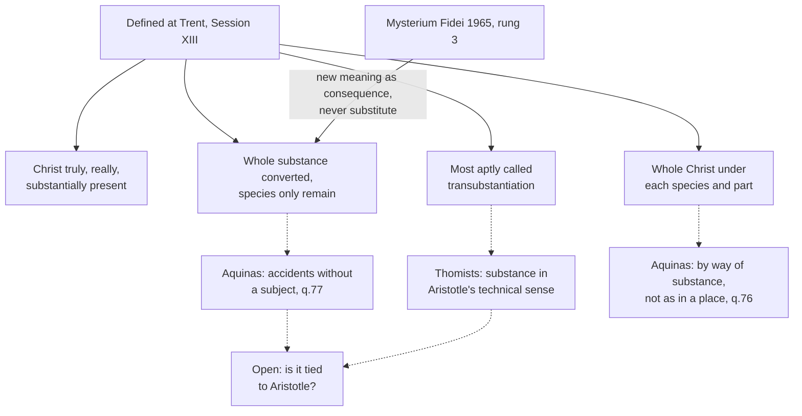

# Sacraments & Liturgy · Lesson 3.3: Real presence and transubstantiation

> ⏱ ~15 min · Module 3: The Eucharist · Builds on: [3.1 The institution and the earliest witness](03-01-the-institution-and-the-earliest-witness.md), [3.2 The controversies that forced precision](03-02-the-controversies-that-forced-precision.md), [`metaphysics` 2.1](../../metaphysics/lessons/02-01-substance-and-accident.md), [`thomistic-synthesis` 2.1](../../thomistic-synthesis/lessons/02-01-act-and-potency-extended.md) · Unlocks: [3.4 The sacrifice of the Mass](03-04-the-sacrifice-of-the-mass.md), [3.5 Communion, reservation, adoration](03-05-communion-reservation-adoration.md)

## Why this matters

[`metaphysics` 2.1](../../metaphysics/lessons/02-01-substance-and-accident.md) and [`thomistic-synthesis` 2.1](../../thomistic-synthesis/lessons/02-01-act-and-potency-extended.md) both stopped at this bridge. Trent's Session XIII is where this course's two columns most easily blur, because its key word has a famous philosophical owner. This lesson reads what the council defined, then Aquinas's account, labelled as one. The presence is a mystery strictly so called ([`fundamental-theology` 1.3](../../fundamental-theology/lessons/01-03-supernatural-revelation.md)): defining it fixes what must be said, not how it is possible.

## The idea

Ask a host two questions: *what does it look like, taste like, weigh?* and *what is it?* Before the consecration both answers are "bread". After it, on Trent's teaching, they come apart: everything you can see, taste or measure still answers "bread"; the answer to *what is it* is "the body of Christ".

Compare the changes [`metaphysics` 2.2](../../metaphysics/lessons/02-02-change-act-and-potency.md) sorts. In accidental change one thing gains new properties: a leaf turns red. In substantial change a new thing comes to be, its appearances change too, and matter persists underneath: wood burns to ash. The Eucharist fits neither. What the thing *is* changes wholly, how it *appears* not at all, and nothing of the bread persists to become the body. So Aquinas calls it "not a formal, but a substantial conversion" which, "with a name of its own", can be called transubstantiation (ST III q.75 a.4).

Then the three adverbs. Canon 1 condemns saying Christ is there "only ... as in a sign, or in figure, or virtue" (power), and sets against them *truly*, *really* and *substantially*. The usual pairing: *truly* against figure, *really* against mere sign, *substantially* against presence by power alone, as Christ acts through baptism's water. The canon lists both triples; the pairing is the theologians' reading.

## In their own words

The Synod of Jerusalem (1672), whose decrees are called the Confession of Dositheus, answered the Calvinist-leaning *Confession* issued under Cyril Lucaris's name. Its Decree 17 stacks four verbs: the bread is changed, transubstantiated (*metousiousthai*), made over and refashioned into the Lord's true body. It places that body under the bread's accidents (*sumbebēkota*), where Trent says "species". And it limits its own key word (lesson's translation of the Greek):

> By the word *metousiosis* we do not believe the manner is explained ... for that is wholly beyond grasp except to God himself ... but that the bread becomes truly, really and substantially the Lord's true body.

Later Orthodox writers differ: some use the word as Jerusalem did; others prefer the Byzantine epiclesis's verb, *metaballō*, "to change" (lesson's gloss), and decline any account of how.

## The doctrine

[Session XIII](../reference.md#trent-session-xiii) (11 October 1551; the events are [`church-history` 6.4](../../church-history/lessons/06-04-trent-and-catholic-reform.md)) states the change in chapter 4 (Waterworth):

> by the consecration ... a conversion is made of the whole substance of the bread into the substance of the body of Christ ... which conversion is, by the holy Catholic Church, suitably and properly called Transubstantiation.

1. **[Real presence](../reference.md#real-presence).** After the consecration Christ, true God and man, is "truly, really, and substantially contained under the species" (ch. 1). Canon 1 anathematizes denying that his body and blood, with soul and divinity, "and consequently the whole Christ", are so contained. *In words:* not a picture, a reminder or a power working through bread, but Christ himself.
2. **The conversion; no remanence.** Canon 2 condemns saying the substance of bread and wine "remains conjointly with" the body and blood, and denying the conversion "of the whole substance". *In words:* not bread *and* Christ, but Christ under what remains of bread.
3. **The species remain.** Canon 2 again: "the species only of the bread and wine remaining". Trent's word is *species*, appearances; it never says "accident". *In words:* everything senses and instruments reach is still there.
4. **[The name](../reference.md#transubstantiation).** Chapter 4 says the conversion "is ... suitably and properly called" transubstantiation (*convenienter et proprie ... est appellata*); canon 2, that the Church "most aptly calls" it so (*aptissime appellat*). The council declares the conversion and endorses the Church's name for it ([3.2](03-02-the-controversies-that-forced-precision.md)). *In words:* the reality is defined, and the word as the right word for it.
5. **[Concomitance](../reference.md#concomitance).** By "the force of the words" the body is under the bread and the blood under the wine; by the "natural connexion and concomitancy" of the risen Christ's parts, each is under the other species too, with the soul, and the divinity by the hypostatic union (ch. 3). Canon 3: the whole Christ is under each species "and under every part of each species, when separated". *In words:* the words aim at body and at blood, and reach the living Christ, who cannot be had in pieces.
6. **Permanence and worship.** The presence is not there "only during the use"; it remains in reserved hosts (can. 4). The sacrament is adored with latria, the worship due to God (ch. 5, can. 6), on the principle of one adoration of the Word with his flesh ([`christology` 3.4](../../christology/lessons/03-04-the-grace-of-the-head.md)). *In words:* what is there at the consecration stays, and it is God.

**What Trent did not do.** It did not say how the species exist once the bread's substance is gone, or how one body is on many altars: only that this is a manner of existing which, "though we can scarcely express it in words", faith holds possible to God, distinct from Christ's natural mode at the Father's right hand (ch. 1). Aristotle is never named.

**[*Mysterium Fidei*](../reference.md#transignification) (1965).** In the early 1960s some theologians, chiefly in the Netherlands, restated the change as *transignification* (a new meaning) or *transfinalization* (a new purpose). Paul VI rejects treating it as if it involved "nothing more than" these (§11), and accepts them as consequences: the species take on a new signification and finality because they contain a new reality rightly called ontological (§46). Trent's formulas are tied to no culture, stage of science or school, and may be clarified only with their meaning kept (§§24–25). Pius VI had censured a synod for omitting the word as if it were merely scholastic (*Auctorem fidei*, 1794, prop. 29): the *how* may go unsaid, not the word guarding the *what*.

**Aquinas's account, as an account.** Of ST III qq.75–77, tabled below, two steps carry the weight. The body is there "after the manner of substance", so not as in a place (q.76 a.5); God's presence in all things and in the just is [`trinity-and-god` 1.4](../../trinity-and-god/lessons/01-04-immutability-eternity-immensity.md)'s, which left this third mode here. And the [accidents remain without a subject](../reference.md#accidents-without-a-subject), held in being by God (q.77 a.1). That is where [substance and accident](../reference.md#substance-and-accident) are pressed hardest: [`metaphysics` 2.1](../../metaphysics/lessons/02-01-substance-and-accident.md)'s P2, from the *Categories*, says what is present in a subject cannot exist apart from it. Aquinas replies that existing in a subject belongs to what an accident is, but these stand "through the Divine power sustaining them" (q.77 a.1 ad 2). He borrows Aristotle's categories, then asks God for what Aristotle's definition rules out by nature.

**Is the doctrine committed to Aristotle?** For the Thomist, "substance" in canon 2 is the *Categories*' substance. On the other reading, it means what a thing is as against how it appears; its defenders cite Trent's "species" and *Mysterium Fidei* 24. The argument belongs to the module's boss problem and to [`apologetics-catholic-claims`](../../apologetics-catholic-claims/syllabus.md). Either way no account may let the bread's substance remain, or reduce the change to one of meaning.

| Defined or taught (with level) | A school's explanation (no magisterial level) |
|---|---|
| Christ truly, really, substantially present (can. 1): rung 1 | Not by local motion, so by conversion (q.75 a.2) |
| Whole substance converted, none remaining (can. 2): rung 1 | Only infinite power converts whole being (q.75 a.4) |
| Species only remain (can. 2): rung 1 | Accidents without a subject (q.77 a.1)\*, quantity bearing the rest (a.2) |
| Most aptly called transubstantiation (can. 2): rung 1 | "Substance" in the *Categories*' technical sense |
| Whole Christ under each species and part (can. 3): rung 1; concomitance (ch. 3): at least rung 3 | Present by way of substance, whole in each part (q.76 aa.1, 3) |
| Not in his natural mode (ch. 1); not as bodies are in a place (MF 46): at least rung 3 | Related to the place only through the bread's dimensions (q.76 a.5) |
| Presence remains after the celebration (can. 4); latria (can. 6): rung 1 | It ends when bread would have been corrupted (q.77 a.4) |

\*Not in Trent. Constance (1415) condemned Wyclif's thesis that the accidents do *not* remain without a subject, among forty-five articles censured together, some as heretical, others as erroneous, rash or offensive, without saying which is which (Martin V, *Inter cunctas*, 1418). Not defined; that act's weight here is the theologians' question.

**Mark the levels** ([`fundamental-theology` 4.4](../../fundamental-theology/lessons/04-04-the-ladder-of-doctrinal-authority.md); [levels](../reference.md#levels-of-authority)). Session XIII is a conciliar act with canons; the chapter expounds, and the canon is where the definition bites. Canons 1–4 and 6 are **rung 1**: for the change and the term, **not** for Aristotle ([`fundamental-theology` 5.1](../../fundamental-theology/lessons/05-01-vincent-of-lerins.md)). Chapter teaching no canon repeats (concomitance as the reason, the contrast of modes) is **at least rung 3**. *Mysterium Fidei*, an encyclical, is **rung 3**, restating and applying Trent. Aquinas settles nothing by authority: **no magisterial level**. Whether the doctrine needs an Aristotelian account of substance is **freely disputed**, inside the line the canons draw.

## Defined and explained

Solid edges carry magisterial weight; dashed ones are school explanation.

## Worked examples

**Ex 1 (clean): the fraction.** The priest breaks the host, drops a piece into the chalice, and a crumb falls on the corporal. *Was Christ broken?* No: the whole Christ is under every part of the species when separated (can. 3, rung 1); what breaks is the species. Aquinas's reason (q.76 a.3), presence after the manner of substance, is explanation. *Is Christ in the crumb?* Yes, while it keeps the species of bread. *Is the body now under the wine too?* It always was, by concomitance (ch. 3); the rite signifies and supplies nothing.

**Ex 2 (strain): the forgotten pyx.** Invented: a hospital chaplain finds a pyx left in a coat for months, the host discoloured, mouldy, crumbling. Is Christ there? The presence does not end with the Mass (can. 4, rung 1); when it ends, Trent does not say. The Catechism: as long as the species subsist (CCC 1377). The working criterion is Aquinas's (q.77 a.4): the presence survives changes that would not have corrupted bread, and ceases once bread would have stopped being bread. Nothing happens to Christ, whose body is not the subject of these accidents (q.77 a.1). The strain: permanence is defined, but its end is fixed only by an explanatory test, a counterfactual about a substance no longer there. What to do with it is discipline, and [3.5](03-05-communion-reservation-adoration.md)'s.

## Watch out

- **You might think Trent defined the Thomist machinery.** It says *species*; accidents without a subject are Aquinas's explanation, and calling them defined **overstates**, as does "a Catholic must be a Thomist" (*Mysterium Fidei* 24).
- **You might think transubstantiation is one theory among several.** The conversion of the whole substance and its name are **rung 1** (can. 2). Calling them a school's opinion **understates**: the move *Auctorem fidei* censured.
- **You might think "real" makes Christ's other presences unreal.** It marks presence "par excellence", because substantial, without denying the others (*Mysterium Fidei* 39; CCC 1374).
- **You might think "not as in a place" means "only spiritually".** Canon 8 condemns saying Christ is eaten "spiritually only"; *Mysterium Fidei* 46: corporeally present, though not as bodies are in a place.

## One-liner

> Trent defined *that* the bread's whole substance becomes Christ's body, only the species remaining, and the right name for it; Aquinas explained *how*, and the explanation is not the definition.

## Problems

**P1 (🟢)** *(Exegetical)* An **invented** social-media thread, written for this problem:

> **Yerlan:** Trent defined that after the consecration the accidents of the bread exist without a subject, exactly as Aristotle teaches. So you can't be Catholic without being a Thomist.
>
> **Henrike:** That's backwards. Transubstantiation is one theological theory among several, and Catholics are free to hold that Christ becomes present alongside the bread, which stays bread. Anyway, the presence lasts only while Mass is going on; leftover hosts are blessed bread.

Find **four** errors, at least one in each post. For each give the correction and the level of the point at stake. 150 words or fewer.

**P2 (🟡)** *(Exegetical)* Two **invented** paragraphs, written for this problem and attributed to no one, from a graduate seminar's reading pack:

> **A.** "I prefer to speak of transfinalization. Because the whole substance of the bread has become the body of Christ, the host now serves a new end and carries a new meaning: food for eternal life, the sign of Christ's self-gift. The new purpose is real because what lies under the species is really different."
>
> **B.** "Transubstantiation, rightly understood, simply is transignification. Nothing happens to the bread as bread; what changes is what it means and what it is for, since Christ now gives it to us as the sign of his self-giving. That change of meaning is all the doctrine ever needed to say."

(a) Using *Mysterium Fidei*, say whether each paragraph offers the new meaning as an addition to the conversion or as a substitute for it, citing the section that decides each.

(b) Which canon of Session XIII does the substitute fall under, and at what level? Two sentences per part.

**P3 (🔴)** *(Exegetical)* Aquinas, ST III q.76 a.5, from the body of the article (English Dominican Province):

> ... Christ's body is in this sacrament not after the proper manner of dimensive quantity, but rather after the manner of substance. But every body occupying a place is in the place according to the manner of dimensive quantity, namely, inasmuch as it is commensurate with the place according to its dimensive quantity. Hence it remains that Christ's body is not in this sacrament as in a place, but after the manner of substance, that is to say, in that way in which substance is contained by dimensions; because the substance of Christ's body succeeds the substance of bread in this sacrament ... Nevertheless the substance of Christ's body is not the subject of those dimensions, as was the substance of the bread ... the substance of Christ's body is compared with that place through the medium of foreign dimensions.

(a) Reconstruct the main argument as numbered premises and a conclusion, and name the premise that comes from the doctrine of the conversion rather than from the theory of place.

(b) What part of the article's conclusion does the Church teach, where, and at what level, and what part is Aquinas's explanation? Two sentences.

Solutions

**P1** *(Exegetical)*

**Accept:** any four of the six below, with at least one from each post, each with a correct level.

**Must hit, strict:**

- **Yerlan, "Trent defined ... accidents ... without a subject".** Trent defined that the *species* only remain (can. 2, rung 1). It never speaks of accidents or of their subject. Accidents without a subject is Aquinas's explanation (ST III q.77 a.1), not defined.
- **Yerlan, "as Aristotle teaches".** Aristotle teaches the opposite: what is present in a subject cannot exist apart from it (*Categories*; [`metaphysics` 2.1](../../metaphysics/lessons/02-01-substance-and-accident.md), P2). Aquinas needs divine power precisely because of that.
- **Yerlan, "can't be Catholic without being a Thomist".** The formulas are tied to no theological school (*Mysterium Fidei* 24, rung 3), and whether the doctrine needs Aristotle is freely disputed. Overstated.
- **Henrike, "one theory among several".** The conversion of the whole substance and its name are rung 1 (can. 2). *Auctorem fidei* censured treating it as a merely scholastic question. Understated.
- **Henrike, "alongside the bread, which stays bread".** Canon 2 condemns the substance of bread remaining "conjointly with" the body: rung 1.
- **Henrike, "only while Mass is going on".** Canon 4 condemns presence "only during the use" and affirms it in reserved and remaining hosts: rung 1.

**Wrong turns:** correcting Yerlan by saying accidents without a subject is "condemned" or "false", when it is the leading explanation and Constance condemned its denial; correcting Henrike's first sentence by saying Aquinas's account is defined, which trades her understatement for Yerlan's overstatement; giving a rung to Aquinas.

**Model answer:** Yerlan: Trent defined only that the species remain (can. 2, rung 1); "accidents without a subject" is Aquinas's explanation (q.77 a.1), with no magisterial level. Nor is it Aristotle's: for Aristotle an accident cannot exist apart from its subject. Henrike: the conversion of the whole substance and the name are defined (can. 2, rung 1), not one theory among several. Christ present alongside bread that stays bread is the remanence canon 2 condemns, and canon 4 (rung 1) defines that the presence remains after the celebration in reserved hosts.

---

**P2** *(Exegetical)*

**Accept:** for (b), canon 2, or canon 2 with canon 1; the level must be rung 1.

**Must hit, strict (a):**

- **A is an addition.** It grounds the new end and meaning in the conversion of the whole substance and in a real difference under the species. That is *Mysterium Fidei* 46: new signification and finality *because* of a new ontological reality. Using the word "transfinalization" is not the error.
- **B is a substitute.** "Nothing happens to the bread as bread" makes the change one of meaning only. That is what *Mysterium Fidei* 11 rejects: treating transubstantiation as involving "nothing more than" transignification. Keeping the word "transubstantiation" does not save it, since the formulas must keep their meaning (§§24–25).

**Must hit, strict (b):**

- B falls under canon 2: the bread's substance remains, and the conversion of the whole substance is denied. It arguably also falls under canon 1, which condemns a presence only "as in a sign". Level: **rung 1**, Session XIII's canons. *Mysterium Fidei* applies that definition at **rung 3**; the rung-1 weight comes from Trent.

**Wrong turns:** judging by vocabulary, condemning A for "transfinalization" or clearing B for "transubstantiation"; giving *Mysterium Fidei* rung 1; treating the question as open because some theologians proposed transignification.

**Model answer:** (a) A offers transfinalization as an addition: it makes the new end real *because* the whole substance has become Christ's body, which is exactly what *Mysterium Fidei* 46 allows. B offers transignification as a substitute: "nothing happens to the bread as bread" is the "nothing more than" that §11 rejects, whatever word it keeps. (b) B falls under canon 2 of Session XIII, which condemns holding that the bread's substance remains and denying the conversion of the whole substance (and arguably canon 1, presence "only ... as in a sign"). That is rung 1; *Mysterium Fidei* restates and applies it at rung 3.

---

**P3** *(Exegetical)*

**Must hit, strict (a):**

- P1. Christ's body is in the sacrament after the manner of substance, not after the manner of dimensive quantity.
- P2. Whatever is in a place as in a place is there by its dimensive quantity, commensurate with the place.
- ∴ C. Christ's body is not in the sacrament as in a place.
- P1's ground, and the doctrinal premise: the substance of Christ's body *succeeds the substance of bread*, so it stands as the bread's substance stood, under dimensions that are not its own. That is the conversion (Trent, can. 2). P2 comes from the theory of place.

**Must hit, strict (b):**

- **Taught:** Christ is present in many places sacramentally, by a mode distinct from his natural mode at the Father's right hand (Trent XIII ch. 1); *Mysterium Fidei* 46 says he is present not as bodies are in a place. No canon defines it, so **at least rung 3**.
- **Explanation:** "after the manner of substance", dimensive quantity and "foreign dimensions" are Aquinas's account, with **no magisterial level**.

**Wrong turns:** calling "not as in a place" rung 1, since no canon defines it; calling it mere Thomist opinion, since Trent ch. 1 and *Mysterium Fidei* 46 teach it; reading "not locally" as "not really" or "only spiritually" (can. 1, can. 8); confusing it with divine omnipresence ([`trinity-and-god` 1.4](../../trinity-and-god/lessons/01-04-immutability-eternity-immensity.md)), when Christ's body is not everywhere and *Mysterium Fidei* 39 rejects a body present everywhere.

**Model answer:** (a) P1: Christ's body is in the sacrament after the manner of substance, because it succeeds the substance of the bread under the bread's dimensions. P2: whatever is in a place is there by its own dimensive quantity, commensurate with that place. C: so Christ's body is not there as in a place. The premise from doctrine is that the body's substance succeeds the bread's, which is the conversion of canon 2; P2 is from the theory of place. (b) The Church teaches the negative: Christ is present by a mode other than his natural mode (Trent XIII ch. 1), not as bodies are in a place (*Mysterium Fidei* 46), at least rung 3. Why and how, by way of substance and through the bread's dimensions, is Aquinas's explanation, with no magisterial level.

## Flashback

**From Lesson [3.1](03-01-the-institution-and-the-earliest-witness.md) (The institution and the earliest witness):** *(Exegetical.)* Diagnose. Four notes from the choir director's email to the choir of Holy Name parish, Cardew, before the Mass of the Lord's Supper, **invented**, written for this problem:

> (1) "The first reading calls the Passover 'a memorial', and that is what Jesus meant by 'Do this in memory of me': we look back on that night the way a family recalls a loved one on an anniversary, and the remembering happens in our minds."
>
> (2) "The second reading, Paul's account of the Supper, was written after the Gospels, as his summary of them."
>
> (3) "Trent solemnly defined that 'This is my body' must be taken in its proper and most manifest meaning, at the same level as the Real Presence itself."
>
> (4) "At Communion we sing *O sacrum convivium*, which calls the sacrament a pledge of future glory. The idea goes back to St Irenaeus, but it is private devotion: the Church has never taught it."

Each note contains an error. Correct each from the text that decides it, and give the level wherever one is involved. **One or two sentences per note.**

Solution

**Accept:** for (1), CCC 1362–1364 or Trent's "a remembrance of his wonderful works" (Session XIII, ch. 2) as the teaching; for (4), CCC 1402, which quotes this antiphon, alongside Trent, provided Trent's chapter is not given rung 1.

**Must hit, strict:**

- **(1) The sense of memorial.** In Scripture a memorial is a rite in which a past saving act reaches those who keep it: the Passover day is "for a memorial" (Exod 12:14), and the father keeping it says "This is what the Lord did to me" (13:8). The Church reads *anamnesis* that way: the Eucharist makes Christ's Passover present and is not mere recollection (CCC 1362–1364, **at least rung 3**). The exegesis of *zikkaron* is scholarship, with **no level**; how the one sacrifice is present is the theology of Lesson 3.4.
- **(2) The order of the witnesses.** Paul's is the earliest written account (mid-50s), older than any Gospel, and he hands on what he "received" and "delivered" (1 Cor 11:23), so its core was fixed before he wrote. A historical point, **no level**.
- **(3) Overstated.** That the words carry "that proper and most manifest meaning in which they were understood by the Fathers" is taught in an expository chapter (Session XIII, ch. 1): **at least rung 3**. What canon 1 defines, at **rung 1**, is the presence itself.
- **(4) Understated.** Trent teaches that Christ willed the sacrament to be "a pledge of our glory to come" (Session XIII, ch. 2): **at least rung 3**, a chapter, not a canon. Irenaeus, who argued that bodies nourished by the Eucharist will rise, is a witness on no rung.

**Wrong turns:** correcting (1) by giving the *zikkaron* exegesis a magisterial level, or by explaining how the sacrifice is made present, which is not the question; correcting (3) by calling the proper sense "only an opinion", which understates the chapter; giving (4) rung 1, or giving Irenaeus a rung; treating (2) as doctrine; volunteering an argument against other traditions' readings of the Supper.

**Model answer:** (1) In Scripture's sense a memorial is a rite in which the saving act reaches those who keep it ("This is what the Lord did to me", Exod 13:8), and the Church teaches that the Eucharist makes Christ's Passover present rather than merely recalling it (CCC 1362–1364, at least rung 3). (2) Paul's account, from the mid-50s, is the earliest written, older than any Gospel, and he hands on a tradition he "received", so its core was fixed before he wrote. (3) The proper sense of the words is taught in an expository chapter (Session XIII, ch. 1), at least rung 3; what canon 1 defines at rung 1 is the real presence itself. (4) Trent teaches that the sacrament is "a pledge of our glory to come" (Session XIII, ch. 2), at least rung 3, and Irenaeus is a witness to the idea, on no rung.

## Connections

- **Backward:** [3.1](03-01-the-institution-and-the-earliest-witness.md) showed the realism of the earliest language and [3.2](03-02-the-controversies-that-forced-precision.md) how the word entered use. Substance, accident and P2 are [`metaphysics` 2.1](../../metaphysics/lessons/02-01-substance-and-accident.md); substantial change is its 2.2. The modes of God's presence are [`trinity-and-god` 1.4](../../trinity-and-god/lessons/01-04-immutability-eternity-immensity.md), and one adoration of the Word with his flesh is [`christology` 3.4](../../christology/lessons/03-04-the-grace-of-the-head.md). The levels are [`fundamental-theology` 4.4](../../fundamental-theology/lessons/04-04-the-ladder-of-doctrinal-authority.md) and [5.1](../../fundamental-theology/lessons/05-01-vincent-of-lerins.md).
- **Forward:** [3.4](03-04-the-sacrifice-of-the-mass.md) asks how the Christ present here is offered. [3.5](03-05-communion-reservation-adoration.md) uses concomitance for communion under one kind and treats reservation and adoration. [6.3](06-03-the-roman-rite-and-the-eastern-rites.md) tests what the eucharistic form needs, with the Anaphora of Addai and Mari. [`apologetics-catholic-claims`](../../apologetics-catholic-claims/syllabus.md) argues the Eucharistic disputes from this lesson's split between defined and explained.
- **Sideways:** [`metaphysics` 2.1](../../metaphysics/lessons/02-01-substance-and-accident.md) weighs substratum and bundle theories of substance. A bundle theory, on which a thing just is its properties, leaves no room for the *what* to change while every property stays; that is why the Aristotle question is a real one.
