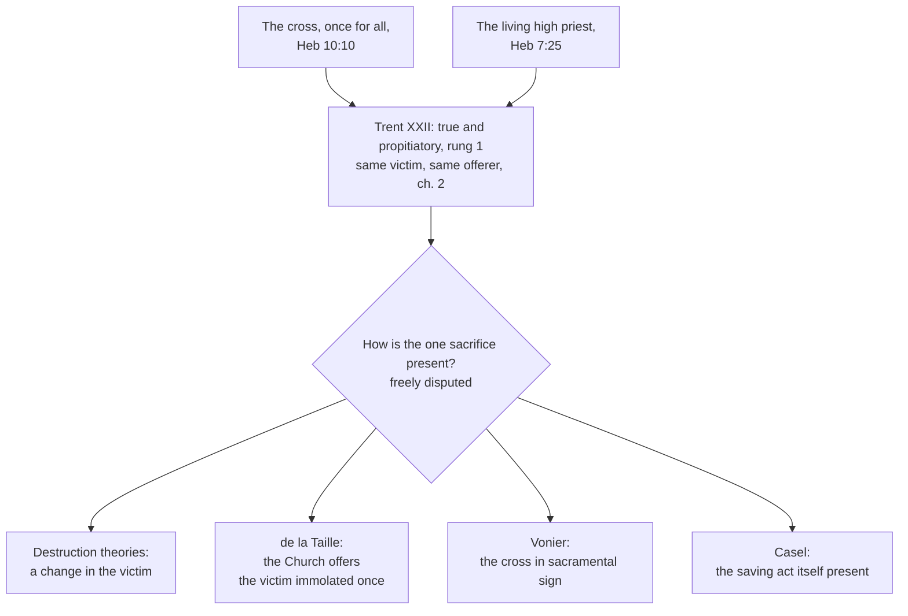

# Sacraments & Liturgy · Lesson 3.4: The sacrifice of the Mass

> ⏱ ~15 min · Module 3: The Eucharist · Builds on: [3.1 The institution and the earliest witness](03-01-the-institution-and-the-earliest-witness.md), [3.2 The controversies that forced precision](03-02-the-controversies-that-forced-precision.md), [3.3 Real presence and transubstantiation](03-03-real-presence-and-transubstantiation.md), [`christology` 5.1](../../christology/lessons/05-01-the-paschal-mystery-and-the-threefold-office.md), [`christology` 5.2](../../christology/lessons/05-02-ransom-christus-victor-and-sacrifice.md) · Unlocks: [3.5 Communion, reservation, adoration](03-05-communion-reservation-adoration.md), [5.1 Holy Orders: the three degrees](05-01-holy-orders-the-three-degrees.md), [6.1 What the liturgy is](06-01-what-the-liturgy-is.md)

## Why this matters

Hebrews says Christ offered himself once for all, [*ephapax*](../reference.md#ephapax) (7:27; 9:12; 10:10), and the Church takes that as a datum, not an objection to defuse ([`new-testament` 6.2](../../new-testament/lessons/06-02-hebrews.md)). Trent defined that at every Mass a true and propitiatory sacrifice is offered. The Reformation confessions judged the two incompatible. Here: their objection in their words, then what Trent holds, and where its definition stops.

## The idea

A sacrifice is an offering made to God. Ask of any sacrifice: who offers, what is offered, and how? Trent's answer for the Mass: the same offerer as on the cross, the same victim, a different manner. Not a second sacrifice beside Calvary, and not a reminder of it: the one sacrifice, made present under the signs of bread and wine.

The offerer is not absent. Hebrews' high priest is "always living to make intercession for us" (Heb 7:25, DR), and the Catechism draws the consequence: in heaven Christ exercises his priesthood permanently, "the centre and the principal actor" of the liturgy that honours the Father (CCC 662). So the Mass is not the Church doing for an absent Christ what he did once, but the living priest drawing his Church into his finished offering. That is how Trent can say "the same now offering" without unsaying "once".

Trent defined the *that*; the *how* it left to theologians.

## In their own words

The Lutheran and Reformed confessions, stated as they state themselves and left standing.

**The Augsburg Confession (1530), art. 24,** opens by denying that its churches abolished the Mass: it is kept, with reverence. It rejects the opinion that Christ's passion satisfied for original sin and the Mass was instituted as an oblation for daily sins, taking away the sins of the living and the dead *ex opere operato*, "for the doing of the work" (Schaff's translation). That diminishes the glory of the passion, since "by one oblation" Christ has perfected the sanctified (Heb 10:14), and puts justification in the work of Masses, not in faith. The Mass exists so that faith recalls Christ's benefits and the fearful conscience is comforted.

**The Apology (1531), art. 24,** draws the decisive distinction (Bente and Dau's translation, 1921):

> One is the propitiatory sacrifice, i.e., ... one that reconciles God, or appeases God's wrath ... The other species is the eucharistic sacrifice, which does not merit the remission of sins or reconciliation, but is rendered by those who have been reconciled

"The death of Christ alone is truly a propitiatory sacrifice." Prayer, thanksgiving, preaching and the saints' afflictions are of the second kind, which Malachi's "clean oblation" (1:11) means. The Mass may be called a daily sacrifice if the whole Mass is meant, not a ceremony profiting others *ex opere operato*.

**The Reformed.** The Heidelberg Catechism, Q. 80 (1563), sets the Supper, witness to full forgiveness by Christ's one sacrifice once accomplished, against a Mass that offers forgiveness only if Christ is "still daily offered" by priests: "a denial of the one sacrifice and passion of Jesus Christ". The Thirty-Nine Articles (1571), art. 31: Christ's offering once made is the perfect redemption, propitiation and satisfaction for all sin, and there is no other; so the sacrifices of Masses for the quick and the dead "were blasphemous fables, and dangerous deceits".

## The doctrine

[Session XXII](../reference.md#trent-session-xxii) (17 September 1562; events in [`church-history` 6.4](../../church-history/lessons/06-04-trent-and-catholic-reform.md)) teaches in nine chapters and defines in nine canons.

1. **The premise.** Christ was "about to offer Himself once on the altar of the cross unto God the Father" (ch. 1). *In words:* Trent starts where Hebrews does.

2. **A true and proper [sacrifice](../reference.md#sacrifice-of-the-mass).** Since his priesthood was not to end at his death, at the Supper Christ left the Church a visible sacrifice (ch. 1, Waterworth):

   > whereby that bloody sacrifice ... might be represented, and the memory thereof remain even unto the end of the world, and its salutary virtue be applied to the remission of those sins which we daily commit

   The Latin verb, *repraesentaretur*, means made present again, not depicted (lesson's gloss; CCC 1366 has "re-presented"). Canon 1 condemns denying that a true and proper sacrifice is offered, or saying the offering is only Christ given us to eat; canon 2, denying that "Do this" made the apostles priests to offer ([5.1](05-01-holy-orders-the-three-degrees.md)). *In words:* made present, remembered, applied: one sacrifice.

3. **Same victim, same offerer, another manner.** In the Mass "that same Christ is contained and immolated in an unbloody manner" ("contained" is [3.3](03-03-real-presence-and-transubstantiation.md)'s word). Then (ch. 2):

   > For the victim is one and the same, the same now offering by the ministry of priests, who then offered Himself on the cross, the manner alone of offering being different.

   The bloody oblation's fruits come through the unbloody, "so far is this (latter) from derogating in any way from that"; canon 4 condemns saying the Mass derogates from the cross. *In words:* the Mass adds no second offering; it is the way the one offering reaches us.

4. **Propitiatory, for the living and the dead.** Read "propitiatory" in [`christology` 5.1](../../christology/lessons/05-01-the-paschal-mystery-and-the-threefold-office.md)'s vocabulary: expiation acts on sin, propitiation on God, and God himself provides it; it is not the Son changing the Father's mind. So in ch. 2 the Lord, "appeased by the oblation", grants "the grace and gift of penitence" and forgives even grave sins to those who come "contrite and penitent". It is offered for the living's sins, punishments, satisfactions and needs, and for the dead "not as yet fully purified". Canon 3 condemns calling it only praise and thanksgiving, a bare commemoration, profitable only to the communicant, or not to be offered for the living and the dead. *In words:* it obtains the cross's mercy for others.

5. **Who offers.** Christ, through priests acting [*in persona Christi capitis*](../reference.md#in-persona-christi-capitis) (CCC 1548; already ST III q.83 a.1 ad 3). And the Church: in the [Roman Canon](../reference.md#roman-canon)'s anamnesis, *nos servi tui, sed et plebs tua sancta ... offerimus*, "we your servants, and your holy people too, ... offer" a pure, holy, spotless victim (lesson's translation). The faithful offer by the priest's hands and with him (*Mediator Dei* 92–93; LG 10 in [`ecclesiology-and-mariology` 3.3](../../ecclesiology-and-mariology/lessons/03-03-the-laity-charisms-and-the-sensus-fidei.md)). *In words:* one principal offerer, and a Church offering with him.

6. **Intentions and [stipends](../reference.md#mass-stipends).** A priest may apply the Mass for anyone, living or dead (can. 901), and may accept an offering to apply it for an intention (can. 945 §1); the donor shares in supporting the Church (can. 946). Any appearance of trade is excluded (can. 947); each accepted offering obliges a separate Mass (can. 948). *In words:* the offering buys nothing; it fixes an intention.

**What the canons do not say.** None explains *how* the one sacrifice is present. Canons 5–9 defend practices: Masses in the saints' honour; the Canon; ceremonies; Masses where only the priest communicates, "truly common" (ch. 6; can. 8); the low voice; water in the wine. Canon 9 condemns requiring the vernacular *only* ([7.2](07-02-liturgical-language-and-ars-celebrandi.md)).

| Defined or taught (with level) | A school's explanation (no magisterial level) |
|---|---|
| A true and proper sacrifice, not merely Christ given to eat (can. 1): rung 1 | **Destruction theories** (post-Tridentine: Bellarmine, de Lugo, Vasquez): sacrifice needs a real or mystical change in the victim, sought in the double consecration or the priest's communion |
| Propitiatory, for the living and the dead (can. 3): rung 1 | **De la Taille**, *Mysterium Fidei* (1921; not Paul VI's encyclical): Supper (oblation) and cross (immolation) are one sacrifice; the Mass is the Church's offering of the victim once immolated |
| It takes nothing from the cross (can. 4): rung 1 | **Vonier**, *A Key to the Doctrine of the Eucharist*: a sacramental sacrifice, the cross present in the sign of the separate consecration, after Aquinas (q.83 a.1) |
| One victim, one offerer, manner alone different (ch. 2): at least rung 3, not open to denial | **Casel**, *Das christliche Kultmysterium*: mystery-presence, the saving act itself made present in the rite |
| The separate species signify the separated body and blood; communion belongs to the Mass's integrity (*Mediator Dei* 70, 115): rung 3 | What "unbloody" consists in |

**Said plainly.** Masses were bargained over for money. Trent's decree on what to observe and avoid at Mass, passed the same day, told bishops to prohibit "all manner of conditions and bargains for recompenses", demands for alms "little removed from a simonical taint", and "the observance of a fixed number of certain masses and of candles" as superstition. The Augsburg Confession had complained of Masses "used for gain" thirty-two years earlier.

**Mark the levels** ([`fundamental-theology` 4.4](../../fundamental-theology/lessons/04-04-the-ladder-of-doctrinal-authority.md), [4.5](../../fundamental-theology/lessons/04-05-reading-a-documents-weight.md); [levels](../reference.md#levels-of-authority)). Session XXII is a conciliar act with canons: the chapter expounds; the canon is where the definition bites ([`fundamental-theology` 1.3](../../fundamental-theology/lessons/01-03-supernatural-revelation.md)). Canons 1–4 are **rung 1**. Chapter teaching no canon repeats is **at least rung 3** and not open to denial: the once-for-all offering (ch. 1; [`christology` 5.2](../../christology/lessons/05-02-ransom-christus-victor-and-sacrifice.md)) and the identity formula (ch. 2), on which canon 4 rests. *Mediator Dei*, an encyclical, is **rung 3**; the Catechism carries the weight of what it restates. Every account of [how the one sacrifice is present](../reference.md#how-the-one-sacrifice-is-present) is **freely disputed**; no magisterial act adopts one. The stipend canons are **law, no rung**; the decree on things to be observed is a reform decree, **no rung**.

## Map of positions

Above the diamond, magisterial weight; below it, theology.

## Worked examples

**Ex 1 (clean): a Mass for a father.** Invented: Wilhelmina Oduya gives her parish an offering for a Mass for her late father. *May it be offered for him?* Yes: for the dead in Christ not yet fully purified (ch. 2; can. 3, rung 1; can. 901). *What did her money do?* It bought nothing. It fixed an intention the priest is now bound to (cann. 948–949) and shared in supporting the Church (can. 946). *What does the Mass do for him?* It applies the fruit of the cross (ch. 1) and adds nothing to it (can. 4). How much it avails Trent does not say; Aquinas's answer, that the offering "suffices of its own quantity" for all punishment but avails "according to the measure of their devotion" (ST III q.79 a.5), is explanation.

**Ex 2 (strain): twelve Masses.** The family books twelve more. A councillor objects: if each Mass makes the whole cross present, one suffices; if twelve do more, the Mass adds to the cross. Trent fixes three things: the Mass derogates nothing from the cross (can. 4); it may be offered for the dead (can. 3); superstition about "a fixed number of certain masses" is banished, so no number works of itself. Why more than one? Trent does not say. Aquinas's answer, that what is offered suffices for all while its application is measured by devotion, is theology. The strain: a practice the Code presupposes (cann. 948, 950) rests on an account never defined.

## Watch out

- **You might think "propitiatory" means the Mass forgives sins mechanically, or wins over a reluctant God.** Ch. 2 routes forgiveness through "the grace and gift of penitence" to the contrite, and God provides the propitiation.
- **You might think "represented" or "unbloody" means "only symbolic".** *Repraesentare* is to make present; "unbloody" denies a new death, not a real offering (can. 1, rung 1).
- **You might think one account is Church teaching,** because of *Mediator Dei* 115 or the Catechism's "re-presents". That **overstates**: all are freely disputed. Inferring from the open *how* that the sacrifice is opinion **understates**: canons 1–4 are rung 1.

## One-liner

> The Mass is the one sacrifice of the cross made present under signs, with the same victim and the same living priest: that much is defined, and how it is made present is theology.

## Problems

**P1 (🟢)** *(Exegetical)* An **invented** funeral-planning sheet, written for this problem, from the bereavement team of Holy Family parish, Orrinsby:

> "Arranging a Mass for your loved one. (1) Your offering purchases the Mass. The standard offering is 25 dollars; the larger 'solemn' offering secures a Mass of greater power. (2) Every Mass adds fresh merit to what Christ won on Calvary, so the more Masses you book, the more grace is banked for your loved one. (3) Because the Mass is a propitiatory sacrifice, it forgives your loved one's sins whether or not he repented. (4) If no one but the priest receives Communion, the Mass does not really count, so please ask the family to receive."

For each numbered sentence, name the error and give the correction, citing the text and giving its level wherever a level is involved. **Two sentences per item.**

**P2 (🟡)** Three texts:

> Malachi 1:11 (DR): "For from the rising of the sun even to the going down, my name is great among the Gentiles, and in every place there is sacrifice, and there is offered to my name a clean oblation: for my name is great among the Gentiles, saith the Lord of hosts."
>
> *Didache* 14 (ANF 7): "But every Lord's day ... break bread, and give thanksgiving after having confessed your transgressions, that your sacrifice may be pure. But let no one that is at variance with his fellow come together with you, until they be reconciled, that your sacrifice may not be profaned. For this is that which was spoken by the Lord: In every place and time offer to me a pure sacrifice ..."
>
> Trent, Session XXII, ch. 1: "And this is indeed that clean oblation, which cannot be defiled by any unworthiness, or malice of those that offer (it); which the Lord foretold by Malachias was to be offered in every place ..."

(a) *(Exegetical)* Name two things Trent's sentence does with Malachi 1:11 that the verse, as the Douay prints it, does not itself say. **Two sentences.**

(b) *(Exegetical)* The *Didache* says the sacrifice can be "profaned"; Trent says the oblation "cannot be defiled". Do they contradict each other? Answer with this course's distinctions, and say what weight Trent's reading of Malachi carries. **Three sentences.**

**P3 (🔴)** *(Evaluative)* Trent fixes that the victim and the offerer are the same, "the manner alone of offering being different" (ch. 2), and that the Mass is a true, proper and propitiatory sacrifice that takes nothing from the cross (cans. 1, 3, 4). Which account in this lesson's table best explains the "manner": the destruction theories, de la Taille, Vonier or Casel? Argue for one, or argue that none does, and name the strongest difficulty for your choice. **150 words or fewer.**

Solutions

**P1** *(Exegetical)*

**Must hit, strict:**

- **(1) The offering is not a price.** A priest may accept an offering to apply the Mass for an intention (can. 945 §1), the donor shares in supporting the Church (can. 946), and any appearance of trade is excluded (can. 947): **law, no rung**. Trent's reform decree had already ordered bishops to prohibit "conditions and bargains for recompenses" (no rung). The Mass's worth is Christ's own offering, which no sum measures. How its fruit is applied is explanation (Aquinas: by devotion, q.79 a.5), and never by the size of the offering.
- **(2) The Mass adds nothing to the cross.** It applies the "salutary virtue" of the one sacrifice (ch. 1), and its fruits are those "of that bloody one" received through the unbloody (ch. 2). The once-for-all offering is the decree's premise, not open to denial; a Mass that topped up Calvary would derogate from it, which Trent denies the Mass does (can. 4, **rung 1**).
- **(3) Not a substitute for repentance.** For the living, ch. 2 routes forgiveness through "the grace and gift of penitence" to those who come "contrite and penitent". For the dead, it is offered for those "departed in Christ, and who are not as yet fully purified" (can. 3 makes offering for the dead **rung 1**).
- **(4) The Mass is no less a Mass.** Trent approves Masses at which only the priest communicates sacramentally as "truly common" (ch. 6), and canon 8 condemns calling them unlawful: **rung 1**. Asking the family to receive is good: ch. 6 wishes the faithful to communicate at every Mass. The reason given is what is wrong.

**Wrong turns:** "correcting" (1) by saying stipends are forbidden, when can. 945 permits them; saying canon 4 anathematizes sentence (2): canon 4 condemns the charge that the Mass derogates from the cross, and the sheet's over-claim contradicts the doctrine canon 4 protects (chs. 1–2), but no canon names it; in (3), pronouncing on the dead man's eternal state, which the item does not ask; in (4), saying the faithful's communion does not matter.

**Model answer:** (1) The offering buys nothing: the Code allows a priest to accept it to apply the Mass for an intention (can. 945), forbids any appearance of trade (can. 947), and Trent's reform decree banned bargains for recompense; neither carries a rung. No offering makes a Mass more powerful, since its worth is Christ's offering. (2) The Mass applies the power of the one sacrifice and adds no merit to it (chs. 1–2). The once-for-all offering is Trent's premise, and the Mass derogates nothing from the cross (can. 4, rung 1). (3) Ch. 2 obtains forgiveness through the gift of penitence for those who come contrite, and offers the Mass for the dead "departed in Christ" and not yet fully purified (can. 3, rung 1). It does not stand in for repentance. (4) Trent approves Masses where only the priest communicates as truly common, and canon 8 defines that they are lawful (rung 1). The request is fine, since ch. 6 wishes all to communicate, but its reason is false.

---

**P2** *(Exegetical (a) · Exegetical (b))*

**Accept:** for (a), any two of the three moves below.

**Must hit, strict (a):**

- **Tense.** The Douay verse is in the present: "my name is great", "there is sacrifice", "there is offered". Trent reads it as prediction: the Lord "foretold" (*praedixit*) an oblation "to be offered", to a name that "was to be great" (*futurum esset*).
- **Identification.** The verse names no rite, offerer or victim. Trent identifies the clean oblation with the Mass.
- **Indefectible purity.** The verse says only "clean". Trent adds that the oblation "cannot be defiled by any unworthiness, or malice of those that offer".

**Must hit, strict (b):**

- **No contradiction: different subjects.** Trent's purity belongs to what is offered, Christ's own oblation, which no offerer's malice can spoil (the logic of *ex opere operato*, [1.3](01-03-ex-opere-operato-character-and-fruitfulness.md)). The *Didache*'s belongs to the assembly's offering and disposition: confession and reconciliation keep *their* sacrifice from being profaned. That is the fruitfulness side, not validity.
- **Weight.** The *Didache* is an early witness with no magisterial level. Trent's identification of the clean oblation with the Mass is chapter teaching, **at least rung 3**, given as warrant. It defines no exegesis of what Malachi meant in his own setting; the definition is in the canons.

**Wrong turns:** quoting the Douay's footnote to 1:11 ("the precious body and blood of Christ") as if it were the verse; reading the *Didache* as making the Eucharist invalid when someone quarrels, a Donatist reading the text does not support; treating Trent's citation as a definition of Malachi's meaning (overstatement), or as decoration with no weight (understatement).

**Model answer (a):** The Douay's verse speaks in the present, "there is sacrifice ... there is offered", while Trent reads it as a prophecy of what "was to be offered". The verse also names no rite, and Trent identifies its clean oblation with the Mass and adds that no offerer's malice can defile it.

**Model answer (b):** They do not contradict, because they speak of different things. Trent's "cannot be defiled" concerns what is offered, Christ's own oblation, which holds whatever the offerers are; the *Didache*'s "profaned" concerns the assembly's offering of itself, which confession and reconciliation must make pure, so it bears on fruitfulness, not validity. Trent's use of Malachi is the warrant of a doctrinal chapter, at least rung 3, and defines no reading of the prophet; the *Didache* is a witness with no magisterial level.

---

**P3** *(Evaluative)*

**Must hit, any verdict:**

- **Fix what is not up for grabs.** Canons 1, 3 and 4 are rung 1, and the identity formula is Trent's chapter teaching (at least rung 3). The account chosen is **freely disputed**, with no magisterial level. Say so.
- **Locate the newness.** Say what each Mass adds and what it does not: a change in the victim (destruction theories), the Church's oblation of a victim already immolated (de la Taille), the cross present in sign (Vonier), or the saving act itself present (Casel).
- **Account for "the same now offering".** Say who offers now in your account, and how that squares with the living high priest of Heb 7:25 and CCC 662.
- **Name a real difficulty.** For example: the glorified Christ cannot suffer or bleed (*Mediator Dei* 70), so any "destruction" must be mystical, and versions resting on the priest's communion must answer MD 115 (rung 3), which places the sacrifice's nature in the separated species and their oblation, and communion in the Mass's integrity. Is de la Taille's Mass chiefly the Church's act? Does Vonier's sacrifice "in sign" amount to a true and proper sacrifice (can. 1)? How can Casel's past act be present?

**Wrong turns:** giving the chosen account magisterial weight ("*Mediator Dei* 115 makes the double-consecration account Church teaching"; "the Catechism's 're-presents' adopts Casel"); letting the open *how* loosen rung-1 content, as in an account on which nothing is truly offered at Mass; restating what is the same and what differs without evaluating any account.

**Model answer, one of several:** Vonier's account fits best. Trent's "manner" is the sacramental mode: the one victim, made present by consecration, is offered under separate signs of body and blood, which signify his death. Nothing new happens to Christ, who cannot suffer again, so no new immolation is needed, and "the same now offering" names the living priest acting through his minister, not a second sacrifice. It keeps Aquinas's two grounds: the rite is the image of the Passion and it applies the Passion's fruit (q.83 a.1). It is a theologian's account, freely disputed. The strongest difficulty is canon 1: if the sacrifice lies in a sign of a past death, is the Mass a true and proper sacrifice, or a representation of one? Vonier must answer that this sign contains what it signifies, Christ himself (Session XIII), so it is a sacrifice and not a picture of one.

## Flashback

**From Lesson [3.2](03-02-the-controversies-that-forced-precision.md) (The controversies that forced precision):** *(Exegetical.)* Lines from *Lauda Sion*, the sequence of the Mass of Corpus Christi, part of the feast's liturgy that most scholars ascribe to Aquinas (lesson's translation of the Missal's Latin):

> By the one who receives him he is not cut, not broken, not divided: he is received whole. [...] When at last the sacrament is broken, do not waver, but remember: there is as much under a fragment as is covered by the whole. Of the thing no splitting is made (*nulla rei fit scissura*); of the sign alone is a breaking made (*signi tantum fit fractura*), by which neither the state nor the stature of the one signified is lessened.

(a) Which predicates of the 1059 oath do these lines take away from Christ's body, and to what do they give them? Quote the deciding words, and say what of the 1059 oath the lines keep.

(b) What weight does the sequence itself carry, and what weight do its claims carry? Say which act or source each weight comes from.

Two sentences per part.

Solution

**Accept:** in (a), "the species" or "the sacramental species" for "the sign"; leaving out "handled", which these lines do not address.

**Must hit, strict (a):**

- **Taken from the body:** 1059's "broken by the hands of priests" and "ground by the teeth of the faithful". "Not cut, not broken, not divided" by "the one who receives" answers the teeth; "of the thing no splitting is made" answers the breaking at the fraction.
- **Given to the sign:** "of the sign alone is a breaking made". The breaking belongs to the sacramental species, which is how Aquinas reads Berengar's oath (ST III q.77 a.7 ad 3). "As much under a fragment as is covered by the whole" is why the breaking divides nothing of Christ.
- **Kept:** the realism. "The one signified" is there whole and unlessened, so the lines keep the oath's "not only in sacrament but in truth" and drop only its sensory predicates.

**Must hit, strict (b):**

- **The sequence:** a liturgical text of the feast Urban IV instituted by *Transiturus* (1264), which is liturgical law, **no rung**. Its ascription to Aquinas, a theologian, adds **no magisterial level**, and being sung every year defines nothing.
- **Its claims:** that Christ's body is truly there is **rung 1** through Lateran IV's *Firmiter* and Trent; that the whole Christ is under every part of each species when separated is **rung 1** (Trent, Session XIII, can. 3). Reading the breaking as said of the species is Aquinas's **explanation**, with **no magisterial level**; the 1059 sensory wording was never defined of the body.

**Wrong turns:** reading "of the sign alone" as Berengar's sign-only presence, when the sign is what breaks and the one signified is whole under each fragment; saying the lines reject the 1059 oath outright or brand it heretical, when they keep its realism and correct its predicates from inside; giving the sequence a rung because the Church sings it or because Aquinas wrote it, or crediting *Transiturus* with a definition; the reverse error, treating "as much under a fragment" as mere piety when canon 3 defines it; calling the reassignment of the breaking to the species defined.

**Model answer:**

(a) "Not cut, not broken, not divided" by the receiver, and "of the thing no splitting is made", take from Christ's body the 1059 oath's breaking by the priests' hands and grinding by the teeth; "of the sign alone is a breaking made" gives them to the sacramental species, as Aquinas reads the oath (ST III q.77 a.7 ad 3). The oath's realism stays, since "the one signified" is whole under every fragment and nothing of him is lessened.

(b) The sequence belongs to the liturgy of a feast instituted by *Transiturus*, liturgical law with no rung, and Aquinas's authorship, if accepted, gives it no magisterial level. The true presence it sings is rung 1 through *Firmiter*, and the whole Christ under every part is rung 1 by Trent, Session XIII, can. 3; that the breaking falls on the sign alone is explanation, with no level.

## Connections

- **Backward:** [`christology` 5.1](../../christology/lessons/05-01-the-paschal-mystery-and-the-threefold-office.md) fixed which way propitiation points, and [`christology` 5.2](../../christology/lessons/05-02-ransom-christus-victor-and-sacrifice.md) the one offering made to God. [`new-testament` 6.2](../../new-testament/lessons/06-02-hebrews.md) reads *ephapax* and the high priest of Hebrews 7. [3.1](03-01-the-institution-and-the-earliest-witness.md)'s *anamnesis* is ch. 1's "memory"; [3.3](03-03-real-presence-and-transubstantiation.md)'s "contained" is how the victim is there. [`ecclesiology-and-mariology` 3.3](../../ecclesiology-and-mariology/lessons/03-03-the-laity-charisms-and-the-sensus-fidei.md) gives the common priesthood that joins in the offering.
- **Forward:** [3.5](03-05-communion-reservation-adoration.md) takes up the communion ch. 6 wishes for every Mass. [5.1](05-01-holy-orders-the-three-degrees.md) takes the priesthood canon 2 ties to "Do this". [6.1](06-01-what-the-liturgy-is.md) makes the liturgy Christ's priestly act, [6.3](06-03-the-roman-rite-and-the-eastern-rites.md) reads the Roman Canon, and [7.2](07-02-liturgical-language-and-ars-celebrandi.md) takes canon 9 and the vernacular. The Reformation dispute stated here is argued in [`apologetics-catholic-claims`](../../apologetics-catholic-claims/syllabus.md).
- **Sideways:** Chapter 2's "sins, punishments, satisfactions" is the ledger of [`theology-of-debt` 3.4](../../theology-of-debt/lessons/03-04-aquinas-satisfaction-and-the-debt-of-punishment.md): guilt forgiven, a debt of punishment still owed. Augustine's definition in [`christology` 5.2](../../christology/lessons/05-02-ransom-christus-victor-and-sacrifice.md), a true sacrifice as every work done to unite us to God, is why a sacrifice can be offered by a whole people.
