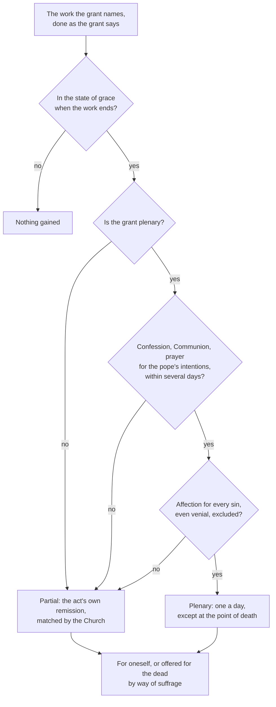

# Sacraments & Liturgy · Lesson 4.2: Indulgences as a practice

> ⏱ ~15 min · Module 4: The sacraments of healing · Builds on: [4.1 Penance](04-01-penance-the-sacrament-and-its-history.md), [3.5 Communion, reservation, adoration](03-05-communion-reservation-adoration.md), [`theology-of-debt` 3.5](../../theology-of-debt/lessons/03-05-the-christian-jubilee-and-the-treasury.md) and [3.6](../../theology-of-debt/lessons/03-06-luther-trent-and-the-reform-of-indulgences.md) · Unlocks: [4.3 Anointing of the sick](04-03-anointing-of-the-sick.md), [7.3 Sacramentals and popular devotion](07-03-sacramentals-and-popular-devotion.md)

## Why this matters

Most Catholics meet indulgences as small print: "a plenary indulgence under the usual conditions." That line is a legal grant with a spiritual condition inside it. Some read it as a ticket that works once the boxes are ticked; others as a medieval embarrassment the Church quietly dropped. This lesson reads it as it stands: what an indulgence is, what the conditions actually are, how to read a grant, and what can be offered for the dead.

## The idea

**The doctrine, reloaded, not re-derived.** [`theology-of-debt` 3.5](../../theology-of-debt/lessons/03-05-the-christian-jubilee-and-the-treasury.md) and [3.6](../../theology-of-debt/lessons/03-06-luther-trent-and-the-reform-of-indulgences.md) did the theology. After guilt and eternal punishment are forgiven, a [temporal punishment](../reference.md#temporal-punishment) can remain (Trent, Session VI, can. 30). The Church has from Christ the power to grant indulgences, and their use is salutary (Session XXV, 1563). She grants them from the treasury of the satisfactions of Christ and the saints (*Unigenitus*, 1343; Paul VI, *Indulgentiarum Doctrina*, 1967, §5). They never touch guilt, and reach the living *per modum absolutionis*, the dead *per modum suffragii* (Leo X, *Cum postquam*, 1518). Luther's objection is stated in 3.6 in his words and argued in [`apologetics-catholic-claims`](../../apologetics-catholic-claims/syllabus.md).

**The practice: a standing offer with one clause nobody can tick for you.** A grant reads: *whoever does this, so disposed, under these conditions, receives that.* The work, the dates, confession and Communion can be checked. The disposition cannot, and the 1967 reform was built so that the disposition decides. The current *Enchiridion*'s introduction says it gives more weight to the believer's act (*opus operantis*) than to the work done (*opus operatum*), a contrast that echoes [1.3](01-03-ex-opere-operato-character-and-fruitfulness.md)'s, and so lists few grants (Praenotanda 4).

## The doctrine

1. **[What an indulgence is](../reference.md#indulgence).** *Indulgentiarum Doctrina* norm 1, restated in can. 992 and CCC 1471: a remission before God of the temporal punishment due to sins whose guilt is already forgiven, which a properly disposed believer gains under defined conditions through the Church, dispensing with authority the treasury of the satisfactions of Christ and the saints. *In words:* the Church pays down a debt of punishment, from a common fund, for someone already forgiven and well disposed. It is not a sacrament: no matter and form, no grace conferred, none of the three sacramental verdicts. For the one who seeks it, the question is: gained in full, in part, or not at all.
2. **[Partial and plenary](../reference.md#plenary-and-partial-indulgences).** A plenary removes all the temporal punishment, a partial some (1967 norm 2; can. 993). Before 1967 partials carried figures such as "300 days," reckoned as the remission that so many days of the old canonical penance would have won, never as days in purgatory (the standard explanation: *Catholic Encyclopedia*, "Indulgences," 1910). The 1967 norm 4 abolished the figures, and norm 5 replaced them: an indulgenced act done with at least a contrite heart receives, besides the remission it earns by itself, an equal remission through the Church. *In words:* the Church matches what your own charity earns.
3. **Who can gain one.** Can. 996: baptized, not excommunicated, in the state of grace at least when the work is finished, with at least a general intention of gaining indulgences, doing the work at the time and in the manner the grant specifies. *In words:* the grant's wording binds, and grace must be present at the finish line.
4. **[The conditions for a plenary](../reference.md#conditions-for-a-plenary-indulgence).** *Enchiridion* norm 20 (from 1967 norm 7): the work; three conditions, namely sacramental confession ([4.1](04-01-penance-the-sacrament-and-its-history.md)), eucharistic Communion ([3.5](03-05-communion-reservation-adoration.md)) and prayer for the pope's intentions (one Our Father and one Hail Mary suffice); and the exclusion of all attachment to any sin, even venial. If the disposition is less than full or a condition is missing, the indulgence is partial (§4). The conditions may fall several days before or after the work, though same-day Communion and prayer are fitting (§3); the Apostolic Penitentiary's note *The Gift of the Indulgence* (2000, ¶5) reads "several" as about twenty. One confession serves several plenaries; each needs its own Communion and prayer (§2). One plenary a day, except at the point of death (*Enchiridion* norm 18). *In words:* three conditions with a generous calendar, one disposition with none.

   **Why the last condition makes plenaries rare.** The Latin excludes *affectus*, affection, for any sin: not sinlessness, but no sin, however small, one still wants to keep. Nobody can check it from outside. A confessor may commute the work and the other conditions for the legitimately impeded (norm 24), never this one (*The Gift of the Indulgence* ¶6). *Indulgentiarum Doctrina* 12 says plenaries were cut back so they would be gained with the proper dispositions, which many need considerable time to reach. The fallback is generous: without full detachment, a partial, not nothing.
5. **[The Enchiridion](../reference.md#enchiridion-of-indulgences), and how to read an entry.** The *Enchiridion Indulgentiarum*, 4th edition (Apostolic Penitentiary decree, 16 July 1999), holds the norms and the grants; only the supreme authority and those given the power by law or the pope grant indulgences (can. 995). Its four general grants are all partial: raising the mind to God amid duties and troubles with a short invocation; serving people in need; freely giving up something lawful and pleasant in a spirit of penance; open witness to the faith. Specific grants follow: grant 7, adoring the Blessed Sacrament for at least half an hour (plenary; a shorter visit, partial); grant 30, reading Scripture in an approved text for at least half an hour (plenary; less, partial). Indulgences attach to acts, objects and places being only their occasion (1967 norm 12), and Mass and the sacraments are not themselves indulgenced, since they already sanctify supremely (Praenotanda 3). *Reading an entry:* who may gain it; the exact work (place, day, duration); plenary or partial; for whom. For a plenary, "the usual conditions" means norm 20, printed or not.
6. **[For the dead, by way of suffrage](../reference.md#by-way-of-suffrage).** Any indulgence may be gained for oneself or applied to the dead by way of suffrage (can. 994), not to another living person (*The Gift of the Indulgence* ¶7). Some grants are for the dead only: grant 29, a devout cemetery visit with prayer for the dead on any day from 1 to 8 November, is a plenary applicable only to souls in purgatory. *By way of suffrage* is set against *by way of absolution*: to the living the Church applies the remission by her authority; for the dead she offers it to God as intercession. None of the texts cited here promises that a given suffrage reached a given soul. That the suffrages of the living help the souls in purgatory is defined at Florence (1439) and restated by Trent (Session XXV, Decree concerning Purgatory); purgatory itself is [`creation-grace-last-things`](../../creation-grace-last-things/syllabus.md)'s.
7. **Jubilee indulgences.** Each jubilee gets its own Penitentiary decree. That for the Ordinary Jubilee of 2025 (13 May 2024) named pilgrimages, devout visits with adoration, and works of mercy and penance; kept every other indulgence in force and the usual conditions; and relaxed one norm, allowing a second plenary the same day, for the dead only, with a second Communion at Mass. The Jubilee ran from 24 December 2024 to 6 January 2026 (*Spes non confundit* 6).
8. **What is bound, and what is free.** Bound: that the Church can grant indulgences and that they are useful. Free: whether to seek any. *Indulgentiarum Doctrina* 11 leaves their use to the "holy and free liberty of the sons of God," and ranks the Mass and the sacraments, penance above all, ahead of them.

**Said plainly.** Indulgences were sold. Alms were a lawful indulgenced work (Aquinas defends grants for building churches and bridges, Supp. q.25 a.3), and by the late Middle Ages collectors were preaching indulgences for money and promising more than the grants said; Boniface IX condemned such sellers in 1392 ([`theology-of-debt` 3.5](../../theology-of-debt/lessons/03-05-the-christian-jubilee-and-the-treasury.md)), and the St Peter's campaign of 1517 is [`church-history` 6.1](../../church-history/lessons/06-01-the-late-medieval-church-and-luthers-protest.md)'s. Trent's own decree admits the abuses and orders

> that all evil gains for the obtaining thereof,—whence a most prolific cause of abuses amongst the Christian people has been derived,—be wholly abolished. (Session XXV, Decree concerning Indulgences)

A year earlier Session XXI's reform decree (ch. 9, 1562) abolished the alms-collectors (*quaestores*): bishops were to publish indulgences, and two canons were to receive alms without any payment. Paul VI names the misuse again (§8). Giving to the poor is still an indulgenced work (general grant 2); what was abolished is gain from the grant.

**Mark the levels** ([`fundamental-theology` 4.4](../../fundamental-theology/lessons/04-04-the-ladder-of-doctrinal-authority.md); [levels](../reference.md#levels-of-authority)), matching [`theology-of-debt` 3.6](../../theology-of-debt/lessons/03-06-luther-trent-and-the-reform-of-indulgences.md). **Rung 1:** the Church's power to grant indulgences and their usefulness (Trent XXV, with anathema); that temporal punishment can remain (VI can. 30); that suffrages help the dead (Florence). **Rung 3:** the treasury, authentic papal teaching Trent never names; *Indulgentiarum Doctrina*'s doctrinal chapters, which restate (CCC 1471 and can. 992 add no weight); that indulgences reach the dead *by way of suffrage* (*Cum postquam*). Accounts of *how* suffrage reaches a soul have **no magisterial level**. Every norm in claims 2–7 (conditions, windows, one a day, the grants, the jubilee decree) is **discipline: it binds, it can be changed, and it sits on no rung**, as 2025's second plenary shows.

## The decision

Only the last diamond cannot be checked from outside.

## Worked examples

**Ex 1 (clean): reading a grant.** Solveig (invented), a night nurse, reads Mark's Gospel in an approved translation for thirty-five minutes on Tuesday after her shift. Grant 30: the work is reading Scripture, approved text, at least half an hour, so a plenary, for herself or the dead. Norm 20: she confessed on Saturday and receives Communion at Wednesday's Mass, then prays an Our Father and a Hail Mary for the pope's intentions; both fall inside "several days," and same-day Communion would only have been fitting. She was in the state of grace when she finished (can. 996). Verdict: plenary if her detachment is complete, partial if not, and only she, and God, know which. She may apply it to her late grandmother.

**Ex 2 (strain): the widow's question.** Folasade (invented): her husband Kunle died in March. On 3 November she visits his grave and prays for him (grant 29: plenary, for the dead only, 1–8 November). She confessed on 28 October, and at that evening's Mass she receives Communion and prays for the pope's intentions. She asks her priest: is Kunle free now? What can be said: she did the work the grant names, inside the window, gaining nothing for herself and offering it for him, and the Church offers it with her. What cannot: Kunle's state, whether the remission was applied to him, even whether her disposition made it plenary rather than partial. That is the strain: a practice that consoles gives no receipt. The priest can add the Church's other suffrages, above all the Mass, which Trent's decree on purgatory puts first.

## Watch out

- **You might think "300 days" meant 300 days off purgatory.** It was reckoned against the old canonical penance, and it went in 1967; a partial is now measured by your own act's charity.
- **You might think "the usual conditions" are a checklist.** Three are. The fourth is a disposition no confessor can commute, and lacking it turns a plenary into a partial.
- **Overstating and understating the level.** Calling the twenty-day window or one-a-day "Church teaching" overstates: it is discipline the Penitentiary adjusts, as in 2025. Calling indulgences an optional opinion understates: the power to grant them is rung 1; only *seeking* one is free.

## One-liner

> An indulgence is a grant: the Church names the work, the calendar and the conditions, but what decides a plenary is a heart that holds on to no sin at all.

## Problems

**P1 (🟢)** *(Exegetical)* Three **invented** cases, written for this problem. Assume each person is in the state of grace and free of all attachment to sin unless told otherwise. For each case, say whether the person gains a plenary indulgence, a partial indulgence, or nothing, and name the norm that decides it. **Two sentences per case.**

(a) Radomir spends half an hour adoring the Blessed Sacrament on a Friday evening. He went to confession nine days earlier. He receives Communion at Mass two days later and afterwards prays an Our Father and a Hail Mary for the pope's intentions.

(b) Wiremu reads Scripture for forty minutes on Monday and adores the Blessed Sacrament for half an hour on Wednesday. On Thursday he goes to confession, receives Communion at Mass and prays once for the pope's intentions. He receives Communion on no other day that month.

(c) Ilka reads Scripture for half an hour on Tuesday. She is conscious of a mortal sin of which she has not repented, and she plans to deal with it on Saturday. On Saturday she confesses. On Sunday she receives Communion and prays for the pope's intentions.

**P2 (🟡)** *(Exegetical)* Four sentences from an **invented** pilgrimage brochure, written for this problem, for the Diocese of Fellbrook's 2025 Jubilee pilgrimage to its cathedral:

> (1) "The indulgence is in the medal: buy one blessed at the cathedral and the plenary goes home with you."
>
> (2) "Confession must be made here at the cathedral on the day of your pilgrimage, or the indulgence is lost."
>
> (3) "You may offer your plenary for a parent who has died."
>
> (4) "During the Jubilee year the Jubilee indulgence replaces every other indulgence."

For each sentence, say whether it is correct. Correct each wrong one from a norm or text in this lesson. Say whether each correction or confirmation rests on doctrine (give the level) or on discipline. **150 words or fewer.**

**P3 (🔴)** *(Exegetical)* Aquinas, *Summa Theologiae*, Supplement q.27 a.3, "Whether an indulgence can ever be granted to one who does not fulfill the conditions required?" The Supplement was compiled after his death from his commentary on the *Sentences*. Translation by the English Dominican Province:

> Objection 1. It would seem that an indulgence can sometimes be granted to one who does not fulfill the required conditions. Because when a person is unable to perform a certain action his will is taken for the deed. Now sometimes an indulgence is to be gained by giving an alms, which a poor man is unable to do, though he would do so willingly. Therefore he can gain the indulgence.
>
> I answer that, Failing the condition of a grant, no grant ensues. Hence, as an indulgence is granted on the condition that a person does or gives a certain thing, if he fails in this, he does not gain the indulgence.
>
> Reply to Objection 1. This is true of the essential reward, but not of certain accidental rewards, such as the remission of punishment and the like.

(a) State the principle of the body, naming the words that carry it. Then say what the reply grants the willing poor man and what it denies him.

(b) Today a confessor may commute the prescribed work or the conditions for someone legitimately impeded (*Enchiridion* norm 24). Does that contradict the article? Name the one requirement for a plenary that no confessor can commute, and the document that says so.

**Two sentences per part.**

Solutions

**P1** *(Exegetical)*

**Accept:** in (b), either work may be the one that gains the plenary.

**Must hit, strict:**

- **(a) Plenary.** The three conditions may be fulfilled several days before or after the work (*Enchiridion* norm 20 §3; about twenty days, *The Gift of the Indulgence* ¶5). Nine days before and two days after both fall inside, and a same-day Communion is only "fitting."
- **(b) One plenary and one partial.** One confession serves several plenaries, but one Communion and one prayer gain only one (norm 20 §2). The other work lacks its conditions and so yields a partial (norm 20 §4).
- **(c) Nothing, neither plenary nor partial.** To be capable of gaining any indulgence a person must be in the state of grace at least when the work is finished (can. 996 §1; *Enchiridion* norm 17 §1). A confession later in the window fulfils a condition but cannot make her capable after the fact. Her Saturday confession can serve a later work.

**Wrong turns:** demanding same-day conditions in (a). Giving (b) two plenaries because "one confession covers several," when Communion and the prayer do not; or giving the second work nothing at all. Giving (c) a partial, or a plenary "because she confessed within the window." Speaking of valid or invalid, as if an indulgence were a sacrament. Calling any of these norms doctrine: they are discipline.

**Model answer:** (a) Radomir gains a plenary. The conditions may be fulfilled several days before or after the work (norm 20 §3), and nine days before and two after are inside the window. (b) Wiremu gains one plenary and one partial. One confession serves both, but a single Communion and prayer gain only one plenary, so the other work falls to a partial (norm 20 §§2, 4). (c) Ilka gains nothing from Tuesday's reading. Can. 996 §1 requires the state of grace at least when the work ends, and a later confession cannot supply it after the fact.

---

**P2** *(Exegetical)*

**Must hit, strict:**

- **(1) Wrong.** Since 1967 indulgences attach to acts, and objects and places are only their occasion (1967 norm 12). Devout *use* of a blessed object can gain an indulgence (1967 norm 17; *Enchiridion* norm 15). The plenary needs its own work, conditions and detachment. **Discipline.**
- **(2) Wrong.** Confession may come several days before or after the work (norm 20 §3; about twenty days in the 2000 note). **Discipline.**
- **(3) Correct.** Any indulgence may be applied to the dead by way of suffrage (can. 994). That they apply to the dead is papal teaching (*Cum postquam*), **rung 3**, under a **rung-1** doctrine that suffrages help the dead (Florence). Applying it is an offering to God, not a guarantee.
- **(4) Wrong.** The Penitentiary's 2025 decree says all other indulgences remain in force. **Discipline.**

**Wrong turns:** marking (3) wrong because "you can't be sure it helps," when offering is exactly what suffrage is. Correcting (1) by saying objects can never be connected with an indulgence. Grading the corrections of (1), (2) or (4) as doctrine. Answering (4) from the general norms instead of the decree.

**Model answer:** (1) is wrong. Since 1967 indulgences attach to acts, not objects (norm 12); devout use of a blessed medal can gain one, but the plenary still needs its work, conditions and detachment. This is discipline. (2) is wrong. The conditions may be fulfilled several days before or after the work, about twenty in the 2000 note; this is discipline. (3) is right. Indulgences can be applied to the dead by way of suffrage (can. 994), taught at rung 3 (*Cum postquam*) on the rung-1 doctrine that suffrages help the dead, though no result is promised. (4) is wrong. The 2025 decree kept every other indulgence in force; this is discipline.

---

**P3** *(Exegetical)*

**Must hit, strict (a):**

- The principle: an indulgence is a conditional grant, so if the condition fails, so does the grant. The deciding words are "Failing the condition of a grant, no grant ensues."
- The reply grants the poor man the **essential reward**: as to eternal life, merited by charity, his will is taken for the deed.
- It denies him the **accidental reward**, the remission of punishment, which is the indulgence.

**Must hit, strict (b):**

- **No contradiction.** Commutation is done by someone with authority over the grant, who substitutes another work or condition. The condition is changed by authority, not waived by the recipient's willingness. The impeded person still gains only by fulfilling the substituted condition, which is what Aquinas's principle requires.
- **Not commutable:** detachment from all sin, even venial (*The Gift of the Indulgence*, Apostolic Penitentiary, 2000, ¶6).
- **Credit:** noting that commutation is discipline, not doctrine; or that Supp. q.25 a.2 ad 3 already measures an alms by the giver's means.

**Wrong turns:** reading the reply as denying the poor man any benefit. Reading commutation as proof that the will now counts for the deed. Saying that detachment can be commuted, or that it is "one of the three conditions."

**Model answer:** (a) An indulgence is a conditional grant, so "Failing the condition of a grant, no grant ensues": whoever does not do or give the thing does not gain it. The poor man's will is taken for the deed as to the essential reward, but not as to the accidental reward of remitted punishment, which is what the indulgence is. (b) There is no contradiction, because commutation is an act of authority that changes the condition, and the person still has to fulfil the new one; his wish alone still gains nothing. Detachment from all sin, even venial, cannot be commuted, as *The Gift of the Indulgence* (2000, ¶6) says.

## Flashback

**From Lesson [3.5](03-05-communion-reservation-adoration.md) (Communion, reservation, adoration):** *(Exegetical.)* Trent, Session XIII (Waterworth): the second sentence of chapter 6, and canon 7.

> Moreover, as to carrying the sacred Eucharist itself to the sick, and carefully reserving it for this purpose in churches, besides that it is exceedingly conformable to equity and reason, it is also found enjoined in numerous councils, and is a very ancient observance of the Catholic Church.
>
> **Canon 7.** If any one saith, that it is not lawful for the sacred Eucharist to be reserved in the sacrarium, but that, immediately after consecration, it must necessarily be distributed amongst those present; or, that it is not lawful that it be carried with honour to the sick; let him be anathema.

A sacristy guide for a parish in Stellbridge, **invented**, written for this problem, tells new sacristans: "We reserve the Blessed Sacrament chiefly so that the faithful can adore it. Trent defined that it must be kept in one locked tabernacle with a lamp burning before it."

(a) Which words of the chapter tie reservation to a purpose, and to which purpose? Is the guide's first sentence right about the order of purposes, and which document settles it?

(b) What does canon 7 define, and at what level? Where do the tabernacle, its lock and the lamp come from, and at what level?

Two sentences per part.

Solution

**Must hit, strict (a):**

- The words: "carefully reserving it **for this purpose** in churches" (Latin *in hunc usum*). The purpose is carrying the Eucharist to the sick.
- The guide inverts the order. The primary and original purpose of reservation is viaticum; communion outside Mass and adoration are secondary (*Eucharisticum Mysterium* 49, 1967, quoting a 1949 instruction).

**Must hit, strict (b):**

- Canon 7 defines a **permission**: it is lawful to reserve the Eucharist rather than distribute all of it at once to those present, and lawful to carry it with honour to the sick. **Rung 1**, an anathematized canon. It says nothing of tabernacle, lock or lamp.
- One tabernacle, immovable and locked, and the lamp before it come from the Code (cann. 938, 940; which churches must reserve is can. 934). **Law: it binds, it can be changed, and it sits on no rung.**

**Wrong turns:** reading "lawful" as "obligatory", or extending canon 7's rung 1 to the Code's tabernacle norms; treating the chapter's reasons (equity and reason, councils, ancient observance) as the definition, when the canon is where it bites; taking "secondary" to mean adoration is merely tolerated, when its legitimacy, with exposition and processions, is defined (Session XIII can. 6, rung 1).

**Model answer:** (a) "Carefully reserving it for this purpose in churches" ties reservation to carrying the Eucharist to the sick. The guide inverts the order: viaticum is reservation's primary and original purpose, and communion outside Mass and adoration are secondary (*Eucharisticum Mysterium* 49), though adoration is fully legitimate (Session XIII can. 6). (b) Canon 7 defines, at rung 1, that it is lawful to reserve the Eucharist rather than distribute it all at once, and lawful to carry it with honour to the sick: a permission that says nothing of tabernacle, lock or lamp. The single locked, immovable tabernacle and the lamp come from the Code (cann. 938, 940): law, which binds but sits on no rung.

## Connections

- **Backward:** [4.1](04-01-penance-the-sacrament-and-its-history.md) supplies the confession condition and the debt left after absolution. [3.5](03-05-communion-reservation-adoration.md) supplies the Communion condition and how to prepare for it. [1.3](01-03-ex-opere-operato-character-and-fruitfulness.md) supplies the *opus operatum* / disposition contrast that the *Enchiridion* turns on works of piety. The doctrine (temporal punishment, the treasury, Trent XXV, Luther) is [`theology-of-debt` 3.5–3.6](../../theology-of-debt/lessons/03-06-luther-trent-and-the-reform-of-indulgences.md).
- **Forward:** the plenary at the point of death, granted even when no priest can come (1967 norm 18), meets [4.3](04-03-anointing-of-the-sick.md)'s rites for the dying. Blessed objects and popular devotions, the occasions of many grants, are [7.3](07-03-sacramentals-and-popular-devotion.md). Purgatory as doctrine is [`creation-grace-last-things`](../../creation-grace-last-things/syllabus.md). Luther's objection, argued, is [`apologetics-catholic-claims`](../../apologetics-catholic-claims/syllabus.md).
- **Sideways:** Clermont's canon 2 (1095), counting the journey "in place of all penance," is the crusade indulgence in [`church-history` 4.3](../../church-history/lessons/04-03-the-crusades.md). The Jubilee as a release of the debt of punishment rather than of land is [`theology-of-debt` 3.5](../../theology-of-debt/lessons/03-05-the-christian-jubilee-and-the-treasury.md).
