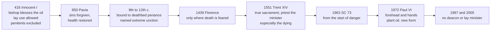

# Sacraments & Liturgy · Lesson 4.3: Anointing of the sick

> ⏱ ~15 min · Module 4: The sacraments of healing · Builds on: [4.1 Penance: the sacrament and its history](04-01-penance-the-sacrament-and-its-history.md), [3.5 Communion, reservation, adoration](03-05-communion-reservation-adoration.md), [1.2 Matter, form, minister, intention](01-02-matter-form-minister-intention.md), [`new-testament` 6.3](../../new-testament/lessons/06-03-james-faith-and-works.md) · Unlocks: [5.1 Holy Orders: the three degrees](05-01-holy-orders-the-three-degrees.md)

## Why this matters

Ask what "the last rites" are and many Catholics will say: the priest comes with oil when you are dying. The 1983 Code disagrees: anointing is for anyone who *begins* to be in danger from sickness or old age; it can be repeated and suits the night before surgery. The sacrament of the dying is another. This lesson states what Trent defined, what changed by 1972, and why the question pressed hardest, who may anoint, is closed.

## The idea

**The text.** James 5:14–15 supplies the elements ([`new-testament` 6.3](../../new-testament/lessons/06-03-james-faith-and-works.md) glosses only *presbyterous*). The sick man calls the *presbyterous tēs ekklēsias*, the church's elders, a body with a standing, and they pray over him, "anointing him with oil in the name of the Lord" (DR). Three promises follow. The prayer of faith *sōsei*, will save (rescue and healing alike, lesson's gloss); the Lord *egerei*, will raise him (from the bed; also the verb of resurrection, lesson's gloss); and *if* he has sinned, he will be forgiven. In Mark 6:13 the Twelve anoint the sick; Trent calls the sacrament "insinuated" there, hinted at, not instituted.

**The sick, then the dying.** The earliest papal text (the Source) concerns sick believers. In 850 the Council of Pavia still calls it a great mystery that forgives sins and restores bodily health (lesson's translation). The usual historians' account follows. Carolingian reformers bound the anointing to the priest's visit, with penance and viaticum. A penitent could not be anointed, and penance was put off toward the deathbed, so the anointing followed it there. By the late twelfth century the West called it [*extrema unctio*](../reference.md#extreme-unction). Theology followed: for Aquinas it is the last remedy, an immediate preparation for glory, for those whose sickness puts them in a state of departure (Supp. q.32 a.2). Florence (1439) gave it only to the sick whose death is feared, anointing each of the senses.

**What Trent answered.** The Reformers counted no sacrament here; Calvin tied James's oil to a temporary gift of healing, now ceased (*Institutes* IV.19.18–19). That is stated and left standing.

## Source

Innocent I to Decentius of Gubbio, *Si instituta ecclesiastica*, 19 March 416, ch. 8. Decentius had asked about James 5:14–15, which Innocent quotes in full before answering (lesson's translation of the Latin in Denzinger):

> There is no doubt that this is to be taken of the faithful who are sick, who can be anointed with the holy oil of chrism [*chrisma*, consecrated oil]. Once the bishop has prepared it, it is lawful not only for priests but for all Christians to use it for anointing, in their own need or that of their own. [...] But it cannot be poured on penitents, because it is a kind of sacrament. For how could one kind be granted to those to whom the other sacraments are denied?

**Read the shape of the act.** In the elided lines Innocent adds that a bishop may certainly anoint too. The letter fixes that James concerns sick believers, that the oil is the bishop's to bless, and that canonical penitents ([4.1](04-01-penance-the-sacrament-and-its-history.md)) are excluded because it is *genus sacramenti*, "a kind of sacrament" (not yet the technical term of the seven: [1.4](01-04-why-seven.md)). It fixes no oil, no form and no deathbed. The lay clause has two readings: lay application was simply part of anointing the sick, before the presbyters' rite was set apart; or, the older Catholic reading (so the 1912 *Catholic Encyclopedia*), it was a separate devotional use of the blessed oil, not James's rite.

## The doctrine

1. **A true sacrament, instituted by Christ, promulgated by James** (Trent, Session XIV, 25 November 1551, *On Extreme Unction*, ch. 1, can. 1). *In words:* [anointing of the sick](../reference.md#anointing-of-the-sick) is one of the seven; no moment of institution is named.
2. **It confers grace, remits sins and comforts the sick, and it has not ceased** (can. 2). Chapter 2: the Spirit's grace cleanses sins still to be expiated and the remains of sin, strengthens the sick by confidence in God's mercy, and gives bodily health "at times", when that serves the soul. CCC 1520–1523 add union with Christ's passion (LG 11); CCC 1532 adds forgiveness where the sick person could not confess. *In words:* the first grace is strength; the healing is conditional.
3. **The minister is a priest** (can. 4). James's "presbyters" are priests ordained by a bishop, not elders by age, and the priest alone is the *proper* minister. Every priest and only a priest anoints validly (can. 1003 §1). Against proposals to delegate deacons or lay people where priests are scarce, *Ecclesiae de mysterio* (1997, art. 9) allowed no ordinary or extraordinary non-priest minister and forbade the non-ordained any anointing with oil; the CDF's note of 11 February 2005 called any attempt a simulation.
4. **The recipient.** Trent taught that it is given:

   > to the sick, but to those especially who lie in such danger as to seem to be about to depart this life: whence also it is called the sacrament of the departing. (ch. 3)

   *Sacrosanctum Concilium* 73 (1963) calls "anointing of the sick" the more fitting name: the time has certainly come once a believer begins to be in danger of death from sickness or old age. Can. 1004 requires the use of reason and allows repetition; CCC 1515 names a serious operation. In doubt the priest anoints (can. 1005); the unconscious, if they at least implicitly asked (can. 1006); not the obstinate in manifest grave sin (can. 1007). *In words:* "especially" was never "only".
5. **The rite since 1972.** Paul VI's *Sacram Unctionem Infirmorum* (30 November 1972) prescribes anointing on forehead and hands with olive oil or another plant oil, duly blessed, and this form said once:

   > *Per istam sanctam unctionem et suam piissimam misericordiam adiuvet te Dominus gratia Spiritus Sancti, ut a peccatis liberatum te salvet atque propitius allevet.* Through this holy anointing and his most loving mercy may the Lord help you by the grace of the Holy Spirit, so that, freed from sins, he may save you and kindly raise you up. (lesson's translation)

   *In words:* the old form asked pardon for each sense's sins; the new one prays James's promises.

**[Viaticum](../reference.md#viaticum) is the sacrament of the dying.** SC 74 orders confession, anointing, then viaticum; CCC 1517 makes the Eucharist the last sacrament of the journey. Viaticum serves danger of death from *any* cause (can. 921 §1), and in necessity any minister of communion brings it (can. 911 §2). [3.5](03-05-communion-reservation-adoration.md) owns it.

**Persisting in a request for euthanasia.** *Samaritanus Bonus* (CDF, dated 14 July 2020, made public September 2020), V.11, finds in someone who has decided on euthanasia and persists a manifest lack of the disposition for absolution, anointing and viaticum (cann. 1007, 915) until he is ready for concrete steps, such as cancelling a registration. Postponing judges nothing about guilt; an unconscious person may be anointed *sub condicione* if an earlier sign lets the priest presume repentance. The moral verdict is [`moral-theology` 5.3](../../moral-theology/lessons/05-03-euthanasia-and-the-end-of-life.md)'s; the obstacle bears on [liceity and fruitfulness](../reference.md#valid-licit-fruitful), not on the priest's power.

| Defined or taught (with level) | A school's explanation (no magisterial level) |
|---|---|
| Grace, remission of sins, comfort of the sick (can. 2, rung 1) | Aquinas: the principal effect is the remnants of sin, a spiritual weakness; guilt goes only consequently (Supp. q.30 a.1) |
| Bodily health "at times", when it serves the soul (ch. 2) | Aquinas: God heals the body only when the spiritual healing needs it (q.30 a.2) |

**Said plainly.** For centuries the Latin Church gave this sacrament almost only to the dying (CCC 1512), though James wrote of the sick, Trent wrote "especially", and the Roman Catechism called it "a very grievous sin" to defer it until life ebbs. In 1611 the Holy Office judged "rash and next to error" the claim that oil not blessed by a bishop could validly serve. Can. 999 now lets any presbyter bless it in necessity. The usual account: validity needs oil blessed by one with power to bless, a power the Church can grant, as the Byzantine office of Holy Unction, where priests bless the oil, assumes (Hapgood, *Service Book*, 1906). That is her power over [the dispensation, not the substance](../reference.md#substance-of-the-sacraments).

**Mark the levels** ([`fundamental-theology` 4.4](../../fundamental-theology/lessons/04-04-the-ladder-of-doctrinal-authority.md); [levels of authority](../reference.md#levels-of-authority)). **Rung 1** (XIV cann. 1–4): a true sacrament instituted by Christ; it confers grace, remits sins, comforts the sick, and has not ceased; the Roman rite is not repugnant to James (not thereby unchangeable); James's presbyters are priests, and the priest alone is the proper minister. **At least rung 2:** that only priests anoint validly. The 1997 instruction called it "theologically certain doctrine"; the CDF in 2005 labelled it *definitive tenenda* ([definitive teaching](../reference.md#definitive-teaching)). Whether can. 4 already defined it need not be settled: on neither reading is it open. Trent's chapters on the bishop's oil and the dying are not canons, and their details lie within the Church's power over the rite; Florence's Decree for the Armenians is an instruction ([1.4](01-04-why-seven.md)). **Rung 3:** SC 73–74, LG 11, SB V.11; the Catechism adds no weight. Paul VI's constitution, the canons and *Ecclesiae de mysterio*: **law, no rung**. Innocent's lay permission was discipline. Aquinas and the readings of Innocent: **no magisterial level**.

## The timeline

## Worked examples

**Ex 1 (clean): before surgery, and again.** Invented: Joaquim Barros, 79 and frail, is booked for a hip replacement. His parish priest hears his confession, then anoints his forehead and hands with oil the bishop blessed at the Chrism Mass, saying the form once. *Recipient:* baptized, with reason, facing a serious operation in frail old age (can. 1004 §1; CCC 1515). **Valid:** a priest, blessed plant oil, the form. **Licit:** the rite, by his own pastor (can. 1003 §2). **Fruitful:** he is disposed, so grace meets no obstacle ([1.3](01-03-ex-opere-operato-character-and-fruitfulness.md)). Six months later pneumonia brings new danger, and he is anointed again (can. 1004 §2). If he is then dying, what he needs next is viaticum.

**Ex 2 (strain): no priest for months.** Invented: in the Vicariate of Ruvana a priest reaches the outstations twice a year. The catechists ask the vicar apostolic to let deacons or catechists anoint the dying with oil he blesses, citing Innocent's "all Christians". He cannot: with the minister fixed at least at rung 2, the Church holds she lacks the power. Innocent's clause, read most kindly, permitted lay *use* of the oil. Discipline now forbids that use and could change, but the change would yield a blessed oil ([sacramentals](../reference.md#sacramentals), [7.3](07-03-sacramentals-and-popular-devotion.md)), not this sacrament. Ruvana can bring viaticum through any minister of communion and help the sick toward the perfect contrition that reconciles before the sacrament ([4.1](04-01-penance-the-sacrament-and-its-history.md)). The cost is plain: without a priest, the sick die without this sacrament. Whether women could be ordained deacons ([5.2](05-02-the-reservation-of-priestly-ordination.md)) is a separate question, since no deacon anoints.

## Watch out

- **You might think anointing is the last rites, for the dying only.** SC 73 dates it from the *start* of danger, and viaticum is the sacrament of the dying. Over-correcting fails: CCC 1523 says it is given even more rightly to those about to depart.
- **You might think "priests only" is canon law the Church could relax.** That understates: the proper minister is rung 1, priests-only validity at least rung 2. Overstating fails too: Trent's *chapters* on the bishop's oil and the dying are not defined, as 1972 and 1983 show.
- **"Vatican II abolished extreme unction."** SC 73 says it may *also and more fittingly* be called anointing of the sick; the doctrine stood, while the timing and the rite changed.

## One-liner

> Anointing is the sacrament of the seriously sick, given by a priest alone; viaticum is the sacrament of the dying, and the West spent centuries running the two together.

## Problems

**P1 (🟢)** *(Exegetical)* Two **invented** cases, written for this problem.

(a) Rosamund Horvat, 84, a lifelong Mass-goer, is brought into Larkhill General Hospital after a massive stroke. She is unconscious, and the nurse cannot say for certain that she is still alive. Fr Ugo Ferreira anoints her forehead once with oil of the sick blessed by the bishop, saying the whole form. Give three verdicts, valid, licit and fruitful, each naming the element that decides it.

(b) Nkem Oyelaran, a Catholic in good health, is to be executed at dawn and asks the prison chaplain, a priest, for "the last rites". Which sacraments should the chaplain give, which should he not, and why?

One or two sentences per verdict in (a); two sentences for (b).

**P2 (🟡)** *(Exegetical)* An **invented** leaflet from the chaplaincy of Larkhill General Hospital, written for this problem:

> "**Last Rites.** Anointing is the Church's sacrament for the dying, so please call us only when the doctors say the end is near. A patient may be anointed only once in each illness. If no priest can come, our deacons and trained lay chaplains may anoint in an emergency with oil the bishop has blessed, as the early Church allowed. And if the patient can no longer speak, anointing cannot touch his sins: only absolution forgives."

Find **four** errors. For each, give the correction and the level wherever a level is involved. 150 words or fewer.

**P3 (🔴)** *(Exegetical)* Reread the Source, Innocent I's letter of 416.

(a) Which words tie the oil to a church office, and which make the anointing more than a remedy? What exclusion follows, and by what reasoning?

(b) State the two readings of the clause "not only for priests but for all Christians to use it for anointing, in their own need or that of their own", naming what in the text each reading leans on.

(c) Say why neither reading reopens the question of who can confer the sacrament today, and give the level.

Two sentences per part.

Solutions

**P1** *(Exegetical)*

**Accept:** for (a), a validity verdict made conditional on her being alive.

**Must hit, strict (a):**

- **Valid, if she is alive.** A priest (can. 1003 §1), duly blessed oil, and the whole form with a single anointing, which suffices in necessity (can. 1000 §1). The recipient has the use of reason and is in danger from sickness. Her silence does not block it: a practising Catholic at least implicitly asked (can. 1006), and the doubt about death is resolved by anointing (can. 1005), since the sacrament is for the living.
- **Licit.** Cann. 1005 and 1006 direct exactly this, and the single anointing is the rite's own provision for necessity.
- **Fruitful: it depends on her, and no one can see it.** If she was turned from sin before losing consciousness, the anointing strengthens her and forgives even sins she can no longer confess (Trent XIV can. 2, rung 1; ch. 2; CCC 1532). An obstacle on her side would block the fruit, not the sacrament ([1.3](01-03-ex-opere-operato-character-and-fruitfulness.md)).

**Must hit, strict (b):**

- **Not anointing.** Its recipient is in danger from sickness or old age (can. 1004 §1). Nkem is healthy and in danger from an outside cause, a case the Roman Catechism names in so many words.
- **Penance and viaticum.** Viaticum serves danger of death from any cause (can. 921 §1), and he can confess first ([4.1](04-01-penance-the-sacrament-and-its-history.md)).

**Wrong turns:** refusing (a) because she never asked, when can. 1006 covers an implicit request; waiting for proof of life before anointing; calling (a) certainly fruitful because the sacrament works *ex opere operato*; in (b), anointing because "last rites" means anointing, or refusing viaticum because he is not sick.

**Model answer:** (a) Valid if she is alive: a priest, blessed oil and the whole form with one anointing, given to someone in danger from sickness who at least implicitly asked (cann. 1003 §1, 1000 §1, 1006), with the doubt about death resolved by anointing (can. 1005). Licit, because the canons direct exactly this. Fruitful as far as she places no obstacle; if she was turned from sin before losing consciousness, it forgives sins she can no longer confess (Trent XIV can. 2; CCC 1532). (b) The chaplain hears his confession and gives viaticum, which serves danger of death from any cause (can. 921 §1). He does not anoint, because anointing is for danger from sickness or old age (can. 1004 §1), and the Roman Catechism excludes the condemned man by name.

---

**P2** *(Exegetical)*

**Accept:** the four errors below in any order. A note that "Last Rites" names viaticum earns credit but replaces none of the four.

**Must hit, strict:**

1. **"For the dying … only when the end is near."** The time has come once danger from sickness or old age *begins* (SC 73, rung 3; can. 1004 §1, law). Trent wrote "especially", not "only" (ch. 3). Viaticum is the sacrament of the dying, given while the person is still conscious (CCC 1524–1525; cann. 921–922).
2. **"Only once in each illness."** It can be repeated if the condition grows more grave in the same illness (can. 1004 §2; law, no rung).
3. **"Deacons and lay chaplains may anoint."** That would be invalid. The priest alone is the proper minister (Trent XIV can. 4, rung 1), and that only priests anoint validly is **at least rung 2** (CDF, 2005, *definitive tenenda*; can. 1003 §1). *Ecclesiae de mysterio* 9 forbids the non-ordained any anointing with oil; an attempt simulates the sacrament. Innocent's permission of 416 concerned lay use of oil and was discipline.
4. **"Cannot touch his sins."** Anointing remits sins (Trent XIV can. 2, **rung 1**), and CCC 1532 adds that it forgives where the sick person could not confess, provided he places no obstacle.

**Wrong turns:** correcting item 3 to "deacons yes, laity no"; calling item 3 a changeable discipline (understates the level), or calling SC 73 a definition (overstates it); over-correcting item 1 into "not for the dying", against CCC 1523; reading item 4 as if anointing replaced confession for someone able to confess.

**Model answer:** Anointing is for anyone who begins to be in danger from sickness or old age (SC 73, rung 3; can. 1004 §1). Trent said "especially" the dying, not "only", and the sacrament of the dying is viaticum (CCC 1524). It can be repeated when the same illness worsens (can. 1004 §2). Deacons and lay people cannot anoint validly. The priest alone is the proper minister (Trent XIV can. 4, rung 1), and only priests are valid ministers, *definitive tenenda* per the CDF in 2005, so at least rung 2. *Ecclesiae de mysterio* forbids lay anointing with any oil, and Innocent's lay use was a discipline, never a lay minister. Finally, the anointing does forgive sins (Trent XIV can. 2, rung 1), including those of a patient who can no longer confess (CCC 1532).

---

**P3** *(Exegetical)*

**Accept:** for (b), any wording that keeps the two readings distinct and ties each to something in the text.

**Must hit, strict (a):**

- **Office:** "Once the bishop has prepared it": the oil is the bishop's. (The elided lines, and James's presbyters, supply the ministers.)
- **More than a remedy:** "a kind of sacrament" (*genus sacramenti*). Penitents are excluded on an argument from the class: those denied the other sacraments cannot be given one of their kind.

**Must hit, strict (b):**

- **Reading 1, one practice:** lay application was simply part of anointing the sick, before the presbyters' rite was set apart. It leans on "lawful not only for priests but for all Christians" and on the letter making the bishop's preparation of the oil, not the hand that applies it, the point that matters.
- **Reading 2, two practices:** the lay application was a devotional use of the blessed oil, distinct from James's rite. It leans on "to use it", on the household scope ("their own need or that of their own"), and on James's call for presbyters who pray over the sick.

**Must hit, strict (c):**

- The doctrine concerns who confers the **sacrament**. The priest alone is the proper minister (Trent XIV can. 4, **rung 1**), and only priests anoint validly (CDF, 2005, *definitive tenenda*, **at least rung 2**; can. 1003 §1).
- On reading 2, the lay use was never the sacrament. On reading 1, it is evidence of a practice from before the distinction was drawn, which the CDF's 2005 commentary says proves no non-priest minister. Lay use of oil is now governed, and forbidden, by discipline (*Ecclesiae de mysterio* 9).

**Wrong turns:** taking "a kind of sacrament" as Trent's technical sense of the seven ([1.4](01-04-why-seven.md)); taking "chrism" as confirmation's chrism; arguing that because laypeople anointed in 416 the Church could restore lay ministers of the sacrament; calling the minister rule "mere canon law" (understates); declaring exclusivity settled at rung 1 by can. 4, when the act that labels it is the CDF's *definitive tenenda* (say "at least rung 2").

**Model answer:** (a) "Once the bishop has prepared it" ties the oil to the bishop's office, and "a kind of sacrament" makes the anointing more than a remedy. So penitents are excluded: those denied the other sacraments cannot be granted one of their kind. (b) On one reading, lay application was simply part of anointing the sick before the presbyters' rite was set apart, since "all Christians" may use the bishop's oil. On the other, it was a separate devotional use, limited to "their own need or that of their own", while James's rite needs presbyters who pray over the sick. (c) The doctrine fixes who confers the sacrament: the priest alone is its proper minister (Trent XIV can. 4, rung 1), and only priests are valid ministers (CDF 2005, at least rung 2). Either reading concerns a use of oil, which discipline now forbids, and the CDF judges such testimonies no proof of a non-priest minister.

## Flashback

**From Lesson [4.1](04-01-penance-the-sacrament-and-its-history.md) (Penance: the sacrament and its history):** *(Exegetical.)* Three notes from an **invented** OCIA retreat schedule, written for this problem, for candidates who will make their first confession before they are received into full communion at Easter:

> (1) "Confession settles things between you and God alone. The Church has no part in it, which is why it is private."
>
> (2) "If you do not feel at peace afterwards, the absolution has not worked, and you are still in your sins."
>
> (3) "Do the penance the priest gives you if you like, but it is a formality: absolution wipes away the guilt and all the punishment together."

For each note, name the error and correct it, citing the text that fixes it and giving the level wherever a level is involved. **Two sentences per note.**

Solution

**Accept:** in (1), either can. 959 (law) or *Lumen Gentium* 11 (rung 3) as the text, so long as reconciliation with the Church is not called a definition of Trent; in (2), citing Trent's "sometimes" (ch. 3) earns credit but is not required; in (3), either can. 12 or can. 15 for the remaining punishment.

**Must hit, strict:**

- **(1) Reconciled with the Church as well.** Absolution brings forgiveness from God and at the same time reconciles the penitent with the Church his sin wounded (can. 959, law, no rung; it restates *Lumen Gentium* 11, rung 3). What is private is the telling of the sins, not the effect: the absolution is the Church's act, given by her priest with the faculty she grants (can. 966 §1).
- **(2) The effect is not a feeling.** Penance was instituted "for reconciling the faithful unto God" (Trent XIV can. 1, **rung 1**), and that reconciliation is its effect (ch. 3). Validity rests on the priest, the form and the penitent's acts, and fruitfulness on his disposition (can. 987), not on what he feels; Trent itself says peace of conscience follows only "sometimes", in devout recipients (ch. 3).
- **(3) A remainder is owed, and so is the penance.** It is false that God always remits the whole punishment with the guilt (can. 12), and once absolution has removed the guilt and the eternal punishment, temporal punishment for the most part remains (can. 15): both **rung 1**. Satisfaction made through Christ's merits answers to it (can. 13, **rung 1**), and the penitent is obliged to fulfil the penance personally (can. 981, law, no rung).

**Wrong turns:** in (1), over-correcting into "confession ought to be public", when telling sins to the priest alone is the Church's way and the seal guards it, or calling reconciliation with the Church a Tridentine definition; in (2), making validity hang on the penitent's feelings, or swinging to "it works whatever your disposition", when can. 987 still governs the fruit; in (3), saying the guilt stays until the penance is done, when absolution remits the guilt and satisfaction answers to the remaining punishment, or calling can. 981 defined doctrine, or cans. 12 and 15 mere discipline.

**Model answer:** (1) Absolution forgives sin before God and at the same time reconciles the penitent with the Church his sin wounded (can. 959, law, restating *Lumen Gentium* 11, rung 3). Only the telling of sins is private; the absolution is the Church's act, given by her priest with the faculty she grants (can. 966 §1). (2) The sacrament's effect is reconciliation with God (Trent XIV can. 1, rung 1; ch. 3), not a feeling, and Trent says peace of conscience follows only "sometimes", in devout recipients. Whether it was valid rests on the priest, the form and the penitent's acts, and its fruit on his disposition (can. 987), whatever he feels afterwards. (3) God does not always remit all punishment with the guilt: after absolution, temporal punishment for the most part remains (Trent XIV cann. 12, 15, rung 1), and satisfaction through Christ's merits answers to it (can. 13, rung 1). The penance is therefore no formality, and the penitent is bound to perform it himself (can. 981, law).

## Connections

- **Backward:** [4.1](04-01-penance-the-sacrament-and-its-history.md) supplies canonical penance (why penitents could not be anointed), perfect contrition and the confession that comes first. [3.5](03-05-communion-reservation-adoration.md) owns viaticum. [1.2](01-02-matter-form-minister-intention.md) makes the minister an element of validity, and [1.3](01-03-ex-opere-operato-character-and-fruitfulness.md) separates the sacrament from its fruit. [1.4](01-04-why-seven.md) says what "instituted by Christ" commits to, which is why "insinuated in Mark" is no institution narrative. James and *presbyterous* are [`new-testament` 6.3](../../new-testament/lessons/06-03-james-faith-and-works.md), which marks Trent's title "James the Apostle, and brother of the Lord" freely disputed as to authorship.
- **Forward:** [5.1](05-01-holy-orders-the-three-degrees.md) takes the priesthood that makes anointing a priest's act, and the deacon's place in orders. [5.2](05-02-the-reservation-of-priestly-ordination.md) keeps the female-diaconate question apart from this one. [7.3](07-03-sacramentals-and-popular-devotion.md) treats [sacramentals](../reference.md#sacramentals), the class into which a blessed oil used outside the sacrament falls. Boss problem 4 close-reads James 5:13–16.
- **Sideways:** [`moral-theology` 5.3](../../moral-theology/lessons/05-03-euthanasia-and-the-end-of-life.md) grades euthanasia's wrongness definitive (rung 2) and reads *Samaritanus Bonus* for the act; this lesson reads V.11 for the sacraments. *Ecclesiae de mysterio* was approved *in forma specifica*, the feature [`fundamental-theology` 4.5](../../fundamental-theology/lessons/04-05-reading-a-documents-weight.md) says makes a dicastery's act the pope's own. The grace the anointing causes is [`creation-grace-last-things`](../../creation-grace-last-things/syllabus.md)'s.
