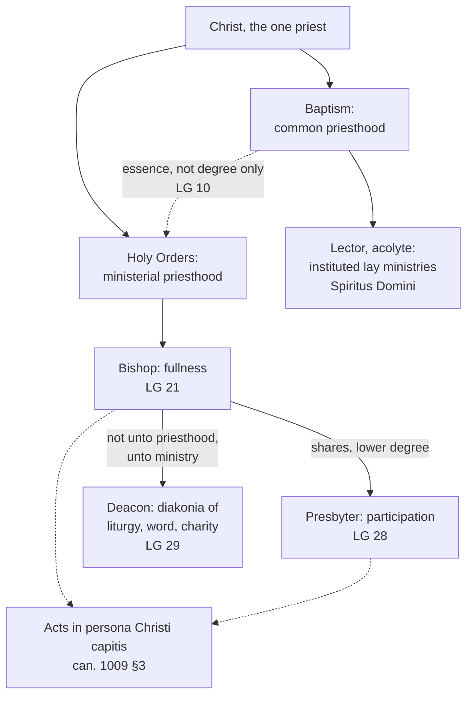

# Sacraments & Liturgy · Lesson 5.1: Holy Orders: the three degrees

> ⏱ ~15 min · Module 5: The sacraments at the service of communion · Builds on: [`christology` 5.1](../../christology/lessons/05-01-the-paschal-mystery-and-the-threefold-office.md), [`ecclesiology-and-mariology` 3.1](../../ecclesiology-and-mariology/lessons/03-01-bishops-and-apostolic-succession.md) and [3.3](../../ecclesiology-and-mariology/lessons/03-03-the-laity-charisms-and-the-sensus-fidei.md), [1.2](01-02-matter-form-minister-intention.md), [1.3](01-03-ex-opere-operato-character-and-fruitfulness.md) · Unlocks: [5.2 The reservation of priestly ordination](05-02-the-reservation-of-priestly-ordination.md)

## Why this matters

A married former Anglican vicar can be ordained a Catholic priest, yet a Catholic priest cannot marry. A priest dismissed from the clerical state may absolve a dying stranger; a deacon may not anoint her. A bishop consecrated in defiance of Rome ordains real priests. Each case comes apart along three joints: what ordination makes a man, what the Church authorizes him to do, and what Latin discipline requires of him. Here is the one sacrament in its three degrees, each claim weighed.

## The idea

**One priest, two participations.** Every Christian priesthood is a share in Christ's ([`christology` 5.1](../../christology/lessons/05-01-the-paschal-mystery-and-the-threefold-office.md)). Baptism gives the common priesthood; ordination gives the ministerial one, which differs from it "in essence and not in degree only" (*Lumen Gentium* 10, as [`ecclesiology-and-mariology` 3.3](../../ecclesiology-and-mariology/lessons/03-03-the-laity-charisms-and-the-sensus-fidei.md) translates it).

**One sacrament, three degrees.** Orders is one sacrament in [three degrees](../reference.md#three-degrees-of-orders): the bishop has its fullness, the presbyter a share in it, and the deacon is ordained to serve both. They are not three sacraments, and not a career ladder.

**Three joints.** Hard cases split along these lines:

- **Order**: what the sacrament makes a man. It is permanent, and decides what he *can* do.
- **Office and faculty**: where he serves, under whom, with what authorization. Church authority gives and withdraws them, and they decide what he *may* do; for absolution and marriage, validity too.
- **Discipline**: celibacy, ages, mandates. Changeable law, which chiefly governs lawfulness, though the Church can attach invalidity to its own rules (can. 10; e.g. the impediment of orders to marriage, can. 1087).

Think of a surgeon's skill, his privileges at one hospital, and its rules; but skill fades, and the character of orders does not.

## The doctrine

1. **Order is a sacrament conferring a power and a character.** Trent, Session XXIII (15 July 1563), ch. 1, argues from sacrifice to priesthood: the Church has a visible sacrifice, so a visible priesthood, empowered to consecrate and offer Christ's body and blood and to forgive sins. Its canons anathematize whoever reduces it to preaching (can. 1), denies that order is truly a sacrament instituted by Christ (can. 3), or denies that a character is imprinted, or says "that he who has once been a priest, can again become a layman" (can. 4). *In words:* ordination makes a man something for good.

2. **Three degrees, and who acts in the person of Christ the Head.** Canon 6 defines a hierarchy of bishops, priests and ministers by divine ordination. LG 21 gives the bishop the fullness of the sacrament ([`ecclesiology-and-mariology` 3.1](../../ecclesiology-and-mariology/lessons/03-01-bishops-and-apostolic-succession.md)). LG 28 makes presbyters true priests who lack its highest degree. LG 29 says deacons receive hands *non ad sacerdotium, sed ad ministerium*, "not unto priesthood but unto ministry" (lesson's translation of a phrase LG takes from an ancient church order), for the diakonia of liturgy, word and charity. All three degrees come from one sacrament, and the deacon too receives an indelible character (CCC 1554, 1570). Benedict XVI's *Omnium in mentem* (26 October 2009) added can. 1009 §3: bishops and presbyters receive the mission and capacity to act [*in persona Christi capitis*](../reference.md#in-persona-christi-capitis), whereas deacons are empowered to serve the People of God in the diakonia. The schoolmen's seven orders, each with a character (*Supplement* q.35 a.2), are gone from the Latin Church. *Ministeria quaedam* (15 August 1972) suppressed the minor orders and the subdiaconate, and *Spiritus Domini* (10 January 2021) opened the surviving lector and acolyte to women as lay ministries rooted in baptism. *In words:* two priestly degrees, one degree of service, all three real ordinations.

3. **Matter and form.** Florence's Decree for the Armenians (*Exsultate Deo*, 22 November 1439) followed the schools (lesson's translation):

   > The sixth sacrament is that of order, whose matter is that by whose handing over the order is conferred: thus the presbyterate is handed on by the offering of the chalice with wine and of the paten with bread.

   Aquinas put the priestly character at the giving of the chalice (*Supplement* q.37 a.5; P3). Pius XII's [*Sacramentum Ordinis*](../reference.md#sacramentum-ordinis) (30 November 1947) declared and decreed, for all three degrees, that the only matter is the imposition of hands and the only form the words determining it, which signify the power of order and the grace of the Spirit. The [handing over of the instruments](../reference.md#porrection-of-the-instruments) is not needed for validity *saltem in posterum*, "at least for the future". His reason (§3): Rome always held Greek ordinations valid without the porrection, and Florence never asked the Greeks to add it, so Christ did not require it; if the Church once did, she may change what she established. The limit is the sacraments' *substance*, over which the constitution restates that the Church has no power (§1; [1.4](01-04-why-seven.md)). Paul VI's *Pontificalis Romani* (18 June 1968) kept that matter and gave bishops a prayer from the *Apostolic Tradition*, which it ascribes to Hippolytus. Anointing and the handing over of paten and chalice remain as rites that express what was done (CCC 1574). *In words:* hands and prayer ordain; the rest explains.

4. **The minister** is a consecrated bishop (can. 1012; CCC 1576). Lawfulness asks more: a pontifical mandate to consecrate a bishop (can. 1013), two co-consecrators (can. 1014), and dimissorial letters to ordain another bishop's subject (can. 1015). Consecrating without a mandate brings automatic excommunication, reserved to the Apostolic See, on both bishops (can. 1387, as renumbered in 2021).

5. **The character outlasts the office.** Valid ordination never becomes invalid (can. 290). A dismissed cleric may not exercise orders except to absolve the dying (cann. 292, 976), yet he is never a layman again in the strict sense (CCC 1583). Office is another matter. Every cleric is incardinated (can. 265) and owes obedience to the pope and his own ordinary (can. 273), and a [faculty](../reference.md#faculties) authorizes what ordination makes possible. For absolution it decides validity (can. 966 §1), except in danger of death (can. 976). This is [`ecclesiology-and-mariology` 3.1](../../ecclesiology-and-mariology/lessons/03-01-bishops-and-apostolic-succession.md)'s line between capacity conferred and lawful exercise.

6. **The permanent diaconate.** LG 29 allowed its restoration, open to married men of mature age; Paul VI's *Sacrum Diaconatus Ordinem* (18 June 1967) set the norms. The Code fixes thirty-five, with the wife's consent, for a married candidate (can. 1031 §2).

7. **[Celibacy](../reference.md#celibacy) is discipline**, as [`fundamental-theology` 3.4](../../fundamental-theology/lessons/03-04-tradition.md) showed from the East. *Presbyterorum Ordinis* 16 says the priesthood's nature does not demand it, while commending it as fitting; canon 277 §1 makes it law. A married man is "simply impeded" from orders except the permanent diaconate (can. 1042 1°), a bar to lawfulness, not validity. The ordained invalidly attempt marriage (can. 1087), an impediment the Apostolic See can dispense (can. 1078 §2). The East ordains married deacons and priests but takes bishops from celibates (CCC 1580). *Anglicanorum Coetibus* (4 November 2009, art. VI) lets an ordinariate seek, case by case, the priestly ordination of married former Anglican ministers, by derogation from canon 277 §1.

**Anglican orders, stated and ceded.** Leo XIII's apostolic letter [*Apostolicae Curae*](../reference.md#apostolicae-curae) (13 September 1896) declared ordinations by the Anglican rite *irritas prorsus fuisse et esse, omninoque nullas*, "utterly void and wholly null" (lesson's translation), for defect of form and of intention. The archbishops of Canterbury and York replied in *Saepius Officio* (1897), arguing that Rome's own ancient ordination forms were no more explicit about sacrifice (ch. XII) and citing the Ordinal's preface (ch. XVII). The argument is [`apologetics-catholic-claims`](../../apologetics-catholic-claims/syllabus.md) [4.3](../../apologetics-catholic-claims/lessons/04-03-apostolic-succession-and-the-validity-of-orders.md)'s.

**Said plainly.** For centuries the Latin schools taught, and a council's instruction stated, that a priest is made by the handing over of chalice and paten, while Rome accepted Eastern ordinations that never used that rite. Pius XII did not say the schools had been wrong: he decided "at least for the future", without retroactive force, and left the past unsettled.

**Mark the levels** ([`fundamental-theology` 4.4](../../fundamental-theology/lessons/04-04-the-ladder-of-doctrinal-authority.md); [levels](../reference.md#levels-of-authority)). **Rung 1:** order a true sacrament instituted by Christ; a priesthood with power to consecrate and absolve; the character, so that a priest never becomes a layman again; a hierarchy by divine ordination; bishops superior to priests (Trent XXIII cans. 1, 3, 4, 6, 7). Those canons do **not** define the episcopate as a sacramental degree. **At least rung 3:** LG 10, 21, 28 and 29, the deacon's sacramental grace included; PO 16. ***Sacramentum Ordinis*** uses no defining formula. It fixes, with supreme authority, what validity requires, and its ground, that Christ did not require the porrection, is at least rung 3. Florence's matters and forms are a practical instruction, changeable, as [1.4](01-04-why-seven.md) grades them. **Law, no rung:** the Code (with *Omnium in mentem*), *Pontificalis Romani*, *Ministeria quaedam*, *Spiritus Domini*, *Anglicanorum Coetibus*, and celibacy itself. ***Apostolicae Curae*** is listed by the CDF's 1998 commentary on the *Professio fidei* (§11) among truths held definitively: **rung 2**. Aquinas on the porrection has **no magisterial level**.

## One priesthood, three degrees

The deacon holds a degree of the sacrament; the lector holds none.

## Worked examples

**Ex 1 (clean): sorting an ordination.** An **invented** deacon, Thaddeus Ferrandi, 26, of the invented Diocese of Stellbrook, is ordained priest by a neighbouring bishop. Sort each element by the verdict it touches ([1.2](01-02-matter-form-minister-intention.md)).

- **Valid:** a consecrated bishop (can. 1012); a baptized man (can. 1024; [5.2](05-02-the-reservation-of-priestly-ordination.md)); the silent imposition of hands and the essential words; the intention to do what the Church does.
- **Licit:** dimissorial letters (can. 1015); age at least twenty-five (can. 1031 §1); celibacy assumed before the diaconate (can. 1037); the full rite, which *Sacramentum Ordinis* orders kept.
- **Explanatory:** the anointing of his hands; paten and chalice. Forget the chalice and he is still a priest.
- **Fruitful:** grace as his disposition allows; the character regardless ([1.3](01-03-ex-opere-operato-character-and-fruitfulness.md)).
- **Not given by ordination:** the faculty to hear confessions (cann. 966, 969). Without it he absolves invalidly outside danger of death, yet he is a priest.

**Ex 2 (strain): the bishop without a mandate.** [`ecclesiology-and-mariology` 3.1](../../ecclesiology-and-mariology/lessons/03-01-bishops-and-apostolic-succession.md) P1(e) left this question here. Corwin Hale, of the invented Diocese of Saltmarsh, was validly consecrated without a mandate and now ordains priests.

- **Valid:** yes, given matter, form and intention. Validity needs a consecrated bishop (can. 1012); mandate and communion are not conditions. Aquinas: a power given by consecration cannot be taken away (*Supplement* q.38 a.2).
- **Licit:** no. Hale is excommunicated (can. 1387), and with no subjects he ordains without dimissorials, so his ordinands are suspended from the order received (can. 1388 §1). The penalty presupposes they have it.
- **Fruitful:** Aquinas's "third and the true opinion" holds such ordinations valid but graceless for those who seek them against the Church's prohibition (q.38 a.2). In [1.3](01-03-ex-opere-operato-character-and-fruitfulness.md)'s terms that is an obstacle, and it is his explanation, not doctrine.

Where it strains: the Nota explicativa praevia declined to judge such acts; sacramental theology answers only validity. The real case is Lefebvre's 1988 consecrations ([`church-history` 9.3](../../church-history/lessons/09-03-after-the-council.md)). In 2016 Francis provided that those who confess to the Society's priests are absolved validly and licitly (*Misericordia et misera* 12): a grant that presupposes their orders and supplies only the faculty.

## Watch out

- **You might think a deacon is a junior priest.** He is ordained "not unto priesthood" (LG 29), for the diakonia that can. 1009 §3 assigns him, and cannot consecrate, absolve or anoint. Yet his is a degree of the sacrament, with a character (CCC 1570), not a lay ministry.
- **You might think celibacy is dogma, or a bare rule.** The first overstates: it is law, no rung. The second understates PO 16's rung-3 teaching that it is fitting.
- **You might think *Sacramentum Ordinis* condemned the medieval rite or defined a dogma.** It fixed the matter "at least for the future", without retroactive force or a defining formula. Calling it a rubric understates it: validity turns on it.

## One-liner

> One sacrament in three degrees, given by a bishop's hands and prayer: the order lasts for ever, while the faculty to use it and the discipline around it are the Church's to give, withdraw and change.

## Problems

**P1 (🟢)** *(Exegetical: apply to a hard case.)* Three **invented** events, written for this problem. For each, give three separate verdicts (valid, licit, fruitful) and name the element that decides each: matter, form, minister, intention, recipient, or rite and faculty. One line per verdict.

(a) Aurelio Moravec, a priest who lost the clerical state by rescript twelve years ago, with a dispensation from celibacy (cann. 290 3°, 291), and has since married, says Mass at home for his family, with bread and wine and the Roman Missal. His brother-in-law, who knows nothing of his status and is in a state of grace, receives communion.

(b) Lisandro Ingram, a married convert and former Lutheran pastor, is ordained priest by the bishop of the invented Diocese of Brightwater with the full rite. The bishop wrongly believes the Holy See's dispensation has arrived; it has not been granted. Lisandro, who believes the same, is well prepared and in a state of grace.

(c) Hyacinth Okeke, a permanent deacon in charge of a remote mission station of the same diocese, is told by the bishop to "take care of the confirmations" this year. He anoints the candidates' foreheads with chrism the bishop consecrated, laying his hand on each and saying the Latin form.

**P2 (🟡)** *(Exegetical: diagnose.)* An **invented** page from the invented Diocese of Hartvale's vocations-office FAQ, written for this problem:

> **Is a deacon a kind of priest?** Yes: the diaconate is the first degree of the priesthood, and like priests, deacons act in the person of Christ the Head. **Can married men become deacons?** Yes: a married man may be ordained a permanent deacon from age thirty-five, with his wife's consent. **Why must priests be celibate?** Because celibacy is a dogma: Christ required it of the apostles. The married priests of the Eastern Catholic churches and of the Anglican ordinariates are temporary concessions, tolerated until they adopt the Latin discipline. **What about our new women lectors and acolytes?** Since 2021 women can receive the first minor orders, so the path to the diaconate is now open to them.

Find **four** errors and name the one answer that is correct. For each error give the correction, the text that fixes it, and the level where one is involved. **170 words or fewer.**

**P3 (🔴)** *(Exegetical: find the crux.)* Aquinas, *Supplement* q.37 a.5 (English Dominican Province):

> the bishop in conferring orders does two things; for he prepares the candidates for the reception of orders, and delivers to them the power of order. ... This preparation consists of three things, namely blessing, imposition of hands, and anointing. ... The conferring of power is effected by giving them something pertaining to their proper act. And since the principal act of a priest is to consecrate the body and blood of Christ, the priestly character is imprinted at the very giving of the chalice under the prescribed form of words.

Pius XII, *Sacramentum Ordinis* (1947), §§3–5, paraphrased: ordination must signify the effects it produces, power and grace. In every rite of every time and place these are sufficiently signified by the imposition of hands and the words that determine it. Rome always held Greek ordinations valid without the handing over of the instruments, and Florence did not require the Greeks to add it. So that rite is not required for validity by Christ's will. For the presbyterate the matter is the first, silent imposition of hands.

(a) Name the premise in Aquinas's argument that the 1947 reasoning denies, quoting its words, and say what role Aquinas gives the imposition of hands.

(b) Say what kind of evidence Pius XII brings against that premise, and name one thing in Aquinas's account that the 1947 settlement keeps.

**Two sentences per part.**

Solutions

**P1** *(Exegetical)*

**Must hit, strict:**

- **(a) Valid: yes; minister.** The priestly character is indelible (can. 290; Trent XXIII can. 4, rung 1), and matter, form and intention are present. **Licit: no; minister.** Can. 292 forbids him to exercise the power of orders. **Fruitful: yes for the brother-in-law; recipient.** He receives in good faith and in grace, and the celebrant's illicit act does not block grace in a well-disposed recipient ([1.3](01-03-ex-opere-operato-character-and-fruitfulness.md)).
- **(b) Valid: yes; recipient.** A baptized man validly receives orders (can. 1024), and a bishop, the imposition of hands and the consecratory prayer are all present; marriage is no bar to validity. **Licit: no; recipient.** A married man is simply impeded from the priesthood (can. 1042 1°), and that dispensation is reserved to the Apostolic See (can. 1047 §2 3°). **Fruitful: yes; recipient.** He is in good faith and in a state of grace, so nothing blocks the grace ([1.3](01-03-ex-opere-operato-character-and-fruitfulness.md)).
- **(c) Valid: no; minister.** The Latin Church's ordinary minister of confirmation is the bishop, and only a presbyter with the faculty also confirms validly (can. 882; [2.3](02-03-confirmation.md)). A deacon is neither, and a bishop's instruction cannot make him one. **Licit: no; minister.** He attempts a sacrament he cannot confer. **Fruitful: no sacramental grace, since there is no sacrament;** the candidates are still to be confirmed by a competent minister.

**Wrong turns:** "invalid because he was laicized" in (a), confusing the clerical state with the order; "unfruitful because the Mass was illicit" in (a), collapsing licit into fruitful; "invalid because he is married" in (b), turning Latin discipline into a condition of validity, or "unfruitful because illicit", when he acted in good faith; "valid but illicit" in (c), as if a bishop could give a deacon the faculty he gives presbyters.

**Model answer:** as above, one line per verdict.

---

**P2** *(Exegetical)*

**Must hit, strict:**

- **Correct:** the married-deacon answer (can. 1031 §2: thirty-five, with his wife's consent).
- **Deacon as priest.** The diaconate is a degree of Orders, not of the priesthood: "not unto priesthood but unto ministry" (LG 29, rung 3). Since *Omnium in mentem* (2009), can. 1009 §3 gives bishops and presbyters the capacity to act in the person of Christ the Head and empowers deacons for the diakonia of liturgy, word and charity (law, no rung).
- **Celibacy a dogma.** It is discipline: can. 277 §1, law, no rung. PO 16 says it is not demanded by the nature of the priesthood (rung 3).
- **"Temporary concessions."** Split the two. Eastern married priesthood is that Church's own long-legitimate discipline (CCC 1580; PO 16). In the ordinariates the answer is half right: married priests are admitted case by case by derogation from can. 277 §1, celibacy remaining the rule (*Anglicanorum Coetibus* VI), but nothing waits on their "adopting" anything.
- **Women lectors.** Minor orders were suppressed in the Latin Church in 1972 (*Ministeria quaedam*). Lector and acolyte are lay ministries rooted in baptism, essentially distinct from ordination (*Spiritus Domini*, 2021; law, no rung). They settle nothing about the diaconate ([5.2](05-02-the-reservation-of-priestly-ordination.md)).

**Wrong turns:** "correcting" the first answer by denying that the diaconate is a sacrament (understates LG 29 and CCC 1570); making celibacy "merely arbitrary" (understates PO 16); treating Eastern and ordinariate priests alike; marking the married-deacon answer wrong; using the lector item to argue the women's-diaconate question either way.

**Model answer:** The married-deacon answer is right (can. 1031 §2). A deacon is ordained "not unto priesthood but unto ministry" (LG 29, rung 3), and since 2009 can. 1009 §3 ascribes acting in the person of Christ the Head to bishops and priests, and the diakonia to deacons. Celibacy is Latin discipline (can. 277 §1, law); PO 16 says the priesthood's nature does not demand it. The Eastern churches' married clergy follow their own legitimate discipline (CCC 1580). In the ordinariates married priests are an exception, granted case by case under *Anglicanorum Coetibus*, but not a stopgap. Women lectors and acolytes hold lay ministries rooted in baptism (*Spiritus Domini*). The minor orders were abolished in 1972, and these ministries are no step toward ordination.

---

**P3** *(Exegetical)*

**Must hit, strict (a):**

- The premise: "The conferring of power is effected by giving them something pertaining to their proper act". The sign of a power must be an instrument of that power's act, and with "the principal act of a priest is to consecrate" this yields the chalice.
- The imposition of hands, for Aquinas, belongs to the *preparation* of the candidate, with blessing and anointing, not to the conferring of the power.

**Must hit, strict (b):**

- The evidence is the Church's practice, not a rival theory of signs: what every rite, East and West, has always used, and what Rome, Florence included, has always accepted as valid.
- Kept: the principle that a sacrament must signify what it effects (*Sacramentum Ordinis* §3 states it as common ground), and the handing over of paten and chalice as a rite that expresses the power conferred (CCC 1574).

**Wrong turns:** saying Aquinas gave the imposition of hands no role; saying Pius XII declared the medieval ordinations invalid or Aquinas's view heretical, when the decree speaks "at least for the future" and has no retroactive force; giving Aquinas's view magisterial weight; drifting into whether the Church could change the matter, which the question does not ask.

**Model answer:** (a) Aquinas's premise is that "the conferring of power is effected by giving them something pertaining to their proper act", so the priest's power, whose chief act is consecration, is given with the chalice. The imposition of hands he counts with blessing and anointing as preparation of the candidate, not as the conferring of the power. (b) Pius XII argues from the Church's practice: every rite signifies power and grace by hands and words, and Rome always accepted Greek ordinations without the porrection, so Christ cannot have required it. He keeps Aquinas's principle that the sign must signify what it causes, and keeps the porrection itself as an explanatory rite.

## Flashback

**From Lesson [4.2](04-02-indulgences-as-a-practice.md) (Indulgences as a practice):** *(Exegetical: diagnose.)* An **invented** note from the worship aid for Father Osvaldo Ferreyra's first Mass in the invented town of Dunholt, written for this problem. One fact you need: the *Enchiridion* (grant 27 §1) does grant a plenary indulgence to a newly ordained priest who celebrates his first Mass with the people on an appointed day, and to the faithful who devoutly attend it.

> (1) "Every Mass carries an indulgence, and a first Mass carries the greatest of all: a plenary."
>
> (2) "To receive it you need only be in church for this Mass. The plenary is given to everyone present."
>
> (3) "Anyone who does not fulfil the usual conditions gains a partial indulgence instead. Before 1967 a partial was counted in days off purgatory; today it is a token amount the Church leaves unmeasured."

For each numbered item, say what is right and what is wrong, and correct the error from a norm or text in Lesson 4.2. **100 words or fewer.**

Solution

**Must hit, strict:**

- **(1) Half right.** A plenary does attach to this first Mass (grant 27 §1). But taking part in Mass is never itself indulgenced, because Mass and the sacraments already sanctify supremely (*Enchiridion*, Praenotanda 3). The grant rewards the extraordinary occasion, devout attendance at a new priest's first Mass, and the same Praenotanda says so of first Masses.
- **(2) Wrong.** Attendance is the work, not the whole grant. The person must be in the state of grace at least when the work ends and have at least a general intention of gaining indulgences (can. 996). A plenary also needs confession, Communion and prayer for the pope's intentions within several days, and the exclusion of all attachment to sin (*Enchiridion* norm 20). Short of that, a partial; without grace at the end, nothing.
- **(3) Right, then wrong twice.** Without the conditions the indulgence is partial (norm 20 §4), for someone in grace who does the work. But the old figures ("300 days") were reckoned against the old canonical penance, never as time in purgatory, and since 1967 a partial is measured: through the Church the person receives a remission equal to the one their own act already earns (*Indulgentiarum Doctrina* norm 5, after norm 4 dropped the figures).

**Wrong turns:** correcting (1) by denying that any plenary attaches to a first Mass; treating the indulgence like a sacrament, conferred *ex opere operato* on all present or called "valid", when it is gained in full, in part, or not at all; reading "300 days" as time off purgatory; calling any of these norms doctrine, when they are discipline with no rung.

**Model answer:** (1) A plenary does attach to a first Mass (grant 27 §1), but Mass itself is never indulgenced (Praenotanda 3): the grant rewards the occasion. (2) Presence is only the work. A plenary also needs grace at the end and the intention to gain it (can. 996), the three conditions within several days, and detachment from all sin (norm 20); otherwise a partial, or without grace nothing. (3) The partial is right (norm 20 §4), but "300 days" never meant time off purgatory, and since 1967 a partial matches what your own act earns (1967 norm 5).

## Connections

- **Backward:** [`christology` 5.1](../../christology/lessons/05-01-the-paschal-mystery-and-the-threefold-office.md) gave the one priest and the threefold office. [`ecclesiology-and-mariology` 3.1](../../ecclesiology-and-mariology/lessons/03-01-bishops-and-apostolic-succession.md) gave the episcopate's sacramentality and the Nota; its P1(e) is answered in Ex 2. [3.3](../../ecclesiology-and-mariology/lessons/03-03-the-laity-charisms-and-the-sensus-fidei.md) gave the essence-not-degree formula. [1.2](01-02-matter-form-minister-intention.md) supplied minister, intention and the three verdicts, and [1.3](01-03-ex-opere-operato-character-and-fruitfulness.md) the character and the obstacle. The faculty to absolve is [4.1](04-01-penance-the-sacrament-and-its-history.md)'s; the priest as sole minister of anointing is [4.3](04-03-anointing-of-the-sick.md)'s.
- **Forward:** [5.2](05-02-the-reservation-of-priestly-ordination.md) takes the recipient, the reservation of priestly ordination, and the separate question of the diaconate. [5.3](05-03-matrimony-sacrament-contract-indissolubility.md) has the priest or deacon as the Church's witness at a marriage. [6.1](06-01-what-the-liturgy-is.md) returns to the Church's authority over her rites and its limit at the substance of the sacraments. [`apologetics-catholic-claims`](../../apologetics-catholic-claims/syllabus.md) [4.3](../../apologetics-catholic-claims/lessons/04-03-apostolic-succession-and-the-validity-of-orders.md) reads *Apostolicae Curae* against *Saepius Officio*.
- **Sideways:** the offices of the Pastorals are [`new-testament` 6.1](../../new-testament/lessons/06-01-the-disputed-pauline-letters-and-the-pastorals.md)'s, and those of 1 Clement and Ignatius are [`patristics` 1.2](../../patristics/lessons/01-02-first-clement-and-the-didache.md)–[1.3](../../patristics/lessons/01-03-ignatius-of-antioch.md)'s: the history behind LG 28's bishops, priests and deacons "from antiquity". The 1988 consecrations are [`church-history` 9.3](../../church-history/lessons/09-03-after-the-council.md)'s. Celibacy as an ecclesiastical tradition is [`fundamental-theology` 3.4](../../fundamental-theology/lessons/03-04-tradition.md)'s.
