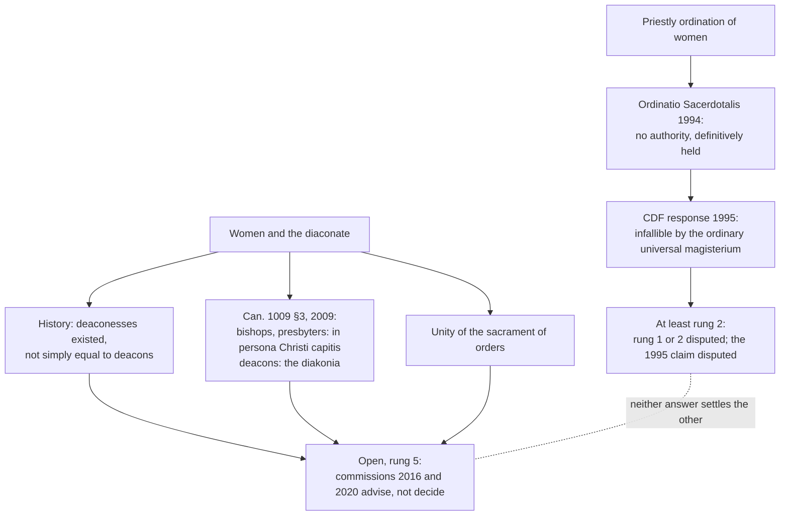

# Sacraments & Liturgy · Lesson 5.2: The reservation of priestly ordination

> ⏱ ~15 min · Module 5: The sacraments at the service of communion · Builds on: [5.1 Holy Orders](05-01-holy-orders-the-three-degrees.md), [`fundamental-theology` 4.4](../../fundamental-theology/lessons/04-04-the-ladder-of-doctrinal-authority.md), [`ecclesiology-and-mariology` 4.4](../../ecclesiology-and-mariology/lessons/04-04-infallibility-in-exercise-and-the-ordinary-universal-magisterium.md) · Unlocks: [5.3 Matrimony](05-03-matrimony-sacrament-contract-indissolubility.md)

## Why this matters

In 1994 John Paul II declared that the Church has no authority to ordain women priests. How firmly that is taught is [`fundamental-theology` 4.4](../../fundamental-theology/lessons/04-04-the-ladder-of-doctrinal-authority.md)'s worked case. Taking its result as given, this lesson asks about the reasons the Church gives, what Catholic theologians object, what other communions argue, and why the diaconate is a different question.

## The idea

Trent drew the line this lesson turns on, explaining why the Church could withhold the cup:

> this power has ever been in the Church, that, in the dispensation of the sacraments, their substance being untouched, it may ordain,—or change, what things soever it may judge most expedient (Trent, Session XXI, ch. 2)

A steward may rearrange the household; he may not alter what the master left. The cup and celibacy are dispensation ([3.5](03-05-communion-reservation-adoration.md), [5.1](05-01-holy-orders-the-three-degrees.md)). The magisterium's claim is that who can receive priestly ordination belongs to the [substance](../reference.md#substance-of-the-sacraments). So the Church does not say she *will* not ordain women priests, but that she *cannot*: "no authority whatsoever", not "forbidden".

Two questions travel together and must be pulled apart. Can women be ordained priests? *Ordinatio Sacerdotalis* answers. Can women be ordained deacons? No act answers. The diaconate is a grade of the same sacrament, but conferred "not unto the priesthood, but unto a ministry of service" (*Lumen Gentium* 29). Whether the reasons for the first reach the second is what is unsettled.

## In their own words

Communions that ordain women, in their own terms, left standing.

The Church of Sweden decided in 1958 to ordain women, and has since 1960. The US Episcopal Church's General Convention authorized it in 1976. The Church of England's General Synod voted for it in 1992; thirty-two women were ordained priests in 1994, and women bishops followed in 2014–2015. On 9 July 1975 Archbishop Donald Coggan told Paul VI of a slow but steady consensus growing in the Anglican Communion that there was no fundamental objection in principle.

Two arguments carry most of the weight. **From baptism:** "There is neither Jew nor Greek: there is neither bond nor free: there is neither male nor female. For you are all one in Christ Jesus" (Gal 3:28, DR). Krister Stendahl, a Lutheran exegete in the Swedish debate (*The Bible and the Role of Women*, English 1966), read the verse as the new creation breaking into the Church's own order, not only as equal standing before God. **From the incarnation:** "For that which He has not assumed He has not healed" (Gregory Nazianzen, Letter 101, NPNF). Richard A. Norris Jr., in a 1975 paper for the United States Anglican–Roman Catholic Consultation, argued that the Fathers took no christological interest in Jesus' maleness. The saving point is the humanity women share with him, so a priest represents Christ by that humanity; requiring maleness adds a premise the tradition never used.

## The doctrine

1. **The teaching, reloaded.** [*Ordinatio Sacerdotalis*](../reference.md#ordinatio-sacerdotalis) (22 May 1994) §4: the Church has no authority whatsoever to confer priestly ordination on women, and this judgment is to be definitively held by all the Church's faithful; it concerns "the Church's divine constitution". The CDF's [response of 28 October 1995](../reference.md#cdf-responsum-of-1995), approved by the pope: the teaching belongs to the deposit of faith and, founded on the written word of God and constantly kept in Tradition, was set forth infallibly by the ordinary and universal magisterium. The 1998 commentary on the Profession of Faith (¶11) lists it among truths to be held definitively, notes that the pope did not intend a dogmatic definition, and leaves a future one open. *In words:* not new in 1994, and not the Church's to change.

2. **The law.** "A baptized male alone receives sacred ordination validly" (can. 1024). Attempting to confer a sacred order on a woman, or to receive one, incurs automatic excommunication reserved to the Apostolic See (can. 1379 §3, revised 2021). *In words:* both canons cover every grade; for the priesthood they restate teaching, for the diaconate they are the law in force.

3. **[*Inter Insigniores*](../reference.md#inter-insigniores)'s reasons.** The CDF declaration (dated 15 October 1976, approved by Paul VI) gives four. **(a)** Constant tradition, East and West (§1). **(b)** Christ called no woman to the Twelve, though he broke boldly with custom about women elsewhere, so the choice was not cultural conformity (§2). **(c)** The apostles, who broke with Mosaic practice, ordained none of Paul's women co-workers, Phoebe and Priscilla among them (§3). **(d)** The Church's power over the sacraments stops at their substance (§4). Then fittingness (§5): the priest acts [*in persona Christi*](../reference.md#in-persona-christi-capitis), Christ's image at the consecration; sacramental signs signify by natural resemblance; Christ is the Bridegroom and the Church his Bride, so his role "must be taken by a man". Galatians 3:28 concerns divine sonship, not ministries (§6). *In words:* the conclusion rests on what Christ did, as the Church received it; the symbol shows why it fits.

    **What it declines to claim.** That §5 proves anything: it is offered by the analogy of faith, not as a demonstration, and the CDF's 1995 reflection calls such reasons fitting (*ex convenientia*), not strictly logical proofs. Any superiority of men: the difference is of function, not worth. That the old reasons were good (below). That the Gospel facts are self-evident: they "do not make the matter immediately obvious" (§2). And it says nothing of deaconesses.

4. **Catholic objections, as their makers state them.** *History:* Phyllis Zagano, a member of the 2016 commission, argues that the ancient deaconesses were truly ordained. *Scripture:* a 1976 Pontifical Biblical Commission report, never officially published but printed in *Origins* after a leak, reportedly found unanimously that the New Testament alone does not clearly settle the question. *Constant is not unchangeable:* Karl Rahner, replying to the declaration, argued that a practice may stay unbroken because no one questioned the social order it mirrored. *The symbol proves too much:* why maleness, and not other features of the man Jesus? Defenders such as Sara Butler (*The Catholic Priesthood and Women*) answer that the teaching stands on Christ's act as received, so weakening the symbol leaves it standing.

    **Two objections about the level.** *(i) Rung 1 or rung 2* ([`fundamental-theology` 4.4](../../fundamental-theology/lessons/04-04-the-ladder-of-doctrinal-authority.md), Ex 2). Rung 1 requires that the ordinary universal magisterium proposed it *as revealed*, which the response's "written word of God" and "deposit of faith" suggest. Rung 2 requires only that it is held definitively as *connected with* revelation, which OS's "held" and the commentary's placement suggest. *(ii) Whether the response's claim is established* (Francis Sullivan, *Creative Fidelity*, 1996; [`fundamental-theology` 4.1](../../fundamental-theology/lessons/04-01-the-magisterium.md)). A dicastery's reply is not itself infallible. For its claim to stand, the bishops' agreement in teaching this as definitive must be shown, and can. 749 §3's principle asks that infallibility be manifest; Sullivan held it had not been shown. Neither objection makes the teaching rung 3 or open. If (ii) were right, the 1995 claim would be unproven, not refuted; whether that would lower the full assent 4.4 says is owed is itself disputed.

5. **The diaconate, a different question.** Paul commends "Phebe, our sister, who is in the ministry of the church" (Rom 16:1, DR). Her title is *diakonos*, servant or minister (lesson's gloss): for the ITC a recognized service, not the deacon's office. 1 Timothy 3:11's "women" may be [deaconesses](../reference.md#deaconesses) or deacons' wives. From the third century, in parts of the East, deaconesses anointed women at baptism, instructed and visited them. The *Apostolic Constitutions* (about 380) have the bishop lay hands on a deaconess with a prayer for the Spirit (VIII.19–20), yet deny her a deacon's functions (VIII.28). Chalcedon's canon 15 legislates a laying-on of hands; the West shows none for five centuries. The ITC's *From the Diakonia of Christ to the Diakonia of the Apostles* (2002) drew two indications: deaconesses were not simply equivalent to deacons, and tradition stresses the unity of orders. It left the decision to the magisterium. Since *Omnium in mentem* (2009), can. 1009 §3 gives the capacity to act in the person of Christ the Head to bishops and presbyters, and service to deacons ([5.1](05-01-holy-orders-the-three-degrees.md)). So §5's symbol, as stated, does not reach deacons; the unity of orders may.

    Francis set up commissions (2 August 2016, 8 April 2020) and reserved the question to himself. Cardinal Petrocchi's summary letter to Leo XIV (18 September 2025, published 4 December 2025) reports a 2022 thesis, passed 7–1: the state of research rules out moving toward women deacons as a grade of orders, a strong assessment that still does not permit a definitive judgment like the one on priestly ordination. *In words:* the [female diaconate](../reference.md#female-diaconate) is open. Neither level objection reaches it, since both concern a teaching on *priestly* ordination; it turns on "for ministry", the unity of orders and the history.

**Said plainly.** Some of the reasons the tradition once gave were bad. *Inter Insigniores* itself concedes the Fathers' prejudices against women and scholastic arguments that modern thought would "rightly reject" (§1). The Church holds the practice was faithful; she does not defend every reason given for it.

**Mark the levels** ([levels of authority](../reference.md#levels-of-authority)). OS's teaching and the 1995 response: **at least rung 2**, with rung 1 against rung 2, and whether the 1995 claim is established, disputed: never "settled", never "open". *Inter Insigniores* as an act: **rung 3**. Its conclusion is now held at least at rung 2 through OS; its reasons of fittingness are illustration, so rejecting them is not rejecting the teaching. Cann. 1024, 1009 §3 and 1379 §3: **law, no rung**. The ITC study, the 1976 report, the commissions and the 2025 letter: **no magisterial level**. The female diaconate: **open, rung 5**, its decision reserved to the magisterium.

## Two questions, two levels

Left: an act and a disputed rung. Right: evidence and arguments, and no act.

## Worked examples

**Ex 1 (clean): an attempted ordination.** Invented: Ewan Halloway, a retired Catholic bishop, ordains Ingeborg Fennick, a Catholic laywoman, priest in a rented chapel, with the Roman rite's laying on of hands and prayer, exactly. *Valid?* No. Minister, matter and form are in order, so the **recipient** alone decides (can. 1024, restating OS). *Licit?* No: both incur excommunication reserved to the Apostolic See, and he may be dismissed from the clerical state (can. 1379 §3). *Fruitful?* No sacrament took place: no character, no grace of orders. The validity verdict rests on teaching held at least at rung 2; the penalty is law.

**Ex 2 (strain): the Byzantine deaconess.** In eighth-century Byzantium the bishop laid hands on a deaconess in the sanctuary during the liturgy and gave her the stole, as for a deacon (ITC 2002). Does this break *Inter Insigniores*'s "constant tradition"? Its claim concerns only **priestly or episcopal** ordination. The rite touches that only if (a) it conferred the sacramental diaconate and (b) the three grades stand or fall together. The ITC and the 2021 commission thesis doubt (a); Zagano affirms it. (b) is the disputed unity-of-orders argument. The strain is real, but it lives in the diaconate question.

## Watch out

- **You might think OS is a solemn definition, or a discipline the next pope could lift.** The first overstates, the second understates: at least rung 2, the rung disputed ([`fundamental-theology` 4.4](../../fundamental-theology/lessons/04-04-the-ladder-of-doctrinal-authority.md)).
- **You might think that refuting the nuptial symbol refutes the teaching.** The symbol is fittingness; the teaching rests on Christ's act.
- **You might think the 2025 letter closed the diaconate.** It reports a commission thesis that itself declines a definitive judgment; commissions are not magisterium.
- **You might think deacons act *in persona Christi capitis*.** The pre-2009 can. 1008 said so, and the ITC wrote under it; can. 1009 §3 now distinguishes.

## One-liner

> The Church holds, at least as definitive teaching, that she cannot ordain women priests; whether women can be deacons is another, open question.

## Problems

**P1 (🟢)** *(Exegetical)* An **invented** transcript, written for this problem, from a Catholic radio phone-in on Rookhaven Catholic Radio:

> FOLASADE (caller): The pope could ordain women priests tomorrow if he wanted. It's only a rule, like celibacy.
>
> RADEK (caller): And people talk about deaconesses, but there never were any. That's a modern invention.
>
> HOST: Not quite, Radek. The Council of Chalcedon proves deaconesses were ordained deacons exactly like men. So the Church has already ordained women, and nothing stops her ordaining them priests. Mind you, the Vatican's 2025 report has now settled the diaconate for good.

Find **four** errors. For each, give the correction and say whether it rests on doctrine (with its level) or on discipline or law. 150 words or fewer.

**P2 (🟡)** *(Exegetical)* Two canons (NPNF second series vol. 14, Percival's translation). Chalcedon (451), canon 15:

> A woman shall not receive the laying on of hands as a deaconess under forty years of age, and then only after searching examination. And if, after she has had hands laid on her and has continued for a time to minister, she shall despise the grace of God and give herself in marriage, she shall be anathematized and the man united to her.

Nicaea (325), canon 19, on members of the Paulianist sect received into the Church:

> Likewise in the case of their deaconesses, and generally in the case of those who have been enrolled among their clergy, let the same form be observed. And we mean by deaconesses such as have assumed the habit, but who, since they have no imposition of hands, are to be numbered only among the laity.

(a) What does Chalcedon's canon establish about deaconesses? Name the words that carry it, and name two things it does not establish.

(b) What does Nicaea's last sentence add, and why can it not be used as clean evidence either way?

Two sentences per part.

**P3 (🔴)** *(Evaluative)* Could the Church admit women to the diaconate as a grade of holy orders? Any verdict, 150 words or fewer.

Solutions

**P1** *(Exegetical)*

**Accept:** any four of the five below.

**Must hit, strict:**

- **"Could ... tomorrow ... only a rule."** OS §4 says the Church has no authority whatsoever, because priestly ordination's recipient belongs to the sacrament's substance, which the Church cannot change (Trent XXI ch. 2). **Doctrine:** to be definitively held, at least rung 2 ([`fundamental-theology` 4.4](../../fundamental-theology/lessons/04-04-the-ladder-of-doctrinal-authority.md)). Celibacy, by contrast, is discipline ([5.1](05-01-holy-orders-the-three-degrees.md)).
- **"Never any deaconesses."** False as history. Deaconesses are attested from the third century, chiefly in the East: the Didascalia, the *Apostolic Constitutions* VIII, Chalcedon can. 15. **History, no level.**
- **"Ordained deacons exactly like men."** Chalcedon shows a laying-on of hands, a minimum age and a ban on later marriage. It does not show the same order or functions: *Apostolic Constitutions* VIII.28 denies deaconesses a deacon's tasks, and the ITC (2002) judged them not simply equivalent. **History; the sacramental question is open.**
- **"Nothing stops her ordaining them priests."** Two questions. Even a sacramental female diaconate would not touch OS, whose teaching concerns priestly ordination. **Doctrine, at least rung 2.**
- **"Settled the diaconate for good."** The 2022 thesis itself declined a definitive judgment, and a commission's summary is not magisterium. **The question is open, rung 5, reserved to the magisterium.**

**Wrong turns:** calling OS an *ex cathedra* definition (overstates) or a disciplinary norm (understates); "correcting" Radek by asserting that deaconesses were sacramentally ordained, which is disputed; treating can. 1024 as the reason, when the canon restates the teaching.

**Model answer:** The Church holds she has no authority to ordain women priests, because the matter belongs to the sacrament's substance, not its dispensation. That is doctrine to be definitively held, at least rung 2; celibacy is discipline. Deaconesses existed: the Didascalia, the *Apostolic Constitutions* and Chalcedon attest them. But Chalcedon shows a laying-on of hands, an age and a ban on marriage, not an order identical with deacons. The *Constitutions* deny them a deacon's functions. Even a sacramental diaconate for women would not reach OS, which concerns the priesthood. The 2025 letter reports a commission thesis that refuses a definitive judgment, and a commission is not magisterium: the diaconate question remains open.

---

**P2** *(Exegetical)*

**Must hit, strict (a):**

- **Establishes:** a recognized office into which a woman entered by a liturgical laying-on of hands ("receive the laying on of hands as a deaconess", "had hands laid on her"), with a minimum age of forty, prior examination, a continuing ministry ("continued for a time to minister"), and a lifelong ban on marriage under anathema. The ITC reads the canon's Greek as *cheirotonia*, the word for ordaining clergy (lesson's gloss).
- **Does not establish,** any two: that the rite was the same as a deacon's; what the deaconess's functions were; that the office was sacramental in the later sense; that it existed in the West.

**Must hit, strict (b):**

- It says the Paulianists' deaconesses had **no imposition of hands** and are counted among the laity. So some women called deaconesses were not ordained at all, and "deaconess" did not name one thing everywhere.
- **Caution:** the text is uncertain. Percival notes that several ancient witnesses, Gratian among them, read "deacons" for "deaconesses" in the first sentence, and he calls the second most difficult to translate. It also concerns a sect's practice, before Chalcedon.

**Wrong turns:** reading Chalcedon's laying-on of hands as proof of sacramental diaconal ordination; reading Nicaea as proof that no deaconess was ever ordained; ignoring Percival's textual note; giving either canon a doctrinal level about the diaconate (they are disciplinary canons).

**Model answer:**

(a) Chalcedon treats the deaconess as an office entered by a laying-on of hands ("had hands laid on her") after examination, at forty, with a continuing ministry and a lifelong ban on marriage. It does not say her rite or functions matched a deacon's, nor that the office was sacramental.

(b) Nicaea's sentence says the sect's deaconesses had no imposition of hands and count as laity, so the name did not always mark an ordination. But the reading is textually uncertain, and it concerns a sect, so it cannot settle the matter either way.

---

**P3** *(Evaluative)*

**Must hit, any verdict:**

- States the question's standing: **open, rung 5**, no magisterial act; the 2025 letter reports a commission's strong but non-definitive negative thesis, and is not magisterium.
- **Keeps the priesthood question separate:** does not decide the diaconate from OS, and does not argue from a female diaconate to the priesthood without facing OS.
- Engages the **unity-of-orders** argument: rests on it, or answers it.
- Engages **"for ministry, not priesthood"** (LG 29) and can. 1009 §3, which since 2009 ascribes acting *in persona Christi capitis* to bishops and presbyters and the diakonia of liturgy, word and charity to deacons, so the symbol argument as stated does not plainly reach them.
- Says what the **history** shows and does not: deaconesses existed with a laying-on of hands, chiefly in the East, but were not simply equivalent to deacons; history alone cannot decide.

**Wrong turns:** treating the question as settled either way; treating OS or the 1995 response as covering deacons; treating the ITC or a commission as the magisterium; resting the verdict on history alone, which the 2025 letter itself says cannot reach certainty.

**Model answer, one of several (no):** The question is open; the 2025 letter reports a strong commission thesis against, but no magisterial act decides it. OS does not reach it, and since 2009 can. 1009 §3 ascribes acting in the person of Christ the Head to bishops and presbyters and the diakonia to deacons, so the nuptial symbol cannot be my ground. My ground is the unity of orders: one sacrament in three grades, the diaconate ordered to assist the bishop's apostolic ministry. A grade open to a recipient the higher grades exclude would split the sacrament. The history fits this: the deaconesses' rite and functions differed from deacons', which suggests an office of its own kind. The strongest reply is "for ministry, not priesthood": if the diaconate is not priestly, the reason for the reservation may not apply. I concede that the unity argument then has to carry the whole weight.

## Flashback

**From Lesson [4.3](04-03-anointing-of-the-sick.md) (Anointing of the sick):** *(Exegetical.)* Florence's Decree for the Armenians (in the bull *Exsultate Deo*, 22 November 1439) on this sacrament (lesson's translation of the Latin):

> The fifth sacrament is extreme unction, whose matter is olive oil blessed by a bishop. This sacrament must not be given except to a sick person whose death is feared. He is to be anointed in these places: on the eyes because of sight, [...] on the hands because of touch, on the feet because of walking [...]. The form of this sacrament is this: Through this holy anointing and his most loving mercy may the Lord pardon you whatever [you have sinned] through sight, and so on. [...] The minister of this sacrament is the priest.

For each of the four features (matter, recipient, anointings and form, minister), say whether it still holds in the Latin Church, name the act that changed it if it did, and give the level of what holds now. Then say which feature the Church holds she cannot change, and why the decree's own wording is not the reason.

One sentence per feature; two for the last part.

Solution

**Accept:** for the matter, either change with its level; for the minister, "rung 1 that the priest alone is the proper minister, at least rung 2 that only priests anoint validly".

**Must hit, strict:**

- **Matter: changed.** Paul VI's *Sacram Unctionem Infirmorum* (1972) admits another plant oil, and can. 999 lets any presbyter bless the oil in necessity, within the celebration: **law, no rung**. Trent's "oil blessed by a bishop" is chapter teaching (Session XIV, *On Extreme Unction*, ch. 1), not a canon. The usual account, that validity needs oil blessed by one with power to bless, a power the Church can grant, is explanation with **no magisterial level**.
- **Recipient: changed.** The time has come once a believer *begins* to be in danger of death from sickness or old age (SC 73, **rung 3**; can. 1004 §1, law). Trent had already written "especially" the departing (ch. 3, not a canon), never "only".
- **Anointings and form: changed.** Since 1972 the forehead and hands are anointed, with one form praying James's promises instead of asking pardon sense by sense, and in necessity a single anointing suffices (can. 1000 §1): **law, no rung**.
- **Minister: unchanged.** The priest alone is the proper minister (Trent XIV can. 4, **rung 1**), and that only priests anoint validly is **at least rung 2** (the CDF's note of 11 February 2005, *definitive tenenda*); can. 1003 §1 restates it as law.
- **The last part:** the minister is the feature the Church holds she cannot change, because it belongs to the sacrament's substance, not its dispensation. The Decree for the Armenians is an instruction, not a definition ([1.4](01-04-why-seven.md)), as the three changed features show; what fixes the minister is Trent's canon and the 2005 note.

**Wrong turns:** reading Florence as a definition, so that 1972 broke dogma (overstates the decree); arguing that because three features changed the fourth can (understates a teaching held at least at rung 2); calling exclusivity rung 1 by canon 4 alone, when canon 4 names the *proper* minister and the act that labels exclusivity is the CDF's *definitive tenenda*; calling SC 73 a definition, or over-correcting the recipient into "not for the dying" against CCC 1523; giving the account of the power to bless a magisterial level.

**Model answer:** Matter: changed, since Paul VI (1972) allowed another plant oil and can. 999 lets any presbyter bless it in necessity, both law with no rung, Trent's bishop's oil being a chapter, not a canon. Recipient: changed, since the time comes once danger of death from sickness or old age begins (SC 73, rung 3; can. 1004 §1, law), and Trent had said "especially", never "only". Anointings and form: changed in 1972 to forehead and hands with one form praying James's promises (law, no rung). Minister: unchanged; the priest alone is the proper minister (Trent XIV can. 4, rung 1), and only priests anoint validly (CDF 2005, at least rung 2). That is the feature the Church holds she cannot change, because it belongs to the substance of the sacrament, not its dispensation. Florence's decree is an instruction, not a definition, as the three changes show; what fixes the minister is Trent's canon and the CDF's *definitive tenenda*.

## Connections

- **Backward:** the three grades, matter, form and *Omnium in mentem* are [5.1](05-01-holy-orders-the-three-degrees.md); the substance/dispensation line is Trent XXI ch. 2 in [3.5](03-05-communion-reservation-adoration.md). OS's level is worked in [`fundamental-theology` 4.1](../../fundamental-theology/lessons/04-01-the-magisterium.md), [4.2](../../fundamental-theology/lessons/04-02-infallibility-and-its-conditions.md), [4.4](../../fundamental-theology/lessons/04-04-the-ladder-of-doctrinal-authority.md) and [4.5](../../fundamental-theology/lessons/04-05-reading-a-documents-weight.md), and the ordinary universal magisterium in [`ecclesiology-and-mariology` 4.4](../../ecclesiology-and-mariology/lessons/04-04-infallibility-in-exercise-and-the-ordinary-universal-magisterium.md). The common and ministerial priesthood are [`ecclesiology-and-mariology` 3.3](../../ecclesiology-and-mariology/lessons/03-03-the-laity-charisms-and-the-sensus-fidei.md).
- **Forward:** [5.3](05-03-matrimony-sacrament-contract-indissolubility.md) returns to the nuptial symbol of Ephesians 5 as the ground of a sacrament. Women's ordination is named, as an obstacle to reconciliation with the Anglicans, in [`apologetics-catholic-claims`](../../apologetics-catholic-claims/syllabus.md) [4.3](../../apologetics-catholic-claims/lessons/04-03-apostolic-succession-and-the-validity-of-orders.md), not argued.
- **Sideways:** Gregory's "not assumed, not healed", which Norris turns on Christ's maleness, is the soteriological rule of [`christology` 2.1](../../christology/lessons/02-01-apollinaris-a-complete-humanity.md). 1 Timothy 3's deacons and the Pastorals' offices are [`new-testament` 6.1](../../new-testament/lessons/06-01-the-disputed-pauline-letters-and-the-pastorals.md).
