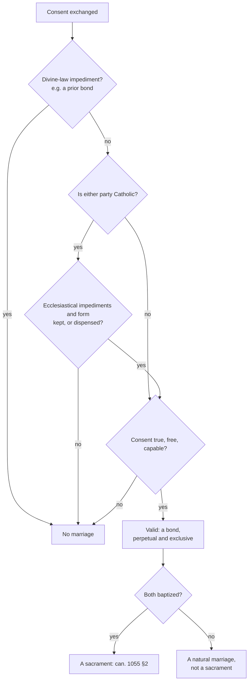

# Sacraments & Liturgy · Lesson 5.3: Matrimony: sacrament, contract, indissolubility

> ⏱ ~15 min · Module 5: The sacraments at the service of communion · Builds on: [1.1 What a sacrament is](01-01-what-a-sacrament-is.md), [1.3 *Ex opere operato*, character, and fruitfulness](01-03-ex-opere-operato-character-and-fruitfulness.md), [`moral-theology` 6.1](../../moral-theology/lessons/06-01-the-theology-of-the-body-and-chastity.md) · Unlocks: [5.4 Nullity, dissolution, and the pastoral debates](05-04-nullity-dissolution-and-the-pastoral-debates.md)

## Why this matters

Matrimony is the one sacrament older than the Church. If marriage is natural, what did Christ add? If the couple's consent makes it, who is the minister, and why does a Catholic who marries without the parish priest marry no one? And what does "indissoluble" claim when Matthew's Jesus names an exception? Sexual ethics stay with [`moral-theology` 6.1](../../moral-theology/lessons/06-01-the-theology-of-the-body-and-chastity.md).

## The idea

**Nothing is laid on top.** Trent's Session XXIV opens with Adam pronouncing the bond perpetual and indissoluble (Gen 2:24), and Christ confirming it. What Christ added was grace "which might perfect that natural love", merited by his passion. Between two baptized people the marriage itself, the covenant they make, is the sign that causes ([1.1](01-01-what-a-sacrament-is.md)).

**What it signifies.** Of the "two in one flesh" Paul says: "This is a great sacrament: but I speak in Christ and in the church" (Eph 5:32, DR). The Greek is *mega mystērion*, a great hidden purpose now disclosed (lesson's gloss; [`new-testament` 6.1](../../new-testament/lessons/06-01-the-disputed-pauline-letters-and-the-pastorals.md) cedes this reading here). The verse alone settles nothing ([1.1](01-01-what-a-sacrament-is.md)), and Trent says only that the Apostle "intimates" the grace. Florence names the sign, the union of Christ and the Church, and lists Augustine's three goods ([`moral-theology` 5.5](../../moral-theology/lessons/05-05-assisted-reproduction-and-the-embryo.md)), with indivisibility where he has *sacramentum* (Decree for the Armenians, 1439).

**The exception clause.** Matthew 19:9 forbids putting away a wife and marrying another, "except it be for fornication" (DR). *Porneia* (sexual wrongdoing, lesson's gloss) has borne three readings.

1. *Unlawful union:* a union within forbidden degrees (Lev 18; Acts 15:29), never a marriage, so nothing real is excepted. Joseph Fitzmyer argued this from Qumran texts (*Theological Studies*, 1976).
2. *Separation without remarriage:* Jerome (the wife put away "must remain unmarried", Letter 77.3), Augustine (*On Adulterous Marriages*), and Florence: separation of bed is lawful for fornication, another marriage is not, "since the bond of a lawfully contracted marriage is perpetual" (lesson's translation).
3. *Dissolution:* adultery ends the bond and the innocent party may remarry. So the Reformed confessions (below), and Orthodox practice by economy ([5.4](05-04-nullity-dissolution-and-the-pastoral-debates.md)).

## In their own words

Two traditions, stated as they state themselves and left standing.

**The Orthodox crowning.** In the Byzantine rite the priest asks God to join the couple, then crowns each in the name of the Trinity and blesses them three times:

> conjoin this thy servant, N., and this thy handmaid, N.; for by thee is the husband united unto the wife. … O Lord our God, crown them with glory and honour. (Office of Holy Matrimony, Hapgood's *Service Book*, 1906)

The Orthodox Church in America's catechism *The Orthodox Faith* (vol. 2, *Worship*) says marriage "is not a juridical contract" and that the service "contains no vows or oaths". By the Church's recognition and incorporation into Christ's Body the union becomes an image of God's unending love; the crowned are witnesses (martyrs) and heirs of the Kingdom.

**The Reformed confession.** The Westminster Confession (1647) counts two sacraments only, baptism and the Supper (27.4). On marriage:

> In the case of adultery after marriage, it is lawful for the innocent party to sue out a divorce, and after the divorce to marry another, as if the offending party were dead. (24.5)

## The doctrine

1. **One of the seven.** Trent anathematizes whoever says matrimony is not truly and properly one of the seven sacraments instituted by Christ, but a human invention that confers no grace ([Session XXIV](../reference.md#trent-session-xxiv), can. 1). *In words:* Christian marriage is a sacrament and gives grace; how Christ instituted it is left open ([1.4](01-04-why-seven.md)).
2. **[Ends and properties](../reference.md#ends-and-properties-of-marriage).** The covenant is a partnership of the whole of life, ordered by its nature to the good of the spouses and to the procreation and education of children (can. 1055 §1, after GS 48). Its essential properties, unity and indissolubility, gain a special firmness from the sacrament (can. 1056). *In words:* every marriage has these; the sacrament firms them. The 1917 Code ranked procreation and education primary, mutual help and the remedy of concupiscence secondary (can. 1013 §1); GS 48–50 and the 1983 Code do not rank, repudiate nothing, and leave how much changed to argument.
3. **Contract and sacrament are one thing between the baptized.** Against jurists who would give the contract to the state, Leo XIII (*Arcanum*, 1880, §23, lesson's translation of the Latin):

    > Christ the Lord enriched marriage with the dignity of a sacrament; and marriage is the contract itself, if only it is lawfully made. … Every lawful marriage between Christians is in itself and by itself a sacrament.

    Hence can. 1055 §2: between the baptized no valid contract exists that is not by that fact a sacrament (also CCEO can. 776 §2). *In words:* for two baptized people the valid marriage is the sacrament, even before a registrar where canonical form does not bind them (can. 1117).
4. **Consent and the [minister](../reference.md#minister-of-matrimony).** Consent lawfully manifested makes marriage, and no human power can supply it (can. 1057 §1); Florence calls it the efficient cause "as a rule" (*regulariter*). In the Latin Church it is "ordinarily understood" that the spouses confer the sacrament on each other (CCC 1623); the cleric asks for and receives their consent in the Church's name (can. 1108 §2). In the Eastern liturgies the minister is the priest who crowns them after receiving their consent (CCC 1623), and Eastern Catholic law makes the rite sacred "by the very intervention of a priest who assists and blesses" (CCEO can. 828 §2, lesson's translation). *In words:* one Church, two received theologies of the minister: the covenant itself as the sign, or the joining as God's act through the Church's prayer.
5. **Matter and form: a school's explanation.** Aquinas's *Supplement* makes the words of consent the form, "not the priest's blessing, which is a sacramental" (Suppl. q.42 a.1 ad 1); the act makes the bond, which disposes to grace (a.3 ad 2), [1.1](01-01-what-a-sacrament-is.md)'s middle layer. *In words:* theology, not dogma.
6. **[Canonical form](../reference.md#canonical-form) and [impediments](../reference.md#impediments).** Trent defines that the Church can establish nullifying impediments and dispense from some (cans. 3–4). *Tametsi*, a reform decree, made marriage before the parish priest and witnesses a condition of validity where published; *Ne temere* (1907, in force 1908) made the form universal ([`church-history` 6.4](../../church-history/lessons/06-04-trent-and-catholic-reform.md)). Now form binds whenever one party is Catholic (can. 1117): the local ordinary, pastor, or a delegated priest or deacon assists, with two witnesses (can. 1108 §1). It can be dispensed in a mixed marriage (can. 1127 §2), and in danger of death witnesses alone suffice (can. 1116). Since 2016 only a priest validly assists where a party is Eastern (can. 1108 §3), and with an Eastern non-Catholic party form binds only for liceity, a priest's intervention sufficing for validity (can. 1127 §1). Divine-law impediments, such as a prior bond, are never dispensed; ecclesiastical ones can be (can. 1078). *In words:* the Church cannot supply consent, but she sets the conditions under which her members' consent is valid.
7. **[Mixed marriages](../reference.md#mixed-marriages) and disparity of cult.** A Catholic marrying a baptized non-Catholic needs permission, for liceity (can. 1124); the marriage is a sacrament. Marrying an unbaptized person needs a dispensation, for validity (can. 1086), and yields a valid natural marriage, not a sacrament: the covenant is raised "between the baptized" (can. 1055 §1). *In words:* permission decides liceity, dispensation validity, baptism sacramentality.
8. **Effects.** Every valid marriage yields a bond, perpetual and exclusive by nature; in Christian marriage a special sacrament strengthens and as it were consecrates the spouses for their state (can. 1134). *In words:* the bond, and the grace of state to live it.

**Said plainly.** Trent's canon on adultery was reworded at a secular government's request to spare a practice of the Greeks. The July 1563 draft anathematized whoever said adultery dissolves a marriage. In August Venice's ambassadors pleaded for the Greeks of its territories, who allowed remarriage after adultery. Canon 7 as passed anathematizes whoever says the Church has erred in teaching that adultery leaves the bond intact. What the change meant is disputed: Piet Fransen's 1947 thesis, followed by Giancarlo Pani (*La Civiltà Cattolica*, 2014), held that the Fathers declined to define indissolubility as of faith; E. Christian Brugger (*Public Discourse*, 2014) holds that they held it so and spared the Greeks as a pastoral accommodation.

**Mark the levels** ([`fundamental-theology` 4.4](../../fundamental-theology/lessons/04-04-the-ladder-of-doctrinal-authority.md); [levels](../reference.md#levels-of-authority)). Session XXIV's doctrinal canons are **rung 1**: one of the seven, conferring grace (can. 1); unity (can. 2); the power over impediments (cans. 3–4); no dissolution for heresy or desertion (can. 5); virginity the better state (can. 10). Canon 7 is **rung 1 as worded**; whether it defined indissolubility as revealed is the Fransen–Brugger dispute. The absolute indissolubility of a ratified, consummated marriage is **at least rung 2**: John Paul II called it to be held definitively, though no defining act had solemnly declared it (Address to the Roman Rota, 21 January 2000, §8). Canons 8, 9, 11 and 12 define the Church's authority over separation, vowed persons' marriages, rite and marriage cases, not the permanence of any law; canon 6 is 5.4's. The doctrinal chapter, *Arcanum*'s inseparability, the ends and the grace of state: **at least rung 3**. The spouses as ministers: **rung 4**, Latin common teaching, reported beside the Eastern view. Florence's clauses carry the weight of what they restate ([1.4](01-04-why-seven.md)). Matter and form of consent: **no magisterial level**. Canonical form, the particular impediments, *Tametsi*, *Ne temere*: **law, no rung**.

## The decision

Liceity (permission, place, rite) sits beside this chart.

## Worked examples

**Ex 1 (clean): a Catholic and an unbaptized spouse.** Invented. Folake, a Catholic, marries Kiran, a Hindu never baptized, in her parish church. Folake is Catholic, so disparity of cult nullifies unless dispensed (can. 1086); the bishop dispenses after her promises, of which Kiran is informed (can. 1125). The pastor and two witnesses assist; both consent freely. **Valid** and **licit**; **not a sacrament**, since Kiran is unbaptized (can. 1055 §1). A bond still arises (can. 1134), and neither spouse can end it, for indissolubility belongs to every marriage (can. 1056). Dissolution in favour of the faith is [5.4](05-04-nullity-dissolution-and-the-pastoral-debates.md)'s.

**Ex 2 (strain): the deacon at a Latin–Eastern wedding.** Invented. Brigida, a Latin Catholic, marries Taras, a Ukrainian Greek Catholic, in her Latin parish in Tarrow. Her uncle, a permanent deacon with the pastor's general delegation, receives their consent before two witnesses. If the spouses are the ministers and a delegated deacon a qualified witness, it looks sound. But only a priest validly assists where a party is Eastern (can. 1108 §3), and delegation is subject to that rule (can. 1111 §1, as amended). **Invalid** for defect of form, **illicit** too, and **no sacrament**, because no marriage. The strain: how can the deacon's presence void the ministers' consent? Because form is the Church's condition on the validity of her members' consent, here shaped to the Eastern party's tradition, in which the priest's blessing belongs to the rite (CCEO can. 828). The law decides validity, not which theology of the minister is right.

## Watch out

- **You might think the priest marries the couple.** In the Latin Church the spouses confer the sacrament and the cleric is the Church's qualified witness. But in the Eastern churches, Catholic ones included, the priest's blessing is required for validity.
- **You might think canonical form is divine law.** It is ecclesiastical law, no rung, universal only from 1908, and dispensable; clandestine marriages before it were true marriages, as *Tametsi* says.
- **On indissolubility, both level errors are live.** "Canon 7 solemnly defined it" overstates what is settled about the canon; "its indirect wording left remarriage after adultery open" understates. Rung 1 as worded; absolute indissolubility at least rung 2.

## One-liner

> Between the baptized the marriage is the sacrament: their consent makes it, the Church sets the form it must take, and once it is consummated no human power undoes it.

## Problems

**P1 (🟢)** *(Exegetical)* Three **invented** weddings, written for this problem. For each give three verdicts: valid or not, licit or not, a sacrament or not. Name the element that decides each (consent, impediment, form, permission, baptism) and the canon. Two sentences per case.

(a) Signe and Mateus, both baptized and raised Lutheran, neither ever a Catholic, marry before a judge at the town hall in Fenby.

(b) Tiago and Efua, both Catholics, marry on a beach. A friend with an online "ordination" asks for their vows, and two guests sign as witnesses. No one asked the parish or the diocese for anything.

(c) Corentin, a Catholic, marries Ksenia, a baptized member of the Russian Orthodox Church, in her parish; the Orthodox priest blesses and crowns them. Corentin never asked his bishop's permission.

**P2 (🟡)** *(Exegetical (a) · Exegetical (b))* Trent, Session XXIV, canon 7 (Waterworth, 1848):

> If any one saith, that the Church has erred, in that she hath taught, and doth teach, in accordance with the evangelical and apostolical doctrine, that the bond of matrimony cannot be dissolved on account of the adultery of one of the married parties; and that both, or even the innocent one who gave not occasion to the adultery, cannot contract another marriage, during the life-time of the other; and, that he is guilty of adultery, who, having put away the adulteress, shall take another wife, as also she, who, having put away the adulterer, shall take another husband; let him be anathema.

(a) What proposition does the anathema strike, and what three things does the canon say the Church teaches? Name what the canon pointedly does not anathematize, and the words that show it. Three sentences.

(b) Give the canon's level as worded. Does its indirect wording leave remarriage after adultery open for Catholics? Name the act that fixes the level of absolute indissolubility today. Two sentences.

**P3 (🔴)** *(Exegetical)* An **invented** wedding programme, written for this problem: the "note for our guests" in the order of service for Renske, a Catholic, and Joaquim, a baptized Anglican, at a Latin-rite parish.

> (1) Father Hallam will marry Renske and Joaquim today; it is his blessing that makes them husband and wife.
>
> (2) Because Joaquim is Anglican, this is a mixed marriage: valid, but not the full sacrament Renske would receive marrying a Catholic.
>
> (3) We are not marrying at the vineyard where we got engaged, because canonical form is divine law: Catholics married anywhere but in a church have never been truly married, in any century.
>
> (4) Renske's cousin Dorota, a Catholic, married a Muslim in a mosque with the bishop's dispensations. Since that marriage is not a sacrament, the two of them can end it whenever they choose.

For each sentence give the error and the correction, citing the canon or document, and the level wherever a level is involved. Two sentences per item.

Solutions

**P1** *(Exegetical)*

**Must hit, strict:**

- **(a) Valid; no Catholic law of liceity at issue; a sacrament.** Canonical form binds only when a party was baptized in or received into the Catholic Church (can. 1117), so true consent before the judge suffices, and the Code's rules of liceity govern marriages of Catholics (can. 1059). Both are baptized, so the valid contract is by that fact a sacrament (can. 1055 §2; *Arcanum* 23).
- **(b) Invalid, by defect of form; so no sacrament.** Both are Catholics and bound by form (can. 1117); no local ordinary, pastor, or delegated priest or deacon asked for and received consent (can. 1108), nothing was dispensed, and the witnesses-only form needs danger of death or a long absence of any assistant (can. 1116). Liceity does not arise where there is no marriage, and baptism makes no sacrament out of no marriage.
- **(c) Valid, illicit, a sacrament.** With an Eastern non-Catholic party, form binds only for liceity, and validity requires a priest's intervention (can. 1127 §1, as amended in 2016), which the Orthodox priest supplies. It is illicit for want of permission for a mixed marriage (can. 1124) and of form; both are baptized, so it is a sacrament (can. 1055 §2).

**Wrong turns:** calling (a) invalid or "merely civil" because no priest was present; calling (c) invalid for defect of form; letting (c)'s illiceity become invalidity; denying (c) is a sacrament because Ksenia is Orthodox; calling (b) "valid but illicit".

**Model answer:** (a) Valid: form binds only marriages with a Catholic party (can. 1117), and nothing suggests defective consent or an impediment; no Catholic rule of liceity governs them (can. 1059). Both are baptized, so their valid marriage is by that fact a sacrament (can. 1055 §2). (b) Invalid for defect of form: as Catholics they are bound by it (can. 1117), and no qualified person received their consent (can. 1108), with no dispensation and no case for the witnesses-only form (can. 1116). With no marriage there is no sacrament, baptized or not. (c) Valid, because with an Eastern non-Catholic party form binds only for liceity and the Orthodox priest's intervention meets the validity requirement (can. 1127 §1). Illicit for want of permission (can. 1124) and of form, and a sacrament because both are baptized.

---

**P2** *(Exegetical (a) · Exegetical (b))*

**Must hit, strict (a):**

- The anathema strikes the claim that **the Church has erred** in so teaching: its target is a charge against the Church's teaching.
- The three: the bond is not dissolved by adultery; neither spouse, not even the innocent one, may remarry while the other lives; whoever puts away an adulterous spouse and remarries commits adultery. All are taught "in accordance with the evangelical and apostolical doctrine".
- It does not directly anathematize whoever merely holds or practises that adultery dissolves the bond, the Greek practice Venice asked the Council to spare. The words: "If any one saith, that the Church has erred, in that she hath taught".

**Must hit, strict (b):**

- **Rung 1 as worded:** a canon with anathema defining that the Church does not err in this teaching.
- **Not open.** The canon calls the teaching evangelical and apostolic and its denial an error. Whether the Fathers defined indissolubility itself as revealed is disputed (Fransen, Brugger), but the absolute indissolubility of a ratified, consummated marriage is to be held definitively, **at least rung 2** (John Paul II, Address to the Roman Rota, 2000, §8; can. 1141).

**Wrong turns:** reading the indirect form as Trent approving the Greek practice; calling indissolubility "solemnly defined in can. 7" as if the historians' dispute did not exist, or "open because the canon is indirect"; reporting Fransen's or Brugger's reading as the Church's; treating the Venetian request as part of the text.

**Model answer:** (a) The anathema falls on whoever says the Church has erred in teaching three things: that adultery does not dissolve the bond, that neither spouse, not even the innocent one, may remarry while the other lives, and that one who puts away an adulterous spouse and remarries commits adultery. It presents these as "evangelical and apostolical doctrine". It does not directly anathematize whoever holds that adultery dissolves the bond, the Greek practice; its opening, "that the Church has erred", aims it at the charge of error instead. (b) As worded the canon is rung 1, so whatever the Fathers meant by sparing the Greeks, it leaves remarriage after adultery closed to Catholics. The absolute indissolubility of a ratified, consummated marriage is held definitively, at least rung 2, on John Paul II's 2000 address to the Roman Rota, which notes that no defining act solemnly declared it.

---

**P3** *(Exegetical)*

**Must hit, strict:**

- **(1)** Consent makes marriage (can. 1057 §1), and in the Latin Church the spouses are "ordinarily understood" to confer the sacrament on each other (CCC 1623), **rung 4**, common teaching, not defined. Father Hallam assists, asking for and receiving their consent in the Church's name (can. 1108 §2); in an Eastern church his blessing would be required for validity (CCEO can. 828), but this is a Latin-rite wedding.
- **(2)** Both are baptized, so their valid marriage is by that fact a sacrament, fully (can. 1055 §2; *Arcanum* 23; **at least rung 3**). A mixed marriage needs permission for liceity (can. 1124); it is not a lesser sacrament.
- **(3)** Canonical form is ecclesiastical law, **no rung**: *Tametsi* (1563, where published) and *Ne temere* (in force 1908) imposed it, *Tametsi* granting that clandestine marriages had been valid, and it can be dispensed (can. 1127 §2). Form concerns who assists and who witnesses, not the building: the local ordinary can permit another suitable place (can. 1118 §2).
- **(4)** Indissolubility is an essential property of every marriage, sacramental or not (can. 1056), and the bond is perpetual by nature (can. 1134), so neither spouse can end it at will. Whether the Church can dissolve such a bond in favour of the faith is 5.4's question.

**Wrong turns:** correcting (1) by giving the priest no role at all, when form makes his assistance a condition of validity; treating the Latin view of the minister as defined; saying in (2) that the marriage becomes a sacrament only by dispensation; saying in (3) that form is about the church building; correcting (4) by saying the Church can freely dissolve any non-sacramental marriage, which overstates the other way.

**Model answer:** (1) Consent makes marriage (can. 1057 §1), and in the Latin Church the spouses are understood to confer the sacrament on each other, a rung-4 common teaching (CCC 1623). Father Hallam is the qualified witness who asks for and receives their consent in the Church's name (can. 1108 §2). (2) Two baptized spouses who marry validly receive the sacrament by that very fact (can. 1055 §2; *Arcanum*, at least rung 3). Being a mixed marriage affects only liceity, which permission supplies (can. 1124). (3) Canonical form is ecclesiastical law with no rung: *Tametsi* admits that clandestine marriages were valid before it, and the form can be dispensed (can. 1127 §2). It governs who assists, and the ordinary can permit another suitable place (can. 1118 §2). (4) Every marriage is indissoluble by nature (cann. 1056, 1134), so the spouses cannot end Dorota's. What the Church may do with a non-sacramental bond is a separate question (5.4).

## Flashback

**From Lesson [5.1](05-01-holy-orders-the-three-degrees.md) (Holy Orders: the three degrees):** *(Exegetical: apply to a new case.)* An **invented** case, written for this problem. Fintan Mulcahy was ordained a permanent deacon at forty-one, already married, with his wife's consent. Twelve years later she dies. He becomes engaged to Halina, a widow in his parish, and asks his pastor to assist at their wedding.

(a) Can Fintan validly marry Halina as things stand? Name the canon that decides, say whether it is divine or ecclesiastical law, and say who can lift it. **Two sentences.**

(b) Halina asks: "He could be ordained though married, so why can't he marry though ordained? And if he married anyway, would he stop being a deacon?" Answer both from Lesson 5.1's line between order and discipline. **Two sentences.**

Solution

**Must hit, strict (a):**

- **No, not without a dispensation.** Those in sacred orders invalidly attempt marriage (can. 1087), and the diaconate is a sacred order, permanent or not; in the East as in the West the ordained can no longer marry (CCC 1580). With no marriage there is no sacrament.
- **Ecclesiastical law**, part of the discipline of celibacy (law, no rung), and so dispensable. The dispensation is reserved to the Apostolic See (can. 1078 §2 1°); only in urgent danger of death may the local ordinary dispense a deacon, since can. 1079 §1 excepts only the presbyterate.

**Must hit, strict (b):**

- **The asymmetry is the law's, not the sacrament's.** Being married is only a *simple* impediment to receiving orders, a bar to lawfulness, and it does not apply to men destined for the permanent diaconate (can. 1042 1°; can. 1031 §2). Sacred orders is an *invalidating* impediment to marriage (can. 1087). Both are discipline.
- **No.** Valid ordination never becomes invalid (can. 290), and the deacon too bears an indelible character (CCC 1570). An attempted marriage would be no marriage, and he would still be a deacon.

**Wrong turns:** "valid but illicit", as if can. 1087 were a simple impediment like can. 1042: being discipline means changeable and dispensable, not unable to touch validity. Calling the impediment divine law (overstates: the Apostolic See dispenses it), or saying his own bishop can simply dispense it. Treating a permanent deacon as a lay minister free to marry (understates: he holds a degree of the sacrament, LG 29, CCC 1570). Arguing from the East's married priests: the East ordains married men but does not let the ordained marry (CCC 1580). Saying the attempt would laicize him or void his ordination.

**Model answer:** (a) No: those in sacred orders, deacons included, invalidly attempt marriage (can. 1087), so without a dispensation there would be no marriage and no sacrament. The bar is ecclesiastical law, part of the discipline of celibacy, and outside urgent danger of death only the Apostolic See can dispense from it (can. 1078 §2 1°). (b) The asymmetry is the law's: marriage is only a simple impediment to orders, from which candidates for the permanent diaconate are exempt (can. 1042 1°), while orders is an invalidating impediment to marriage (can. 1087), and both are changeable discipline. And no: valid ordination never becomes invalid (can. 290) and his character is indelible (CCC 1570), so a wedding without the dispensation would be no marriage and would leave him a deacon.

## Connections

- **Backward:** [1.1](01-01-what-a-sacrament-is.md) gave the sign that causes and the three layers; the bond is matrimony's middle one. [1.3](01-03-ex-opere-operato-character-and-fruitfulness.md) kept valid, licit and fruitful apart. [`new-testament` 6.1](../../new-testament/lessons/06-01-the-disputed-pauline-letters-and-the-pastorals.md) glossed *mega mystērion*; [`moral-theology` 6.1](../../moral-theology/lessons/06-01-the-theology-of-the-body-and-chastity.md) read Matthew 19:4–8 for creation's norm; [`moral-theology` 5.5](../../moral-theology/lessons/05-05-assisted-reproduction-and-the-embryo.md) quoted Augustine's three goods; [`church-history` 6.4](../../church-history/lessons/06-04-trent-and-catholic-reform.md) close-read *Tametsi*.
- **Forward:** [5.4](05-04-nullity-dissolution-and-the-pastoral-debates.md) takes nullity, the privileges, the unconsummated bond, civil divorce, Orthodox *oikonomia* and *Amoris Laetitia* ch. 8. [6.3](06-03-the-roman-rite-and-the-eastern-rites.md) takes the Eastern rites as rites. The argued disputes with Orthodox and Reformed practice belong to [`apologetics-catholic-claims`](../../apologetics-catholic-claims/syllabus.md).
- **Sideways:** Henry VIII sought a declaration that his marriage had been invalid from the start, arguing from Leviticus ([`church-history` 6.3](../../church-history/lessons/06-03-the-english-reformations.md)): a nullity case, not a divorce. The churches *sui iuris* whose law (CCEO) appears here are [`ecclesiology-and-mariology` 3.2](../../ecclesiology-and-mariology/lessons/03-02-the-local-and-the-universal-church.md)'s. Ephesians' nuptial symbol is also the fittingness argument of [5.2](05-02-the-reservation-of-priestly-ordination.md).
