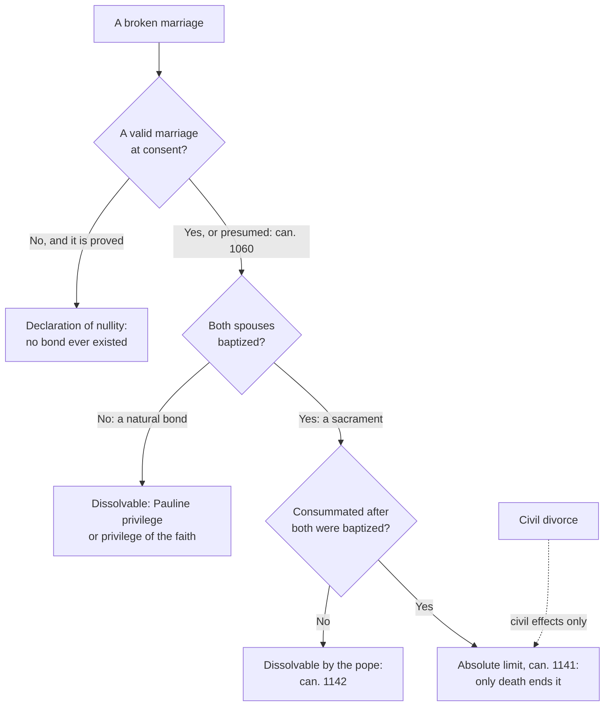

# Sacraments & Liturgy · Lesson 5.4: Nullity, dissolution, and the pastoral debates

> ⏱ ~15 min · Module 5: The sacraments at the service of communion · Builds on: [5.3 Matrimony: sacrament, contract, indissolubility](05-03-matrimony-sacrament-contract-indissolubility.md), [`moral-theology` 2.5](../../moral-theology/lessons/02-05-the-primacy-of-conscience-rightly-understood.md) · Unlocks: [6.1 What the liturgy is](06-01-what-the-liturgy-is.md)

## Why this matters

Henry VIII never asked Rome for a divorce. He asked for a judgement that his marriage to Catherine of Aragon had never existed, and in March 1534 Clement VII ruled it valid ([`church-history` 6.3](../../church-history/lessons/06-03-the-english-reformations.md)). The gap between "it never was" and "it is over" is this lesson. It also carries the sharpest Catholic dispute of the last decade: communion for the divorced and civilly remarried.

## The idea

On a failed marriage the Church can say three kinds of thing.

- **"There never was one."** A [declaration of nullity](../reference.md#declaration-of-nullity) finds that something a marriage needs was missing on the wedding day, so no bond came to be (CCC 1629). It ends nothing.
- **"There was one, and it is ended."** A dissolution ends a real bond. The Church claims this power only over bonds that are not both sacramental and consummated.
- **"The state has ruled."** A civil divorce settles civil effects (can. 1059) and leaves a valid bond untouched (CCC 2382).

Think of a contract found void from the start, against a valid contract lawfully ended. The analogy breaks at the top: a marriage both sacramental and consummated can be ended by no one, the pope included ([5.3](05-03-matrimony-sacrament-contract-indissolubility.md)). So ask in order: did a marriage come to be? Only then: can this kind of bond be dissolved?

## In their own words

The Orthodox practice of second marriage, as Orthodox sources state it; the argument with it belongs to [`apologetics-catholic-claims`](../../apologetics-catholic-claims/syllabus.md).

[*Oikonomia*](../reference.md#oikonomia), "stewardship" (lesson's gloss), is the Church's application of a rule with a view to salvation, against *akribeia*, "exactness" (lesson's gloss). The Holy and Great Council in Crete, in *The Sacrament of Marriage and Its Impediments* (Pentecost 2016), calls the indissoluble union of man and woman an icon of the unity of Christ and the Church (I.2). It makes a marriage not completely dissolved or annulled, and a third marriage, absolute impediments to marrying, condemns a fourth (II.2), and leaves *oikonomia* over impediments to each autocephalous Church's synod (II.5.2).

The Orthodox Church in America's pastoral answer on its website: the Church sees marriage as lifelong and opposes divorce, but for its people's salvation permits a second and even a third marriage, performed by "economy", as an exception, in a service with a penitential character.

Basil's canonical letters, received among the canons by the Council in Trullo (692, can. 2), set a year's penance for a second marriage (Letter 188, can. 4) and call a deserted husband pardonable and the woman who lives with him uncondemned (can. 9). John Meyendorff's *Marriage: An Orthodox Perspective* (St Vladimir's Seminary Press, 1984) is a fuller Orthodox account.

## The doctrine

1. **Validity is presumed; nullity is proved.** In doubt, a marriage is upheld until the contrary is proven (can. 1060). [The grounds](../reference.md#grounds-of-nullity) run 5.3's requirements backwards: an **impediment** (cann. 1083–1094: a prior bond, age, orders, consanguinity…); **defective consent** (cann. 1095–1103: incapacity, including inability to assume the essential obligations; error; fraud; simulation; condition; force or fear); **defect of form** (cann. 1108, as amended in 2016, and 1117). *In words:* a ground is a proved fact about the wedding; what came after is at most evidence.
2. ***Mitis Iudex Dominus Iesus*** (motu proprio, 15 August 2015, in force 8 December 2015) rewrote the process, not the grounds. One sentence for nullity suffices, without a second conforming one (criterion I). The bishop judges a **briefer process** when both spouses petition, or one with the other's consent, and testimony and records make the nullity manifest (can. 1683). The text favours "not the nullity of marriages, but the speed of processes" and admits the briefer process could endanger indissolubility (criterion IV). Defenders cite access and cost; critics, the lost second review and the risk of reading Art. 14's examples as grounds. *In words:* nearer and faster, same law.
3. **Dissolution: three routes, one limit.** The [Pauline privilege](../reference.md#pauline-privilege):

   > But if the unbeliever depart, let him depart. For a brother or sister is not under servitude in such cases. (1 Cor 7:15, DR)

   A marriage of two unbaptized persons is dissolved in favour of the one baptized if the other departs, refusing to live peaceably (cann. 1143–1144). The bond ends not at baptism but when the baptized party marries again (can. 1143 §1). By the [privilege of the faith](../reference.md#privilege-of-the-faith) the pope may dissolve a marriage with at least one unbaptized party, unless consummated after both were baptized, if common life cannot be restored and the petitioner was not mainly to blame (CDF norms *Potestas Ecclesiae*, 30 April 2001, arts. 1, 4). He may dissolve a ratified, non-consummated marriage for a just cause (can. 1142). **The limit:** a marriage *ratum et consummatum* "can be dissolved by no human power and by no cause, except death" (can. 1141; CCC 1640). *In words:* the Church claims power over a bond only until it is both sacrament and consummated.
4. **Civil divorce** sought for legal rights, children or inheritance can be tolerated (CCC 2383), and a divorced Catholic in no new union may receive the sacraments (FC 83). *In words:* the debate concerns a second union.
5. **[*Familiaris Consortio* 84](../reference.md#familiaris-consortio-84)** (22 November 1981) reaffirmed the practice, which it calls based on Scripture, of not admitting the remarried to communion: their state objectively contradicts the union of Christ and the Church that the Eucharist signifies, and admission would mislead the faithful about indissolubility. Absolution is open to those who cannot separate for serious reasons and undertake complete continence. The CDF (14 September 1994) would not let conscience settle it: a prior marriage is a public, external-forum question (§§7–9). The Pontifical Council for Legislative Texts (24 June 2000) took up can. 915, as [3.5](03-05-communion-reservation-adoration.md) promised: "manifest grave sin" is read objectively, and the prohibition derives from divine law. *In words:* the bar rested on the public state, not a verdict on the soul.
6. **[*Amoris Laetitia* ch. 8](../reference.md#amoris-laetitia-chapter-8)** (19 March 2016) followed the synods of 2014 and 2015; the 2015 final report never names communion (§§84–86). It gave no new general rule but asked for discernment of particular cases (300): responsibility differs, so a rule's consequences need not always be the same, "also … with regard to sacramental discipline" (n. 336), and the Church's help can in certain cases include the sacraments (305, n. 351). The [Buenos Aires bishops](../reference.md#buenos-aires-criteria) (5 September 2016) kept continence as the proposal and refused "permissions", but held that where it is not feasible and nullity could not be obtained, a discernment finding diminished responsibility opens the possibility of reconciliation and the Eucharist (criteria 1, 5–7). Francis replied that day: *no hay otras interpretaciones*, "there are no other interpretations" (lesson's gloss). A rescript of 5 June 2017 ordered both published in the *Acta Apostolicae Sedis* *velut Magisterium authenticum*, "as authentic magisterium" (lesson's translation), which the DDF repeated in 2023. Four cardinals' *dubia* (19 September 2016) asked first whether this is now possible without FC 84's conditions.
7. **Two readings, each at its strength.** *Development* (the Buenos Aires bishops, Francis, the DDF): indissolubility is untouched (AL 298), FC 84 already admitted some, and AL applies the old distinction between an objective situation and its imputability (301–302; CCC 1735) to the discipline that applies the rule. *Rupture* (the four cardinals' explanatory note): FC 84 rested not on culpability but on a public state contradicting what the Eucharist signifies, which diminished imputability leaves unchanged, and the 1994 and 2000 texts call the rule unmodifiable and of divine law. Admitting someone who lives in the new union as a spouse would teach that divorce dissolves the bond, or that the unmarried may live as spouses, or that sacraments are detached from life. *In words:* both keep can. 1141; they divide over whether FC 84's rule follows from the objective state or applies discipline to persons.

**Said plainly.** The Church dissolves real marriages, by her law or the pope's act. Such cases multiplied in the twentieth century, and the CDF's 2001 preface records that the Holy Office kept its 1934 instruction on them out of the *Acta Apostolicae Sedis* for fear of seeming to favour divorce.

**Mark the levels** ([`fundamental-theology` 4.4](../../fundamental-theology/lessons/04-04-the-ladder-of-doctrinal-authority.md), [4.5](../../fundamental-theology/lessons/04-05-reading-a-documents-weight.md)). Trent Session XXIV is **rung 1** for what it defines: heresy, irksome cohabitation or desertion do not dissolve the bond (can. 5); solemn religious profession dissolves a non-consummated marriage (can. 6), though the 1983 Code names only papal dispensation (can. 1142); the Church does not err in teaching that adultery does not dissolve it (can. 7). That no human power, the pope's included, can dissolve a ratified and consummated marriage is **at least rung 2**, held definitively (John Paul II to the Roman Rota, 2000, §8; [5.3](05-03-matrimony-sacrament-contract-indissolubility.md)). Grounds, processes, the privileges' conditions, *Mitis Iudex* and the 2001 norms are **law, no rung**. FC, and FC 84's practice, are **rung 3**, resting on higher doctrine (indissolubility; worthiness for communion, [3.5](03-05-communion-reservation-adoration.md)). The 1994 letter, published by papal order, is **rung 3**; the 2000 declaration interprets a canon and has no rung of its own. AL is **rung 3** ([`moral-theology` 2.5](../../moral-theology/lessons/02-05-the-primacy-of-conscience-rightly-understood.md)), as are the Buenos Aires texts by the rescript; the *dubia* are petitions. **Whether ch. 8 develops or breaks with FC 84 is freely disputed (rung 5).** Basil's canons and the Orthodox practice carry no Catholic level.

## Three ways a marriage ends, or does not

## Worked examples

**Ex 1 (clean): licit and void.** *Invented.* Lorcan and Soraya married at their parish church, every requirement kept. Seven years later she petitions: three friends testify that the week before, Lorcan called it a trial, to end in divorce if it failed, and he says the same now. The ground is simulation, excluding indissolubility by a positive act of will (can. 1101 §2). His consent is presumed to match his words (cann. 1060, 1101 §1), so all turns on proof. **Valid?** Not if that is proved: consent decides. **Licit?** Yes as a rite; the defect was hidden. **Fruitful?** No sacrament came to be, so none of its grace was given. Soraya acted in good faith, so the marriage was *putative* and the children are legitimate (cann. 1061 §3, 1137).

**Ex 2 (strain): one baptism moves the line.** *Invented.* Tanvir, unbaptized, and Malika, a baptized Anglican, married at a registry office in 2009. No form bound them (can. 1117), and disparity of cult binds only Catholics (can. 1086 §1): a valid, natural bond. Divorced, Malika wants to marry a Catholic. The Pauline privilege needs two unbaptized spouses; the privilege of the faith fits, if reconciliation is hopeless and she was not mainly to blame (2001 norms, arts. 1, 4). Now suppose Tanvir was baptized in 2012 and they lived together until 2018. From his baptism the marriage was a sacrament, consummation after it is presumed (can. 1061 §2), and the bond is beyond any power (can. 1141); only a ground in the 2009 consent could help. Same vows, same breakdown, opposite sides of the limit, by one baptism. The tradition accepts that, because it draws the line where the bond becomes a sacrament in the flesh ([5.3](05-03-matrimony-sacrament-contract-indissolubility.md)).

## Watch out

- **You might think a declaration of nullity says the marriage failed.** It says something was missing on the day.
- **You might think the Pauline privilege "annuls" the first marriage.** It ends a real one, when the new one is contracted (can. 1143 §1).
- **You might think *Mitis Iudex* added grounds.** It changed who judges and how fast.
- **You might think *Amoris Laetitia* defined a new doctrine, or is only advice.** Both misgrade it: AL and the Buenos Aires texts are **rung 3**, defining nothing and leaving can. 1141 intact. The rescript fixes their weight; whether they develop or break with FC 84 stays **freely disputed**.

## One-liner

> Nullity says there never was a bond, dissolution ends one that is not both sacrament and consummated, civil divorce ends neither, and how the Church applies this to the remarried is still disputed.

## Problems

**P1 (🟢)** *(Exegetical)* Three **invented** couples, written for this problem. For each, say which route the Church offers (nullity, a named kind of dissolution, or none on these facts) and name the deciding element and canon. Two sentences per couple.

(a) Jurgis, baptized a Catholic, married Vesna, a baptized Methodist, at a city registry office in 2015. No one sought a dispensation from canonical form. They divorced in 2023, and Jurgis wants to marry in church.

(b) Yetunde and Wojtek, both unbaptized, married in 2012. Yetunde was baptized at the 2024 Easter Vigil. Asked, Wojtek says he will not live with her now that she is a Christian. She wants to marry a Catholic.

(c) Ilaria and Kasimir, both Catholics, married at a nuptial Mass in 2013 with everything in order and lived together for eleven years. They divorced civilly in 2024: "we just fell out of love."

**P2 (🟡)** *(Exegetical)* From an **invented** "Frequently asked questions" page on the website of the Diocese of Thornmere's marriage tribunal, written for this problem:

> (1) "An annulment is simply the Church's version of a divorce: the tribunal ends marriages that have broken down."
>
> (2) "Be aware that if your marriage is annulled, the Church will regard your children as illegitimate."
>
> (3) "Since *Mitis Iudex* (2015), the bishop can annul any marriage within weeks, provided both spouses ask."
>
> (4) "*Amoris Laetitia* has defined that divorced and remarried Catholics may now receive communion once a priest gives them permission."

For each sentence give the correction, and say whether it rests on doctrine (with its level) or on law. Two sentences per item.

**P3 (🔴)** *(Exegetical)* Basil, Letter 188, can. 9, its closing sentences (Blomfield Jackson, NPNF second series vol. 8), and the Council in Trullo (692), can. 87 (Percival, NPNF second series vol. 14):

> Here then the wife, if she leaves her husband and goes to another, is an adulteress. But the man who has been abandoned is pardonable, and the woman who lives with such a man is not condemned. But if the man who has deserted his wife goes to another, he is himself an adulterer because he makes her commit adultery; and the woman who lives with him is an adulteress, because she has caused another woman's husband to come over to her. (Basil)
>
> If therefore she appears to have departed from her husband without reason, he is deserving of pardon and she of punishment. And pardon shall be given to him that he may be in communion with the Church. (Trullo)

(a) Whom does Basil call pardonable and whom adulterers, and on what fact does the difference turn? What does the Trullan canon attach to the pardon? Quote the words that carry each answer.

(b) In 100 words or fewer, state the present Orthodox practice of second marriage by *oikonomia* as Orthodox sources state it, citing two of them. No reply is asked for, and a reply earns nothing.

Solutions

**P1** *(Exegetical)*

**Must hit, strict:**

- **(a) Nullity, for defect of form.** Jurgis was baptized in the Catholic Church, so he was bound to canonical form (can. 1108, as amended in 2016; can. 1117). Without a dispensation from form (can. 1127 §2) the registry wedding was invalid, and a document proving the lack of form and of any dispensation suffices (documentary process, can. 1688). Nothing is dissolved, because no bond came to be.
- **(b) The Pauline privilege** (cann. 1143–1146). Both were unbaptized at the wedding, she has been baptized, and his refusal to live peaceably with her is the "departure", established by interpellation (can. 1144). The bond ends when she contracts the new marriage, not at her baptism (can. 1143 §1).
- **(c) None on these facts.** Both are baptized and consummation is presumed after years of common life (can. 1061 §2), so the bond is ratified and consummated and cannot be dissolved (can. 1141). It is presumed valid (can. 1060), and falling out of love afterwards is no ground. They may petition only on evidence of a ground at the moment of consent; the civil divorce changed nothing in the bond (CCC 2382).

**Wrong turns:** calling (a) a dissolution, or "invalid because she was Methodist", when the decisive fact is Jurgis's obligation to form; dating the dissolution in (b) to the baptism; sending (b) to the pope for the privilege of the faith, when the Pauline privilege dissolves this bond by the law itself, with no recourse to higher authority (CDF 2001 norms, preface); offering (c) a nullity on the strength of the breakdown; saying in (c) that the civil divorce ended the marriage.

**Model answer:** (a) Nullity: Jurgis, baptized a Catholic, was bound to canonical form, and with no dispensation the registry wedding was invalid (cann. 1108, 1117, 1127 §2); documents prove it (can. 1688). (b) The Pauline privilege: two unbaptized spouses, one baptized, the other departing (can. 1143). Interpellation establishes the departure, and the bond is dissolved when Yetunde marries again. (c) No route on these facts. A presumed-valid, ratified and consummated marriage cannot be dissolved (cann. 1060, 1141), and a later loss of love is not a ground of nullity.

---

**P2** *(Exegetical)*

**Must hit, strict:**

- **(1)** Nullity declares that no bond came to be (CCC 1629); it ends nothing, and breakdown after consent is not a ground (cann. 1083–1108 concern the wedding). The correction rests on law for the grounds, and on doctrine for why the tribunal cannot end a valid marriage: Trent XXIV cann. 5 and 7, **rung 1** for what they define, and the absolute limit of can. 1141 / CCC 1640, **at least rung 2**.
- **(2)** False. A marriage celebrated in good faith by at least one party is putative (can. 1061 §3), and its children are legitimate (can. 1137). **Law, no rung.**
- **(3)** The briefer process needs the joint petition (or consent) **and** a nullity made manifest by testimony and records (can. 1683). Otherwise, or if the bishop lacks moral certainty, the case goes to the ordinary process (can. 1687 §1). He declares that no bond existed and cannot "annul" a valid one; the motu proprio favours speed, not nullity. **Law, no rung**, with the limit itself doctrine (**at least rung 2**).
- **(4)** Overstates level and content. AL defines nothing (**rung 3**) and gave no new general rule (300). The Buenos Aires criteria (**rung 3** by the 2017 rescript) reject "permissions" and unrestricted access and speak of a possibility of access only where discernment finds diminished responsibility, with continence proposed first. Whether this develops or breaks with FC 84 is **freely disputed**, and the FAQ should not settle it either way.

**Wrong turns:** correcting (4) with "AL changed nothing and FC 84 still bars every case", which picks a side of a disputed question, or with "AL is merely pastoral advice", which understates rung 3. Calling (1) heresy. Treating *Mitis Iudex* as doctrine, or as weakening can. 1141. Correcting (2) by saying children's legitimacy is a purely civil matter, when the Code itself settles it.

**Model answer:** (1) A declaration of nullity finds that no bond ever existed (CCC 1629). The tribunal cannot end a valid marriage: Trent defines that desertion does not dissolve it (XXIV can. 5, rung 1), and the limit of can. 1141 is at least rung 2. (2) A marriage entered in good faith is putative, and its children are legitimate (cann. 1061 §3, 1137); this is law. (3) The briefer process needs a joint petition and a manifestly proven nullity, or the case goes the ordinary way (cann. 1683, 1687). A bishop declares nullity; he does not annul marriages; this is law. (4) AL, rung 3, defines nothing and gives no general rule. The Buenos Aires criteria, rung 3, exclude "permissions" and allow a possibility of access only after discernment of diminished responsibility. Whether that develops or breaks with FC 84 is freely disputed.

---

**P3** *(Exegetical)*

**Accept:** in (b), any two of the sources named in the lesson's "In their own words", or Basil's canons, provided at least one is a modern Orthodox source.

**Must hit, strict (a):**

- **Adulterers:** the wife who "leaves her husband and goes to another", and the man who "has deserted his wife" and goes to another, with the woman who lives with him.
- **Pardonable:** "the man who has been abandoned is pardonable, and the woman who lives with such a man is not condemned".
- **The difference turns on who deserted whom**, that is, on fault, not on whether there is a second union: the abandoned husband living with another woman is pardoned.
- **Trullo attaches communion to the pardon:** "pardon shall be given to him that he may be in communion with the Church".

**Must hit, strict (b), fidelity only:**

- Marriage is lifelong and indissoluble in intent, an icon of Christ and the Church (Crete 2016, I.2); the Church opposes divorce (OCA).
- For the salvation of its people the Church permits a second and even a third marriage by *oikonomia*, as an exception that does not abolish the rule (OCA); a fourth is condemned, and a third marriage is an impediment to any further one (Crete II.2).
- The second-marriage service has a penitential character (OCA).
- The Church's own authority applies *oikonomia*: each autocephalous Church's synod for impediments (Crete II.5.2).

**Wrong turns:** reading Basil as declaring the first marriage null or dissolved, when he speaks of pardon; giving Basil's canon a Catholic rung; describing the Orthodox practice as divorce on demand, as "Orthodox annulments", or as a denial of indissolubility; **volunteering a rebuttal**, such as setting Trent XXIV can. 7 or can. 1141 against it.

**Model answer (b):** The Orthodox Church holds marriage to be lifelong, its indissoluble union an icon of Christ and the Church (Crete 2016, I.2), and it stands opposed to divorce. Yet for the salvation of its people it permits a divorced person to marry a second and even a third time "by economy", as an exception to the rule. The second-marriage service has a penitential character (OCA). A fourth marriage is excluded: an undissolved marriage and a third marriage are absolute impediments (Crete II.2). The decision belongs to the Church, through each autocephalous Church's synod (II.5.2).

## Flashback

**From Lesson [5.2](05-02-the-reservation-of-priestly-ordination.md) (The reservation of priestly ordination):** *(Exegetical.)* Three excerpts from Book VIII of the *Apostolic Constitutions*, a church order of about 380 (ANF vol. 7, 1886):

> **VIII.19–20, on the deaconess.** O bishop, thou shalt lay thy hands upon her in the presence of the presbytery, and of the deacons and deaconesses, and shall say: … look down upon this Thy servant … and grant her Thy Holy Spirit …
>
> **VIII.22, on the reader.** … laying thy hands upon him … give him Thy Holy Spirit, the prophetic Spirit.
>
> **VIII.28.** A deaconess does not bless, nor perform anything belonging to the office of presbyters or deacons, but only is to keep the doors, and to minister to the presbyters in the baptizing of women, on account of decency.

The deacon's own rite (VIII.17–18) has the same frame: the bishop lays hands on him before the whole presbytery and the deacons, and prays that God fill him with the Holy Spirit. Two replies in a social-media thread, **invented**, written for this problem:

> MAELLE: Hands, the Holy Spirit, the clergy looking on: that is the deacon's rite exactly. The deaconesses were ordained deacons, full stop.
>
> BRANIMIR: VIII.28 settles it the other way. She did nothing liturgical and received no rite; "deaconess" was a job title for a laywoman.

(a) Where does each reply outrun the text? Cite the words that show it. Two sentences per reply.

(b) In one sentence, give the weight of this evidence and the standing of the question it bears on.

Solution

**Must hit, strict (a):**

- **Maelle is right about the frame, not about what it proves.** The frame matches ("lay thy hands upon her", "in the presence of the presbytery, and of the deacons", "grant her Thy Holy Spirit"). But the same church order gives a reader hands and the Spirit ("laying thy hands upon him … give him Thy Holy Spirit"), and the reader holds no degree of the sacrament as the Church now counts them (can. 1009 §1: episcopate, presbyterate, diaconate; [5.1](05-01-holy-orders-the-three-degrees.md)). So the frame alone cannot establish the sacramental diaconate.
- **"Deacons, full stop" is contradicted by VIII.28:** she does not "perform anything belonging to the office of presbyters or deacons". She was not simply equivalent to a deacon, as the ITC (2002) judged.
- **Branimir is right that VIII.28 denies her a deacon's office, wrong that she had no rite and no part in the liturgy.** VIII.19–20 has the bishop lay hands on her with a prayer for the Spirit before the clergy, and VIII.28 itself gives her tasks in the liturgy: to "keep the doors" and to "minister to the presbyters in the baptizing of women".
- **What the text does show:** an office entered by a liturgical rite and set below the deacon's. Whether that rite was a sacramental ordination it cannot say, so it "settles" nothing either way.

**Must hit, strict (b):**

- The *Constitutions* are historical evidence with **no magisterial level**. The female diaconate is **open, rung 5**, its decision reserved to the magisterium; history alone cannot settle it, and the commission thesis reported in 2025 itself declines a definitive judgment.

**Wrong turns:** correcting Maelle by denying that any rite took place (Branimir's error), or correcting Branimir by asserting that deaconesses were sacramentally ordained, which is disputed; reading "on account of decency" as proof that the office was merely practical and so not sacramental, when a pastoral reason decides nothing about the rite; carrying either reading over to priestly ordination, a separate question; giving the *Constitutions* a doctrinal level, or treating the ITC study or a commission as the magisterium.

**Model answer:** (a) Maelle is right that the frame matches the deacon's, "lay thy hands upon her" before "the presbytery, and … the deacons" with "grant her Thy Holy Spirit", but the same order lays hands on a reader with a prayer for the Spirit, and the reader holds no degree of the sacrament, so the frame cannot prove the sacramental diaconate. And VIII.28 denies her "anything belonging to the office of presbyters or deacons", so she was no deacon "full stop". Branimir is right that she did not do a deacon's work, but she received a rite, the bishop's hands and a prayer for the Spirit before the clergy, and had tasks in the liturgy: to "keep the doors" and "minister to the presbyters in the baptizing of women". The text shows an office entered by a liturgical rite and set below the deacon's, and leaves open whether the rite was sacramental. (b) A church order is historical evidence with no magisterial level, and the question it bears on, the female diaconate, is open (rung 5) and reserved to the magisterium.

## Connections

- **Backward:** [5.3](05-03-matrimony-sacrament-contract-indissolubility.md) gave what makes a marriage valid and sacramental; nullity runs that list backwards. The conscience apparatus, including the AL 303 crux, is [`moral-theology` 2.4](../../moral-theology/lessons/02-04-conscience-its-nature-and-its-errors.md) and [2.5](../../moral-theology/lessons/02-05-the-primacy-of-conscience-rightly-understood.md). [3.5](03-05-communion-reservation-adoration.md) set out who may receive and can. 916; can. 915 is taken up here. *Tametsi* and *Ne temere* are [`church-history` 6.4](../../church-history/lessons/06-04-trent-and-catholic-reform.md)'s, and why a motu proprio is law, not doctrine, is [`fundamental-theology` 4.5](../../fundamental-theology/lessons/04-05-reading-a-documents-weight.md)'s.
- **Forward:** [6.1](06-01-what-the-liturgy-is.md) turns from the seven sacraments to the liturgy that celebrates them. [Boss 5](../syllabus.md) (c) close-reads 1 Corinthians 7 on the privilege, and (d) asks whether ch. 8 develops or breaks with FC 84. [`apologetics-catholic-claims`](../../apologetics-catholic-claims/syllabus.md) argues the Orthodox *oikonomia* question stated here.
- **Sideways:** the Orthodox Churches whose practice is stated here are, in Catholic doctrine, true particular Churches ([`ecclesiology-and-mariology` 5.2](../../ecclesiology-and-mariology/lessons/05-02-subsistit-in-and-the-status-of-other-churches.md)). Can. 1060's presumption is a burden-of-proof rule: it decides which error a tribunal prefers to risk, the same design question as a criminal court's presumption of innocence.
