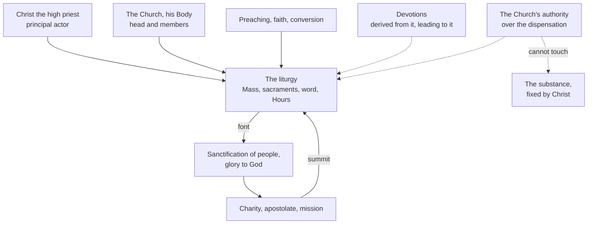

# Sacraments & Liturgy · Lesson 6.1: What the liturgy is

> ⏱ ~15 min · Module 6: The liturgy · Builds on: [3.4 The sacrifice of the Mass](03-04-the-sacrifice-of-the-mass.md), [3.5 Communion, reservation, adoration](03-05-communion-reservation-adoration.md), [`trinity-and-god` 2.4](../../trinity-and-god/lessons/02-04-from-confession-to-creed.md), [`church-history` 9.3](../../church-history/lessons/09-03-after-the-council.md) · Unlocks: [6.2](06-02-the-liturgical-year-and-the-liturgy-of-the-hours.md), [6.3](06-03-the-roman-rite-and-the-eastern-rites.md), [7.1](07-01-the-twentieth-century-reform-and-the-disputes-over-it.md), [7.3](07-03-sacramentals-and-popular-devotion.md)

## Why this matters

Most arguments about the liturgy are about how it looks: Latin or English, which way the altar faces, who reads. The documents begin with who is acting. Get that wrong and everything after is misframed: "participation" becomes a rota of jobs, "summit" a ranking that demotes charity, and the Church's authority over the rites either a blank cheque or a museum guard.

## The idea

**The word.** [*Leitourgia*](../reference.md#leitourgia) joins *laos*, people, and *ergon*, work: a public work (lesson's gloss). In classical Athens it named a service a wealthy citizen performed for the city at his own cost, such as equipping a warship. The Greek Old Testament uses it for the service of priests and Levites at the sanctuary, and Luke for Zachary's "days of his office" (Luke 1:23, DR). Hebrews then gives it to Christ: he is "a minister of the holies" (*leitourgos*, Heb 8:2, DR) who "hath obtained a better ministry" (*leitourgia*, 8:6). So the word carries both senses, a work for the people and a priestly service, and applies first to Christ (CCC 1069–1070).

**Who is acting.** An Athenian liturgy was a rich man's gift to the city. The Christian one is the service of the high priest "always living to make intercession" (Heb 7:25, DR; [3.4](03-04-the-sacrifice-of-the-mass.md)), which his people share. Pius XII's [*Mediator Dei*](../reference.md#mediator-dei) (1947) defined [the liturgy](../reference.md#liturgy) as the public worship Christ as Head renders to the Father together with the worship the community renders through him: the worship of the Mystical Body "in the entirety of its Head and members" (§20). [*Sacrosanctum Concilium*](../reference.md#sacrosanctum-concilium) (4 December 1963) took this over in §7. Christ is present in the sacrifice of the Mass, in his minister and "especially" under the species; by his power in the sacraments, so that when anyone baptizes, Christ baptizes; in his word read in the Church; and when the Church prays and sings. *Mediator Dei* §20 had listed altar, sacraments and prayer; the council added the word. So the liturgy is an exercise of Christ's priestly office, in which signs perceptible to the senses signify sanctification and effect it, each in its own way: [1.1](01-01-what-a-sacrament-is.md)'s sign that causes, widened from seven rites to the whole of public worship.

**The movement behind both.** The [liturgical movement](../reference.md#liturgical-movement) began with Prosper Guéranger (d. 1875), who restored monastic life in France at Solesmes (*Directory on Popular Piety*, 2001, §44). Pius X gave it a watchword in 1903, active participation ([`church-history` 9.3](../../church-history/lessons/09-03-after-the-council.md)). Lambert Beauduin, a monk of Mont César at Louvain, gave it a pastoral programme at the Malines congress of September 1909. Odo Casel of Maria Laach (d. 1948) built a theology of Christ's saving acts made present in worship (*Das christliche Kultmysterium*, 1932). Pius Parsch, an Augustinian canon of Klosterneuburg, brought Bible and liturgy into a parish church from 1919. *Mediator Dei* §4 credits the revival particularly to Benedictine monasteries.

**What *Mediator Dei* corrected.** It welcomed the movement and fenced it. The liturgy is neither ornamental ceremonial nor a list of rubrics (§25). "Objective" piety may not belittle personal devotion (§§28–32). Antiquity is no warrant by itself: insisting on a table-form altar or banning black vestments revives Pistoia's antiquarianism (§§61–64). The faithful offer with the priest but hold no priestly power (§§82–84). Christ's mysteries are present in the liturgical year, but not "in a vague and uncertain way as some modern writers hold" (§165); the encyclical names no one. The council later called the movement a sign of providence and of the Spirit's working (SC 43).

## The doctrine

1. **The liturgy is Christ's priestly act, and his Body's.** SC 7 and *Mediator Dei* §20, restated as law in can. 834 §1: the whole public worship of God is carried out by the Head and members of the Mystical Body. So no other action of the Church equals a liturgical celebration's efficacy by the same title and degree (SC 7). *In words:* Christ is the principal actor, and the one who worships is the whole Christ, Head and members together.
2. **Summit and font, not the whole.** SC 9 says first that the liturgy does not exhaust the Church's activity: faith and conversion precede it, and preaching and the works of charity and the apostolate go alongside it. SC 10 then makes it the summit toward which that activity tends and the font from which all her power flows (*culmen ad quod actio Ecclesiae tendit et simul fons*). SC 12: the spiritual life is not confined to it. SC 13: popular devotions are highly commended if they harmonize with the seasons, derive from the liturgy and lead to it. *In words:* the Church's other work leads to the liturgy or flows from it: a claim about direction, not a ranking that makes the rest optional. The familiar "[source and summit](../reference.md#source-and-summit)" is a different text: *Lumen Gentium* 11 says it of the Eucharistic sacrifice and the whole Christian life (CCC 1324).
3. **[*Lex orandi, lex credendi*](../reference.md#lex-orandi-lex-credendi).** The tag is condensed from a fifth-century chapter usually attributed to Prosper of Aquitaine ([`trinity-and-god` 2.4](../../trinity-and-god/lessons/02-04-from-confession-to-creed.md)), whose Latin is *ut legem credendi lex statuat supplicandi*, "that the law of supplication may establish the law of believing" (lesson's translation). Its argument is narrow and concerns grace (P1). *Mediator Dei* §§46–48 sets the limits: the liturgy professes the faith and supplies weighty evidence (Pius IX argued from it for the Immaculate Conception), but it does not decide the faith independently of the magisterium, and in general terms the rule runs the other way too: *lex credendi legem statuat supplicandi*. *In words:* the Church's universal prayer is a witness to her faith, a proper locus ([`fundamental-theology` 5.5](../../fundamental-theology/lessons/05-05-the-loci-theologici.md)), not an independent court; and since she regulates that prayer (claim 5), it is law as well as evidence.
4. **[Full, conscious and active participation](../reference.md#active-participation).** SC 14: the Church desires all the faithful to be led to participation that is *plenam, consciam atque actuosam*, which the liturgy's nature demands and which is their right and duty by baptism (1 Pet 2:9). In the reform it is the aim to be considered before all else, the "primary and indispensable source" of the Christian spirit (echoing Pius X). Its content: internal and external (SC 19); minds attuned to voices (SC 11); acclamations, responses, songs, gestures and postures, and at the proper times reverent silence (SC 30); each doing all and only his own part (SC 28); and at the core, offering the Victim through the priest's hands and with him, and learning to offer oneself (SC 48; *Mediator Dei* §80). *In words:* participation is the baptized offering themselves with Christ through the rite, inwardly and outwardly; it is neither a job nor a mood.
5. **The Church's authority, and its limit.** Regulation of the liturgy belongs solely to the Church's authority: the Apostolic See and, as law determines, bishops and their conferences (SC 22; *Mediator Dei* §58). So *nemo omnino alius, etiamsi sit sacerdos*: no one else, not even a priest, may add, remove or change anything on his own authority (SC 22 §3; can. 846 §1). The liturgy has immutable, divinely instituted elements and elements subject to change (SC 21; *Mediator Dei* §50). The limit is Trent's: the Church may order or change the dispensation of the sacraments, "their substance being untouched" (Session XXI, ch. 2; [1.4](01-04-why-seven.md); [substance](../reference.md#substance-of-the-sacraments)). The cup restored to the laity after the council is that power at work ([3.5](03-05-communion-reservation-adoration.md)). Even the supreme authority may not change it arbitrarily (CCC 1125). *In words:* a priest may not alter the rite; the Church may; no one may alter what Christ fixed.

**What the documents did and did not do.** SC defined nothing; it restated and applied, and left the revision itself to others ([7.1](07-01-the-twentieth-century-reform-and-the-disputes-over-it.md)). It adopted no account, Casel's included, of how the mysteries are made present ([3.4](03-04-the-sacrifice-of-the-mass.md)).

**Mark the levels** ([`fundamental-theology` 4.4](../../fundamental-theology/lessons/04-04-the-ladder-of-doctrinal-authority.md), [4.5](../../fundamental-theology/lessons/04-05-reading-a-documents-weight.md); [levels](../reference.md#levels-of-authority)). Where SC 7 restates defined doctrine it carries that weight: Christ substantially present under the species is **rung 1** ([3.3](03-03-real-presence-and-transubstantiation.md)). SC is a plain Constitution of an ecumenical council, neither "dogmatic" nor "pastoral", and defines nothing new. Its doctrinal teaching (the liturgy as Christ's priestly act, summit and font, participation as a baptismal right and duty) is **at least rung 3**, asking religious submission. Its general norms are law, **no rung**, and reformable. *Mediator Dei* is an encyclical: its teaching is **rung 3**. Its disciplinary directions, such as reserving the vernacular to Rome's permission (§60), were **no rung**, and have changed. The Church's power over dispensation but not substance is **at least rung 3**, the level [1.4](01-04-why-seven.md) gives Trent XXI ch. 2. *Lex orandi* is a rule of theological method with no level of its own. Casel's and the movement's theories have **no magisterial level**; SC 43 praises the movement, not any theory.

## Where the liturgy stands

The authority reaches the rite, not the substance: claim 5's limit.

## Worked examples

**Ex 1 (clean): the rewritten prayers.** Invented: Fr Wendelin Vandersloot rewrites the preface and the intercessions of the Eucharistic Prayer in his own words each Sunday "to make them relevant", leaving the words of institution exactly as in the Missal, with valid matter and the intention of doing what the Church does. **Valid**, decided by the **form**: the consecratory words stand ([1.2](01-02-matter-form-minister-intention.md)). **Illicit**, decided by the **rite**: SC 22 §3 and can. 846 §1 forbid a priest to change the liturgy on his own authority; GIRM 147 requires an approved Eucharistic Prayer. **Fruitful** for each communicant according to his own disposition ([1.3](01-03-ex-opere-operato-character-and-fruitfulness.md)); the priest's disobedience does not block grace for the disposed. Claim 1 is why the rule exists: the prayer is not his but Christ's and the Church's.

**Ex 2 (strain): the rosary at Mass.** Invented: Ludmila Hrabe, eighty-four, has always prayed the rosary through Sunday Mass; a newcomer tells her she is "not participating". *Mediator Dei* §108 allowed those unable to follow the rite to meditate on Christ's mysteries or pray in harmony with it, and said they share its fruits; her fruit depends on her disposition, not on following the text (1.3). But SC wants devotions to lead to the liturgy, not run beside it (SC 13), wants the faithful to understand the rites rather than be silent spectators (SC 48), and revised the rites to be understood (SC 21). The strain: §108 was a concession to a rite the people could not follow. Once the rite is intelligible, does it describe participation or only its floor? The texts fix the aim (SC 14) and the core (offering herself with the Victim, SC 48); they give no test of one woman's interior. They ask pastors for formation (SC 19), not the pew for a verdict.

## Watch out

- **You might think "source and summit" is SC 10's phrase about the liturgy.** SC 10 makes the liturgy the summit of the Church's activity and font of her power; "source and summit" is LG 11's phrase for the Eucharist in the Christian life (CCC 1324).
- **You might think *lex orandi* lets any liturgical text settle doctrine.** The chapter argued from apostolic prayers used everywhere, and *Mediator Dei* §48 denies that the liturgy decides by itself. Nor is the four-word tag the chapter's own wording.
- **You might think SC binds as dogma, or not at all.** Calling its norms irreformable overstates: they are law, no rung. Calling it "only pastoral", so optional, understates twice: it is a Constitution, not a pastoral constitution, and its doctrinal teaching is at least rung 3.
- **You might think active participation means activity.** SC 30 counts silence among its forms, and SC 28 limits each to his own part.

## One-liner

> The liturgy is Christ the high priest at work with his Body: the Church's other work leads to it and flows from it, the faithful take part by offering themselves with him, and no one may alter it but the Church, which may not alter its substance.

## Problems

**P1 (🟢)** *(Exegetical)* Chapter 8 of the *Indiculus*, a fifth-century collection of papal rulings on grace usually attributed to Prosper of Aquitaine: the chapter from which *lex orandi, lex credendi* was later condensed (lesson's translation of the Latin):

> … let us look also at the sacred rites of the priestly prayers, which, handed down from the apostles, are celebrated uniformly throughout the whole world and in every Catholic Church, so that the law of supplication may establish the law of believing. For when the leaders of the holy peoples discharge the embassy entrusted to them, they plead the cause of the human race before the divine mercy and, with the whole Church groaning with them, they ask and pray that faith be given to unbelievers, … that heretics come to their senses by receiving the Catholic faith, … that the remedies of penance be granted to the lapsed, and finally that the hall of heavenly mercy be opened to catechumens brought to the sacraments of rebirth. … This is felt to be so wholly God's work that thanks and praise are always given to God who effects it …

(a) What conclusion does the chapter argue for, from what evidence, and which words make the evidence probative?

(b) Name two ways the later tag claims more than this chapter does, and one thing *Mediator Dei* §48 adds that the chapter does not say.

Two sentences per part.

**P2 (🟡)** *(Exegetical)* Two **invented** texts, written for this problem.

Minutes of the liturgy-planning group of an invented parish:

> "Item 3, active participation. The chair, Leocadia Brann, reminded members that the Council requires active participation, which means as many people as possible should have a job. Agreed: (i) the silence after communion will be dropped, since nobody is doing anything; (ii) parishioners who simply kneel and pray will be invited to join a ministry so that they can participate."

From a Catholic radio phone-in, a caller:

> "'Active participation' is a myth. The Council only meant interior devotion; it never asked the people to say or sing anything. And *Sacrosanctum Concilium* was a pastoral document, so a Catholic can take it or leave it."

Find **five** errors, at least two in each text. For each give the correction, citing the article of *Sacrosanctum Concilium* (or *Mediator Dei*) that settles it, and give the level wherever a level is involved. 150 words or fewer.

**P3 (🔴)** *(Exegetical)* **Invented.** At a school Mass, Fr Florian Vasko asks all the pupils to say the whole Eucharistic Prayer aloud with him, the words of institution included, "so that everyone participates actively". He himself says every word of an approved Eucharistic Prayer over wheaten bread and grape wine, intending to do what the Church does.

(a) Give three separate verdicts (valid, licit, fruitful) and name the element that decides each.

(b) Say what is wrong with his reading of participation, citing two texts.

Two sentences per verdict; 60 words for (b).

Solutions

**P1** *(Exegetical)*

**Must hit, strict (a):**

- **Conclusion:** faith itself, and conversion, are God's gift: grace goes before even the beginning of faith (the Gallic dispute of [`church-history` 2.3](../../church-history/lessons/02-03-the-desert-and-the-monastery.md); the doctrine of grace is [`creation-grace-last-things`](../../creation-grace-last-things/syllabus.md)'s).
- **Evidence:** the Church's intercessions, which ask God to give faith to unbelievers. One does not ask God for what human effort supplies by itself.
- **Probative words:** "handed down from the apostles", "uniformly throughout the whole world and in every Catholic Church" (apostolic and universal, so the Church's own prayer), "pray that faith be given", "so wholly God's work".

**Must hit, strict (b):**

- **Two overclaims, any two:** the tag drops the restriction to prayers of apostolic origin in universal use and applies the rule to any liturgical text; it states as a general principle what the chapter uses for one doctrine; its bare juxtaposition reads as an identity or a verdict, where the chapter says the Church's prayers are looked at so that they may establish what is believed.
- **What *Mediator Dei* adds:** the liturgy does not decide the faith independently, since it stands under the magisterium; and in general terms the rule also runs the other way, *lex credendi legem statuat supplicandi*.

**Wrong turns:** reading the chapter as a general treatise on liturgy and doctrine; saying Prosper coined *lex orandi, lex credendi*, or dropping the "usually attributed" hedge; giving the tag a magisterial level.

**Model answer:** (a) The chapter argues that faith and conversion are God's gift, from the fact that the Church everywhere asks God to give faith to unbelievers and to bring heretics back. The evidence counts because these prayers are "handed down from the apostles" and celebrated "uniformly throughout the whole world", and because the Church thanks God for their effect as "wholly God's work". (b) The later tag applies the rule to any liturgical text and as a general principle, where the chapter argued from apostolic, universal prayers to one doctrine about grace. *Mediator Dei* adds that the liturgy does not decide the faith by itself, and that taken generally the rule of belief also governs the rule of prayer.

---

**P2** *(Exegetical)*

**Accept:** any five of the six below, at least two from each text.

**Must hit, strict:**

- **"As many as possible should have a job."** Participation is every baptized person's right and duty (SC 14), not a ministry. Each person does all of his own part and only his own (SC 28).
- **(i) Dropping the silence.** SC 30 lists reverent silence at the proper times among the means of active participation.
- **(ii) Kneelers not participating.** Participation is internal as well as external (SC 19), and its core is offering the Victim with the priest and offering oneself (SC 48; *Mediator Dei* §80). The kneeler at prayer participates; a ministry is not the entry ticket.
- **"A myth."** SC 14 makes it the aim to be considered before all else in the reform.
- **"Only interior; never asked them to say or sing."** SC 30 names acclamations, responses, psalmody, antiphons, songs, actions, gestures and postures; SC 19 says "internally and externally"; SC 48 says the faithful should not be silent spectators.
- **"Pastoral document, take it or leave it."** SC is a Constitution, not a pastoral constitution. Its doctrinal teaching is **at least rung 3**, asking religious submission; its norms are law (no rung), and law binds.

**Wrong turns:** correcting the caller by saying participation is chiefly external activity, which is the minutes' error in reverse; calling SC's norms dogma; giving SC "rung 1" because it is conciliar.

**Model answer:** The minutes make participation a job, but SC 14 makes it every baptized person's right and duty, and SC 28 limits each to his own part. They drop the silence that SC 30 counts as participation. They exclude the kneeler at prayer, though participation is internal as well as external (SC 19) and its core is offering oneself with the Victim (SC 48). The caller's "myth" ignores SC 14, which makes participation the reform's first aim. "Only interior" ignores SC 30's acclamations, responses and songs and SC 48's "not silent spectators". And SC is a plain Constitution: its teaching is at least rung 3, its norms are binding law.

---

**P3** *(Exegetical)*

**Must hit, strict (a):**

- **Valid**, decided by the **minister and form**: a priest says the words of institution over valid matter with the right intention. The pupils' voices add nothing and remove nothing; they do not concelebrate, because the faithful hold no priestly power (*Mediator Dei* §§82–84).
- **Illicit**, decided by the **rite**: the Eucharistic Prayer is by its nature the priest's alone in virtue of his ordination, and the people join in faith, in silence and through their acclamations (GIRM 147). *Redemptionis Sacramentum* [52] names recitation by all the faithful together an abuse; SC 22 §3 forbids any priest to change the rite.
- **Fruitful** for each recipient according to his disposition ([1.3](01-03-ex-opere-operato-character-and-fruitfulness.md)); the abuse does not block grace for the disposed.
- **Weight:** GIRM 147 is liturgical law and *Redemptionis Sacramentum* an instruction (FT 4.5: changeable practical rules): discipline, **no rung**.

**Must hit, strict (b):** he equates participating with doing another's part. SC 28: each does all and only his own part. SC 48: the people offer the Victim through the priest's hands and with him, and offer themselves.

**Wrong turns:** calling the Mass invalid because the people said the words, or "doubtful"; calling it licit because SC 14 asks for active participation; collapsing the verdicts ("an abuse, so no grace"); giving GIRM 147 a doctrinal rung.

**Model answer:** (a) Valid: the priest, with valid matter and the Church's intention, said the words of institution himself, and the pupils' voices neither add to nor subtract from the form. Illicit: GIRM 147 reserves the Eucharistic Prayer to the priest by his ordination, *Redemptionis Sacramentum* [52] calls joint recitation by the faithful an abuse, and SC 22 §3 forbids his changing the rite. Fruitful for each communicant according to his disposition, since the abuse does not block grace for those disposed. (b) He takes participation to be saying the priest's part. SC 28 gives each person his own part only, and SC 48 places the people's offering with the priest and of themselves.

## Flashback

**From Lesson [5.3](05-03-matrimony-sacrament-contract-indissolubility.md) (Matrimony: sacrament, contract, indissolubility):** *(Exegetical.)* Trent, Session XXIV (11 November 1563; Waterworth, 1848): one of its doctrinal canons, then a chapter of the same day's Decree on the Reformation of Marriage, whose first chapter is *Tametsi*.

> **Canon 11.** If any one saith, that the prohibition of the solemnization of marriages at certain times of the year, is a tyrannical superstition, derived from the superstition of the heathen; or, condemn the benedictions and other ceremonies which the Church makes use of therein; let him be anathema.
>
> **Decree on the Reformation of Marriage, ch. 10.** The holy Synod enjoins, that the ancient prohibitions of solemn nuptials be carefully observed by all, from the Advent of our Lord Jesus Christ until the day of the Epiphany, and from Ash-Wednesday until the octave of Easter inclusively; but at other times It allows marriage to be solemnly celebrated …

(a) What exactly does canon 11 define, and what does it leave to chapter 10? Give the level of each.

(b) Did chapter 10 forbid Catholics to marry in Lent? Name the words that decide it, and say what, on Lesson 5.3's account, makes the marriage.

Two sentences per part.

Solution

**Must hit, strict (a):**

- **What it defines:** the canon anathematizes calling the Church's seasonal ban on solemn weddings "a tyrannical superstition, derived from the superstition of the heathen", and condemning "the benedictions and other ceremonies which the Church makes use of therein". So it defines that this discipline and these rites are legitimate, that is, the Church's authority over the rite: **rung 1**, for what it defines.
- **What it leaves:** it names no season and makes no ban permanent. Which seasons, and whether to keep any, is chapter 10's, a chapter of the same reform decree as *Tametsi*: **law, no rung**, and changeable. This is 5.3's point that canons 8, 9, 11 and 12 define the Church's authority, not the permanence of any law.

**Must hit, strict (b):**

- **No.** The ban falls on "solemn nuptials", and at other times the Synod "allows marriage to be solemnly celebrated": it restricts the solemnities, the blessings and ceremonies canon 11 defends, not marrying itself.
- **Consent makes the marriage:** the consent of the parties, lawfully manifested between persons qualified by law, in the form the law requires (can. 1057 §1). The nuptial blessing does not make a Latin marriage; the spouses are ordinarily understood to confer the sacrament on each other (CCC 1623, **rung 4**).

**Wrong turns:** reading canon 11 as defining the seasons, so that no bishop could ever permit a solemn wedding in Lent (overstates: the anathema protects the authority, not the calendar); dismissing canon 11 as "only discipline" (understates: a canon with anathema, rung 1 for what it defines); taking "derived from the superstition of the heathen" as Trent's own admission, when it is the condemned claim; saying the chapter forbade marrying in Lent; making the blessing what marries a Latin couple, or giving Aquinas's account of the blessing as a sacramental (Suppl. q.42 a.1 ad 1) a magisterial level.

**Model answer:** (a) Canon 11 anathematizes calling the Church's seasonal ban on solemn weddings "a tyrannical superstition" of heathen origin, or condemning her wedding "benedictions and other ceremonies", so it defines, at rung 1, that her authority over that rite is legitimate. It fixes no season: which seasons, and whether to keep any, is chapter 10's reform law, a renewal of "ancient prohibitions" with no rung, and so changeable. (b) No: the chapter bans "solemn nuptials" and allows marriage "to be solemnly celebrated" at other times, so it restricts the solemnities, not marrying. What makes the marriage is the parties' consent lawfully manifested in the required form (can. 1057 §1), not the blessing, which in the Latin Church does not make it.

## Connections

- **Backward:** [3.4](03-04-the-sacrifice-of-the-mass.md) gave the living high priest of Hebrews 7:25 and CCC 662, whose service this lesson calls the liturgy; [3.5](03-05-communion-reservation-adoration.md) gave the cup withheld and restored, the Church's power over dispensation in action; [1.4](01-04-why-seven.md) drew the line at the substance. [`trinity-and-god` 2.4](../../trinity-and-god/lessons/02-04-from-confession-to-creed.md) and [6.2](../../trinity-and-god/lessons/06-02-the-trinity-in-the-economy-liturgy-and-prayer.md) read the *lex orandi* as evidence of belief and called a doxology's wording liturgical law; claim 5 is that law's source. [`church-history` 9.2](../../church-history/lessons/09-02-the-second-vatican-council.md) has *Sacrosanctum Concilium* as an event.
- **Forward:** [6.2](06-02-the-liturgical-year-and-the-liturgy-of-the-hours.md) takes the year and the Hours, Christ's prayer continued; [6.3](06-03-the-roman-rite-and-the-eastern-rites.md) asks what a rite is; [7.1](07-01-the-twentieth-century-reform-and-the-disputes-over-it.md) takes what the council mandated and how the reform executed it; [7.2](07-02-liturgical-language-and-ars-celebrandi.md) takes language and celebration; [7.3](07-03-sacramentals-and-popular-devotion.md) judges devotions by SC 13's rule.
- **Sideways:** Durkheim's rite, which periodically re-creates a group's unity ([`social-theory` 3.3](../../social-theory/lessons/03-03-religion-as-social-the-elementary-forms.md)), describes from outside what SC 7 describes from inside as Christ's act; the two descriptions answer different questions.
