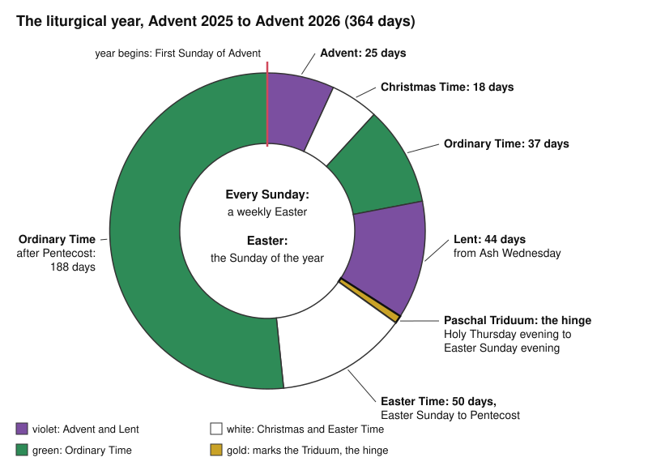

# Sacraments & Liturgy · Lesson 6.2: The liturgical year and the Liturgy of the Hours

> ⏱ ~15 min · Module 6: The liturgy · Builds on: [6.1 What the liturgy is](06-01-what-the-liturgy-is.md), [3.4 The sacrifice of the Mass](03-04-the-sacrifice-of-the-mass.md), [`old-testament` 5.1](../../old-testament/lessons/05-01-the-psalms.md) · Unlocks: [7.1 The twentieth-century reform and the disputes over it](07-01-the-twentieth-century-reform-and-the-disputes-over-it.md)

## Why this matters

[6.1](06-01-what-the-liturgy-is.md) said what the liturgy is. This lesson lays it over the week, the year and the day. Why did the Ascension move to a Sunday? Why is the breviary's "Psalm 94" Psalm 95 in your Bible? Is the Office the priest's private prayer book? Nearly every answer is law, not doctrine, and that is itself the lesson.

## The idea

**One mystery, spread over time.** The [liturgical year](../reference.md#liturgical-year) is not a string of anniversaries. Each week, on the Lord's day, the Church keeps the Resurrection; once a year she keeps it with the Passion at Easter; across the year she unfolds the whole mystery of Christ, from the Incarnation to the waiting for his return (*Sacrosanctum Concilium*, SC, 102; *Universal Norms on the Liturgical Year*, GNLY, 1). So: Sunday first, then Easter, then everything arranged around Easter.

**Sunday came first.** John was "in the spirit on the Lord's day" (Rev 1:10, DR). The Didache's community gathers that day to break bread and give thanks ([`patristics` 1.2](../../patristics/lessons/01-02-first-clement-and-the-didache.md)). Ignatius describes those raised in the old order as

> no longer observing the Sabbath, but living in the observance of the Lord's Day, on which also our life has sprung up again by Him (*Magnesians* 9, shorter recension, ANF 1)

Justin's two reasons for the Sunday assembly are creation's first day and the Resurrection (*1 Apol.* 67). SC 106 calls Sunday the original feast day, kept every eighth day by apostolic tradition; *Dies Domini* (John Paul II, 1998) heads its account "the weekly Easter" (§19).

**Easter and its date.** The Quartodeciman quarrel is told in [`church-history` 1.2](../../church-history/lessons/01-02-bishops-canon-and-the-parting-of-the-ways.md). Nicaea did less than is usually said. Its synodal letter to the Alexandrians announces that the Easterners who had followed the Jewish reckoning will now keep Easter with Rome and Alexandria. Constantine's letter (Eusebius, *Life of Constantine* III.18–20; NPNF second series vol. 14) asks for one day for all and argues for it in openly anti-Jewish terms. Neither text gives a method of calculation, and Rome and Alexandria kept different Sundays in several years after 325 (Hefele's excursus, same volume). The rule the West settled into is Alexandria's: the Sunday after the paschal full moon, the first tabular full moon on or after 21 March, so [Easter falls](../reference.md#date-of-easter) between 22 March and 25 April. Since the Gregorian reform of 1582, East and West usually keep different dates (CCC 1170).

## The doctrine

1. **The year makes the mysteries present, not merely remembered.** Recalling them, the Church opens the riches of Christ's powers and merits, so that they are in some way made present in every age (SC 102). *Mediator Dei* (1947) had called the year no cold record of the past but Christ living in his Church (§165). *In words:* a feast is a means of grace, by Christ's act through the Church's prayer; *how* the mysteries are present is theology (Casel's mystery-presence is one account: [3.4](03-04-the-sacrifice-of-the-mass.md)).

2. **Sunday and the holy days.** Sunday, kept by apostolic tradition, is the primordial feast day. Only solemnities and feasts of the Lord displace it, and nothing displaces a Sunday of Advent, Lent or Easter (GNLY 4–5). Canon 1246 §1 adds ten holy days; §2 lets a bishops' conference, with Rome's prior approval, suppress some or move them to Sunday (so GNLY 7 for the Epiphany, Ascension and Corpus Christi). By can. 1247 the faithful are obliged to participate in Mass; by can. 1248 §1 a Mass in any Catholic rite, on the day or the evening before, satisfies it. The 1917 Code first made this universal law; it is understood as grave (*Dies Domini* 47, citing the Catechism). *In words:* the Mass obligation is the law guarding the week's Easter.

3. **Two cycles, one table.** The [temporal cycle](../reference.md#temporal-and-sanctoral-cycles) runs Advent, Christmas Time, Ordinary Time, Lent, the [Paschal Triduum](../reference.md#paschal-triduum), Easter Time, Ordinary Time again. The Triduum is the high point of the year: it begins with the evening Mass of the Lord's Supper, centres on the Easter Vigil and closes with Vespers of Easter Sunday (GNLY 18–19). The fifty days to Pentecost are one feast, "one great Sunday" (GNLY 22). Over this the sanctoral cycle lays the feasts of Mary and the saints, and the Proper of Time has precedence (SC 103–104, 108). Celebrations rank as solemnity (begun at First Vespers the evening before), feast (within the day) or memorial, obligatory or optional (GNLY 10–14). When two coincide, the Table of Liturgical Days alone decides; an impeded solemnity moves to the nearest free day, but an Annunciation in Holy Week goes to the Monday after the Second Sunday of Easter (GNLY 59–60). *In words:* the saints are kept inside Christ's year, never against it.

4. **The 1969 calendar.** Paul VI's motu proprio *Mysterii Paschalis* (14 February 1969; in force 1 January 1970) carried out SC 111. Some saints left the General Calendar, others became optional with their cult returned to their regions, and martyrs from lands evangelized later were added. *In words:* a calendar entry says who is kept everywhere, not who is a saint; particular calendars keep their own (GNLY 9, 49).

5. **The [lectionary](../reference.md#lectionary).** SC 51 asked for a more representative part of Scripture read over a set number of years. The *Ordo Lectionum Missae* (1969; second edition 1981) gives each Sunday three readings (Old Testament, or Acts in Easter Time; apostle; gospel) on a three-year cycle: Year A Matthew, B Mark, C Luke. John is read in late Lent and Easter Time, and in Year B five Sundays of John 6 follow the sixteenth, John's feeding replacing Mark's (Introduction 66, 74, 105). A year divisible by three is Year C, and each cycle begins at Advent of the year before (note 102). Weekdays have a yearly gospel cycle and a two-year first reading: Year I in odd years, Year II in even (69). *In words:* a Sunday text now returns once in three years, not every year.

6. **The [Liturgy of the Hours](../reference.md#liturgy-of-the-hours).** Through the Church Christ continues his priestly work, in the Eucharist and especially in the Office, the bride's voice to the bridegroom and the prayer Christ with his body addresses to the Father (SC 83–84; *General Instruction of the Liturgy of the Hours*, GILH, 15). It is no private function but the whole Church's (GILH 20). Its shape (SC 89; GILH 34–92): an invitatory; the Office of Readings, the old Matins, now sayable at any hour; Lauds and Vespers, "the two hinges" of the day; daytime prayer, Terce, Sext and None, of which one suffices outside choir; Compline before sleep. Prime was suppressed. Paul VI's apostolic constitution *Laudis Canticum* (1 November 1970) promulgated the reformed books, spreading the psalter over four weeks instead of the one week Pius X's breviary of 1911 had restored. *In words:* the day is prayed through, morning and evening above all.

7. **Bound and invited.** Priests and deacons aspiring to the presbyterate must pray the Office daily, permanent deacons as far as their bishops' conference defines (can. 276 §2, 3°). The obligation is "the whole sequence of Hours", Lauds and Vespers not omitted without serious reason (GILH 29). The other faithful are earnestly invited to take part "as an action of the Church" (can. 1174 §2). Pastors should see that Vespers is celebrated in church on Sundays, and lay people may pray the Office with priests, among themselves or alone (SC 100; GILH 27); *Mediator Dei* had noted they have no obligation (§150). *In words:* clergy are deputed so that the Church's prayer never lapses (GILH 28), not so that it becomes theirs.

8. **The psalter and its [numbering](../reference.md#psalm-numbering).** The Office prays mostly with the psalms (GILH 100). Their genres, the two numberings and the conversion table are [`old-testament` 5.1](../../old-testament/lessons/05-01-the-psalms.md)'s, as is GILH 131's omission of three imprecatory psalms and some verses. The practical hazard is that the Latin books and their instructions number by the Greek: GILH 34's invitatory "Psalm 94" is Hebrew 95, and the Lectionary's psalm references follow the Neo-Vulgate (Introduction, note 123). Convert before you look.

9. **One *opus Dei*.** Benedict's name for the Office is the Work of God. Of monks called by the bell he writes *Ergo nihil operi Dei praeponatur*, "Therefore let nothing be put before the Work of God" (*Rule* 43, lesson's translation). The Office extends to the hours the praise and memorial offered in the Eucharist (GILH 12; CCC 1178). *In words:* Mass and Office are one priestly praise, gathered at the altar and spread across the day.

**Mark the levels** ([`fundamental-theology` 4.4](../../fundamental-theology/lessons/04-04-the-ladder-of-doctrinal-authority.md), [4.5](../../fundamental-theology/lessons/04-05-reading-a-documents-weight.md); [levels of authority](../reference.md#levels-of-authority)). What SC teaches the year, Sunday and the Office *are* (SC 83–84, 102, 106) restates *Mediator Dei* and the tradition: **at least rung 3** (SC's weight as a document is [6.1](06-01-what-the-liturgy-is.md)'s). *How* the mysteries are present is **theology, no magisterial level**. The Mass obligation (can. 1247) is **law, no rung**; that wilfully neglecting it is grave is ordinary teaching restated in the Catechism, **rung 3**. The calendar, the ranks and the Table, the transfers, the Easter computus, the lectionary cycles, the shape of the Office, the four-week psalter, the clergy's obligation and GILH 131 are **law, no rung**, liturgical or canonical. Nicaea's Easter decision was **discipline**, defining nothing. That the 150 psalms are canonical is **rung 1** (Trent, Session IV). Benedict's *Rule* and Casel carry **no magisterial level**.

## The wheel

Computed for the year begun 30 November 2025 (Easter 5 April 2026). The Triduum is a sliver of the year and its axle: Lent leads into it, Easter Time flows out of it, and Easter Sunday belongs to both.

## Worked examples

**Ex 1 (clean): March 2026.** Easter is 5 April 2026. On Thursday 19 March a Lenten weekday (Table no. 9) meets the Solemnity of St Joseph, a General Calendar solemnity (no. 3). The solemnity wins, with First Vespers on the 18th; it is also a holy day of obligation unless the conference has moved or suppressed it (can. 1246). On 25 March, a Wednesday of the fifth week, the Annunciation keeps its day; only Holy Week would push it. The Sunday gospels until 28 November 2026 are Year A, Matthew (2026 leaves remainder 1 on division by 3), and the weekday first readings are Year II. Every verdict here is law, none with a rung.

**Ex 2 (strain): a fixed Easter.** Suppose Rome and the Orthodox agreed to keep Easter on the second Sunday of April. The date is discipline: Nicaea legislated unity, not astronomy, and SC's appendix would not object to a fixed Sunday in the Gregorian calendar if the Churches not in communion with Rome assent. Easter would stay on a Sunday, which is older than any computus. The strain is elsewhere. The lunar date ties Easter to the Passover at which Christ died, and a fixed Sunday would cut that sign. And the council's condition ranks one feast for all above the accuracy of the Church's own reckoning: Nicaea's aim, which the Gregorian reform of 1582 undid with the East.

## Watch out

- **You might think Nicaea fixed the full-moon rule, or that Easter's date is doctrine.** Nicaea's surviving letters fix one day for all, apart from the Jewish reckoning, and no calculation. CCC 1170 compresses later history into 325, and a historical summary in the Catechism adds no weight.
- **You might think the Office is the priest's private breviary.** It is no private function (GILH 20), and can. 1174 §2 invites all the faithful to it. What belongs to the clergy is the *obligation*, which is law.
- **Levels, both ways.** "The Sunday obligation is only a custom now" understates: can. 1247 binds, and its gravity is taught (rung 3). "Moving the Ascension to Sunday changed the faith" overstates: which day keeps a feast is liturgical law, left to conferences (can. 1246 §2; GNLY 7).

## One-liner

> Sunday is the weekly Easter and Easter the Sunday of the year; the Office carries the Eucharist's praise through the day; and nearly every rule that arranges them is law the Church made and can remake.

## Problems

**P1 (🟢)** *(Exegetical (a)–(c) · Evaluative (d))* In 2027 Easter falls on 28 March, and 30 November is a Tuesday.

(a) Give the dates of Ash Wednesday; Ascension Thursday, and the Sunday it moves to where it is not a holy day of obligation; Pentecost; Trinity Sunday; Corpus Christi where it is moved to Sunday; and the First Sunday of Advent. Name the norm behind each.

(b) Where is the Solemnity of the Annunciation kept in 2027, and why?

(c) Which Sunday lectionary year runs until Advent 2027, which begins then, and which weekday year is used for 2027?

(d) Many bishops' conferences have moved the Ascension to the Seventh Sunday of Easter. Gain or loss? Two sentences, any verdict.

**P2 (🟡)** *(Exegetical)* Chidubem Ezeh (**invented**, written for this problem) reads a modern Bible with Hebrew numbering. Give the number in his Bible for each psalm below.

(i) The invitatory, "Psalm 94" (GILH 34).

(ii) Compline's "Ps 4 and Ps 133" after First Vespers of Sunday, and "Ps 90" after Second Vespers (GILH 88).

(iii) "Ps 77, Ps 104 and Ps 105", reserved to Advent, Christmas, Lent and Easter Time (GILH 130).

(iv) Benedict's *Septies in die laudem dixi tibi* (*Rule* 16), which is Douay 118:164.

(v) Reverse: where does he find his Psalm 116:12, "What shall I render to the Lord", in a Douay?

One line each, then one sentence on why the GILH's numbers differ from his Bible's.

**P3 (🔴)** *(Exegetical)* An **invented** Catholic radio phone-in transcript, written for this problem:

> CALLER: Our parish has started Evening Prayer on Sundays, led by lay people, no priest. Is that real liturgy?
>
> HOST: Honestly, no. The breviary is the priest's private prayer book. When lay people say it, it's a lovely devotion, not the Church's prayer. And since the Council a priest only has to say Morning and Evening Prayer; the rest is optional. Vatican II abolished Matins and Prime anyway. Your group is fine, but don't think it has anything to do with the Eucharist. The Office is a separate thing.

Find **four** errors. For each, give the correct statement with its source, and say whether the correction rests on doctrine (with its level) or on law. **150 words or fewer.**

Solutions

**P1** *(Exegetical (a)–(c) · Evaluative (d))*

**Must hit, strict (a):**

- **Ash Wednesday, 10 February** (Easter minus 46 days): Lent runs from Ash Wednesday to the Mass of the Lord's Supper exclusive (GNLY 28–29).
- **Ascension, Thursday 6 May**, the fortieth day counting Easter as the first (GNLY 25); **Sunday 9 May** where moved to the Seventh Sunday of Easter (GNLY 7b).
- **Pentecost, 16 May**, closing the fifty days (GNLY 22–23). **Trinity, 23 May**, the Sunday after Pentecost (GNLY 6c). **Corpus Christi, Sunday 30 May**, the Sunday after Trinity (GNLY 7c); Thursday 27 May where kept on its day.
- **First Sunday of Advent, 28 November**, the Sunday on or closest to 30 November: two days before a Tuesday the 30th, against five after (GNLY 40).

**Must hit, strict (b):** 25 March 2027 is Holy Thursday. A solemnity falling in Holy Week would normally go to the nearest free day, but GNLY 60 sends the Annunciation to the Monday after the Second Sunday of Easter: **Monday 5 April 2027**.

**Must hit, strict (c):** the liturgical year ending in 2027 is **Year B** (2027 leaves remainder 2 on division by 3: Mark), begun at Advent 2026; Advent 2027 begins **Year C** (2028 is divisible by 3) (Introduction, note 102). The weekday first reading uses **Year I**, since 2027 is odd (Introduction 69).

**Must hit, any verdict (d):**

- Say the conference's authority is not in question (can. 1246 §2; GNLY 7): this is prudence, not validity or doctrine.
- Weigh a real gain (the whole Sunday assembly keeps the feast where few come on a weekday) against a real cost (the forty days of Acts 1:3, "for forty days appearing to them", and the days of waiting for the Spirit, GNLY 26, lose their count; a holy day disappears).

**Wrong turns:** subtracting a plain forty days from Easter (16 February); putting the Annunciation on the Monday after Easter (that is in the Octave, Table no. 2); calling the transfer an error against the faith, or treating "the Church allowed it" as settling whether it was wise.

**Model answer (d), one of several:** Gain, on balance: the conference acted within its law (can. 1246 §2), and a feast kept by the whole Sunday assembly teaches more than one kept by a weekday few. The cost is real, since the fortieth day of Acts 1:3 and the days of waiting for the Spirit lose their shape, so the sign should be preached where the day is not kept.

---

**P2** *(Exegetical)*

**Must hit, strict:**

- (i) **95.** (ii) **4** (same in both), **134**, **91**. (iii) **78, 105, 106**. (iv) **119:164**: Psalm 119 has no title, so its 176 verses match.
- (v) **Douay 115:12.** Hebrew 116 is split in the Greek into Douay 114 (vv. 1–9) and 115 (vv. 10–19), and the Douay keeps the verse count running, so verse 12 stays 12.
- **Why:** the Latin liturgical books number by the Greek and Vulgate, which divide the psalms differently, so between Hebrew 10 and 147 the Latin number is usually one lower ([`old-testament` 5.1](../../old-testament/lessons/05-01-the-psalms.md)).

**Wrong turns:** adding one to 4 (Psalms 1–8 agree); answering 117 for (v) by adding one; "correcting" the GILH as if its numbers were misprints.

**Model answer:** (i) 95. (ii) 4, 134 and 91. (iii) 78, 105 and 106. (iv) 119:164. (v) Douay 115:12, the second half of the Hebrew 116. The GILH numbers by the Greek and Vulgate psalter, which joins and splits psalms differently, so most numbers between 10 and 147 sit one lower than in a Bible numbered by the Hebrew.

---

**P3** *(Exegetical)*

**Accept:** the four errors below, in any order. The Prime clause is true, and an answer that "corrects" it spends a point on a non-error.

**Must hit, strict:**

- **"Private prayer book … not the Church's prayer."** The Office is no private function but belongs to the whole Church (GILH 20); lay people praying it together manifest the Church at prayer (GILH 22, 27) and take part "as an action of the Church" (can. 1174 §2). That the Office is the prayer of Christ with his body is conciliar teaching (SC 83–84), **rung 3**; the invitation is **law**.
- **"Only Morning and Evening Prayer."** Priests owe the whole sequence of Hours daily, the Office of Readings included (can. 276 §2, 3°; GILH 29); Lauds and Vespers have priority, not exclusivity. **Law, no rung.**
- **"Abolished Matins."** Matins became the Office of Readings, kept and sayable at any hour (SC 89c; GILH 57–59). **Law.** ("Abolished Prime" is true: SC 89d; *Laudis Canticum*.)
- **"Nothing to do with the Eucharist."** The Office extends to the hours the praise and memorial of the Eucharist (GILH 12; SC 83; CCC 1178). **Rung 3.**

**Wrong turns:** "correcting" the host by saying lay people are obliged to the Office (*Mediator Dei* 150 and can. 1174 §2 invite, not oblige); giving the clergy's obligation a doctrinal rung; saying the lay-led Office is a Mass or a sacrament; treating Prime's suppression as an error.

**Model answer:** The Office is no private function but the prayer of the whole Church (GILH 20), and lay people praying it take part "as an action of the Church" (can. 1174 §2); that it is Christ's prayer with his body is conciliar teaching (SC 83–84, rung 3), the invitation law. Priests owe the whole sequence of Hours each day, with Lauds and Vespers first, not alone (can. 276 §2, 3°; GILH 29: law). Matins was not abolished but became the Office of Readings (SC 89c: law); Prime was indeed suppressed. And the Office extends the Eucharist's praise through the day (GILH 12; CCC 1178: rung 3).

## Flashback

**From Lesson [5.4](05-04-nullity-dissolution-and-the-pastoral-debates.md) (Nullity, dissolution, and the pastoral debates):** *(Exegetical: apply to a new case, then mark the levels.)* An **invented** case, written for this problem. Sunniva and Bogdan, both baptized Catholics, married at a nuptial Mass in June 2025: canonical form kept, no impediment, both consenting without reservation. At the reception they quarrelled over Bogdan's plan to take a job abroad. Sunniva went home to her parents that night, and they never lived together or had intercourse; neither is incapable of it. A civil court granted a divorce in March 2026. Sunniva now wants to marry another man in church, and her brother Haakon tells her: "It was never consummated, so it was never a marriage. The tribunal will annul it."

(a) Is Haakon right? Say which route, if any, the Church offers on these facts, who acts, and what decides it. **Two sentences.**

(b) Give each claim its weight, **rung 1**, **at least rung 2** or **law, no rung**, and name the text that carries it. One line each.

- (i) Sunniva's walking out did not by itself dissolve the bond.
- (ii) Had they consummated the marriage, no human power, the pope's included, could dissolve it.
- (iii) A papal dissolution of a non-consummated marriage needs a just cause and the request of at least one spouse.

Solution

**Accept:** for the text in (b)(ii), John Paul II's Address to the Roman Rota (2000), or can. 1141 or CCC 1640 as places that state the doctrine, provided the weight given is at least rung 2.

**Must hit, strict (a):**

- **Haakon is wrong: no nullity on these facts.** Consent lawfully given makes marriage (can. 1057 §1), and validity is presumed (can. 1060). A valid marriage exists before and without consummation: between the baptized it is by that fact a sacrament (can. 1055 §2), *ratum tantum*, ratified but not consummated (can. 1061 §1). Non-consummation is no defect in the consent, so it is no ground of nullity.
- **The route is dissolution, by the Roman Pontiff, not the tribunal.** He can dissolve a non-consummated marriage between baptized persons for a just cause, at the request of either spouse even if the other is unwilling (can. 1142). The deciding fact is non-consummation: the bond was real, and only his act can end it. Neither the walk-out nor the civil divorce, which concerns merely civil effects (can. 1059), touched it.

**Must hit, strict (b):**

- **(i) Rung 1:** Trent, Session XXIV, can. 5, which anathematizes whoever says the bond may be dissolved on account of "the affected absence of one of the parties".
- **(ii) At least rung 2:** held definitively (John Paul II, Address to the Roman Rota, 2000, §8); can. 1141 and CCC 1640 state it.
- **(iii) Law, no rung:** can. 1142.

**Wrong turns:** agreeing with Haakon, as if consummation completed the consent or made the marriage a sacrament (it makes a sacramental bond absolutely indissoluble, can. 1141); invoking impotence, which nullifies only if antecedent and perpetual (can. 1084 §1), when the facts exclude it; offering the Pauline privilege or the privilege of the faith, which need an unbaptized party; saying the walk-out or the civil divorce ended the bond; asking the tribunal for a dissolution, or the pope for a declaration of nullity. In (b): grading (ii) rung 1 "because Trent defined indissolubility" (Trent's can. 7 is rung 1 as worded, on adultery; the absolute limit is held definitively, not defined), or law because the Code states it; grading (i) law or rung 3; giving (iii) any doctrinal rung.

**Model answer:** (a) Haakon is wrong: consent made the marriage (can. 1057 §1), validity is presumed (can. 1060), and between the baptized a valid marriage is a sacrament from the vows, ratified though not consummated (cann. 1055 §2, 1061 §1), so the missing consummation is no ground of nullity. The route is dissolution: the Roman Pontiff, not a tribunal, can dissolve a non-consummated marriage for a just cause at the request of either spouse (can. 1142), and neither the walk-out nor the civil divorce touched the bond. (b) (i) Rung 1: Trent XXIV can. 5. (ii) At least rung 2: held definitively (John Paul II to the Rota, 2000; can. 1141). (iii) Law, no rung: can. 1142.

## Connections

- **Backward:** [6.1](06-01-what-the-liturgy-is.md) for what the liturgy is and the weight of *Sacrosanctum Concilium*; [3.4](03-04-the-sacrifice-of-the-mass.md) for Casel and the accounts of how a mystery is made present; [3.5](03-05-communion-reservation-adoration.md) for the Easter communion precept. The psalms, their numbering and GILH 131 are [`old-testament` 5.1](../../old-testament/lessons/05-01-the-psalms.md); Easter's second-century quarrel is [`church-history` 1.2](../../church-history/lessons/01-02-bishops-canon-and-the-parting-of-the-ways.md); Pius V's Breviary of 1568 is [`church-history` 6.4](../../church-history/lessons/06-04-trent-and-catholic-reform.md); the *Gloria Patri* as liturgical law is [`trinity-and-god` 6.2](../../trinity-and-god/lessons/06-02-the-trinity-in-the-economy-liturgy-and-prayer.md).
- **Forward:** [6.3](06-03-the-roman-rite-and-the-eastern-rites.md) puts the Roman calendar and Office beside the Eastern rites; [7.1](07-01-the-twentieth-century-reform-and-the-disputes-over-it.md) weighs the 1969–1971 reforms of calendar, lectionary and breviary as parts of the disputed reform; [7.3](07-03-sacramentals-and-popular-devotion.md) takes up the devotions that gather round the feasts.
- **Sideways:** Easter's date is a lunisolar computation: the algorithm checked for this lesson begins from the year taken mod 19, the Metonic cycle. Durkheim's periodic assemblies, which re-create a group's unity, are [`social-theory` 3.3](../../social-theory/lessons/03-03-religion-as-social-the-elementary-forms.md).
