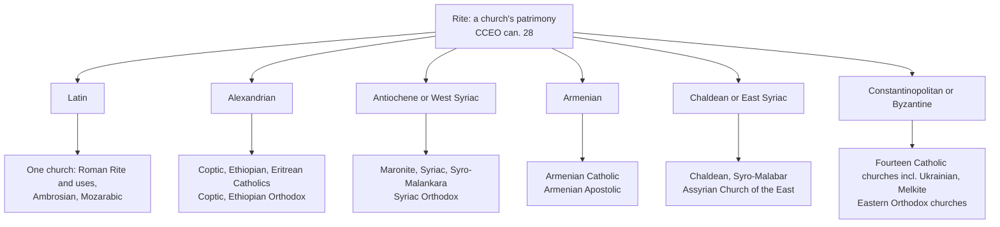

# Sacraments & Liturgy · Lesson 6.3: The Roman Rite and the Eastern rites

> ⏱ ~15 min · Module 6: The liturgy · Builds on: [6.1](06-01-what-the-liturgy-is.md), [3.1](03-01-the-institution-and-the-earliest-witness.md), [1.2](01-02-matter-form-minister-intention.md), [`ecclesiology-and-mariology` 3.2](../../ecclesiology-and-mariology/lessons/03-02-the-local-and-the-universal-church.md) · Unlocks: [7.1](07-01-the-twentieth-century-reform-and-the-disputes-over-it.md), [7.2](07-02-liturgical-language-and-ars-celebrandi.md)

## Why this matters

A Latin Catholic at a Melkite Sunday liturgy hears the anaphora of St John Chrysostom, not the Roman Canon. A Chaldean Catholic in Sweden who cannot reach any Catholic minister may, in that necessity, receive communion at an Assyrian altar whose anaphora, as received, has no institution narrative, and the Holy See judges that Eucharist valid. Same sacrament, other prayers, other orders: both facts turn on what a rite is, and on what in a eucharistic prayer the Church may shape.

## The idea

**A rite is a patrimony, not a rulebook.** [`ecclesiology-and-mariology` 3.2](../../ecclesiology-and-mariology/lessons/03-02-the-local-and-the-universal-church.md) defined the church *sui iuris* and the [rite](../reference.md#rite) it lives. In CCEO can. 28 a rite is a "liturgical, theological, spiritual and disciplinary patrimony", marked by peoples' culture and history and expressed in each church's own way of living the faith (§1, lesson's translation). The Eastern rites arise from five traditions: Alexandrian, Antiochene, Armenian, Chaldean, Constantinopolitan (§2). A **tradition** is a family several churches share: Melkite and Ukrainian Catholics and the Orthodox of Greece and Russia all pray the Byzantine liturgies of Chrysostom and Basil. A **rite**, strictly, is that tradition as one church lives it. The Latin Church lives principally the Roman Rite, with the Ambrosian at Milan, the Mozarabic at Toledo and some religious orders' rites (CCC 1203).

**One shape, three orders.** Justin's Sunday ([3.1](03-01-the-institution-and-the-earliest-witness.md)) has the skeleton: readings, gifts brought, a thanksgiving sealed by the people's Amen, communion. Its president prayed "according to his ability": the shape was fixed before the words. By the fourth century the thanksgiving survives in written [anaphoras](../reference.md#anaphora) (*anaphora*, "a carrying up, an offering", lesson's gloss). After the dialogue ("Lift up your hearts"), their constants are those GIRM 79 lists: thanksgiving (the preface), Sanctus, [epiclesis](../reference.md#epiclesis), institution narrative, anamnesis, offering, intercessions, doxology. The families order them differently:

- **Antiochene** (Byzantine, West Syriac, Armenian): Sanctus, narrative, anamnesis, the Spirit invoked, then all the intercessions.
- **Alexandrian** (St Mark, ANF 7): intercessions inside the preface, before the Sanctus; a petition to consecrate both before and after the narrative (Fortescue, 1912).
- **Roman**: a variable preface, then a fixed Canon whose intercessions are split, the living before the narrative and the dead after; just before the narrative, *Quam oblationem* asks that the offering become Christ's Body and Blood, naming no Spirit.

**The Roman line.** *On the Sacraments* IV quotes the Canon's core, from the petition before the narrative through the offering after it: the earliest Latin witness, late fourth century, its ascription to Ambrose long doubted and now widely accepted ([`patristics` 4.1](../../patristics/lessons/04-01-ambrose-of-milan.md)). Gregory I defends his own changes, among them the Lord's Prayer said "immediately after the canon" (*Ep.* IX.12, NPNF). Between 784 and 791 Pope Hadrian sent Charlemagne Gregory's sacramentary; it lacked much, so the Franks supplemented it (Duchesne credited Alcuin; later scholarship, Benedict of Aniane), and the mixed book returned to Rome and displaced the pure one. Low Mass produced the single-volume missal, and local uses of the Roman Rite multiplied (Sarum, Lyons) until 1570.

## In their own words

The Orthodox position, in its own texts, left standing.

After the narrative and anamnesis, the Byzantine anaphora asks the Father to "send thy Holy Spirit upon us, and upon these Gifts here spread forth" and make them Christ's Body and Blood, "Transmuting them by thy Holy Spirit" (Hapgood's *Service Book*, 1906). The *Orthodox Confession* drawn up under Peter Mogila and signed by the Eastern patriarchs (1643) makes that prayer the moment (Part I, Q. 107, lesson's translation of the Latin in Schaff):

> When the priest consecrates the gifts, he must hold that the very substance of bread and wine is changed into that of Christ's true body and blood by the working of the Holy Spirit, whose power he then implores.

As soon as those words are said, it continues, the change (*metousiosis*) takes place. A note in the modern Greek service books (printed by Brightman, 1896) calls the deacon's pointing at the gifts during "This is my body" contrary to the right mind of the Eastern Church: there the Lord's words are repeated *diēgēmatikōs*, "as narrative" (lesson's gloss), and refer to what Jesus took then. Orthodox texts differ: Philaret's Longer Catechism, approved by the Russian Holy Synod, calls "the most essential act" Christ's words "and after this the invocation of the Holy Ghost" (Q. 338 in Schaff, Blackmore's translation).

## The doctrine

1. **Rites are equal in dignity.** The council holds all lawfully recognized rites "of equal right and dignity" (SC 4), and no church *sui iuris* superior to another by reason of rite (OE 3). *In words:* no rite is the norm the others deviate from.
2. **The Church shapes rites, not substance.** Her power over the dispensation of the sacraments stops at their substance (Trent XXI ch. 2; [1.4](01-04-why-seven.md), [6.1](06-01-what-the-liturgy-is.md)). *In words:* an anaphora's order is hers to set; what Christ instituted is not.
3. **The [Roman Canon](../reference.md#roman-canon) contains no error.** Trent says the Church instituted it "many years ago", composed "out of the very words of the Lord, the traditions of the apostles, and the pious institutions also of holy pontiffs" (Session XXII, ch. 4), and anathematizes whoever says it contains errors and should therefore be abrogated (can. 6). *In words:* Trent vouches for its orthodoxy, admits that popes added to it, and fixes neither its date nor its sole use.
4. **[*Quo Primum*](../reference.md#quo-primum) (14 July 1570).** Pius V imposed his restored Missal wherever Mass followed "the rite of the Roman Church" (lesson's translation), exempted rites approved from their institution or by custom and kept for over two hundred years, forbade changes, and declared the bull perpetually valid. That bound his subjects, not his successors: Clement VIII (1604) and Urban VIII (1634) revised the Missal, as its title page announced (*Clementis VIII et Urbani VIII auctoritate recognitum*). *In words:* a law of uniformity with an exemption for old rites, not a doctrinal act.
5. **The form, in Latin teaching.** Florence's instruction for the Armenians (1439, lesson's translation): "The form of this sacrament is the words of the Saviour by which he effected this sacrament; for the priest, speaking in the person of Christ, effects this sacrament." Trent puts the body under the bread "by the force of the words" (XIII ch. 3). CCC 1353 joins epiclesis and narrative: Christ's words and action and the Spirit's power make him present. *In words:* the Lord's words belong to the form; the Spirit is not excluded.

**Said plainly.** Since Florence the Latin Church has taught that the Saviour's words are this sacrament's form. In 2001 its doctrinal congregation, with the pope's approval, judged valid an anaphora that does not recite them as a narrative, as a whole church has prayed it "from time immemorial" (Guidelines §3).

**The [Anaphora of Addai and Mari](../reference.md#addai-and-mari).** The Assyrian Church of the East prays this East Syriac anaphora for about two hundred days a year; in its oldest manuscripts and unbroken use it has no coherent narrative (the explanatory article, §2). Brightman prints one only in brackets, from observed practice, as "obviously incoherent with the context"; ANF 7's rubric "Here follow the words of institution" is its editors'. The *Guidelines for Admission to the Eucharist between the Chaldean Church and the Assyrian Church of the East* (Pontifical Council for Promoting Christian Unity, 20 July 2001, "in agreement with" the CDF) report that on 17 January 2001 the CDF concluded the anaphora "can be considered valid", and John Paul II approved. Three grounds: great antiquity and the intention of continuing the Last Supper, its validity never officially contested; a true particular church with apostolic succession and full eucharistic faith (UR 15); and the words of institution present "in a dispersed euchological way" through its thanksgiving, praise and intercession.

**What it did and did not do.** It judged one anaphora valid and let Assyrians in necessity, and Chaldeans who cannot reach a Catholic minister, receive at each other's altars. It restated that the words of institution are constitutive and indispensable, invited Assyrian priests to insert them when Chaldeans are present, confined itself to this case, and denied that this is full communion. It drew no general rule about eucharistic form.

**Mark the levels** ([`fundamental-theology` 4.4](../../fundamental-theology/lessons/04-04-the-ladder-of-doctrinal-authority.md), [4.5](../../fundamental-theology/lessons/04-05-reading-a-documents-weight.md); [levels](../reference.md#levels-of-authority)). CCEO cann. 27–28: law, **no rung**. Equal dignity (SC 4, OE 3) and power over dispensation, not substance (as in 1.4): conciliar teaching, **at least rung 3**. Trent XXII can. 6: **rung 1** that the Canon contains no error, not for its age, sole use or unchangeability. *Quo Primum*: papal law, **no rung**. Florence on the form, with Trent XIII ch. 3: **at least rung 3**. That the words of institution alone consecrate, at the instant they are completed: long the common teaching of Latin theology, **rung 4**, never defined. The 2001 judgment: a CDF doctrinal judgment with papal approval (the text does not say in what form), **rung 3**, neither definitive nor general; its admission rules, discipline, **no rung**. Orthodox texts and the historians: no Catholic level.

## The rite families

Every Eastern family is shared by Catholic and other churches; the [Eastern Catholic churches](../reference.md#eastern-rites) number twenty-three.

## Worked examples

**Ex 1 (clean): the shape of the Chrysostom anaphora.** In Hapgood's text the preface thanks the Father for creation, for raising us when we fell, for the kingdom and for "this ministry", then joins the angels' Sanctus. "Holy art thou" leads to the narrative. The anamnesis remembers the Cross, the grave, the Resurrection, the Ascension and "the Second and glorious Coming-again": a memorial that includes the future. The offering follows ("Thine own, of thine own, we offer unto thee"), then the invocation of the Spirit, then the commemorations, the departed and the saints first and the living after, then the doxology. All eight of GIRM 79's elements, in the Antiochene order: beside the Roman Canon, the elements match and the order does not.

**Ex 2 (strain): how Roman is the Roman Rite?** A pilgrim says she heard at Rome "the pure Mass of the city of Rome". Test it. The sacramentary came back from Francia supplemented; the Creed entered the Roman Mass in 1014 at Emperor Henry II's request, by the usual account; the offertory prayers from beyond the Alps (Fortescue); the missal from low Mass. Pius V's experts restored the Missal "to the original norm and rite of the holy Fathers" (*Quo Primum*, lesson's translation) and kept all of these. So is the Roman Rite not Roman? Can. 28 resolves it: a rite is a patrimony as one church lives it, Roman by that church's reception and authority, not by unmixed origin. The Missal agrees: the Rite has absorbed other churches' usages and gained a "supraregional character" (GIRM 397). Borrowing runs both ways: the Latin confirmation formula of 1971 is Byzantine ([2.3](02-03-confirmation.md)). How much growth should be organic, and how much a commission may restore, the principle cannot settle: that is [7.1](07-01-the-twentieth-century-reform-and-the-disputes-over-it.md)'s dispute.

## Watch out

- **You might think *Quo Primum* made the 1570 Missal irreformable.** It is papal law, **no rung**, with the standard perpetuity clause, and his successors revised the book within 34 years. Calling it a dogmatic act overstates its level.
- **You might think the 2001 judgment made the institution narrative optional.** That overstates: the Guidelines call the words constitutive and indispensable, find them present in dispersed form, and confine themselves to this case. "A pastoral tolerance" understates: it is a doctrinal judgment of validity, **rung 3**.
- **You might think canon 6 made the Roman Canon the only lawful eucharistic prayer.** It defines that the Canon is free from error (**rung 1**). It says nothing of exclusivity, and Trent's own chapter credits "holy pontiffs" with additions.

## One-liner

> A rite is one church's whole way of praying the one faith; the Roman Canon is one much-added-to form of a shape all rites share, and what the eucharistic form requires is narrower than any rite's wording.

## Problems

**P1 (🟢)** *(Exegetical)* Pius V, *Quo Primum* (14 July 1570), the exemption clause (lesson's translation of the Latin printed in the Roman Missal):

> [We ordain] that for all future time, in all patriarchal, cathedral, collegiate and parish churches or chapels of the Christian world, secular or of any order, in which conventual Mass is accustomed or bound to be celebrated according to the rite of the Roman Church, Mass be sung or said only according to the formula of the Missal We have published, even if those churches are exempt …; unless they have been approved by the Apostolic See from their very first institution, or by custom, and that custom, or the institution itself, has been continuously observed there in celebrating Masses for more than two hundred years. From these We in no way take away their manner or custom of celebrating; but if this Missal should please them more, We permit them, with the consent of the bishop or prelate and of the whole chapter, to celebrate according to it.

(a) Which churches does the clause bind, and which may keep their own way of celebrating, on what conditions?

(b) What does it leave the exempt churches free to do, and with whose consent? Does it name any church that qualifies, and what follows?

Two sentences per part.

**P2 (🟡)** *(Exegetical)* **Invented**, written for this problem: from the Diocese of Hollin Ridge's brochure for a pilgrimage to Lebanon.

> (1) "On Sunday we join the Melkite Catholics for their Divine Liturgy of St John Chrysostom. This is the Orthodox rite, which the Melkites borrowed from the Greek Orthodox when they entered communion with Rome."
>
> (2) "Back home, listen for the Roman Canon: word for word the oldest eucharistic prayer in the world, unchanged since the apostles, as the Council of Trent teaches."
>
> (3) "The Divine Liturgy is beautiful, but it is not the Mass, so Latin pilgrims will also attend a Latin Mass to fulfil the Sunday obligation."
>
> (4) "The Church honours all the rites, but the Roman Rite, as the pope's own, ranks first among them."

For each, say what is wrong and give the correct statement, marking the level of any Church text you cite. Two sentences per item.

**P3 (🔴)** *(Exegetical)* The Roman Canon as printed in the Missal of 1570, from the first prayer after the Sanctus (lesson's translation of the Latin):

> … which we offer you first of all for your holy catholic Church: be pleased to grant her peace, to guard, unite and govern her throughout the whole world, together with your servant N. our Pope, N. our Bishop, and all who hold the right faith and cherish the catholic and apostolic faith. …
>
> In communion with, and venerating the memory first of the glorious ever-Virgin Mary, Mother of our God and Lord Jesus Christ, and of your blessed Apostles and Martyrs Peter and Paul, Andrew, James, John, Thomas, James, Philip, Bartholomew, Matthew, Simon and Thaddeus; Linus, Cletus, Clement, Xystus, Cornelius, Cyprian, Lawrence, Chrysogonus, John and Paul, Cosmas and Damian, and all your saints: by their merits and prayers grant that in all things we may be defended by the help of your protection.

(a) Which of GIRM 79's elements is this, and where does the Roman Canon put it relative to the institution narrative? How does the Chrysostom anaphora (Ex 1) differ?

(b) What does the list of saints suggest about where the Canon took shape? Name two features of the list that carry the inference, and one thing the list cannot show.

Two sentences per part.

Solutions

**P1** *(Exegetical)*

**Accept:** either construal of the two-hundred-year condition, provided the answer says which: the clause attaches it to "that custom, or the institution itself", so it can be read as governing both titles.

**Must hit, strict (a):**

- It binds every church or chapel, of whatever rank, secular or regular, where conventual Mass is celebrated "according to the rite of the Roman Church", even exempt churches.
- The exception: a rite approved by the Apostolic See from its first institution, or by custom, **and** continuously observed in those churches for more than two hundred years.

**Must hit, strict (b):**

- The exempt churches keep their practice ("We in no way take away"), and may still adopt the new Missal with the consent of the bishop or prelate **and of the whole chapter**.
- The clause names no church: which ones qualified was a matter of application. Fortescue reports that Lyons, the Dominicans, Carmelites and Carthusians, Milan and Toledo kept their rites, and that some who could have claimed the exemption did not.

**Wrong turns:** treating age alone as enough, when approval or custom and continuous observance are required; saying exempt churches were barred from the new Missal; reading the clause as touching the Eastern rites, when it governs churches bound to the Roman rite; answering from the bull's separate clause on perpetuity, which is not this clause.

**Model answer:** (a) The clause binds every church, of any rank or order, where conventual Mass is celebrated according to the Roman Church's rite, exemptions notwithstanding. It spares a rite approved by the Apostolic See from its institution, or by custom, which has been observed continuously in those churches for more than two hundred years. (b) Those churches keep their own way of celebrating, but may adopt the new Missal with the consent of their bishop or prelate and of the whole chapter. The clause names no one, so which churches qualified was a matter of application: on Fortescue's account Lyons, several orders, Milan and Toledo kept their rites.

---

**P2** *(Exegetical)*

**Must hit, strict:**

- **(1)** A tradition is not one church's property: the Byzantine rites of several churches arise from it (CCEO can. 28 §2, **law, no rung**). The Melkites did not borrow it on entering communion; it was already theirs, and OE 1 counts the Eastern heritage as part of the undivided heritage of the universal Church (**at least rung 3**).
- **(2)** Trent says the Canon was composed from the Lord's words, apostolic traditions "and the pious institutions also of holy pontiffs" (XXII ch. 4), and defines only that it contains no error (can. 6, **rung 1**), not its age or an unchanged text. Its earliest witness is late fourth-century and differs from the later text; Gregory changed the rite around it; and "oldest" cannot be established, since the 2001 article counts Addai and Mari among the most ancient anaphoras.
- **(3)** The Divine Liturgy is the Eucharist in the Byzantine rite. Can. 1248 §1: assisting at Mass celebrated anywhere in a Catholic rite satisfies the obligation (**law, no rung**).
- **(4)** SC 4 holds all lawfully recognized rites of equal right and dignity, and OE 3 says no church is superior to another by reason of rite, each equally under the Roman Pontiff (**at least rung 3**). The pope's primacy is over all the churches; it does not rank his own church's rite above theirs.

**Wrong turns:** correcting (3) by saying a Latin Catholic may never worship in another church; calling the Melkites "Orthodox in communion with Rome" or "Latins in Greek vestments"; overcorrecting (2) by asserting that Addai and Mari is certainly older; giving can. 1248 a doctrinal rung, or SC 4 and OE 3 none.

**Model answer:** (1) A tradition is shared by several churches (CCEO can. 28, law), and the Melkites brought their Byzantine patrimony into communion rather than borrowing it; OE 1 calls that heritage part of the universal Church's (at least rung 3). (2) Trent defines only that the Canon is free from error (XXII can. 6, rung 1), and its own chapter credits apostolic traditions and popes' additions. The earliest witness is late fourth-century and "oldest" cannot be shown. (3) The Divine Liturgy is the Eucharist in a Catholic rite, and can. 1248 §1 counts it for the obligation (law). (4) SC 4 and OE 3 hold the rites and churches equal in dignity, none superior by reason of rite (at least rung 3); papal primacy does not rank rites.

---

**P3** *(Exegetical)*

**Accept:** for (b), any two of the features below, and any one limit (a date for the whole text; apostolic origin; priority over other anaphoras).

**Must hit, strict (a):**

- The **intercessions**, with the commemoration of the saints: for the Church, the pope, the bishop and the faithful, then the saints.
- The Roman Canon places this half **before** the narrative and the commemoration of the dead **after** it, so its intercessions are split. The Chrysostom anaphora places all its commemorations, departed, saints and living, **after** the narrative, the anamnesis and the invocation of the Spirit.

**Must hit, strict (b):**

- Two features: after Mary and the twelve apostles, **every name is a martyr's**; and **every one had a cult at Rome**: five Roman bishops (Linus to Cornelius), the Roman deacon Lawrence, and martyrs honoured with Roman churches, a few of them not Roman by origin (Cyprian of Carthage, paired with Cornelius; Chrysogonus; Cosmas and Damian). The list points to the local church of Rome in the age of martyr cult; Fortescue calls the Mass "the local liturgy of the city of Rome".
- What it cannot show: a date for the whole text, or apostolic authorship. A list of martyrs dates at most the list, and the text has grown since: the current Missal names St Joseph after Mary.

**Wrong turns:** reading the opening petition to accept the gifts as the consecration, which the passage is not about; taking "the right faith" (*orthodoxis*) to mean the Eastern Orthodox; saying all the Roman intercessions precede the narrative; inferring from the martyrs that the Canon is apostolic.

**Model answer:** (a) These are the intercessions with the saints' commemoration, and the Roman Canon puts this half before the institution narrative, keeping the dead for after it. The Chrysostom anaphora puts all its commemorations together after the narrative, anamnesis and invocation, in the Antiochene order. (b) After the apostles every name is a martyr's, and every one belongs to Rome's own cult of bishops, a deacon and martyrs (a few, such as Cyprian, honoured at Rome though not Roman by origin), so the prayer took shape as the local liturgy of the Roman church. The list cannot date the whole Canon or show it apostolic, and the text has been added to since.

## Flashback

**From Lesson [6.1](06-01-what-the-liturgy-is.md) (What the liturgy is):** *(Exegetical: close reading.)* Augustine, *Tractates on the Gospel of John* 6.6–7 (NPNF, first series, vol. 7), on the Baptist's "he it is that baptizeth with the Holy Ghost" (John 1:33, DR). *Sacrosanctum Concilium* 7 cites this tractate for its sentence that when anyone baptizes, it is Christ himself who baptizes.

> … by this authority, which Christ has retained to Himself alone, and conferred upon none of His ministers, though He has deigned to baptize by His ministers; by this authority, I say, stands the unity of the Church … For if … the authority were transferred by the Lord to His minister, there would be as many baptisms as ministers … [A]lthough many ministers, be they righteous or unrighteous, should baptize, the virtue of baptism would be attributed to Him alone … Peter may baptize, but this is He that baptizeth; … Judas may baptize, still this is He that baptizeth.

(a) What does Christ keep for himself, and what does he do through his ministers? Give Augustine's reason, and the words that make the minister's own holiness beside the point. **Two sentences.**

(b) On Lesson 6.1's reading, name two ways *Sacrosanctum Concilium* 7 claims more than this passage, and say what it adds, as *Mediator Dei* §20 had, about *who* worships. **Two sentences.**

Solution

**Accept:** in (b), any two of the three widenings below.

**Must hit, strict (a):**

- **Kept:** the authority to baptize, "retained to Himself alone, and conferred upon none of His ministers". **Done through them:** the act itself, since he "deigned to baptize by His ministers": they perform the rite, and he is the one who baptizes.
- **Reason:** unity. If the authority passed to the minister there would be "as many baptisms as ministers"; on this authority "stands the unity of the Church".
- **Words:** "be they righteous or unrighteous", "attributed to Him alone", and the climax "Judas may baptize, still this is He that baptizeth".

**Must hit, strict (b):**

- **Wider in scope:** from baptism to every sacrament, and past the sacraments to the whole of public worship. Christ is present in the sacrifice of the Mass, in his minister and especially under the species; in his word when Scripture is read in the Church; and when the Church prays and sings. The word is the council's addition to *Mediator Dei* §20's list.
- **Wider in kind:** from an authority exercised through ministers to presence in several modes, the presence under the species chief among them ("especially").
- **Wider in title:** the liturgy is an exercise of Christ's priestly office, in which perceptible signs signify sanctification and effect it, each in its own way: Lesson 1.1's sign that causes, widened from seven rites to all public worship.
- **Who worships:** not Christ alone, acting by his ministers, but the whole Mystical Body, Head and members. Christ associates the Church with himself; the worship is his, as Head, to the Father, and the community's, through him (*Mediator Dei* §20; SC 7; can. 834 §1). He stays the principal actor.

**Wrong turns:** reading "retained to Himself alone" as making the minister needless, when Christ "deigned to baptize by His ministers"; taking the passage for a theology of the whole liturgy, as if Augustine had listed SC 7's modes, when he speaks of baptism and its unity; flattening the modes, as if Christ were present in the word or the singing assembly as he is under the species; making the assembly the principal actor; inferring that because Christ acts, the minister may shape the rite as he likes, when the reverse follows: the prayer is Christ's and the Church's, not his, which is why no priest may alter it (SC 22 §3; can. 846 §1; Lesson 6.1, Ex 1).

**Model answer:** (a) Christ keeps the authority to baptize "to Himself alone", conferring it on no minister, though he "deigned to baptize by His ministers", so they perform the rite and he is the one who baptizes. The reason is unity, since transferred authority would mean "as many baptisms as ministers", and so, ministers "be they righteous or unrighteous", "Judas may baptize, still this is He that baptizeth". (b) SC 7 widens the claim from baptism to every sacrament and to all public worship, with Christ present in the minister and especially under the species at Mass, in his word and in the Church praying and singing, and it calls the liturgy an exercise of his priestly office whose signs effect what they signify. Following *Mediator Dei* §20, it adds that the one who worships is the whole Mystical Body, Head and members: Christ associates the Church with himself, so the faithful are not only those he acts through but worship with him and through him.

## Connections

- **Backward:** [3.1](03-01-the-institution-and-the-earliest-witness.md) gave Justin's shape and the president praying "according to his ability"; [1.2](01-02-matter-form-minister-intention.md) the essential sense of a form, which Addai and Mari tests; [1.4](01-04-why-seven.md) Florence's decree as an instruction and the line between dispensation and substance; [6.1](06-01-what-the-liturgy-is.md) the Church's authority over the liturgy. Churches *sui iuris* are [`ecclesiology-and-mariology` 3.2](../../ecclesiology-and-mariology/lessons/03-02-the-local-and-the-universal-church.md); *On the Sacraments* is [`patristics` 4.1](../../patristics/lessons/04-01-ambrose-of-milan.md); *Quo primum* within Trent's reform is [`church-history` 6.4](../../church-history/lessons/06-04-trent-and-catholic-reform.md); the Assyrian Church and the 1994 declaration are [`christology` 6.3](../../christology/lessons/06-03-the-churches-that-did-not-receive-chalcedon.md).
- **Forward:** [7.1](07-01-the-twentieth-century-reform-and-the-disputes-over-it.md) takes the Missal of 1570 to the Missal of 1970 and the dispute over the reform; [7.2](07-02-liturgical-language-and-ars-celebrandi.md) takes language.
- **Sideways:** Gregory's own letter on what he changed (*Ep.* IX.12) is one of the few dated traces of his liturgical reform, the kind of evidence [`patristics` 5.3](../../patristics/lessons/05-03-gregory-the-great.md) sets against John the Deacon's ninth-century *Life*. The Slavonic liturgy of Cyril and Methodius, a rite carried into a new language, is [`church-history` 3.1](../../church-history/lessons/03-01-gregory-the-great-and-the-conversion-of-the-peoples.md); the Syriac world of the East Syriac rite is [`patristics` 3.4](../../patristics/lessons/03-04-ephrem-and-syriac-christianity.md).
