# Sacraments & Liturgy · Lesson 7.1: The twentieth-century reform and the disputes over it

> ⏱ ~15 min · Module 7: The reform, the language, and the life around the liturgy · Builds on: [6.1 What the liturgy is](06-01-what-the-liturgy-is.md), [6.3 The Roman Rite and the Eastern rites](06-03-the-roman-rite-and-the-eastern-rites.md), [`church-history` 9.3](../../church-history/lessons/09-03-after-the-council.md), [`fundamental-theology` 4.5](../../fundamental-theology/lessons/04-05-reading-a-documents-weight.md) · Unlocks: [7.2 Liturgical language and *ars celebrandi*](07-02-liturgical-language-and-ars-celebrandi.md)

## Why this matters

Almost every Roman-Rite Mass follows a missal promulgated in 1969, and the argument about it usually runs three questions together. Could the Church reform her rites? Is the reformed rite valid and lawful? Was the reform done well? The first two are settled; the third is open. A fourth, what freedom the older books have, is law. This lesson keeps them apart, and reads the legal history as practice in [reading a document's weight](../../fundamental-theology/lessons/04-05-reading-a-documents-weight.md).

## The idea

**The reform began before the council.** Pius X brought "active participation" into papal teaching in 1903 ([`church-history` 9.3](../../church-history/lessons/09-03-after-the-council.md)), promoted frequent and early communion ([3.5](03-05-communion-reservation-adoration.md)) and redistributed the psalter (*Divino Afflatu*, 1911). Pius XII wrote *Mediator Dei* ([6.1](06-01-what-the-liturgy-is.md)), restored the Easter Vigil to the night (1951) and reformed Holy Week (1955). John XXIII issued new rubrics (1960) and the 1962 Missal. Paul VI's 1969 constitution calls Pius XII's Holy Week the Missal's first stage of revision.

**Two readings of what came next, each at full strength.**

*Organic development.* Alcuin Reid (*The Organic Development of the Liturgy*, 2004; 2nd ed. 2005) reads the Roman Rite's history as slow growth: elements accrue, are pruned, are received. The liturgical movement assumed this, as did the council, asking that new forms "grow organically from forms already existing" (SC 23). A missal composed by experts in a few years, with new eucharistic prayers and a rewritten offertory, broke that principle and exceeded the mandate. Authority over the liturgy is real, but it is a guardian's, not an author's.

*Ressourcement and reception.* Massimo Faggioli (*True Reform*, 2012) reads *Sacrosanctum Concilium* as the council's first act and the key to its ecclesiology: the Church as God's people assembled, fed by the word, offering with the priest. The reform is that council received, not a commission's improvisation. It removed what SC 50 told it to remove, and what it restored, from the prayer of the faithful to the cup, was older than what it replaced. To reject the reform is to reject the ecclesiology. The Missal's preamble claims Pius V's warrant: SC, like *Quo Primum*, restores rites to "the original norm of the holy Fathers" (GIRM 6).

## The doctrine

1. **The authority.** In dispensing the sacraments the Church may change what she judges expedient, their substance untouched (Trent, Session XXI, ch. 2; [3.5](03-05-communion-reservation-adoration.md)). SC 21 separates "immutable elements divinely instituted" from elements that may, and sometimes must, change. SC 22 gives the regulation of the liturgy to the Apostolic See and, as law provides, to bishops, and to no one else on his own authority. Trent's Session VII, can. 13 anathematizes whoever says the received rites may be despised, dropped at will, or changed into new ones *per quemcumque ecclesiarum pastorem*, "by any pastor whatever" (lesson's gloss). The council that wrote it left the missal's correction to the pope (*Quo Primum*). *In words:* the rite is the Church's to order, from the top, never the celebrant's.

2. **The mandate ([*Sacrosanctum Concilium*](../reference.md#sacrosanctum-concilium), 1963), paraphrased.** A general restoration (21); sound tradition kept and legitimate progress allowed, no innovation unless the Church's good genuinely and certainly requires it, new forms growing organically from old (23); noble simplicity (34); Latin preserved, the vernacular extendable (36), at Mass first for the readings, the common prayer and the people's parts, with the people still able to say or sing their parts of the Ordinary in Latin (54). The Mass's parts made clearer, its rites simplified with their substance kept, duplications dropped, lost elements restored (50); Scripture opened "more lavishly" (51). *In words:* principles and a direction; the books were left to others.

3. **What was done.** A commission set up under *Sacram Liturgiam* (1964), the Consilium, under Cardinal Giacomo Lercaro with Annibale Bugnini as secretary, drafted the books. Paul VI's apostolic constitution *Missale Romanum* (3 April 1969; in force 30 November) promulgated the [Missal of Paul VI](../reference.md#missal-of-paul-vi): three new eucharistic prayers beside the Roman Canon, the Lord's words identical in all; duplications cut "above all" in the offertory and communion rites; homily, prayer of the faithful and penitential act restored; a three-year Sunday cycle with an Old Testament reading. New rites of ordination, confirmation, anointing and adult initiation followed by 1972 ([5.1](05-01-holy-orders-the-three-degrees.md), [2.3](02-03-confirmation.md), [4.3](04-03-anointing-of-the-sick.md), [2.1](02-01-baptism-the-rite-and-its-effects.md)). *In words:* by 1972 the Mass and most sacramental rites had new books.

4. **The objection, and the answer.** On 25 September 1969 Cardinals Alfredo Ottaviani and Antonio Bacci sent Paul VI a *Short Critical Study* by unnamed theologians, the [Ottaviani Intervention](../reference.md#ottaviani-intervention). It charged a striking departure from Trent's Session XXII: the Instruction's article 7 defined the Mass as the people assembled, a priest presiding, to celebrate the Lord's memorial, naming neither sacrifice nor real presence; offertory prayers stating the oblation were cut. It begged to keep the Missal of Pius V. Paul VI answered at two general audiences (19 and 26 November 1969): the change was the council's will; nothing in the Mass's substance had changed; a rite and its rubrics are not of themselves a dogmatic definition; *non diciamo dunque «nuova Messa», ma piuttosto «nuova epoca»*, not a new Mass but a new era. The definition was later rewritten (GIRM 27 now names a priest acting *in the person of Christ* and the Eucharistic Sacrifice), and a preamble restating Trent opens the Instruction (GIRM 1–15). *In words:* the charge was doctrinal; the answer separated doctrine from rite and amended the text.

5. **The older books in law.** *Quattuor abhinc annos* (1984), a circular letter of the Congregation for Divine Worship, let bishops grant named groups the 1962 Missal: in Latin, in parish churches only in extraordinary cases, the Missals unmixed, if they did not question the 1970 Missal's legitimacy. [*Ecclesia Dei*](../reference.md#ecclesia-dei) (1988) set up a commission and asked for "wide and generous application" of that indult. [*Summorum Pontificum*](../reference.md#summorum-pontificum) (2007) held the 1962 Missal never abrogated, called the two Missals ordinary and extraordinary expressions of one *lex orandi*, and freed any Latin priest to use it without a congregation; Benedict's letter found in liturgical history "growth and progress, but no rupture". *Universae Ecclesiae* (2011), an instruction, applied it. [*Traditionis Custodes*](../reference.md#traditionis-custodes) (2021) made the reformed books "the unique expression" of the Roman Rite's *lex orandi* (art. 1), gave the bishop exclusive competence, barred parish churches and new groups, and abrogated non-conforming earlier norms (art. 8). *Responsa* (2021) and a rescript (2023) reserved key dispensations to the Holy See. [*Desiderio Desideravi*](../reference.md#desiderio-desideravi) (2022) holds there is no going back to the ritual form the council judged in need of reform (§61). As of this writing (October 2026) Leo XIV has not changed *Traditionis Custodes*; on 29 June 2026 he urged respect for the rites of Paul VI and John Paul II. *In words:* law, loosened then tightened; none of it touches the doctrine of the Mass.

6. **The Society of St Pius X.** For 1988 and the 2009 remission, see [`church-history` 9.3](../../church-history/lessons/09-03-after-the-council.md). After Leo XIV's plea of 29 June 2026 against an imminent "schismatic act", a decree of the Dicastery for the Doctrine of the Faith (2 July 2026) declared that the consecrating bishop and four new bishops had incurred excommunication reserved to the Apostolic See (can. 1387), and called the act schismatic. Its note calls the Society's confessions and the marriages its priests witness invalid (no faculty, [4.1](04-01-penance-the-sacrament-and-its-history.md); no canonical form, [5.3](05-03-matrimony-sacrament-contract-indissolubility.md)), its other sacraments unlawful. The consecrations are valid and unlawful ([5.1](05-01-holy-orders-the-three-degrees.md), Ex 2).

| Settled (with level) | Open |
|---|---|
| The Church's authority to reform her rites, the substance untouched: at least rung 3 | Whether the books as executed followed SC, above all SC 23 |
| The reformed sacraments are valid: defined doctrine of matter and form applied ([1.2](01-02-matter-form-minister-intention.md)) | Whether particular changes were prudent: offertory, orientation, the vernacular's extent, new prayers, lectionary |
| The reformed Missal is lawful: it is the Roman Rite's law | The historiography: Reid against Faggioli, and the Consilium's pace |
| SC's doctrinal teaching: at least rung 3 | The future discipline of the 1962 books: law, changeable |

**Said plainly.** The reform was carried out faster and more extensively than most council fathers expected. They passed a constitution, 2,147 to 4 ([`church-history` 9.2](../../church-history/lessons/09-02-the-second-vatican-council.md)), that preserved Latin and opened the vernacular first to the readings and the common prayer. Less than six years later Paul VI told a general audience that Latin would no longer be the Mass's principal language, and called its loss *un grande sacrificio*, a great sacrifice. Serious Catholics have argued about it ever since.

**Mark the levels** ([`fundamental-theology` 4.4](../../fundamental-theology/lessons/04-04-the-ladder-of-doctrinal-authority.md); [levels](../reference.md#levels-of-authority)). The power over the rites, substance untouched: **at least rung 3** (Trent XXI ch. 2, as in [1.2](01-02-matter-form-minister-intention.md)). Trent VII can. 13: **rung 1** for what its words reach; the Church's practice since Pius V reads them as not reaching the supreme authority. That the Mass is a true sacrifice, affirmed by the 1969 critics and by Paul VI alike: **rung 1** (XXII can. 1; [3.4](03-04-the-sacrifice-of-the-mass.md)). SC's doctrinal teaching: **at least rung 3**; its norms are law. *Missale Romanum*, the 1984 indult, *Ecclesia Dei*, *Summorum Pontificum*, *Universae Ecclesiae*, *Traditionis Custodes*, the *Responsa*, the rescript and the 2026 decree: **law or juridical acts, no rung**, changeable by the competent authority. *Desiderio Desideravi* teaches at **rung 3**. Audiences and letters like Leo XIV's: ordinary teaching at its lightest. The *Study*, Reid and Faggioli: **no magisterial level**. The prudence of particular changes: **freely disputed**.

## The legal history

```mermaid
graph LR
  A["1969 Missale Romanum<br/>apostolic constitution"] --> B["1984 Quattuor abhinc annos<br/>indult"]
  B --> C["1988 Ecclesia Dei<br/>motu proprio"]
  C --> D["2007 Summorum Pontificum<br/>motu proprio"]
  D --> E["2011 Universae Ecclesiae<br/>instruction"]
  E --> F["2021 Traditionis Custodes<br/>motu proprio"]
  F --> G["2021 Responsa ad dubia<br/>dicastery answers"]
  G --> H["2022 Desiderio Desideravi<br/>apostolic letter"]
  H --> I["2023 rescript<br/>dispensations reserved"]
```

All law but the eighth, which teaches; none defines.

## Worked examples

**Ex 1 (clean): the Sunday request.** Invented: Fr Ferdia Quill, ordained in 2023 for the Diocese of Tarnmouth, is asked to celebrate the 1962 Missal every Sunday in his parish church, St Brendan's, Fellbridge. Both his permission (TC art. 4) and the use of a parish church (art. 3 §2) are dispensations reserved to the Holy See since 2023. He goes ahead without them.

- **Valid:** yes. Matter, the 1962 Missal's form of consecration, a priest, the intention of doing what the Church does ([1.2](01-02-matter-form-minister-intention.md)).
- **Licit:** no. The **rite** is used without the permission the law requires.
- **Fruitful:** for each communicant, as disposed ([1.3](01-03-ex-opere-operato-character-and-fruitfulness.md)); the priest's disobedience does not empty it.

**Ex 2 (strain): one expression or two?** *Summorum Pontificum* art. 1 calls the two Missals two expressions of one *lex orandi*; *Traditionis Custodes* art. 1 calls the reformed books "the unique expression". Did one pope contradict another? Read the weight first: both are apostolic letters given motu proprio, law, no rung. In both, the phrase names which books the law recognizes as the Roman Rite's prayer, and a later legislator may change that. SP's "never abrogated" judged 1970; TC does not deny it, but abrogates norms from 2021. The strain: *lex orandi* is also a theological source ([6.1](06-01-what-the-liturgy-is.md)), and the 1962 Missal prayed the Church's faith for centuries. TC says nothing against that faith, and its letter invokes Pius V, who also abrogated rites. Whether "unique expression" is purely juridical, Catholics dispute; no act settles it.

## Watch out

- **You might think *Summorum Pontificum* or *Traditionis Custodes* defined something.** Both are law. Reading "unique expression" as dogma, or "never abrogated" as a permanent guarantee, overstates each.
- **You might think criticizing the reform is disloyal, or that the reformed Missal's validity is debatable.** The first shrinks what is open; the second opens what is settled. TC art. 3 §1 asks groups not to deny the reform's validity and legitimacy, not to think every change prudent.
- **You might think Trent VII can. 13 forbade the reform.** It bars change by "any pastor whatever"; the same council left the missal to the pope.
- **You might think the council ordered Mass facing the people.** SC is silent on it (P3).

## One-liner

> The Church could reform her rites and did so validly and lawfully; whether she did it well is open, and the older books' freedom is law, which changes.

## Problems

**P1 (🟢)** *(Exegetical)* An **invented** answer key for a university chaplaincy's quiz night, "The Mass since 1969", written for this problem:

> (1) 1984: John Paul II let any priest say the 1962 Mass without asking anyone.
>
> (2) 1988: *Ecclesia Dei* made the 1962 Missal universal law alongside the new one.
>
> (3) 2011: *Universae Ecclesiae* is an instruction, so it outranks a motu proprio and still protects the old Mass today.
>
> (4) 2026: Rome excommunicated everyone who goes to the Latin Mass.

For each answer, say what is wrong and give the correct statement, naming the kind of act involved. One or two sentences each.

**P2 (🟡)** *(Exegetical)* Find the crux. The 1969 *Study* argues that the new Order of Mass cut the offertory prayers that stated the purpose of the oblation (the old *Suscipe, sancta Trinitas* among them), and concludes: "The change in the formula reveals the change in doctrine." Paul VI's *Missale Romanum* says the reform removed elements that had come to be duplicated or were added with little advantage, "above all in the rites of offering the bread and wine", applying SC 50.

(a) Name the single premise the *Study*'s inference needs and Paul VI's side denies. One sentence.

(b) Name one feature of the reformed Order of Mass that bears on that premise, and say which way it bears. One or two sentences.

**P3 (🔴)** *(Evaluative)* SC says nothing about which way the priest faces; its art. 128 orders only a revision of the laws on building altars and churches. GIRM 299 asks that the altar stand apart from the wall, so that it can be walked around and Mass celebrated at it facing the people, "which is desirable wherever possible". GIRM 146, 154, 157 and 165 tell the priest to face the people at the *Orate, fratres*, the greeting of peace, the *Ecce Agnus Dei* and the prayer after communion. Was the near-universal turn of the celebrant toward the people after 1969 a sound application of the council's principles? Any verdict, **150 words or fewer**.

Solutions

**P1** *(Exegetical)*

**Accept:** each correction must name the act's kind and state what it actually did; wording may vary.

**Must hit, strict:**

- **(1)** The 1984 *Quattuor abhinc annos* was an indult granted through a circular letter of the Congregation for Divine Worship. It let *bishops* permit *named groups*, on conditions: no questioning of the 1970 Missal's legitimacy, Latin, no parish churches save exceptionally, no mixing of Missals. Freedom for any Latin priest to celebrate without a congregation and without permission came only with *Summorum Pontificum* art. 2 (2007).
- **(2)** *Ecclesia Dei*, a motu proprio issued after the 1988 consecrations, set up a commission and asked for "wide and generous application" of the 1984 indult. It made no new universal law on the 1962 Missal.
- **(3)** Wrong twice. An instruction applies the law and cannot derogate from it, so it never outranked a motu proprio ([`fundamental-theology` 4.5](../../fundamental-theology/lessons/04-05-reading-a-documents-weight.md)). And TC art. 8 (2021) abrogated earlier norms and instructions that do not conform to it.
- **(4)** The Dicastery for the Doctrine of the Faith's decree of 2 July 2026 concerned the Society of St Pius X's consecrations without a mandate. It declared the consecrators and the consecrated excommunicated, and its note counts as schismatic the lay faithful who *formally adhere* to the Society. Neither the decree nor the note mentions the 1962 Missal, which is still celebrated with permission under TC.

**Wrong turns:** giving any of these acts a doctrinal rung; dating the end of the 1984 indult's conditions to *Ecclesia Dei* rather than to 2007; in (4), treating attendance at the older rite as the same thing as formal adherence to the Society; in (4), denying that any excommunication was declared in 2026.

**Model answer:** (1) The 1984 indult, sent as a circular letter of the Congregation for Divine Worship, let bishops grant named groups the 1962 Missal on conditions. Only from *Summorum Pontificum* (2007) could any Latin priest use it without a congregation and without permission. (2) *Ecclesia Dei*, a motu proprio, set up a commission and asked for generous use of that indult; it made no new universal law on the Missal. (3) An instruction cannot derogate from law, and TC art. 8 abrogated non-conforming instructions in 2021. (4) The 2026 decree declared the Society's consecrators and new bishops excommunicated and treats formal adherents of the Society as schismatic. It says nothing about the 1962 Missal, which is still celebrated with permission.

---

**P2** *(Exegetical (a) and (b))*

**Accept:** for (a), any accurate formulation of the premise below; for (b), any accurate feature, in either direction, with the direction stated.

**Must hit, strict (a):**

- The *Study* needs this premise: removing a prayer that stated a doctrine at one point of the rite signifies a change in that doctrine. That is, the *lex orandi* is read element by element, so each omission teaches something.
- Paul VI's side denies it. The oblation is stated where it belongs, in the Eucharistic Prayer, so a statement that anticipated it duplicated it (SC 50), and the rite as a whole carries the faith. He said in November 1969 that rite and rubric are not of themselves a dogmatic definition.
- Both sides hold that the Mass is a true sacrifice (Trent XXII can. 1, rung 1). The dispute is over what a rite's omissions signify, not over the doctrine.

**Must hit, strict (b):** one accurate feature, with its direction, e.g.:

- **Against the premise:** the reformed Order keeps the *Orate, fratres*, *ut meum ac vestrum sacrificium acceptabile fiat* ("that my sacrifice and yours may be acceptable", lesson's translation; GIRM 146). Eucharistic Prayer III says *offerimus tibi … hoc sacrificium vivum et sanctum* ("we offer you this living and holy sacrifice"). The Roman Canon stays as the first prayer, and GIRM 2 restates Trent.
- **For the premise:** the 1969 Instruction's article 7 defined the Mass without naming the sacrifice, and it was rewritten (now GIRM 27). A defender of the *Study* reads the rewrite as an admission that the omission said something.

**Wrong turns:** turning the crux into whether the Mass is a sacrifice; treating the *Study* as magisterial, or the choice to cut the prayers as doctrine; answering whether the cut was prudent, when the task asks for the premise, not the verdict; quoting the new offertory's *quem tibi offerimus* as if it settled (a), when it only bears on it.

**Model answer:** (a) The *Study* must assume that removing a prayer that stated the oblation signifies a change in what the Church believes about it; Paul VI's side denies this, holding that the Eucharistic Prayer states the oblation and the old offertory duplicated it. (b) The reformed Order still has the priest ask that "my sacrifice and yours" be acceptable, and Eucharistic Prayer III offers "this living and holy sacrifice". Both tell against reading the cut as a change of doctrine, though they settle nothing about its prudence.

---

**P3** *(Evaluative)*

**Must hit, any verdict:**

- State the texts accurately. SC is silent on orientation. GIRM 299 asks for a freestanding altar, and its "desirable wherever possible" is read by some as attaching to the freestanding altar and by others as attaching to facing the people. The "facing the people" rubrics presuppose moments when the priest is not.
- Keep validity out. Orientation touches neither matter nor form, so the question is prudence and law, not doctrine.
- Test the change against a principle SC actually gives: participation and intelligibility (14, 50), or organic growth and no innovation without genuine and certain need (23).
- State the strongest case for the other verdict.

**Wrong turns:** saying the council mandated Mass facing the people; saying celebration facing the people is invalid or doctrinally deficient; treating the GIRM's wording as settling a question whose reading is disputed; giving no argument against your own verdict.

**Model answer, one of several:** Not a sound application, though a lawful one. SC never asked for it. GIRM 299 asks for a freestanding altar, and its "desirable" may refer to the altar rather than the direction, while the rubrics telling the priest to face the people at four moments presuppose that at other moments he may be facing elsewhere. So a near-universal turn within a few years was an innovation, which SC 23 allows only for a genuine and certain need. The gain, a people who see and hear, was largely secured by the vernacular. The cost was a shared direction of prayer that most Roman-Rite churches had kept for centuries. The strongest reply is that SC 14 and 50 make visible, intelligible participation the aim, and that facing the assembly makes the Eucharistic Prayer audibly and visibly a prayer offered with them. Validity is untouched either way.

## Flashback

**From Lesson [6.2](06-02-the-liturgical-year-and-the-liturgy-of-the-hours.md) (The liturgical year and the Liturgy of the Hours):** *(Exegetical.)* Close reading. Tertullian, writing at Carthage around 200, on the times of prayer (*On Prayer* 25, ANF 3, abridged; the omitted lines give Acts 2:15, 10:9 and 3:1 as the warrants for the three hours):

> … the extrinsic observance of certain hours will not be unprofitable—those common hours, I mean, which mark the intervals of the day—the third, the sixth, the ninth—which we may find in the Scriptures to have been more solemn than the rest. … Albeit these practices stand simply without any precept for their observance, still it may be granted a good thing to establish some definite presumption, … so that … we pray at least not less than thrice in the day, … in addition to our regular prayers which are due, without any admonition, on the entrance of light and of night.

(a) Which prayers does Tertullian treat as owed, and which as a useful custom that no precept requires? Quote the words that decide each. **Two sentences.**

(b) Which Hours of the Liturgy of the Hours correspond to each group, and what rank does the reformed Office give each, for a priest praying outside choir? **Two sentences.**

(c) Give the weight of (i) Tertullian's distinction and (ii) the reformed Office's ranking of the Hours. **One line.**

Solution

**Accept:** in (a), any accurate quotation of the deciding words; in (b), "Morning Prayer" and "Evening Prayer" for Lauds and Vespers, and "Daytime Prayer" or "the middle Hour" for Terce, Sext and None.

**Must hit, strict (a):**

- **Owed:** the morning and evening prayers, "our regular prayers which are due, without any admonition, on the entrance of light and of night". They are owed as a matter of course and need no reminder.
- **Custom without precept:** the third, sixth and ninth hours, which "stand simply without any precept for their observance", though Scripture marks them as solemn and fixing them is "a good thing". The thrice-daily prayer comes "in addition to" the morning and evening prayers: five times in all.

**Must hit, strict (b):**

- Light and nightfall are **Lauds and Vespers**, "the two hinges" and chief Hours of the Office (SC 89a; GILH 37), which the clergy are not to omit without serious reason (GILH 29).
- The third, sixth and ninth hours are **Terce, Sext and None**, the daytime prayer: all three are kept in choir, but outside choir one, chosen by the time of day, suffices (SC 89e; GILH 77). The reformed Office keeps Tertullian's order of importance.

**Must hit, strict (c):**

- (i) **No magisterial level:** a theologian's witness to the practice of his church.
- (ii) **Law, no rung:** SC 89's norms for the revision, the GILH's ordering and the clergy's obligation (can. 276 §2, 3°) are liturgical and canonical law. What SC teaches the Office *is*, the prayer of Christ with his body (SC 83–84), stands at least at rung 3; how it orders the Hours does not.

**Wrong turns:** counting "thrice" as including morning and evening; reading "without any admonition" as "optional", when it means owed without needing to be commanded; reading "extrinsic" as "worthless", when Tertullian says the observance "will not be unprofitable"; mapping "the entrance of night" to Compline, which is prayed before sleep; saying a priest must pray all three daytime Hours outside choir; giving the ranking rung 3 because a council wrote it, or giving Tertullian a level because he is early.

**Model answer:** (a) Morning and evening prayers are owed: they "are due, without any admonition, on the entrance of light and of night". The third, sixth and ninth hours "stand simply without any precept", but fixing them is "a good thing", so one prays thrice daily "in addition to" the owed prayers. (b) Morning and evening are Lauds and Vespers, the two hinges and chief Hours, which the clergy may not omit without serious reason (SC 89a; GILH 29, 37). The three hours are Terce, Sext and None, all kept in choir, one sufficing outside it (SC 89e; GILH 77). (c) Tertullian: no magisterial level; the ranking: law, no rung.

## Connections

- **Backward:** [6.1](06-01-what-the-liturgy-is.md) gave SC's doctrine, *Mediator Dei* and participation; [6.3](06-03-the-roman-rite-and-the-eastern-rites.md) gave the Missal of Pius V and *Quo Primum*. The sacrifice both sides affirmed is [3.4](03-04-the-sacrifice-of-the-mass.md)'s; the validity verdicts are [1.2](01-02-matter-form-minister-intention.md)'s. The events, the 2,147 to 4 vote and Lefebvre, are [`church-history` 9.2](../../church-history/lessons/09-02-the-second-vatican-council.md) and [9.3](../../church-history/lessons/09-03-after-the-council.md).
- **Forward:** [7.2](07-02-liturgical-language-and-ars-celebrandi.md) takes the vernacular, the translation fights and the norms against abuse. Boss 7 ([syllabus](../syllabus.md)) asks whether the reform was a legitimate development, with [Newman's notes](../../fundamental-theology/lessons/05-02-newmans-theory-of-development.md) applied by analogy, since they test doctrine, and without chronic vigour, which cannot test anything recent.
- **Sideways:** the continuity-or-rupture map, Bologna against Benedict's "hermeneutic of reform", is [`church-history` 9.3](../../church-history/lessons/09-03-after-the-council.md); this lesson is that quarrel in its liturgical form. A consecration without a mandate is graded in [`ecclesiology-and-mariology` 3.1](../../ecclesiology-and-mariology/lessons/03-01-bishops-and-apostolic-succession.md) P1 and in [5.1](05-01-holy-orders-the-three-degrees.md) Ex 2.
