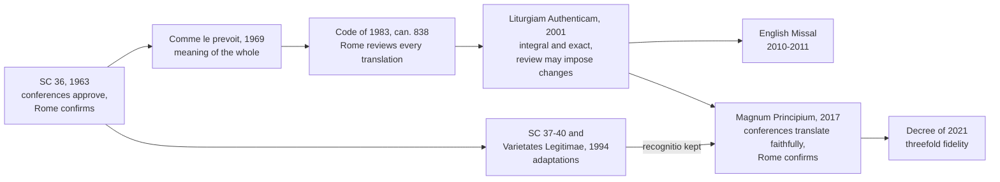

# Sacraments & Liturgy · Lesson 7.2: Liturgical language and *ars celebrandi*

> ⏱ ~15 min · Module 7: The reform, the language, and the life around the liturgy · Builds on: [6.1 What the liturgy is](06-01-what-the-liturgy-is.md), [6.3 The Roman Rite and the Eastern rites](06-03-the-roman-rite-and-the-eastern-rites.md), [7.1 The twentieth-century reform](07-01-the-twentieth-century-reform-and-the-disputes-over-it.md), [`patristics` 4.2](../../patristics/lessons/04-02-jerome.md) · Unlocks: [7.3 Sacramentals and popular devotion](07-03-sacramentals-and-popular-devotion.md)

## Why this matters

Ask a Catholic what changed after the council and the answer is usually about sound: English for Latin, hymns for chant, "And with your spirit" arriving in 2011. These arguments are visible and poorly understood, because they run together three questions the law keeps apart: which language, which translation, how the rite is celebrated. This lesson states what the Church has legislated on each, at its real weight, and what her documents say makes a celebration good.

## The idea

**The Roman liturgy has changed language before.** At Rome it was first celebrated in Greek, the language Roman Christians spoke; Latin replaced it gradually, somewhere between the third century and the end of the fourth, the date being disputed (Fortescue, *The Mass*, 1912, pp. 126–127). Latin became sacred by staying while speech moved on. So the Church's own tongue was once a vernacular, and a tongue held for fifteen centuries becomes part of the prayer.

**One question under all three.** Whose prayer is it? The liturgy is "never anyone's private property", neither the celebrant's nor the community's (John Paul II, *Ecclesia de Eucharistia*, 2003, §52). So the Church decides the language ([6.1](06-01-what-the-liturgy-is.md), claim 5), a translator renders the Church's prayer, and a celebrant serves a rite he did not write. The failures mirror each other: the celebration as the celebrant's **performance**, and as an **archaeology**, prized for being old.

## The doctrine

1. **Language: Latin kept, the vernacular allowed, the Church deciding.** Trent did not condemn the vernacular. It judged:

   > it has not seemed expedient to the Fathers, that it should be every where celebrated in the vulgar tongue. (Session XXII, ch. 8)

   Canon 9 anathematizes whoever condemns the Roman practice of saying part of the Canon in a low voice, or says Mass ought to be in the vernacular only ([3.4](03-04-the-sacrifice-of-the-mass.md) sent this here). *Sacrosanctum Concilium* (1963) 36 preserves Latin in the Latin rites and lets the vernacular be extended, the territorial authority deciding and Rome confirming; SC 54 gives it a place at Mass while asking that the faithful also be able to say or sing their parts of the Ordinary in Latin. Permissions then widened until every celebration with the people could be in the vernacular (GIRM 12). The Missal of Paul VI remains a Latin book ([`church-history` 9.3](../../church-history/lessons/09-03-after-the-council.md)), which every vernacular edition translates (*Liturgiam Authenticam* 23). *In words:* Latin is the Roman Rite's own language and the vernacular its normal practice, both with approved texts (can. 928); a priest may celebrate in Latin except at Masses the authorities have scheduled in the vernacular (*Redemptionis Sacramentum* 112).

2. **Translation: three regimes.** [*Comme le prévoit*](../reference.md#comme-le-prevoit) (Consilium, 1969) asks a translation to communicate to a people, in its own language, what the Church meant by the original (¶6). The passage, not the word, is the unit of meaning (¶12); intelligibility may outrank verbal fidelity (¶29); terse collects may be moderately amplified, keeping their ideas (¶34). Theorists call this dynamic equivalence; the term is not in the text. [*Liturgiam Authenticam*](../reference.md#liturgiam-authenticam) (2001) replaced it (¶8). Translation is "not so much a work of creative innovation" as rendering integrally and exactly, as far as possible, without omissions, additions, paraphrases or glosses (¶20), keeping relative clauses and parallelisms (¶57) and *Et cum spiritu tuo* as literal as possible (¶56). Rome's *recognitio* (review, lesson's gloss) could impose substantial changes (¶80). Its fruit was the English Missal of 2010–2011: "and with your spirit", "consubstantial", "under my roof". Defenders heard fidelity and a register fit for worship; critics heard syntax hard to proclaim, and a review become rewriting. Benedict XVI defended "for many" (*pro multis*) to the German bishops (letter to Archbishop Zollitsch, 14 April 2012): "for all" had been an interpretation as much as a translation.

   [*Magnum Principium*](../reference.md#magnum-principium) (Francis, motu proprio, 2017) amended can. 838. The conferences now "faithfully" prepare versions, approve them and publish after Rome's *confirmatio* (§3); adaptations still need *recognitio* (§2). The Congregation's note makes *confirmatio* a ratification ordinarily granted on trust, with detailed review for the weightiest texts; Archbishop Roche's commentary reads LA in light of the new canon. Francis's letter to Cardinal Sarah (October 2017), known here only as Catholic News Service reported it, said translations need no longer conform to LA in every point. The decree *Postquam Summus Pontifex* (2021) made fidelity threefold: to the Latin, to the receiving language, to the hearers' understanding (¶20). *In words:* the conferences translate and Rome checks; what moved is how closely, and by which fidelity.

3. **Music.** SC 112 prizes the Church's musical tradition above every other art, as integral to solemn liturgy. SC 116 gives Gregorian chant, specially suited to the Roman liturgy, "pride of place", other things being equal, without excluding polyphony; SC 118–121 foster the people's singing and want sung texts drawn chiefly from Scripture and the liturgy. The criteria are older. Pius X required of [sacred music](../reference.md#sacred-music):

   > sanctity and goodness of form, from which its other character of universality spontaneously springs. (*Tra le sollecitudini*, 1903, §2)

   *In words:* the test is fitness to this rite, text and moment, not style; in liturgy one song is not as good as another (Benedict XVI, *Sacramentum Caritatis*, 2007, §42).

4. **[*Ars celebrandi*](../reference.md#ars-celebrandi).** *Sacramentum Caritatis* 38–40: the art of proper celebration is the best way to secure *actuosa participatio*, and the fruit of adherence to the liturgical norms in all their richness, word and music, gesture and silence. *Desiderio Desideravi* (2022) 48: it is neither a rubrical mechanism nor creativity without rules; the rite is itself a norm, serving the reality it protects. Silence is prescribed, not decorative (GIRM 45). DD 54 lists inadequate ways of presiding in opposed pairs, "rigid austerity or an exasperating creativity" among them, with one root: a style that puts the celebrant at the centre. *In words:* the rubrics are the condition of the assembly's freedom, because they guarantee that what it joins is the Church's prayer and not one man's.

5. **Abuse.** [*Redemptionis Sacramentum*](../reference.md#redemptionis-sacramentum) (2004), ch. 8, sorts abuses three ways: *graviora delicta*, offences reserved to the doctrinal congregation, such as profaning the species or simulating Mass (172; those norms have since been revised); grave matters, anything against the paragraphs 173 lists, which it describes as putting the Eucharist's validity and dignity at risk; and other abuses, still to be corrected (174). *In words:* the categories rank gravity; validity stays with matter, form, minister and intention ([1.2](01-02-matter-form-minister-intention.md)).

6. **[Inculturation](../reference.md#inculturation).** SC 37–40 refuses rigid uniformity where faith is not at stake, allows variations saving "the substantial unity of the Roman rite" (38), and sends deeper adaptations to Rome (40). *Varietates Legitimae* (1994), which [`church-history` 7.2](../../church-history/lessons/07-02-accommodation-in-asia.md) sent here, sets the limits: no new family of rites, the adaptations remaining Roman (36); authority alone, never a celebrant or congregation, and no region's concession carried elsewhere unauthorized (37); the books' options exhausted first, then proposal, supervised experiment and Rome's decree (63–68). The Roman Missal for the dioceses of Zaire, approved in 1988, is the best-known instance: an announcer, upright ancestors invoked with the saints, the penitential rite after the homily, dance. Its two governing principles are [`ecclesiology-and-mariology` 2.3](../../ecclesiology-and-mariology/lessons/02-03-catholic.md)'s. *In words:* a culture may enter the Roman Rite; it may not found a new one.

**The two flanks.** Performance is DD 54's target; archaeology is *Mediator Dei*'s (1947, §§61–64): a usage is not better merely because it is ancient, later rites too owe their inspiration to the Spirit, and the contrary zeal revives Pistoia's "exaggerated and senseless antiquarianism". The principle cuts both ways, fourth century or sixteenth.

**Said plainly.** The council gave chant pride of place and wanted congregations able to sing their parts of the Ordinary in Latin. In most parishes of the Roman Rite neither is what happens on a Sunday; the vernacular hymn became the norm. In 2007 Benedict XVI was still asking that the faithful be taught the common prayers in Latin and parts of the liturgy in chant (*Sacramentum Caritatis* 62). The text did not change. Practice went elsewhere.

**Mark the levels** ([`fundamental-theology` 4.4](../../fundamental-theology/lessons/04-04-the-ladder-of-doctrinal-authority.md), [4.5](../../fundamental-theology/lessons/04-05-reading-a-documents-weight.md); [levels](../reference.md#levels-of-authority)). Trent XXII can. 9 is **rung 1**, and narrow: the low-voiced Canon may not be condemned, nor the vernacular required. Chapter 8's "not expedient" was prudential, **no rung**, so a later council could judge otherwise. SC is a plain Constitution: its doctrinal teaching is **at least rung 3**; its norms on language, music and adaptation are law, **no rung**, and reformable ([6.1](06-01-what-the-liturgy-is.md)). The canons cited and *Magnum Principium* (a motu proprio) are law, **no rung**. *Comme le prévoit*, *Varietates Legitimae*, *Liturgiam Authenticam* and *Redemptionis Sacramentum* are instructions: binding practical rules, **no rung**, unable to derogate from law (can. 34 §2), so where LA conflicts with the amended can. 838 the canon prevails. *Mediator Dei*, *Ecclesia de Eucharistia*, *Sacramentum Caritatis* and *Desiderio Desideravi* teach at **rung 3** where they teach; their counsel on celebrating well is prudential, **no rung**. Benedict's and Francis's letters explain disciplinary decisions, **no rung**. Which translation philosophy is better is **freely disputed**.

## Who approves what

Translations and adaptations travel separate roads. Since 2017 only adaptations still need Rome's *recognitio*.

## Worked examples

**Ex 1 (clean): under my roof.** Before Communion the Latin has priest and people say *Domine, non sum dignus, ut intres sub tectum meum*, the centurion's words with "my soul" for "my servant":

> Lord, I am not worthy that thou shouldst enter under my roof (Matt 8:8, DR)

The 1973 English said "to receive you"; 2011 restored "under my roof". *Comme le prévoit*: the unit of meaning is the passage, and this passage approaches Communion, so naming that act is faithful and intelligible to all (¶¶12, 29). *Liturgiam Authenticam*: render integrally and let the image speak rather than make the implicit explicit (¶¶20, 28); the roof keeps the centurion, and with him the Gospel. Each rendering is faithful by its own principle; they differ on which fidelity wins in a conflict. Since 2017 that is the conference's judgment, under Rome's confirmation.

**Ex 2 (strain): the 8:00 and the 11:00.** Invented. At the 8:00, Fr Barnaby Whitlow says every word in the Missal and nothing else, takes the shortest option everywhere and never pauses: 26 minutes. At the 11:00, Fr Ignác Holub uses the introductions GIRM 31 permits at four places, each running to several minutes of anecdote. Both Masses are valid. Fr Barnaby omits the silences GIRM 45 prescribes: his is the rubrical mechanism DD 48 rejects. Fr Ignác uses a real permission, but GIRM 31 asks for a "very brief" word; past that, the rite is his stage (DD 54). The strain: no canon measures minutes, and the law deliberately leaves the celebrant choices (GIRM 24, 352). *Ars celebrandi* lives in that room, and so do both failures.

## Watch out

- **You might think Trent condemned the vernacular.** It judged it not expedient everywhere (ch. 8) and anathematized only the claim that Mass must be in the vernacular alone (can. 9): Latin's legitimacy protected, not Latin required.
- **You might think *Liturgiam Authenticam* still governs every word, or that *Magnum Principium* abolished it.** Both misstate the weight. LA is an instruction, never abrogated, yielding where it conflicts with the amended canon; MP is law, no rung, and itself demands faithful translation.
- **You might think a "grave matter" is an invalid Mass.** A Eucharistic Prayer the priest wrote himself is a grave matter (RS 51, listed in 173), and with the Lord's words intact the Mass is valid ([6.1](06-01-what-the-liturgy-is.md), Ex 1).
- **You might think "for many" teaches that Christ died only for some.** It translates *pro multis*; Benedict's letter keeps redemption's universal reach.

## One-liner

> The liturgy belongs to no one who celebrates it: the Church chooses its language, the translator serves its text, the celebrant serves its rite, and the art is in serving well.

## Problems

**P1 (🟢)** *(Exegetical)* An **invented** Sunday Mass, written for this problem. Fr Benedikt Arvola, a priest in good standing, uses Eucharistic Prayer III from the Roman Missal over wheat bread and grape wine, intending to do what the Church does. Also:

1. Sister Anselma, a religious sister, proclaims the Gospel, though Fr Benedikt is present and well.
2. Florentyna Ruzicka, the parish's lay pastoral assistant, preaches the homily, a careful exposition of the readings.
3. Instead of the Nicene Creed, all recite a "creed of our journey" written by the youth group.
4. The ciborium and the chalice are left on the altar; communicants file past, take a host, and pass the chalice from hand to hand.
5. "To keep things relaxed", Fr Benedikt wears a stole over a polo shirt, with no alb or chasuble.

(a) For each item, give the *Redemptionis Sacramentum* category (*graviora delicta*, grave matter, or other abuse) and the paragraph that decides it. **One line per item.**

(b) Give three verdicts on the Mass: valid, licit, and fruitful for a parishioner who receives in the state of grace, unaware that anything is wrong. Name the element that decides each. **Two sentences.**

**P2 (🟡)** *(Exegetical)* A collect for 24 December in the Leonine collection, as Fortescue prints it (*The Mass*, 1912, p. 251), and two English renderings written by this lesson for the problem:

> *Deus, qui humanae substantiae dignitatem et mirabiliter condidisti et mirabilius reformasti: da, quaesumus, nobis eius divinitatis esse consortes, qui humanitatis nostrae fieri dignatus est particeps.*
>
> **A.** O God, who both wonderfully established the dignity of human nature and more wonderfully still restored it, grant, we pray, that we may be sharers in his divinity who deigned to become a partaker of our humanity.
>
> **B.** Father of all, you made us in your image and, in Christ, made us new more wonderfully still. As he came to share our human life, bring us to share his life with you.

(a) Which rendering follows *Comme le prévoit* and which *Liturgiam Authenticam*? For each, name two features of the English that show it, with the paragraph that licenses them. **Two sentences per rendering.**

(b) B adds "in your image", which is not in the Latin. Is the addition permitted under *Comme le prévoit* 34? Under *Liturgiam Authenticam* 20? **One sentence each.**

**P3 (🔴)** *(Evaluative)* In **150 words or fewer**, any verdict: was *Magnum Principium*'s rebalancing of authority over translations wise? State first what changed in can. 838 and what became of *Liturgiam Authenticam*; then argue, and concede the strongest point against your verdict.

Solutions

**P1** *(Exegetical)*

**Must hit, strict (a):**

- **1. Other abuse.** RS 63 reserves the Gospel to an ordained minister and excludes a layperson "even a religious"; 63 is not among the paragraphs 173 lists, so it falls under 174.
- **2. Other abuse.** RS 64–66 reserve the homily to a priest or deacon and reprobate lay preaching at Mass (with can. 767 §1, which RS 65 cites); not listed in 173.
- **3. Other abuse.** RS 69 forbids any Creed not found in the approved books; not listed in 173.
- **4. Grave matter.** RS 94 forbids the faithful to take the host or the chalice themselves or to hand them on; 94 is listed in 173.
- **5. Grave matter.** RS 126 reprobates celebrating with only a stole over ordinary clothes (see can. 929); 126 is listed in 173.
- None is a *graviora delicta* case (172).

**Must hit, strict (b):**

- **Valid**, decided by **minister, matter, form and intention**, all intact ([1.2](01-02-matter-form-minister-intention.md)).
- **Illicit**, decided by the **rite**: five breaches of liturgical law, two of them grave matters.
- **Fruitful** for the disposed communicant, decided by **his disposition** ([1.3](01-03-ex-opere-operato-character-and-fruitfulness.md)); the abuses do not block grace for him.

**Wrong turns:** calling any item a question of validity, or reading "grave matter" as "invalid"; ranking the lay homily above the vestments by instinct instead of by 173's list; exempting Sister Anselma because she is a religious; collapsing the verdicts ("abuses, so no grace"); giving RS or GIRM a doctrinal rung.

**Model answer:** (a) 1, other abuse (RS 63, not in 173's list). 2, other abuse (RS 64–66; can. 767 §1). 3, other abuse (RS 69). 4, grave matter (RS 94, listed in 173). 5, grave matter (RS 126, listed in 173). None is a *graviora delicta* case. (b) The Mass was valid, since a priest said the Missal's Eucharistic Prayer over valid matter with the Church's intention, and illicit in its rite, with two grave matters among five abuses. It was fruitful for the disposed parishioner, because fruitfulness turns on the recipient's disposition, which none of these touches.

---

**P2** *(Exegetical)*

**Accept:** in (a), any two features per rendering with a correct paragraph.

**Must hit, strict (a):**

- **A follows *Liturgiam Authenticam*.** It keeps the relative clause and the parallel *mirabiliter … mirabilius* (¶57a), and renders every element: "dignity", the address *Deus*, "sharers in his divinity", "partaker of our humanity", with no omission or addition (¶20).
- **B follows *Comme le prévoit*.** It recasts the prayer as a whole, turning the relative clause into direct address and changing the title, because the unit of meaning is the passage (¶12). It drops "dignity" and "substance" for intelligibility (¶29), and amplifies with "in your image" and "in Christ" (¶34).

**Must hit, strict (b):**

- **CLP 34: permitted.** It allows moderate amplification to make a terse collect concrete, provided the original ideas are kept, and "in your image" concretizes the dignity of human nature.
- **LA 20: not permitted.** It forbids additions in content, paraphrases and glosses (and ¶28 forbids making explicit what the original leaves implicit).

**Wrong turns:** taking A to be the official English text, when it is the lesson's; saying LA forbids any restructuring, when ¶20 allows wording, syntax and style to be arranged for a flowing vernacular and ¶57 asks for its features "insofar as possible"; saying CLP permits anything, when ¶34 requires the original ideas kept; giving either instruction a doctrinal rung.

**Model answer:** (a) A follows *Liturgiam Authenticam*: it keeps the Latin's relative clause and its *mirabiliter … mirabilius* parallel (¶57), and renders every element, "dignity" and "sharers in his divinity" included, without omission or addition (¶20). B follows *Comme le prévoit*: it recasts the whole prayer as direct address, treating the passage rather than the word as the unit of meaning (¶12), and amplifies with "in your image" and "in Christ" to make the collect concrete (¶34). (b) Under CLP 34 the addition is permitted, as a moderate amplification that keeps the original idea of human dignity. Under LA 20 it is not, since it adds content the Latin does not have.

---

**P3** *(Evaluative)*

**Must hit, any verdict:**

- **The change, accurately.** Before 2017, can. 838 had Rome recognize translations and the conferences publish after its review, and LA ¶80 made that *recognitio* able to impose substantial changes. After, conferences prepare versions "faithfully", approve them, and publish after Rome's *confirmatio* (§3); adaptations still need *recognitio* (§2).
- **LA's status.** Not abrogated: an instruction, read in light of the new canon (Roche), yielding where it conflicts (can. 34 §2; the 2021 decree). If the Sarah letter is used, it is cited as reported.
- **An argument that meets the other side's good:** the unity of the Roman Rite and doctrinal precision across languages (LA 5, 80), against the conferences' competence and the hearers' understanding (SC 36 §§3–4; MP's preamble).
- **A real concession.**

**Wrong turns:** treating MP as doctrine, or as dissolving the duty of fidelity, when "faithfully" is in the canon; calling LA abolished, or binding point by point; treating the question as closed because the pope legislated, since the law binds but its prudence is freely disputed; citing the Sarah letter's wording as if read in the original, when it is known here only as reported.

**Model answer (one of several):** Before 2017, Rome's *recognitio* of translations could impose substantial changes (LA 80). *Magnum Principium* left translation to the conferences, which must work "faithfully", with Rome confirming (can. 838 §3), and kept *recognitio* for adaptations (§2). LA stands as an instruction, read in light of the new canon and yielding where they conflict. I judge the change wise. SC 36 made the bishops responsible for versions, and they know what their people can hear and pray; a Roman review strong enough to rewrite makes that responsibility nominal. The 2021 decree's threefold fidelity keeps the Latin as the first measure. The strongest point against me is that the Roman Rite is one rite: under strong review, one vocabulary held across languages, and under trust, fidelity may drift by conference.

## Flashback

**From Lesson [6.3](06-03-the-roman-rite-and-the-eastern-rites.md) (The Roman Rite and the Eastern rites):** *(Exegetical: close reading, then apply.)* Gregory the Great, *Ep.* IX.12, to John, bishop of Syracuse (NPNF, second series, vol. 13). A visitor from Sicily had reported people there murmuring that Gregory, for all his claims to keep the Church of Constantinople in check, followed her usage in everything: he had the Alleluia said at Mass outside Eastertide, the subdeacons go to the altar without their linen tunics, the Kyrie eleison said, and the Lord's Prayer said immediately after the Canon. From his reply (his answers on the Alleluia, the subdeacons and the Lord's Prayer are left out; just before the last sentence he insists that the Church of Constantinople is subject to the Apostolic See):

> [W]e neither have said nor now say the Kyrie Eleison, as it is said by the Greeks … as often as it is said, Christe Eleison is said also, which is not said at all among the Greeks. … Wherein, then, have we followed the usages of the Greeks, in that we have either amended our own old ones or appointed new and profitable ones, in which, however, we are not shewn to be imitating others? … Yet, if this or any other Church has anything that is good, I am prepared in what is good to imitate even my inferiors …

(a) Gregory answers the charge in two different ways. Name each, quoting the words that carry it. **Two sentences.**

(b) Lesson 6.3 says what makes a usage part of a church's rite. Which of Gregory's two answers does that account need, and which can it do without? Cite the text that states the account, with its weight, and name one later borrowing, recorded in the lesson, that only the answer it needs could justify. **Two sentences.**

Solution

**Accept:** in (a), the first answer may be split in two (the Kyrie differs; the changes are Rome's own or new), provided the second answer is named; in (b), any one borrowing below, and either text with its weight.

**Must hit, strict (a):**

- **Denial: these are not Greek usages.** Rome does not say the Kyrie "as it is said by the Greeks", and adds "Christe Eleison", "not said at all among the Greeks"; every change either "amended our own old ones" or "appointed new and profitable ones", so "we are not shewn to be imitating others".
- **Principle: borrowing the good is no fault.** "If this or any other Church has anything that is good, I am prepared in what is good to imitate even my inferiors." This answer stands even if a usage did come from Constantinople.

**Must hit, strict (b):**

- **Needs the principle, can do without the denial.** On Lesson 6.3's account a rite is a church's own patrimony as that church lives it, so a usage is Roman by the Roman Church's reception and authority, not by unmixed origin. A usage taken over unchanged would still be Roman once Rome received it, whatever the history of the Kyrie.
- **Text and weight:** CCEO can. 28 (a rite as a church's liturgical, theological, spiritual and disciplinary patrimony), **law, no rung**; or GIRM 397 (the Roman Rite has taken in usages of other churches, West and East, and gained a supraregional character), liturgical law, **no rung**.
- **A borrowing:** the Frankish supplement to Gregory's own sacramentary, which returned to Rome and displaced the pure book; the Creed, entering the Roman Mass in 1014 at Henry II's request, by the usual account; offertory prayers from beyond the Alps (Fortescue); the Latin confirmation formula of 1971, taken from the Byzantine rite.

**Wrong turns:** reading "my inferiors" as ranking the Byzantine rite below the Roman, when it rests on the see of Constantinople's subjection to Rome, a claim about jurisdiction, and the Church now holds that no church is superior to another by reason of rite (OE 3, **at least rung 3**); answering from the omitted reply on the Lord's Prayer, or turning to what consecrates, which is not asked; reading "amended our own old ones" as a return to a pure apostolic Mass; overcorrecting into "so the Roman Rite is really Greek or Frankish"; giving CCEO or GIRM a doctrinal rung.

**Model answer:** (a) First, Gregory denies imitation: Rome does not say the Kyrie "as it is said by the Greeks" and adds the "Christe Eleison … not said at all among the Greeks", and its changes have "amended our own old ones or appointed new and profitable ones". Second, he grants that borrowing would be no fault: "if this or any other Church has anything that is good, I am prepared in what is good to imitate even my inferiors". (b) Lesson 6.3's account, a rite as a church's own patrimony (CCEO can. 28, law, no rung), makes a usage Roman by the Roman Church's reception and authority rather than by unmixed origin, so it needs only Gregory's second answer and can do without his first. Only the second could justify the Latin confirmation formula of 1971, taken from the Byzantine rite, or the Frankish supplement to Gregory's own sacramentary, which came back to Rome and displaced the pure book.

## Connections

- **Backward:** [6.1](06-01-what-the-liturgy-is.md) gave the Church's authority over the rite (SC 22 §3) and participation, the frame for *ars celebrandi*. [6.3](06-03-the-roman-rite-and-the-eastern-rites.md) said what a rite is and read the Roman Canon. [7.1](07-01-the-twentieth-century-reform-and-the-disputes-over-it.md) told the reform that brought the vernacular. [3.4](03-04-the-sacrifice-of-the-mass.md) sent Trent XXII can. 9 here, and [1.2](01-02-matter-form-minister-intention.md) is why no abuse category decides validity. That Latin in the rite is an ecclesiastical tradition, so that its change left Tradition untouched, is [`fundamental-theology` 3.4](../../fundamental-theology/lessons/03-04-tradition.md), Ex 1.
- **Forward:** [7.3](07-03-sacramentals-and-popular-devotion.md) turns to devotions, which are not the liturgy and use any language, and judges them by the liturgy's own rule.
- **Sideways:** Jerome's "sense for sense" is the ancestor of the quarrel between *Comme le prévoit* and *Liturgiam Authenticam*, and Augustine's letter on the riot at Oea over a new word in Jonah is the classic congregation refusing a new translation ([`patristics` 4.2](../../patristics/lessons/04-02-jerome.md)). The Slavonic liturgy Hadrian II approved is the medieval precedent for the vernacular ([`church-history` 3.1](../../church-history/lessons/03-01-gregory-the-great-and-the-conversion-of-the-peoples.md)); the Chinese rites ([`church-history` 7.2](../../church-history/lessons/07-02-accommodation-in-asia.md)) and *Redemptoris Missio* 52–54 ([`ecclesiology-and-mariology` 2.3](../../ecclesiology-and-mariology/lessons/02-03-catholic.md)) are the background to *Varietates Legitimae*.
