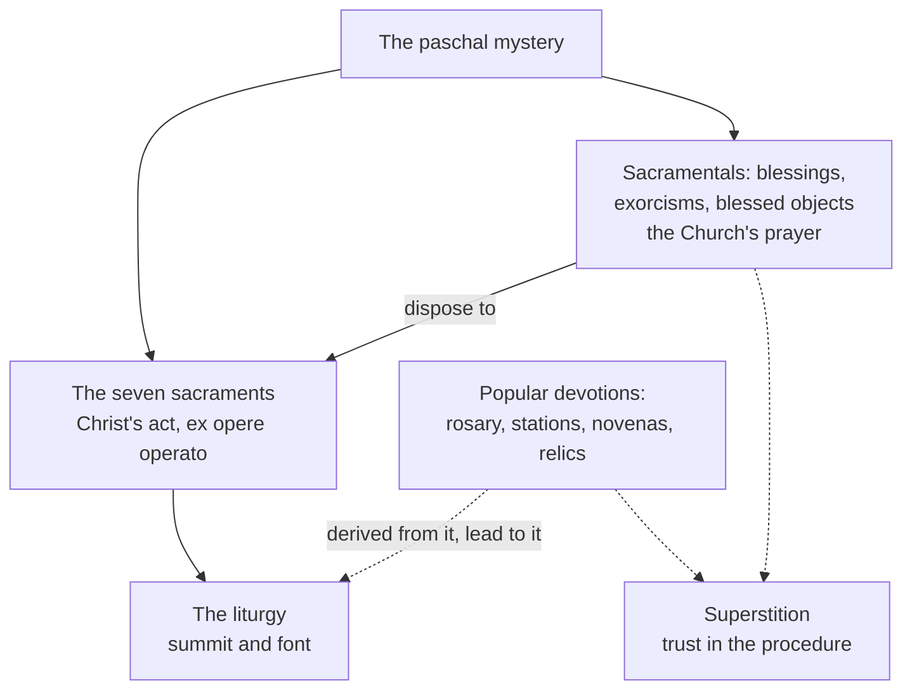

# Sacraments & Liturgy · Lesson 7.3: Sacramentals and popular devotion

> ⏱ ~15 min · Module 7: The reform, the language, and the life around the liturgy · Builds on: [1.3 *Ex opere operato*, character, and fruitfulness](01-03-ex-opere-operato-character-and-fruitfulness.md), [1.4 Why seven](01-04-why-seven.md), [6.1 What the liturgy is](06-01-what-the-liturgy-is.md), [`ecclesiology-and-mariology` 6.5](../../ecclesiology-and-mariology/lessons/06-05-mary-in-the-economy-in-the-church-and-in-devotion.md) · Unlocks: [`apologetics-catholic-claims`](../../apologetics-catholic-claims/syllabus.md), [`creation-grace-last-things`](../../creation-grace-last-things/syllabus.md)

## Why this matters

Most of a Catholic's everyday religious practice is none of the seven: holy water at the door, ashes in Lent, a blessed medal, a rosary, a priest's blessing at a shrine. This lesson asks what the Church claims for the signs she adds around the sacraments, and how she judges what her people add themselves. Err one way and a medal is a small sacrament that works by itself; err the other and it is decoration, nothing to do with grace.

## The idea

**A sacrament is Christ's act; a sacramental is the Church's prayer.** When a priest baptizes, Christ baptizes, and the rite done as he instituted it gives what it signifies ([1.3](01-03-ex-opere-operato-character-and-fruitfulness.md)). When a priest blesses a house, the Church asks God for something, as the bride whose prayer he hears. Aquinas drew the line:

> Holy Water and other consecrated things are not called sacraments, because they do not produce the sacramental effect, which is the receiving of grace. They are, however, a kind of disposition to the sacraments. (ST III q.65 a.1 ad 6)

[1.4](01-04-why-seven.md) used this reply for monastic profession.

**Popular devotion is wider still.** The rosary, the stations, processions, pilgrimages, novenas, relics and the first Fridays are mostly not rites of the Church but prayers the faithful made, which the Church tests and prunes. Gregory the Great had the English mission sprinkle pagan temples with holy water and move their feasting to the saints' days ([`church-history` 3.1](../../church-history/lessons/03-01-gregory-the-great-and-the-conversion-of-the-peoples.md)). The governing text is SC 13, read in [6.1](06-01-what-the-liturgy-is.md): devotions are highly commended if they fit the liturgical seasons, flow from the liturgy and lead people back to it, because the liturgy by its nature stands far above them all. The closing rule compresses it: **a devotion is judged by whether it says about God, Christ and the Church only what the liturgy itself says.**

## The doctrine

1. **What a [sacramental](../reference.md#sacramentals) is.** SC 60, restated in can. 1166 and CCC 1667 (paraphrased): sacred signs instituted by the Church, resembling the sacraments, which signify effects, chiefly spiritual, obtained through her intercession. They dispose people for the sacraments' chief effect and make life's occasions holy, drawing their power from the paschal mystery (SC 61). *In words:* a sign the Church made, which asks for what it shows.

2. **How it differs from a sacrament.**

| | Sacrament | Sacramental |
|---|---|---|
| Instituted by | Christ, all seven (Trent VII can. 1) | the Church; only the Apostolic See creates, changes or abolishes them (can. 1167 §1) |
| How it works | *ex opere operato* (VII can. 8) | [*ex opere operantis Ecclesiae*](../reference.md#ex-opere-operantis): by the action of the Church, holy and united to her Head (*Mediator Dei* 27) |
| What it gives | the grace it signifies, to one who sets no obstacle | not grace as the sacraments give it; by the Church's prayer, a disposition to receive grace and cooperate with it (CCC 1670) |
| Minister | fixed for each sacrament | a cleric with the power; some lay people, as the liturgical books and the local ordinary allow (can. 1168) |

*In words:* the sacrament rests on Christ's promise, the sacramental on the Church's petition, which reaches the user through his faith.

3. **The kinds, and who gives them.** [Blessings](../reference.md#blessings) come first, of persons, meals, objects and places (CCC 1671). Some last, consecrating persons or reserving things, such as altars and the holy oils, for worship (CCC 1672); the manuals called these *constitutive*, against merely *invocative* blessings, terms CCC 1672 does not use. The rites are in *De Benedictionibus* (*Book of Blessings*, *editio typica* 1984). Only bishops, and presbyters permitted by law or grant, consecrate and dedicate, and here the Code says "validly" (can. 1169 §1). Any presbyter gives unreserved blessings, a deacon only those the law expressly permits (§§2–3), and lay people preside at some, fewer the nearer a blessing stands to sacramental life (CCC 1669). One limit: the non-ordained may not anoint the sick with any oil, blessed or not (*Ecclesiae de mysterio*, 1997, art. 9; [4.3](04-03-anointing-of-the-sick.md)). *In words:* the Church blesses almost anything the Gospel allows, and rations who blesses what.

4. **[Exorcism](../reference.md#exorcism).** The Church's authoritative request, in Christ's name, that a person or object be withdrawn from the Evil One's dominion (CCC 1673). Its simple form is part of baptism (CCC 1237). A major exorcism needs the local ordinary's special and express permission, given only to a suitable presbyter (can. 1172), who must first rule out illness (CCC 1673). The CDF's letter of 29 September 1985 bars the faithful from using the exorcism formula drawn from the one Leo XIII published, and anyone without the faculty from leading meetings that question demons directly; prayer for deliverance stays open to all. The revised rite, *De exorcismis et supplicationibus quibusdam* (presented 26 January 1999), adds prayers against influence short of possession: public ones for a priest with the bishop's permission, private ones for the faithful. *In words:* commanding a demon is a mandated priest's act; asking God for deliverance is everyone's.

5. **[Popular piety](../reference.md#popular-piety) and its criteria.** The [*Directory on Popular Piety and the Liturgy*](../reference.md#directory-on-popular-piety) (Congregation for Divine Worship, decree of 17 December 2001, published 2002) builds on SC 13. Sunday Mass binds; no devotion does (§11). The Gospel measures every devotion, which should have a biblical, liturgical, ecumenical and anthropological spirit (§12): criteria from Paul VI's *Marialis Cultus* (1974) §§29–37, cited when the Directory restates them (§75), and applied to Mary in [`ecclesiology-and-mariology` 6.5](../../ecclesiology-and-mariology/lessons/06-05-mary-in-the-economy-in-the-church-and-in-devotion.md). Devotions are not mixed into the liturgy nor dressed up as liturgy (§13), and public devotional prayers need the local ordinary's approval (§21). The *sensus fidei* lives in such piety without being identical to it ([`fundamental-theology` 5.3](../../fundamental-theology/lessons/05-03-the-sensus-fidei.md)). *In words:* a devotion should sound like Scripture and the liturgy, respect other Christians, and be humanly sane.

6. **Relics and the first Fridays.** Trent (Session XXV) teaches that the saints' bodies, once members of Christ and temples of the Spirit, are to be venerated, and condemns those who deny it; the same decree orders "every superstition" removed and "all filthy lucre" abolished. Relics may not be sold (can. 1190 §1); pastors must secure their authenticity and prevent fraud, trafficking and superstition (Directory §237). The first Fridays revived frequent Communion; the Directory warns against reducing them to credulity (§171). *In words:* the practice is approved; the expectation is policed.

7. **[Superstition](../reference.md#superstition), the named failure mode.** Aquinas:

   > superstition is a vice contrary to religion by excess, not that it offers more to the divine worship than true religion, but because it offers divine worship either to whom it ought not, or in a manner it ought not. (ST II-II q.92 a.1)

   The undue manner is worship of mere externals, cut off from interior worship (q.93 a.2). Sacred words or relics worn about the neck are lawful, but superstitious if hope rests in the manner of writing or fastening (q.96 a.4). CCC 2111 agrees: crediting prayers or sacramental signs with an effect that comes from going through the motions, without the dispositions they require, is superstition. *In words:* faith expects the result from God, through the Church's prayer and one's own; superstition expects it from the procedure.

8. **What a blessing is: *Fiducia Supplicans*.** The Dicastery for the Doctrine of the Faith's declaration of 18 December 2023 keeps the CDF's 2021 answer that the Church cannot bless same-sex unions (§§5, 11). It distinguishes liturgical blessings, which require that what is blessed conform to God's will (§§9–11), from spontaneous pastoral ones, brief gestures outside any rite that legitimize nothing (§§31–40). So it allows the latter for couples in irregular situations and same-sex couples, never linked to a civil ceremony or resembling a wedding (§39), and calls this "a real development" (Presentation). Defenders read it as recovering blessing as the Church's prayer for anyone who asks. Critics held that blessing two people because they come as a couple cannot in practice be told apart from blessing the relationship, and some episcopal conferences declined to apply it. The Dicastery's press release of 4 January 2024 called their statements no doctrinal opposition, left timing to each bishop, and excluded "total or definitive denial" (§§1–2); a week later the Symposium of Episcopal Conferences of Africa and Madagascar declared that such blessings would not be given in Africa, while affirming communion with the pope.

**Mark the levels** ([`fundamental-theology` 4.4](../../fundamental-theology/lessons/04-04-the-ladder-of-doctrinal-authority.md), [4.5](../../fundamental-theology/lessons/04-05-reading-a-documents-weight.md); [levels](../reference.md#levels-of-authority)). **Rung 1:** the seven, instituted by Christ, acting *ex opere operato* (Trent VII cans. 1, 8). **At least rung 3:** that sacramentals are the Church's and work by her intercession, not *ex opere operato* (SC 60–61; *Mediator Dei* 27; CCC 1670); that the liturgy by its nature surpasses every devotion (SC 13); that superstition offends against the first commandment (CCC 2110–2111). Relic veneration is Trent's teaching in a decree without canons, given no rung here, as [`ecclesiology-and-mariology` 6.5](../../ecclesiology-and-mariology/lessons/06-05-mary-in-the-economy-in-the-church-and-in-devotion.md) gives none to the same decree on invoking saints. **Law, no rung:** cann. 1166–1172 and 1190, the 1985 letter, the 1999 rite; the Directory's guidelines are **changeable direction**. *Fiducia Supplicans* is a dicastery's declaration, approved and signed by the pope (Presentation) but with no *in forma specifica* clause: its marriage doctrine keeps its own weight, its account of blessings is **at most rung 3**, and its permission is **practical**. Aquinas's analysis, the constitutive/invocative pair and the course's closing rule have **no magisterial level**.

## Around the liturgy

Dashed arrows show where a practice can go.

## Worked examples

**Ex 1 (clean): one priest, three requests.** Invented: Father Rauno Kask, of the Diocese of Brackenford, is asked to bless a family's car, to dedicate a new chapel's altar, and to "exorcise" a teenager her parents think possessed. *The car:* any presbyter gives unreserved blessings (can. 1169 §2). No validity question arises. *The altar:* without a grant from law or the bishop he cannot dedicate it validly (can. 1169 §1). *The teenager:* without the bishop's express permission he may not exorcise (can. 1172), and even then must first rule out illness (CCC 1673). The three verdicts survive, reweighted: validity only where a sacramental changes a thing's status, liceity usually, fruit never guaranteed.

**Ex 2 (strain): the relic with a certificate.** Invented: Akosua Mensah buys a "first-class relic" of a recent saint online, with a printed certificate, for her parish. Parishioners touch rosaries to it; some want it taken to the sick. The sale was forbidden (can. 1190 §1). A seller's certificate is not the Church's authentication: the pastor must verify, and discreetly withdraw a doubtful relic; taking relics to the sick is expressly allowed (Directory §237). Touching rosaries to it is lawful if confidence rests in God and the saint, superstitious if it rests in the contact itself (q.96 a.4). The strain: the devout and the superstitious perform the same act, and the line runs through an expectation no pastor sees. So the Church regulates what she can see; catechesis does the rest.

## Watch out

- **You might think a sacramental is a small sacrament that works the same way.** Saying it confers grace *ex opere operato* is an exegetical error, graded strictly.
- **You might think "not *ex opere operato*" means "only as good as my feelings".** The prayer is the Church's (*Mediator Dei* 27), its power from the paschal mystery (SC 61); the user's faith is the channel, not the source.
- **Overstating and understating the level.** The Directory's criteria are pastoral direction resting on SC 13, not dogma, and approval binds no one to a devotion's promises. But relic veneration is not merely tolerated: Trent teaches it.
- **You might think a lay deliverance group performs a minor exorcism.** The simple exorcism is a rite within baptism; questioning demons without the faculty is what the 1985 letter forbade.

## One-liner

> A sacrament is Christ's act and a sacramental is the Church's prayer; a devotion is sound when it leads to the liturgy and expects its fruit from God, not from the procedure.

## Problems

**P1 (🟢)** *(Exegetical)* For each item, say **sacrament** or **sacramental**, and whether it confers grace *ex opere operato*. One line each.

(a) Holy water taken at the church door.

(b) Ashes blessed and imposed on Ash Wednesday.

(c) The simple exorcism prayed over the candidate in the rite of baptism.

(d) The bishop's consecration of the chrism at the Chrism Mass.

(e) A priest anointing a seriously ill parishioner with the oil of the sick.

(f) A medal blessed by a priest at a shrine.

**P2 (🟡)** *(Exegetical)* An **invented** social-media thread, written for this problem; the saint is real, the posts are not.

> **Post 1:** "This novena to St Jude has NEVER failed. Pray it nine days in a row and your request WILL be granted. Miss one day and it's void: start again."
>
> **Post 2:** "Copy it to nine friends within the hour or the novena loses its power."
>
> **Post 3 (reply):** "Even better, Father blessed my prayer card, so now it works *ex opere operato*, like a sacrament."
>
> **Post 4 (reply):** "Day nine is a Sunday and I'm travelling, so I'll skip Mass. The novena matters more, and it's approved by the Church, so its promise is part of the faith."

For each post, name the error and the text that corrects it, and give the level wherever one is involved. Two sentences per post.

**P3 (🔴)** *(Evaluative)* **Invented case.** A lay association in the Diocese of Brackenford, led by Tarik Haddad, asks the bishop to approve "The Fridays of the Healing Hands". On seven Fridays members meditate on Gospel scenes in which Jesus touches the sick (Mark 1:41 among them), each followed by silence and a petition. The leaflet promises that "whoever completes all seven Fridays will see their sick healed or receive a sign". It asks parishes to hold the exercise in place of Sunday Vespers through Lent. It adopts a local custom of washing hands at the church door before praying. Its closing prayer is "for our separated brethren, who lack the healing touch of the true Church". Should the bishop approve it, approve it with changes, or decline? Use the Directory's four criteria, SC 13, and the line between faith and superstition. **150 words or fewer; any verdict.**

Solutions

**P1** *(Exegetical)*

**Must hit, strict:**

- **(a) Sacramental; no.** A blessed object used with a sign that recalls baptism (CCC 1668); it works by the Church's prayer (CCC 1670).
- **(b) Sacramental; no.** A blessing joined to a sign (CCC 1668, 1671).
- **(c) Sacramental; no.** Exorcism in its simple form, a rite within baptism (CCC 1237, 1673). The baptism around it is a sacrament; the exorcism is not.
- **(d) Sacramental; no.** The blessing of the holy oils is among the lasting blessings of CCC 1672. The chrism it consecrates becomes the matter of a sacrament, confirmation ([2.3](02-03-confirmation.md)), which does act *ex opere operato*; the consecration itself does not.
- **(e) Sacrament; yes.** Anointing of the sick, instituted by Christ (Trent XIV, extreme unction, can. 1, rung 1; [4.3](04-03-anointing-of-the-sick.md)).
- **(f) Sacramental; no.** A blessed object (CCC 1671; can. 1171). Its devout use can gain a partial indulgence (1967 norm 17; [4.2](04-02-indulgences-as-a-practice.md)), the act being the bearer and the medal the occasion; the medal confers nothing by itself.

**Wrong turns:** any "yes" for a sacramental, the strict error of the syllabus Notes (8). Making (d) a sacrament because chrism is sacramental matter, or because it happens at Mass. Making (e) a sacramental because the oil is blessed. Calling (a) "only a reminder", which drops the Church's prayer.

**Model answer:** (a) Sacramental, not *ex opere operato*. (b) Sacramental, not. (c) Sacramental, not: a rite inside the sacrament of baptism. (d) Sacramental, not, though it prepares the matter of confirmation, which is. (e) Sacrament, *ex opere operato*. (f) Sacramental, not.

---

**P2** *(Exegetical)*

**Must hit, strict:**

- **Post 1.** Novenas are recognized pious exercises (Directory §189), so the nine days are not the error. The error is the guarantee tied to an unbroken count: efficacy expected from external performance (CCC 2111), hope placed in a vain circumstance (ST II-II q.96 a.4). Superstition as sin is constant teaching (at least rung 3); Aquinas's analysis has no level.
- **Post 2.** An observance with no relation to reverence for God, mere externals (q.93 a.2; q.96 a.4): superstition by undue manner (q.92 a.1).
- **Post 3.** Sacramentals act *ex opere operantis Ecclesiae*, by the Church's prayer, not *ex opere operato* (*Mediator Dei* 27; CCC 1670; SC 60): at least rung 3. The blessing is real; it disposes, it does not confer.
- **Post 4.** Sunday Mass binds (can. 1247, law; it can be met on Saturday evening, can. 1248 §1) and no pious exercise does (Directory §11); the liturgy surpasses every devotion (SC 13, at least rung 3). Public devotional prayers need the local ordinary's approval (§21), and approval of a devotion is a permission, never a doctrine, as with an approved private revelation ([`fundamental-theology` 1.4](../../fundamental-theology/lessons/01-04-public-and-private-revelation.md)), so no promise becomes "part of the faith".

**Wrong turns:** condemning novenas, or the number nine, as such. Correcting post 3 by calling the blessing worthless or "only psychological". Grading the Sunday precept as defined doctrine: it is Church law. Leaving post 4's approval claim standing because the novena might really be approved.

**Model answer:** (1) A novena is a legitimate pious exercise (Directory §189), but a guaranteed result tied to an unbroken count expects the effect from the procedure, which CCC 2111 calls superstition; that superstition is sinful is constant teaching, and Aquinas's analysis of it (q.96 a.4) has no level. (2) Chain-forwarding has no relation to reverence for God, so it is a vain observance, superstition by undue manner (q.92 a.1; q.93 a.2). (3) A blessed card is a sacramental, acting by the Church's prayer, not *ex opere operato* (*Mediator Dei* 27; CCC 1670): at least rung 3, and the error is strict. (4) The Sunday obligation binds as law (can. 1247; a Saturday evening Mass satisfies it, can. 1248 §1), no devotion does (Directory §11), and the liturgy surpasses them all (SC 13). Approval, which needs the local ordinary (§21), permits a devotion and binds no one to its promise.

---

**P3** *(Evaluative)*

**Accept:** approve, approve with changes, approve for private use only, or decline, if the moves below are made.

**Must hit, any verdict:**

- Run all four criteria on named features: **biblical** (the Gospel scenes: strong); **liturgical** (replacing Sunday Vespers fails SC 13 and Directory §§11, 13, since precedence goes to Sunday and the liturgical seasons); **ecumenical** (the closing prayer ignores other Christians' sensibilities, §12); **anthropological** (the hand-washing custom keeps a meaningful local symbol, provided it is not confused with a baptismal sign).
- Name the promise as the superstition question: a guaranteed healing or sign tied to completing a count (CCC 2111). Say whether it can be removed without destroying the devotion.
- Say what approval would and would not do: the local ordinary permits a public devotion (§21); approval binds no one to its promise.
- State the strongest consideration against your own verdict.

**Wrong turns:** declining because devotions are merely optional (§12: optional does not mean undervalued). Defending the promise by analogy with the first Fridays: the Directory traces those promises to St Margaret Mary and still warns against credulity (§171); an association's promise has no such standing. Treating approval as a doctrinal act. Calling the Vespers clash minor.

**Model answer, one of several:** Approve with changes. The devotion is thoroughly biblical, and the hand-washing custom is the kind of local symbol the anthropological criterion protects. But it fails the liturgical criterion: it may not displace Sunday Vespers, so it should move to a weekday (SC 13; Directory §§11, 13). The prayer for "separated brethren" should be rewritten in the ecumenical spirit §12 asks for. The promise must go: a guaranteed healing for seven completed Fridays expects the result from the count, which CCC 2111 calls superstition. Since the meditations stand without it, the core can be kept. Approval would permit the exercise; it would bind no one to anything in it. The strongest case against: a devotion launched with a promise may keep it in circulation whatever the leaflet says, as chain prayers do, which argues for declining.

## Flashback

**From Lesson [7.1](07-01-the-twentieth-century-reform-and-the-disputes-over-it.md) (The twentieth-century reform and the disputes over it):** *(Exegetical.)* Settled, open, or law? Four remarks from the notes of a parish reading group in Thistlecombe that has just finished a book on the liturgical reform, **invented**, written for this problem. One fact you need: the 2023 rescript is a *rescriptum ex audientia*, in which the prefect of the Dicastery for Divine Worship records what the pope confirmed to him in an audience. It reserves to the Holy See the dispensations for celebrating the 1962 Missal in a parish church and for letting priests ordained after July 2021 use it.

> (1) Mr Brierley: "Trent anathematized anyone who says the received rites may be changed into new ones. Paul VI changed them, so the reform falls under Trent's own canon."
>
> (2) Mrs Okwuosa: "Masses with Eucharistic Prayer III are doubtfully valid. A commission wrote that prayer in the 1960s."
>
> (3) Dr Haverkamp: "Whether the three-year Sunday lectionary has served the people better than the one-year cycle it replaced is still argued among serious Catholics, and either answer is compatible with loyalty to the Church."
>
> (4) Ms Nakashima: "The 2023 rescript came from the pope himself, so its rules on the 1962 Missal are now doctrine, and no later pope can relax them."

For each remark, say whether the question it raises is **settled** (with the weight that settles it), **open**, or a matter of **law**, and correct the remark if it is wrong. **One or two sentences each.**

Solution

**Accept:** any accurate wording. A remark that is right should be marked right, not corrected.

**Must hit, strict:**

- **(1) Settled, and the remark misreads the canon.** The question is the Church's authority to reform her rites. Trent's Session VII, can. 13 condemns saying the received rites may "be changed, by every pastor of the churches, into other new ones": **rung 1** for what its words reach, which the Church's practice since Pius V reads as not reaching the supreme authority, and the same council left the missal's correction to the pope. The Church's power over the dispensation of the sacraments, their substance untouched, is **at least rung 3** (Trent, Session XXI, ch. 2), and the regulation of the liturgy belongs to the Apostolic See (SC 22).
- **(2) Settled, and wrong.** Paul VI made the Lord's words identical in every eucharistic prayer, so with the right matter, a priest and the intention of doing what the Church does, a Mass with Prayer III is **valid**: the defined doctrine of matter and form, applied (Lesson 1.2). It is also **lawful**, since the Missal is the Roman Rite's law. Who drafted a prayer, and when, decides neither verdict.
- **(3) Open, and right as written.** The prudence of particular changes, the lectionary among them, is **freely disputed**. Criticizing a change is not disloyal, and defending it is not required.
- **(4) Law, and wrong twice.** A rescript *ex audientia* is a juridical act carrying the pope's decision: **law, no rung**, which the competent authority can change. It reserves two dispensations to the Holy See and touches no doctrine: a 1962 Mass said in a parish church without the dispensation is unlawful, not invalid.

**Wrong turns:** "correcting" remark (3), or calling criticism of the reform disloyal; treating the reformed Missal's validity as open, or resting it on a prayer's age or author; giving only one verdict in (2), as if valid and lawful were one question; reading Trent's canon either as binding the pope or as a mere discipline without a canon's weight; giving the rescript a doctrinal rung because the pope confirmed it, or concluding that a Mass celebrated without the dispensation is invalid.

**Model answer:** (1) Settled, but misread: Trent's canon (rung 1 for what its words reach) bars change "by every pastor of the churches", and the same council left the missal to the pope; the Church's power over the rites, their substance untouched, is at least rung 3 (Session XXI, ch. 2). (2) Settled, and wrong: the Lord's words are the same in every eucharistic prayer, so the Mass is valid, and the Missal is the Roman Rite's law, so it is lawful; authorship decides neither. (3) Open, and right: the prudence of particular changes is freely disputed. (4) Law, and wrong: a rescript *ex audientia* is a juridical act with no rung, changeable by the competent authority, and a 1962 Mass said against it is unlawful, not invalid.

## Connections

- **Backward:** [1.3](01-03-ex-opere-operato-character-and-fruitfulness.md) gave *ex opere operato* and *ex opere operantis*; [1.4](01-04-why-seven.md) used Aquinas's holy-water reply to keep monastic profession out of the seven; [4.2](04-02-indulgences-as-a-practice.md) made objects the occasion, not the bearer, of an indulgence; [4.3](04-03-anointing-of-the-sick.md) put a blessed oil among the sacramentals and taught *Ecclesiae de mysterio* 9; [6.1](06-01-what-the-liturgy-is.md) read SC 13. [`fundamental-theology` 1.4](../../fundamental-theology/lessons/01-04-public-and-private-revelation.md) parsed what approving a private revelation means, and [`ecclesiology-and-mariology` 3.3](../../ecclesiology-and-mariology/lessons/03-03-the-laity-charisms-and-the-sensus-fidei.md) the *sensus fidei*.
- **Forward:** [`apologetics-catholic-claims`](../../apologetics-catholic-claims/syllabus.md) argues the invocation of saints, images and relics against the Reformed objection (its 6.2). Actual grace, which *Fiducia Supplicans* §31 names, belongs to [`creation-grace-last-things`](../../creation-grace-last-things/syllabus.md).
- **Sideways:** Gregory's letter to Mellitus ([`church-history` 3.1](../../church-history/lessons/03-01-gregory-the-great-and-the-conversion-of-the-peoples.md)) is popular piety's founding method, centuries before the word "inculturation", which [7.2](07-02-liturgical-language-and-ars-celebrandi.md) applies to the liturgy itself. Superstition belongs with the virtue of religion, which no [`moral-theology`](../../moral-theology/syllabus.md) lesson treats.

## Closing the course

The course began with one claim: a sacrament is a sign that does what it shows, because Christ uses it as his instrument ([1.1](01-01-what-a-sacrament-is.md)). Everything after applied it. Matter, form, minister and intention say when the sign has happened ([1.2](01-02-matter-form-minister-intention.md)); *ex opere operato* says why it waits on no one's holiness, and fruitfulness why it still waits on the recipient ([1.3](01-03-ex-opere-operato-character-and-fruitfulness.md)); the number seven marks where Christ's guarantee stops ([1.4](01-04-why-seven.md)). Modules 2–5 ran that principle through each of the seven. Module 6 set them in the liturgy, Christ's priestly act and the Church's public worship, summit and font. Module 7 took the reform, the language, and finally the Church's own signs and her people's devotions, which live from the liturgy and lead back to it.

Three habits carry forward. Return three verdicts, valid, licit and fruitful, and name what decides each. Keep the defined column short, and apart from the schools' explanations. Mark every text's level, no higher and no lower. And for anything built around the liturgy, the closing rule: say about God, Christ and the Church only what the liturgy itself says.

Next, [`apologetics-catholic-claims`](../../apologetics-catholic-claims/syllabus.md) takes these doctrines, and the other traditions' positions stated here without reply, and argues them. [`creation-grace-last-things`](../../creation-grace-last-things/syllabus.md) teaches the grace of which every sacrament in this course was the instrument.
